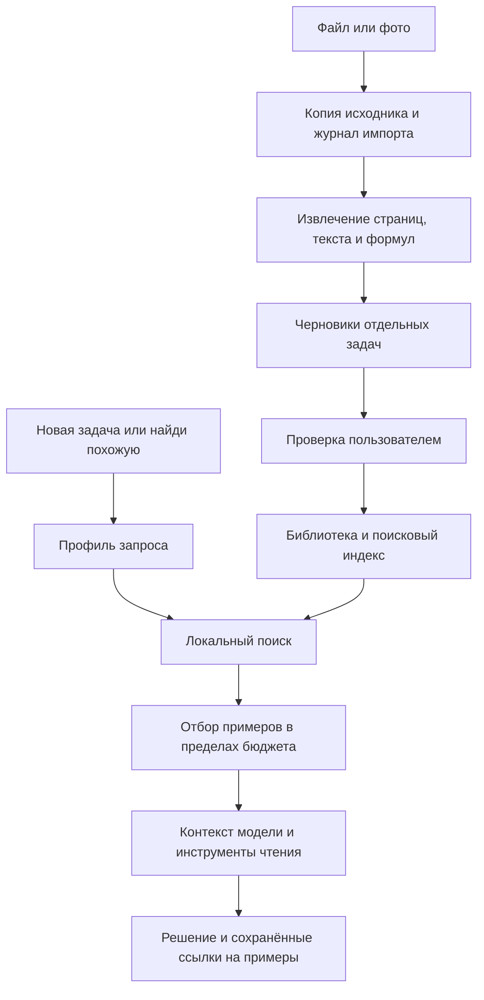

# Библиотека решённых задач и RAG: архитектурное предложение

Дата: 2026-10-12. Основание: `main` / `0425c65`, релиз 1.2.0 и обсуждение с пользователем.
Статус: целевая архитектура RAG остаётся предложением. Пользователь разрешил перенос
базы и ручного поиска из task-search; этот первый пакет реализован отдельно от полного RAG.
[План переноса](../plans/2026-10-12-task-search-integration.md) фиксирует ограниченный объём.

## 1. Задача и согласованные ограничения

Пользователь загружает решённые задачи. Помощник автоматически находит подходящие примеры
для новой задачи и понимает просьбу «найди похожую». Поддерживаемые материалы: PDF, фото,
сканы, Word и текст. Пользователь подтвердил масштаб **до 500 задач**, несколько файлов
или сборников. Поиск должен различать вопрос, искомую величину, тип, формулы и роли чисел.

Обычный калькулятор, скрытый вход в помощник, тихая готовность, черновики и сохранённые
решения остаются независимыми от библиотеки. Удержание ✦ возвращает собственное решение.
Переходы без анимаций, сворачивание блоков — на экране полного решения.

Ни импорт, ни ответ модели автоматически не означают «математически проверено».
Ключи не входят в материалы, индекс, журнал, экспорт или Git. Пользовательские документы
не используются как репозиторные тестовые фикстуры без отдельного согласия.

## 2. Что сейчас есть в коде

- `TemplateStore` хранит шаблоны и примеры в JSON и файлах. `GenerationController.templatePrompt`
  передаёт все примеры выбранного шаблона. Ручной `TaskSearch` уже индексирует библиотеку,
  шаблоны и историю; генерация пока не обращается к нему автоматически.
- `OpenAiClient.solve/followUp` готовит сообщения и возвращает один `SolutionPayload`.
  Ответы `tool_calls`, результаты инструментов и цикл агента пока не представлены типами.
- `RequestRunner` ведёт один запрос с общим тайм-аутом 8 минут; `RequestFiles` сохраняет
  вход и конечный результат. Промежуточных сетевых этапов нет.
- История, шаблоны и сеанс чтения уже сохраняются. Их не нужно переносить целиком в новую БД.
- `DocumentReader` предназначен для одной отправки: PDF ограничен четырьмя страницами,
  текст — 20 000 символов; DOCX извлекается без OMML. Импорт сборников требует отдельного пути.

### Основа, перенесённая из task-search

Отдельный `TemplateStore(filesDir/library)` хранит разделы; `LibraryScreen`, `SearchScreen`
и редактор дают ручное управление, импорт/экспорт ZIP/JSON/Markdown. Поиск использует слова,
числа, тип и дополнительный сигнал структуры простых текстовых формул. Ключ снимка считается
по тексту и байтам фотографий, поэтому перестановка и копирование не меняют его, а новая
фотография создаёт другой снимок. Открытие сохраняет независимые вложения в истории.

Эти части следует развивать, а не писать повторно. Нужна миграция разделов/примеров в модель
ниже с источниками, версиями и статусами. Хеш содержимого сейчас не является постоянным
ID редактируемой сущности; подпись «База · раздел» не является ссылкой на страницу источника.
Текущий просмотр найденного примера заменяет выбранное решение — отдельный просмотр из RAG
и возврат к прежнему решению ещё предстоит добавить.

## 3. Варианты и рекомендация

| Вариант | Польза | Цена и ограничения | Когда выбирать |
|---|---|---|---|
| A. Локальная БД, текстовый индекс и профиль задачи | Работает без сервера и отдельного embeddings API; учитывает формулы, цель и роли чисел | Нужно измерить качество перефразирований; профиль из модели может ошибаться | Первый проверяемый этап для библиотеки до 500 задач |
| B. Та же БД плюс смысловые векторы | Дополнительный канал кандидатов для перефразирований и разных обозначений | Нужен локальный encoder или внешний API; версии векторов, задержка и стоимость | Если A не достигает согласованного качества; сравнивать на тех же примерах |
| C. Сервер импорта и поиска | Удобен для общих больших библиотек и тяжёлой обработки | Развёртывание, учётные записи, хранение файлов вне телефона, эксплуатация | Когда появятся синхронизация или несколько пользователей |

**Рекомендация: A с заменяемым поисковым движком и подготовленной границей для B.** Это RAG:
приложение извлекает материал из библиотеки и добавляет его в контекст решения. Embeddings
не обязательны для самого механизма RAG. Полноценный векторный поиск пока не обещается.
Если A провалит проверки перефразирования, этап поиска не считается готовым: сравниваем B,
а не снижаем порог качества задним числом. Отдельный сервер и MCP сейчас не нужны.

Room/SQLite предлагается только для новой библиотеки: сущности, транзакции и полнотекстовый
индекс; исходники хранятся отдельными файлами. Начальный вариант индекса — FTS4 с `unicode61`.
Конкретную совместимую версию Room и compiler plugin следует закрепить в плане реализации
после проверки текущих Kotlin 2.0.21 / minSdk 26; обновление всего проекта сюда не входит.
[Возможности Room для сущностей и FTS](https://developer.android.com/training/data-storage/room/defining-data).

## 4. Поток данных и границы компонентов

| Компонент | Ответственность и контракт |
|---|---|
| `LibraryRepository` | Источники, версии задач, статусы, транзакционная публикация; никаких сетевых запросов |
| `LibraryImporter` | Журнал стадий, локальное чтение, вызов распознавания, черновики; не публикует задачи без проверки |
| `DocumentExtractor` / `DocumentRecognizer` | Извлечённые блоки со ссылками на оригинал и сомнительными местами; не решают задачу заново |
| `TaskProfiler` | Предмет, цель, формулы, параметры и поисковые формулировки; исходный текст всегда сохранён |
| `ExampleRetriever` | Поиск по активным версиям; результат `matches / no_match / unavailable / needs_clarification` |
| `ContextSelector` | Выбор и снимок версий, лимит материала, исключение неподходящих кандидатов |
| `LibraryTools` | Только поиск и чтение разрешённых примеров; не принимает пути, URL, SQL или команды |
| `LibraryImportController` | Независимый от экрана запуск/пауза/восстановление; не заменяет текущий запрос решения |

Предлагаемые области кода: новый `data/library/` и `ui/library/`; интеграция в
`GenerationController`, `OpenAiClient`, `RequestJournal/RequestFiles`, `HistoryStore`,
`AppRoot` и хранилище сеанса. Без постороннего рефакторинга калькулятора.

## 5. Данные и сохранность

- `Source`: UUID, имя для показа, MIME, SHA256 оригинала, относительный внутренний путь,
  размер, число страниц/блоков и признак включения. SHA256 выявляет повтор того же файла;
  совпадение названия файла не означает совпадение содержимого.
- `SourceSegment`: ID источника, номер страницы для PDF/скана или номер блока для DOCX/TXT,
  диапазон/прямоугольник при наличии. Для DOCX нельзя выдумывать стабильную страницу.
- `Example`: стабильный UUID, текущая версия, происхождение, включение в поиск.
- `ExampleVersion`: неизменяемый снимок условия, решения, ответа, медиа, профиля и ссылок
  на сегменты. Правка создаёт версию; поиск переключается на неё транзакционно.
- `Verification`: `unverified / verified_by_user / rejected`. Подтверждение разбора при
  импорте отдельно от математической проверки. `rejected` никогда не участвует в решении.
- `ImportJob` и `ImportAttempt`: стадия, выбранный диапазон, готовые блоки, ошибки, вызовы
  провайдера и версии распознавания; без ключей и заголовка Authorization.
- `SourceSnapshot`: версия и фактически переданный текст/медиа для одного ответа или
  дополнения; хранится вместе с результатом и позволяет открыть использованный пример.

Новые медиа сначала пишутся во временное внутреннее хранилище, затем атомарно переводятся
в окончательные файлы и привязываются транзакцией. Индекс — производные данные: его можно
перестроить; исходник и подтверждённые задачи нельзя потерять при ошибке индексации.
Файлы без ссылок удаляются после фиксации изменения, с учётом истории и активных снимков.
При перезапуске проводится сверка незавершённых операций и отложенной очистки.
Снимок, ожидающий записи в историю, защищён ссылкой из checkpoint запроса; сбой между
записью БД и JSON истории не даёт сборщику мусора удалить его. Новые поля истории имеют
значения по умолчанию для старых записей. Миграции БД проверяются на данных; пересоздание
библиотеки при несовпадении версии схемы запрещено.

Удаление задачи исключает её из новых поисков. Старый ответ сохраняет использованный
фрагмент и отметку об удалённом оригинале. Полное удаление также исторических копий —
отдельное явно выбранное действие, не побочный эффект удаления строки библиотеки.
Из истории и шаблона создаётся независимый пример по явному действию; оригинал не меняется.

## 6. Импорт и распознавание

Последовательность: выбрать файл → сохранить исходник → извлечь материал → получить
черновики → проверить/исправить/объединить/разделить → добавить выбранные задачи.
Единица поиска — задача, а не произвольные 500 символов. Длинные решения могут иметь
дочерние фрагменты, но каждый связан с полным условием и ответом родительской задачи.

- TXT/Markdown: локальное ограниченное чтение с сохранением границ блоков.
- PDF: обработка выбранных страниц последовательно; текстовый слой, если доступен,
  и изображения страниц с сохранёнными координатами. Нельзя считать наличие текста
  доказательством, что формулы и подписи прочитаны полностью.
- DOCX: структурный разбор абзацев, таблиц, рисунков и OMML; не регулярное выражение
  только по `w:t`. Неизвлечённые элементы становятся видимыми замечаниями. Старый DOC
  в первой версии отклоняется с предложением сохранить DOCX/PDF.
- Фото и сканы: адаптер распознавания для модели с поддержкой изображений. Имя выбранной
  модели само по себе не доказывает поддержку; настройки содержат явные возможности
  провайдера, а несовместимость объясняется до отправки материала.

В первой версии используется настроенный пользователем API, только если он поддерживает
нужную операцию. Автоматической регистрации второго сервиса нет. Если vision недоступен,
исходник сохраняется как ожидающий распознавания; можно выбрать совместимый профиль или
ввести текст вручную. Текстовый импорт доступен независимо от vision. Выбор конкретной
модели распознавания и платные замеры выносятся в отдельный этап настройки, ключ не читаем.

Стартовые ограничения для проверки: 100 МиБ на исходный файл, до 100 выбранных страниц
за импорт, 8 МиБ XML на часть DOCX, 64 МиБ суммарной распаковки DOCX, 2 МиБ текста на
единицу локального чтения и до 4 мегапикселей на растровую страницу в памяти. Для большого
источника диапазон выбирается явно; остаток виден и может быть добавлен следующим импортом.
Медиа не декодируются все сразу. Лимиты — начальные продуктовые предложения, не свойства SDK.

Начальный сетевой пакет — до двух растровых страниц либо до 12 000 символов текста.
За один запуск обработки разрешено до 10 внешних POST, включая повторы; перед запуском
видны диапазон и этот предел. Остаток переходит в `paused`, действие «Продолжить» запускает
следующую партию. Тайм-аут одного пакета — 120 секунд, общий лимит партии — 8 минут.
Незаконченная задача на границе переходит в следующий пакет вместе со ссылками на оригинал;
если её продолжение не помещается, задача остаётся черновиком с замечанием, а не обрезается.
Исходник по SHA256 и номеру сегмента предотвращает дублирование
при повторе. Сомнительные знаки, числа, формулы и границы требуют проверки до включения.
Повторный разбор уже исправленной задачи создаёт сравниваемый черновик, а не перезапись.

## 7. Поиск для 500 задач

`TaskProfile` содержит исходный текст, предмет, тип/метод, искомые величины, заданные значения
с ролями и единицами, формулы и степень уверенности распознавания. Индекс учитывает и условие,
и решение: поиск по названию метода должен вернуть связанную полную задачу.

Текст нормализуется для поиска, но оригинал сохраняется. Структура формулы не должна терять
интегратор, знак, степень, порядок операций и единицы. Допустимо отдельно сравнивать форму
с заменёнными коэффициентами. Это не обещание универсального символьного доказательства
эквивалентности; нераспознанная формула остаётся текстом с пониженной уверенностью.

Сначала объединяются кандидаты текстового индекса и профиля, затем учитываются цель задачи,
структура формулы, метод и роли величин. Числовое совпадение само по себе — слабый сигнал.
Пример с другими числами может быть лучше точного совпадения чисел из другой дисциплины.
Неуверенные типы не используются как жёсткий фильтр. Веса и порог «нет совпадений» выбираются
по development-набору, до отдельной итоговой проверки, а не назначаются как доказанные сейчас.

Одна фотография с четырьмя задачами даёт четыре профиля и отдельный поиск для каждого.
При уточнении используются исходное условие и новый вопрос, а не только короткая фраза
«а при другом K». Передача контекста распределяется между подзадачами, чтобы первая
не заняла всё место. Неразборчивый знак нельзя восстановить по похожему примеру.

Если добавляется B, `SemanticEncoder` хранит идентификатор модели, размерность и версию
нормализации. Смена encoder требует нового индекса, старые и новые векторы не смешиваются.
Для 500 задач сначала измеряем прямое сравнение векторов; отдельную векторную БД не вводим
без измеренной необходимости. Ошибка encoder не скрывается за сообщением «нет совпадений».

## 8. Контекст и инструменты агента

При непустой включённой библиотеке приложение обязательно выполняет первоначальный поиск.
Модель не может случайно пропустить его, не вызвав инструмент. Для сложного текста/фото
может потребоваться один дополнительный вызов построения профилей; результат сохраняется.
Для простого распознанного профиля повторный сетевой анализ не нужен.

Первый отбор передаётся в явном блоке данных сообщения с задачей. Это не system prompt
и не поддельный `tool`-ответ без соответствующего вызова. С моделями, поддерживающими
инструменты, доступны дополнительные вызовы:

- `search_examples(query, target?, limit<=5)` → ID, версия, короткое условие, цель,
  источник, статус проверки и причина сходства.
- `read_example(id, version, section)` → условие вместе с запрошенной частью решения/
  ответа и происхождением. ID должен быть в разрешённой выдаче данного запроса.

Ответы на реальные вызовы идут в `role=tool` с правильным `tool_call_id`. Неизвестные
имена и неверные аргументы отклоняются. После цикла модель возвращает привычное решение
с `problem/answer/steps` и ссылками на переданные версии. `OpenAiClient` нужно разделить
на транспорт, типизированный ответ модели и сборку/разбор решения; не прятать цикл в `parseSolution`.

Стартовый бюджет библиотеки: до 5 прочитанных примеров суммарно по всем подзадачам,
до 2 раундов дополнительных инструментов,
до 4 сетевых вызовов всего (профиль при необходимости + 2 продолжения + финальный ответ),
в пределах существующих 8 минут. Последний разрешённый вызов требует финальный ответ без
инструментов. Если он опять возвращает вызовы, результат — понятная ошибка, а не пятый POST.
Повтор без `response_format` после HTTP 400/422 тоже расходует этот бюджет; существующий
внутренний fallback клиента нельзя оставлять вне счётчика. Ошибка не запускает новый цикл.

Контекст библиотеки ограничен 12 000 Unicode-символов суммарно и 4 000 на пример.
Это ограничение размера, **не эквивалент токенов**. Дополнительно нужен общий бюджет
для задачи, шаблона, формата, истории уточнений, библиотеки и ожидаемого ответа с учётом
модели; при нехватке уменьшается библиотека, затем предлагается сократить выбранные материалы.
Условия и формулы нельзя обрезать посередине молча. Цена показывается только при известном
тарифе/usage, иначе показываются число запросов и объём страниц, без выдуманной суммы.

Без поддержки инструментов выполняется тот же обязательный поиск и один ответ с выбранными
материалами. Это явно режим без дополнительных чтений; поддержка tools не обязательна для
первого RAG. При сетевой ошибке нельзя молча повторять запрос другим провайдером.

Просьба «найди похожую» возвращает список примеров, не запускает полное решение автоматически.
`no_match` позволяет решить исходную задачу обычным способом. `unavailable` сохраняется
как ошибка поиска и отличается от отсутствия аналогов: запрос ожидает действия «Повторить
поиск» или «Решить без библиотеки», обычный калькулятор остаётся доступным. Ожидание не
держит foreground service и не расходует активный тайм-аут; новое действие создаёт новую
попытку с сохранённым входом. Непроверенный пример помечается
для модели и пользователя; его старые числа не являются ответом на новую задачу.

## 9. Фон, журнал и повтор

Импорт имеет отдельный журнал и контроллер; он не использует текущий `RequestRunner<Solution>`
как слот очереди. Иначе загрузка сборника отменит решение или решение сотрёт прогресс импорта.
Для явно запущенного долгого импорта предлагается отдельный foreground service по существующему
паттерну приложения. Перед очередным пакетом импорт уступает ресурсы интерактивному решению.
Переход в калькулятор и закрытие экрана не отменяют работу. Завершение не открывает библиотеку само.

Стадии импорта: `copied → extracting → recognizing → review_required → indexing → ready`;
отдельно `paused / failed / interrupted / cancelled`. Подтверждённые примеры становятся
доступны атомарно. Для запроса решения добавляются снимки профилей, выбранные версии,
стадии поиска и номер сетевой попытки; опубликованный результат сохраняется до истории,
как уже делает текущий контроллер.

Перед каждым внешним POST фиксируется попытка. После ответа сначала сохраняется checkpoint,
затем начинается следующая стадия. Остановка процесса между отправкой и сохранением ответа
означает неизвестный исход: ручной повтор, без скрытой платной переотправки. Сохранённые
локальные этапы продолжаются без нового POST. Отмена увеличивает идентификатор попытки;
поздний ответ старой попытки не публикуется. Retry проверяет доступность исходного решения,
актуальное разрешение на источники и закрепляет новые версии явно.

После force stop/перезагрузки нельзя обещать продолжение сетевого запроса. Планировщик сам
по себе не гарантирует единственное выполнение платного вызова. Даже long-running WorkManager
использует foreground service и подчиняется ограничениям платформы; для первой версии
его добавление не решает этот контракт. [Ограничения фоновой работы Android](https://developer.android.com/develop/background-work/background-tasks/persistent/how-to/long-running).

## 10. UI и источники

Сохраняется [предложение по UI](../../library-ui.md): ✦ → 9, вкладки «Задачи»/«Файлы»,
экран проверки разбора и карточка примера. Новое: перед импортом видны диапазон и способ
распознавания; неполный импорт показывает оставшиеся страницы. Состояния библиотеки и
собственного решения разделены. В обычном калькуляторе нет карточек и прогресса импорта.

В полном решении — сворачиваемый блок использованных примеров. Метки «Передан модели»
и «Указан моделью как использованный» различаются: факт передачи не доказывает причинную
роль источника в ответе. Ссылка берётся только из разрешённого снимка версии. Источники
привязываются отдельно к исходному ответу и каждому дополнению. Страница «Ответ» остаётся
последней в перелистывании шагов, источники не превращаются в вычислительные шаги.

## 11. Проверка и следующие этапы

Подготовлены [12 примеров и 22 сценария](../../library-quality/README.md), включая задачи
с изменёнными числами/вопросами, ложные совпадения, отключённый источник, ошибочное решение
и текст-инструкцию внутри материала. Точные количества и критерии — в README набора.
JSON и эталонная арифметика проверяются локально; качество retrieval пока не измерено.
Файловые фикстуры PDF/DOCX/сканов ещё нужно создать и визуально проверить.

Предлагаемые этапы, каждый со своим проверяемым результатом:

1. **Хранилище и ручные примеры:** версия задачи, оригинал, включение/проверенность,
   добавление из истории/шаблона, сохранность и простой экран просмотра. Без смены формата старой истории.
2. **Импорт:** файловые фикстуры всех форматов, извлечение/распознавание, проверка границ,
   журнал и прерывание. Приёмка по I01–I14.
3. **Поиск:** A и оценка на контрольном наборе; при необходимости сравнительный B.
   Локальная корректность, отдельный незнакомый набор, скорость на 500 задачах.
4. **Агент:** обязательный поиск, безопасный контекст, tools/fallback, бюджеты,
   сохранение промежуточных стадий и ссылки в ответах.

До начала продуктового кода требуется согласование этого предложения и план первого этапа.
Сейчас решение, которое нужно подтвердить: локальная библиотека до 500 задач, старт с A,
заменяемый retrieval, подключение embeddings по результатам измерений, без отдельного сервера.
