<!--
ММУС: задания и решения из папки курса на Google Drive — «Практика», «Домашка», «Звенья»,
примеры из «Лекций» и «КР 1» (листы с вариантами и рукописные решения),
а также задания методички «Задания ММУС» (обновлено 11.10.2026), которых не было в материалах, — раздел «Методичка».
Графики и схемы перерисованы по формулам решений, лежат в mmus-tasks/.
Решения разделов 2–7 сверены с тетрадью практики (вычеты, Крамер, Раус и Гурвиц, Михайлов, Найквист
через U(ω) и V(ω)); оттуда же добавлены 2.1 в и уравнение 4-го порядка, заданное на дом.
Загружается в базу задач: ✦ → 9 «Поиск» → значок папки → «Загрузить из файла».
-->

# Практика. Преобразование Лапласа

## Задача 1

### Условие

1.1 Найти изображение по Лапласу единичной ступенчатой функции $f(t) = 1(t)$.

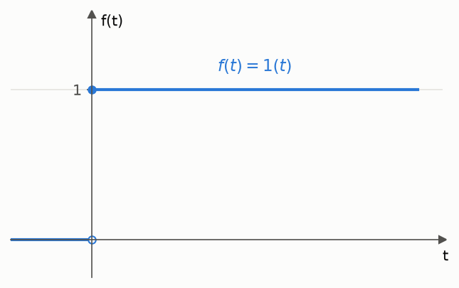

### Решение

1) Определение преобразования Лапласа:
$$F(s) = L\{f(t)\} = \int_0^{+\infty} f(t)\,e^{-st}\,dt$$

2) Подставим $f(t) = 1(t)$:
На промежутке интегрирования $t \in [0, +\infty)$ функция $1(t) = 1$:
$$F(s) = \int_0^{+\infty} 1(t)\,e^{-st}\,dt = \int_0^{+\infty} e^{-st}\,dt$$

3) Вычислим интеграл:
При $\text{Re}\,s > 0$ на бесконечности $e^{-st} \to 0$:
$$F(s) = -\dfrac{1}{s}\,e^{-st}\Big|_0^{+\infty} = 0 - \left(-\dfrac{1}{s}\right) = \dfrac{1}{s}$$

Ответ: $\dfrac{1}{s}$

## Задача 2

### Условие

1.2 а) Найти изображение по Лапласу функции $f(t) = 1(t)\cdot e^{\alpha t}$, где $\alpha \in \mathbb{R}$ или $\alpha \in \mathbb{C}$.

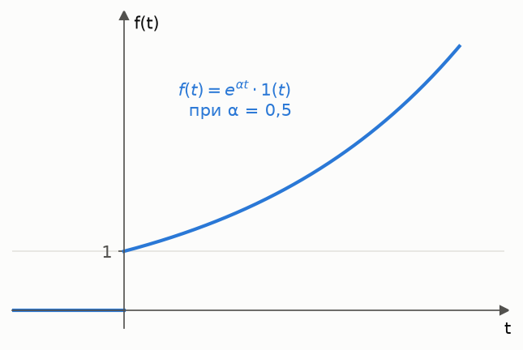

### Решение

1) Подставим в определение:
$$F(s) = L\{1(t)\cdot e^{\alpha t}\} = \int_0^{+\infty} e^{\alpha t}e^{-st}\,dt = \int_0^{+\infty} e^{(\alpha - s)t}\,dt$$

2) Вычислим интеграл:
При $\text{Re}\,s > \text{Re}\,\alpha$ на бесконечности $e^{(\alpha-s)t} \to 0$:
$$F(s) = \dfrac{1}{\alpha - s}\,e^{(\alpha - s)t}\Big|_0^{+\infty} = -\dfrac{1}{\alpha - s} = \dfrac{1}{s - \alpha}$$

Ответ: $\dfrac{1}{s-\alpha}$

## Задача 3

### Условие

1.2 б) Найти изображение по Лапласу функции $f(t) = t$.

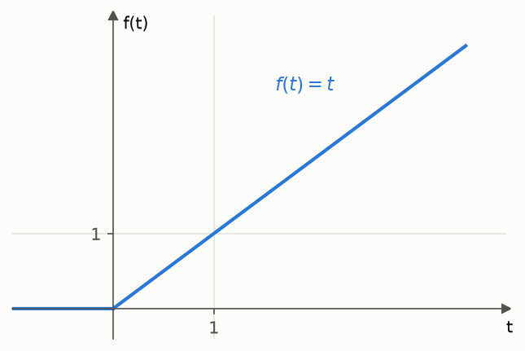

### Решение

1) Подставим в определение:
$$F(s) = L\{t\} = \int_0^{+\infty} t\,e^{-st}\,dt$$

2) Интегрируем по частям:
$u = t$, $du = dt$; $dv = e^{-st}dt$, $v = -\dfrac{1}{s}e^{-st}$:
$$F(s) = -\dfrac{1}{s}\,e^{-st}\,t\,\Big|_0^{+\infty} + \dfrac{1}{s}\int_0^{+\infty} e^{-st}\,dt$$

3) Возьмём оставшийся интеграл и подставим пределы:
$$F(s) = \left[-\dfrac{1}{s}\,e^{-st}\,t - \dfrac{1}{s^2}\,e^{-st}\right]_0^{+\infty} = 0 - \left(0 - \dfrac{1}{s^2}\right) = \dfrac{1}{s^2}$$
На бесконечности оба слагаемых равны 0: экспонента убывает быстрее, чем растёт $t$.

Ответ: $\dfrac{1}{s^2}$

## Задача 4

### Условие

1.3 а) Найти изображение по Лапласу функции $f(t) = \sin\omega t$.

### Решение

1) Формула Эйлера:
$$\sin\omega t = \dfrac{1}{2i}\left(e^{i\omega t} - e^{-i\omega t}\right)$$

2) Линейность преобразования Лапласа:
$$L\{\sin\omega t\} = \dfrac{1}{2i}\left(L\{e^{i\omega t}\} - L\{e^{-i\omega t}\}\right)$$

3) Изображения экспонент:
По 1.2 а с $\alpha = i\omega$ и $\alpha = -i\omega$:
$$L\{\sin\omega t\} = \dfrac{1}{2i}\left(\dfrac{1}{s - i\omega} - \dfrac{1}{s + i\omega}\right)$$

4) Общий знаменатель:
$(s - i\omega)(s + i\omega) = s^2 + \omega^2$, в числителе $(s + i\omega) - (s - i\omega) = 2i\omega$:
$$L\{\sin\omega t\} = \dfrac{1}{2i}\cdot\dfrac{2i\omega}{s^2 + \omega^2} = \dfrac{\omega}{s^2 + \omega^2}$$

Ответ: $\dfrac{\omega}{s^2+\omega^2}$

## Задача 5

### Условие

1.3 б) Найти изображение по Лапласу функции $f(t) = \cos\omega t$.

### Решение

1) Формула Эйлера:
$$\cos\omega t = \dfrac{1}{2}\left(e^{i\omega t} + e^{-i\omega t}\right)$$

2) Линейность преобразования Лапласа:
$$L\{\cos\omega t\} = \dfrac{1}{2}\left(L\{e^{i\omega t}\} + L\{e^{-i\omega t}\}\right)$$

3) Изображения экспонент (1.2 а):
$$L\{\cos\omega t\} = \dfrac{1}{2}\left(\dfrac{1}{s - i\omega} + \dfrac{1}{s + i\omega}\right)$$

4) Общий знаменатель:
В числителе $(s + i\omega) + (s - i\omega) = 2s$:
$$L\{\cos\omega t\} = \dfrac{1}{2}\cdot\dfrac{2s}{s^2 + \omega^2} = \dfrac{s}{s^2 + \omega^2}$$

Ответ: $\dfrac{s}{s^2+\omega^2}$

## Задача 6

### Условие

1.4 а) Найти изображение по Лапласу смещённой функции
$$f(t) = \begin{cases} (t-\tau)^2, & t \ge \tau \\ 0, & t < \tau \end{cases}$$

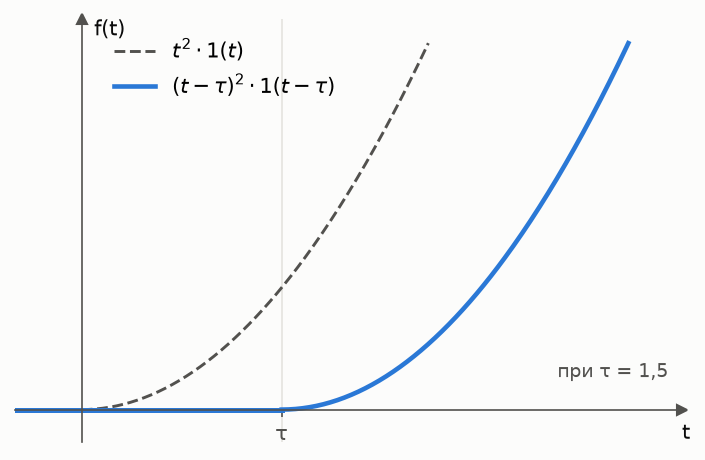

### Решение

1) Запишем функцию через сдвинутую ступеньку:
$$f(t) = (t-\tau)^2\cdot 1(t-\tau)$$
Это функция $t^2\cdot 1(t)$, сдвинутая вправо на $\tau$ (на графике — пунктир и сплошная линия).

2) Теорема запаздывания:
Если $g(t) \to G(s)$, то $g(t-\tau)\cdot 1(t-\tau) \to e^{-s\tau}G(s)$:
$$L\{(t-\tau)^2\cdot 1(t-\tau)\} = e^{-s\tau}\cdotL\{t^2\}$$

3) Изображение $t^2$:
Интегрируя по частям дважды (как в 1.2 б), получаем $t^n \to \dfrac{n!}{s^{n+1}}$, при $n = 2$:
$$L\{t^2\} = \dfrac{2}{s^3}$$

4) Итог:
$$F(s) = e^{-s\tau}\cdot\dfrac{2}{s^3}$$

Примечание: в тетради на графике сдвинутая функция подписана $(t-\tau)^2\cdot 1(t)$; правильно $(t-\tau)^2\cdot 1(t-\tau)$.

Ответ: $e^{-s\tau}\cdot\dfrac{2}{s^3}$

# Практика. Обратное преобразование Лапласа

## Задача 1

### Условие

2.1 а) Найти оригинал $f(t)$ по изображению $F(s) = \dfrac{1}{(s+\alpha)^2}$.

### Решение

1) Формула обращения через вычеты:
$\nu$ — число различных полюсов $F(s)$, $k_i$ — кратность полюса $s_i$:
$$f(t) = L^{-1}\{F(s)\} = \sum_{i=1}^{\nu}\dfrac{1}{(k_i-1)!}\lim_{s\to s_i}\dfrac{d^{\,k_i-1}}{ds^{\,k_i-1}}\left[F(s)\,(s-s_i)^{k_i}\,e^{st}\right],\quad t \ge 0$$

2) Полюсы:
Один полюс $s_1 = -\alpha$ кратности 2: $\nu = 1$, $k_1 = 2$.

3) Вычислим:
$$f(t) = \dfrac{1}{(2-1)!}\lim_{s\to -\alpha}\dfrac{d}{ds}\left[\dfrac{1}{(s+\alpha)^2}\,(s+\alpha)^2\,e^{st}\right] = \lim_{s\to -\alpha}\left[e^{st}\right]' = \lim_{s\to -\alpha} t\,e^{st} = t\,e^{-\alpha t}$$

Ответ: $f(t) = t\,e^{-\alpha t}$, $t \ge 0$

## Задача 2

### Условие

2.1 б) Найти оригинал $f(t)$ по изображению $F(s) = \dfrac{s}{(s+1)(s+2)(s+3)}$.

### Решение

1) Полюсы:
Три простых полюса: $\nu = 3$; $s_1 = -1$, $s_2 = -2$, $s_3 = -3$; $k_1 = k_2 = k_3 = 1$.

2) Формула обращения для простых полюсов:
При $k_i = 1$ производная не нужна (см. 2.1 а):
$$f(t) = \lim_{s\to -1}\dfrac{s(s+1)}{(s+1)(s+2)(s+3)}e^{st} + \lim_{s\to -2}\dfrac{s(s+2)}{(s+1)(s+2)(s+3)}e^{st} + \lim_{s\to -3}\dfrac{s(s+3)}{(s+1)(s+2)(s+3)}e^{st}$$

3) Вычислим пределы:
$$f(t) = \dfrac{-1}{1\cdot 2}e^{-t} + \dfrac{-2}{(-1)\cdot 1}e^{-2t} + \dfrac{-3}{(-2)(-1)}e^{-3t} = -\dfrac{1}{2}e^{-t} + 2e^{-2t} - \dfrac{3}{2}e^{-3t}$$
Проверка: $f(0) = -\dfrac{1}{2} + 2 - \dfrac{3}{2} = 0$, как и $\lim\limits_{s\to\infty} sF(s) = 0$.

Ответ: $f(t) = -\dfrac{1}{2}e^{-t} + 2e^{-2t} - \dfrac{3}{2}e^{-3t}$, $t \ge 0$

## Задача 3

### Условие

2.1 в) Найти оригинал $f(t)$ по изображению $F(s) = \dfrac{1}{s^2 + s + 1}$.

### Решение

1) Полюсы:
$$s^2 + s + 1 = 0,\qquad D = 1 - 4 = -3,\qquad s_{1,2} = \dfrac{-1 \pm \sqrt{-3}}{2} = -\dfrac{1}{2} \pm i\dfrac{\sqrt{3}}{2}$$
Два простых комплексно-сопряжённых полюса: $\nu = 2$, $k_1 = k_2 = 1$, $s^2 + s + 1 = (s - s_1)(s - s_2)$.

2) Формула обращения для простых полюсов (см. 2.1 а):
$$f(t) = \lim_{s\to s_1}\left[\dfrac{1}{s^2+s+1}\left(s + \dfrac{1}{2} - i\dfrac{\sqrt{3}}{2}\right)e^{st}\right] + \lim_{s\to s_2}\left[\dfrac{1}{s^2+s+1}\left(s + \dfrac{1}{2} + i\dfrac{\sqrt{3}}{2}\right)e^{st}\right]$$

3) Вычеты:
После сокращения в первом пределе остаётся $\dfrac{e^{st}}{s - s_2}$, во втором — $\dfrac{e^{st}}{s - s_1}$; $s_1 - s_2 = i\sqrt{3}$:
$$f(t) = \dfrac{e^{s_1t}}{i\sqrt{3}} + \dfrac{e^{s_2t}}{-i\sqrt{3}} = \dfrac{e^{-\frac{1}{2}t}}{i\sqrt{3}}\left(e^{i\frac{\sqrt{3}}{2}t} - e^{-i\frac{\sqrt{3}}{2}t}\right)$$

4) Формула Эйлера:
$e^{i\varphi} - e^{-i\varphi} = 2i\sin\varphi$:
$$f(t) = \dfrac{e^{-\frac{1}{2}t}}{i\sqrt{3}}\cdot 2i\sin\dfrac{\sqrt{3}}{2}t = \dfrac{2}{\sqrt{3}}\,e^{-\frac{1}{2}t}\sin\dfrac{\sqrt{3}}{2}t$$
Проверка: $f(0) = 0 = \lim\limits_{s\to\infty} sF(s)$, $f'(0) = \dfrac{2}{\sqrt{3}}\cdot\dfrac{\sqrt{3}}{2} = 1 = \lim\limits_{s\to\infty} s^2F(s)$.
Примечание: в тетради при сложении вычетов потерян синус — записано $f(t) = e^{-\frac{1}{2}t}\cdot\dfrac{2}{\sqrt{3}}$; верно $\dfrac{2}{\sqrt{3}}e^{-\frac{1}{2}t}\sin\dfrac{\sqrt{3}}{2}t$ (как в ответе методички).

Ответ: $f(t) = \dfrac{2}{\sqrt{3}}\,e^{-\frac{1}{2}t}\sin\dfrac{\sqrt{3}}{2}t$, $t \ge 0$

# Практика. Решение дифференциальных уравнений операторным методом

## Задача 1

### Условие

2.2 а) Решить операторным методом дифференциальное уравнение $\dfrac{d^2x}{dt^2} + 3\dfrac{dx}{dt} + 2x = 0$ при начальных условиях $x(0) = 0$, $x'(0) = 1$.

### Решение

1) Изображения производных:
$x(t) \to X(s)$:
$$\dfrac{dx}{dt} \to sX(s) - x(0) = sX(s)$$
$$\dfrac{d^2x}{dt^2} \to s^2X(s) - s\,x(0) - x'(0) = s^2X(s) - 1$$

2) Изображение уравнения:
$$s^2X(s) - 1 + 3sX(s) + 2X(s) = 0 \;\Rightarrow\; (s^2 + 3s + 2)\,X(s) = 1$$
$$X(s) = \dfrac{1}{s^2 + 3s + 2} = \dfrac{1}{(s+1)(s+2)}$$

3) Полюсы:
$\nu = 2$; $s_1 = -1$, $s_2 = -2$; $k_1 = k_2 = 1$.

4) Оригинал по вычетам:
$$x(t) = \lim_{s\to -1}\dfrac{(s+1)\,e^{st}}{(s+1)(s+2)} + \lim_{s\to -2}\dfrac{(s+2)\,e^{st}}{(s+1)(s+2)} = \dfrac{e^{-t}}{1} + \dfrac{e^{-2t}}{-1} = e^{-t} - e^{-2t}$$
Проверка: $x(0) = 1 - 1 = 0$, $x'(0) = -1 + 2 = 1$.

Ответ: $x(t) = e^{-t} - e^{-2t}$, $t \ge 0$

## Задача 2

### Условие

2.2 б) Решить операторным методом дифференциальное уравнение $\dfrac{d^2x}{dt^2} + 5\dfrac{dx}{dt} + 6x = 1$ при начальных условиях $x(0) = 3$, $x'(0) = -2$.

### Решение

1) Изображения производных и правой части:
$$\dfrac{dx}{dt} \to sX(s) - 3,\qquad \dfrac{d^2x}{dt^2} \to s^2X(s) - 3s + 2,\qquad 1 \to \dfrac{1}{s}$$

2) Изображение уравнения:
$$\left[s^2X(s) - 3s + 2\right] + 5\left[sX(s) - 3\right] + 6X(s) = \dfrac{1}{s}$$
$$(s^2 + 5s + 6)\,X(s) = \dfrac{1}{s} + 3s + 13$$

3) Выразим $X(s)$:
$$X(s) = \dfrac{\frac{1}{s} + 3s + 13}{s^2 + 5s + 6} = \dfrac{3s^2 + 13s + 1}{s(s+2)(s+3)}$$

4) Полюсы:
$\nu = 3$; $s_1 = 0$, $s_2 = -2$, $s_3 = -3$; все $k_i = 1$.

5) Оригинал по вычетам:
$$x(t) = \lim_{s\to 0}\dfrac{3s^2+13s+1}{(s+2)(s+3)}e^{st} + \lim_{s\to -2}\dfrac{3s^2+13s+1}{s(s+3)}e^{st} + \lim_{s\to -3}\dfrac{3s^2+13s+1}{s(s+2)}e^{st}$$
$$x(t) = \dfrac{1}{6} + \dfrac{12 - 26 + 1}{(-2)\cdot 1}e^{-2t} + \dfrac{27 - 39 + 1}{(-3)(-1)}e^{-3t} = \dfrac{1}{6} + \dfrac{13}{2}e^{-2t} - \dfrac{11}{3}e^{-3t}$$

6) Проверка начальных условий:
$x(0) = \dfrac{1}{6} + \dfrac{13}{2} - \dfrac{11}{3} = \dfrac{1 + 39 - 22}{6} = 3$; $x'(0) = -13 + 11 = -2$.

Ответ: $x(t) = \dfrac{1}{6} + \dfrac{13}{2}e^{-2t} - \dfrac{11}{3}e^{-3t}$, $t \ge 0$

## Задача 3

### Условие

2.3 Решить операторным методом систему дифференциальных уравнений
$$\begin{cases} \dfrac{dx}{dt} = x - 2y - 2z \\ \dfrac{dy}{dt} = 2x + 7y + 5z \\ \dfrac{dz}{dt} = -2x - 4y - 2z \end{cases}$$
при $x(0) = 0$, $y(0) = 3$, $z(0) = -2$.

### Решение

1) Изображения уравнений:
$x \to X(s)$, $y \to Y(s)$, $z \to Z(s)$, $\dfrac{dx}{dt} \to sX(s) - x(0)$:
$$\begin{cases} sX(s) = X(s) - 2Y(s) - 2Z(s) \\ sY(s) - 3 = 2X(s) + 7Y(s) + 5Z(s) \\ sZ(s) + 2 = -2X(s) - 4Y(s) - 2Z(s) \end{cases}$$

2) Линейная система относительно $X, Y, Z$:
Переносим всё влево и умножаем каждое уравнение на $-1$:
$$\begin{cases} (s-1)X + 2Y + 2Z = 0 \\ -2X + (s-7)Y - 5Z = 3 \\ 2X + 4Y + (s+2)Z = -2 \end{cases}$$

3) Главный определитель (метод Крамера):
$$\Delta = \begin{vmatrix} s-1 & 2 & 2 \\ -2 & s-7 & -5 \\ 2 & 4 & s+2 \end{vmatrix} = (s-1)(s^2 - 5s + 6) + 4(s-3) - 4(s-3) = (s-1)(s-2)(s-3)$$

4) Определители для $X$, $Y$, $Z$:
Заменяем столбец коэффициентов столбцом свободных членов $(0;\ 3;\ -2)$:
$$\Delta_x = \begin{vmatrix} 0 & 2 & 2 \\ 3 & s-7 & -5 \\ -2 & 4 & s+2 \end{vmatrix} = -2(3s-4) + 2(2s-2) = 4 - 2s$$
$$\Delta_y = \begin{vmatrix} s-1 & 0 & 2 \\ -2 & 3 & -5 \\ 2 & -2 & s+2 \end{vmatrix} = (s-1)(3s-4) - 4 = 3s^2 - 7s$$
$$\Delta_z = \begin{vmatrix} s-1 & 2 & 0 \\ -2 & s-7 & 3 \\ 2 & 4 & -2 \end{vmatrix} = (s-1)(2-2s) + 4 = -2s^2 + 4s + 2$$

5) Изображения:
$$X(s) = \dfrac{-2(s-2)}{(s-1)(s-2)(s-3)} = \dfrac{-2}{(s-1)(s-3)},\quad Y(s) = \dfrac{s(3s-7)}{(s-1)(s-2)(s-3)},\quad Z(s) = \dfrac{-2s^2+4s+2}{(s-1)(s-2)(s-3)}$$

6) Оригиналы по вычетам (все полюсы простые):
$$x(t) = \dfrac{-2}{1-3}e^{t} + \dfrac{-2}{3-1}e^{3t} = e^{t} - e^{3t}$$
$$y(t) = \dfrac{1\cdot(-4)}{(-1)(-2)}e^{t} + \dfrac{2\cdot(-1)}{1\cdot(-1)}e^{2t} + \dfrac{3\cdot 2}{2\cdot 1}e^{3t} = -2e^{t} + 2e^{2t} + 3e^{3t}$$
$$z(t) = \dfrac{4}{(-1)(-2)}e^{t} + \dfrac{2}{1\cdot(-1)}e^{2t} + \dfrac{-4}{2\cdot 1}e^{3t} = 2e^{t} - 2e^{2t} - 2e^{3t}$$

7) Проверка начальных условий:
$x(0) = 1 - 1 = 0$, $y(0) = -2 + 2 + 3 = 3$, $z(0) = 2 - 2 - 2 = -2$.

Примечание: в тетради решение не доведено до конца — записана расширенная матрица системы, вычислен $\Delta_y = 3s^2 - 7s$ и начат $\Delta_x$.

Ответ: $x = e^{t} - e^{3t}$, $y = -2e^{t} + 2e^{2t} + 3e^{3t}$, $z = 2e^{t} - 2e^{2t} - 2e^{3t}$, $t \ge 0$

## Задача 4

### Условие

(Задано на дом вместе с 2.2 б и 2.3) Решить операторным методом дифференциальное уравнение $y^{(4)}(t) + 2y'''(t) + 2y''(t) + 2y'(t) + y(t) = 0$ при начальных условиях $y(0) = y'(0) = 0$, $y''(0) = -2$, $y'''(0) = 4$.

### Решение

1) Изображения производных:
$y(t) \to Y(s)$; по теореме дифференцирования $f^{(n)}(t) \to s^nF(s) - s^{n-1}f(0) - \ldots - f^{(n-1)}(0)$:
$$y' \to sY(s),\qquad y'' \to s^2Y(s),\qquad y''' \to s^3Y(s) - y''(0) = s^3Y(s) + 2$$
$$y^{(4)} \to s^4Y(s) - s\,y''(0) - y'''(0) = s^4Y(s) + 2s - 4$$

2) Изображение уравнения:
$$s^4Y(s) + 2s - 4 + 2\left(s^3Y(s) + 2\right) + 2s^2Y(s) + 2sY(s) + Y(s) = 0$$
$$(s^4 + 2s^3 + 2s^2 + 2s + 1)\,Y(s) = -2s$$

3) Разложим знаменатель:
$s = -1$ — корень: $1 - 2 + 2 - 2 + 1 = 0$. Делим на $(s+1)$ дважды:
$$s^4 + 2s^3 + 2s^2 + 2s + 1 = (s+1)^2(s^2+1),\qquad Y(s) = \dfrac{-2s}{(s+1)^2(s^2+1)}$$

4) Полюсы:
$\nu = 3$: $s_1 = -1$, $k_1 = 2$; $s_2 = i$, $s_3 = -i$, $k_2 = k_3 = 1$.

5) Вычет в двукратном полюсе $s_1 = -1$:
$$\dfrac{1}{1!}\lim_{s\to -1}\dfrac{d}{ds}\left[\dfrac{-2s\,e^{st}}{s^2+1}\right] = \lim_{s\to -1}\dfrac{(-2e^{st} - 2st\,e^{st})(s^2+1) + 4s^2e^{st}}{(s^2+1)^2} = \dfrac{(-2 + 2t)\cdot 2 + 4}{4}\,e^{-t} = t\,e^{-t}$$

6) Вычеты в простых полюсах $\pm i$:
$(1+i)^2 = 2i$, $(1-i)^2 = -2i$:
$$\lim_{s\to i}\dfrac{-2s\,e^{st}}{(s+1)^2(s+i)} = \dfrac{-2i\,e^{it}}{2i\cdot 2i} = \dfrac{i}{2}e^{it},\qquad \lim_{s\to -i}\dfrac{-2s\,e^{st}}{(s+1)^2(s-i)} = \dfrac{2i\,e^{-it}}{(-2i)(-2i)} = -\dfrac{i}{2}e^{-it}$$
По формуле Эйлера их сумма $\dfrac{i}{2}\left(e^{it} - e^{-it}\right) = \dfrac{i}{2}\cdot 2i\sin t = -\sin t$.

7) Оригинал:
$$y(t) = t\,e^{-t} - \sin t$$
Проверка: $y(0) = 0$; $y' = e^{-t} - te^{-t} - \cos t$, $y'(0) = 0$; $y'' = -2e^{-t} + te^{-t} + \sin t$, $y''(0) = -2$; $y''' = 3e^{-t} - te^{-t} + \cos t$, $y'''(0) = 4$.
Примечание: в тетради записаны только условие и ответ.

Ответ: $y(t) = t\,e^{-t} - \sin t$, $t \ge 0$

# Практика. Типовые звенья и их характеристики

## Задача 1

### Условие

Найти передаточную функцию, временные характеристики (переходную $h(t)$ и импульсную $w(t)$ функции) и частотные характеристики (АФЧХ, АЧХ, ФЧХ) пропорционального (усилительного) звена $y(t) = k\,u(t)$, $k > 0$.

### Решение

1) Передаточная функция:
Изображение уравнения $Y(s) = kU(s)$:
$$W(s) = \dfrac{Y(s)}{U(s)} = k$$
Например, при $u(t) = 1(t)$: $U(s) = \dfrac{1}{s}$, $Y(s) = \dfrac{k}{s}$, $y(t) = k\cdot 1(t)$.

2) Переходная функция:
$$h(t) = L^{-1}\left\{\dfrac{W(s)}{s}\right\} = L^{-1}\left\{\dfrac{k}{s}\right\} = k\cdotL^{-1}\left\{\dfrac{1}{s}\right\} = k\cdot 1(t)$$

3) Импульсная (весовая) функция:
$1'(t) = \delta(t)$, а также $L\{\delta(t)\} = 1$, поэтому $w(t) = L^{-1}\{W(s)\}$ даёт то же:
$$w(t) = h'(t) = \left(k\cdot 1(t)\right)' = k\,\delta(t)$$

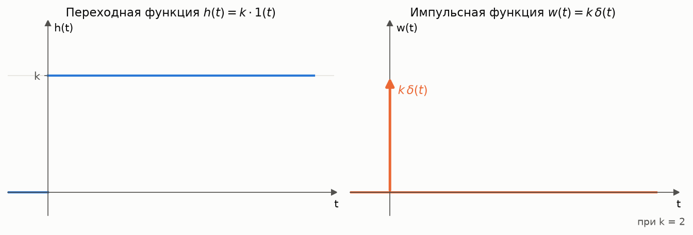

4) АФЧХ:
Подставим $s = i\omega$: $W(i\omega) = U(\omega) + iV(\omega) = k$, то есть
$$U(\omega) = k,\qquad V(\omega) = 0$$
АФЧХ — одна точка $(k;\ 0)$ на вещественной оси.

5) АЧХ и ФЧХ:
$$A(\omega) = \sqrt{U^2(\omega) + V^2(\omega)} = \sqrt{k^2 + 0^2} = k$$
$U > 0$, поэтому
$$\varphi(\omega) = \operatorname{arctg}\dfrac{V(\omega)}{U(\omega)} = \operatorname{arctg}\dfrac{0}{k} = 0$$

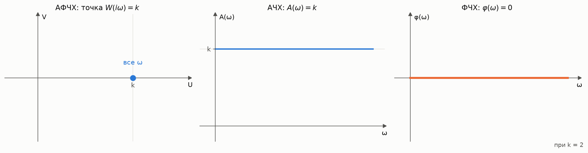

6) Логарифмическая амплитуда:
$$L_m(\omega) = 20\lg A(\omega) = 20\lg k$$
— горизонтальная прямая, не зависит от частоты.

Ответ: $W(s) = k$; $h(t) = k\cdot 1(t)$; $w(t) = k\,\delta(t)$; $A(\omega) = k$; $\varphi(\omega) = 0$; $L_m(\omega) = 20\lg k$

## Задача 2

### Условие

Найти передаточную функцию, переходную $h(t)$ и импульсную $w(t)$ функции и частотные характеристики (АФЧХ, АЧХ, ФЧХ) интегрирующего звена $\dfrac{dy}{dt} = k\,u(t)$, $k > 0$, $y(0) = 0$.

### Решение

1) Передаточная функция:
Изображение уравнения: $sY(s) - y(0) = kU(s)$, $y(0) = 0$:
$$W(s) = \dfrac{Y(s)}{U(s)} = \dfrac{k}{s}$$

2) Переходная функция:
$$h(t) = L^{-1}\left\{\dfrac{W(s)}{s}\right\} = L^{-1}\left\{\dfrac{k}{s^2}\right\}$$
Полюс $s_1 = 0$ кратности 2 ($\nu = 1$, $k_1 = 2$), формула обращения через вычеты:
$$h(t) = k\cdot\dfrac{1}{1!}\lim_{s\to 0}\dfrac{d}{ds}\left[\dfrac{s^2}{s^2}\,e^{st}\right] = k\lim_{s\to 0} t\,e^{st} = kt$$

3) Импульсная функция:
$$w(t) = h'(t) = (kt)' = k\cdot 1(t)$$

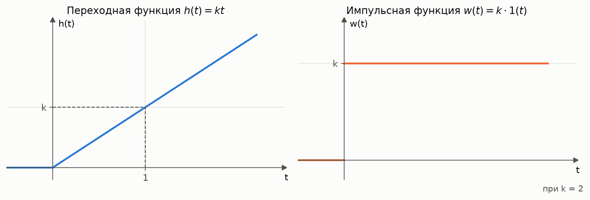

4) АФЧХ:
Подставим $s = i\omega$ и домножим числитель и знаменатель на $i$:
$$W(i\omega) = \dfrac{k}{i\omega} = \dfrac{ik}{i^2\omega} = \dfrac{ik}{-\omega} = i\left(-\dfrac{k}{\omega}\right)$$
$$U(\omega) = 0,\qquad V(\omega) = -\dfrac{k}{\omega}$$
АФЧХ — отрицательная мнимая полуось: при $\omega \to 0$ $V \to -\infty$, при $\omega \to \infty$ $V \to 0$.

5) АЧХ:
$$A(\omega) = \sqrt{0 + \left(-\dfrac{k}{\omega}\right)^2} = \dfrac{k}{\omega}$$

6) ФЧХ:
$U(\omega) = 0$, $V(\omega) < 0$; $\operatorname{arctg}(\pm\infty) = \pm\dfrac{\pi}{2}$:
$$\varphi(\omega) = \operatorname{arctg}\dfrac{V(\omega)}{U(\omega)} = \operatorname{arctg}(-\infty) = -\dfrac{\pi}{2}$$

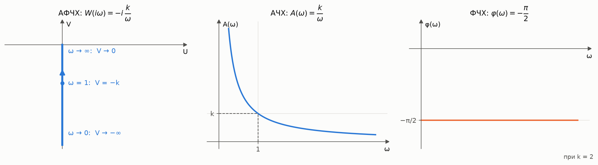

Ответ: $W(s) = \dfrac{k}{s}$; $h(t) = kt$; $w(t) = k\cdot 1(t)$; $A(\omega) = \dfrac{k}{\omega}$; $\varphi(\omega) = -\dfrac{\pi}{2}$

## Задача 3

### Условие

Апериодическое звено 1-го порядка описывается уравнением $T\dfrac{dy}{dt} + y = k\,u$ ($k$ — коэффициент усиления звена, $T$ — постоянная времени). Для электрической цепи на рисунке (резистор $R_1$ и катушка $L$ последовательно, выход $y(t)$ — напряжение на резисторе $R_2$) составить уравнение и найти $T$ и $k$.

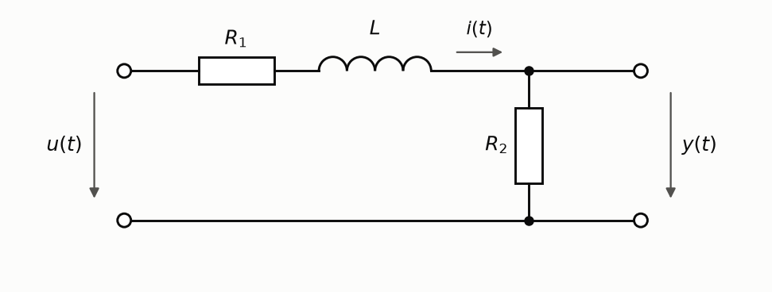

### Решение

1) Напряжения на элементах:
$$u_R = R\,i(t),\qquad u_L = L\dfrac{di(t)}{dt},\qquad u_C = \dfrac{1}{C}\int_0^t i(\tau)\,d\tau$$

2) Второй закон Кирхгофа для контура:
$$u(t) = R_1\,i(t) + L\dfrac{di(t)}{dt} + R_2\,i(t)$$

3) Выразим ток через выход:
$$y(t) = R_2\,i(t) \;\Rightarrow\; i(t) = \dfrac{y(t)}{R_2}$$
$$u(t) = \dfrac{R_1}{R_2}\,y(t) + \dfrac{L}{R_2}\dfrac{dy}{dt} + y(t)$$

4) Приведём к виду апериодического звена:
$$\dfrac{L}{R_2}\dfrac{dy}{dt} + \left(\dfrac{R_1}{R_2} + 1\right)y(t) = u(t)$$
Делим на $\dfrac{R_1}{R_2} + 1 = \dfrac{R_1 + R_2}{R_2}$:
$$\dfrac{L}{R_1 + R_2}\dfrac{dy}{dt} + y = \dfrac{R_2}{R_1 + R_2}\,u(t)$$

5) Сравним с $T\dfrac{dy}{dt} + y = ku$:
$$T = \dfrac{L}{R_1 + R_2},\qquad k = \dfrac{R_2}{R_1 + R_2},\qquad W(s) = \dfrac{k}{Ts + 1}$$

Ответ: $T = \dfrac{L}{R_1+R_2}$, $k = \dfrac{R_2}{R_1+R_2}$

## Задача 4

### Условие

(ДЗ) Для RC-цепи на рисунке (резистор $R$ последовательно, выход $y(t)$ — напряжение на конденсаторе $C$) составить уравнение апериодического звена $T\dfrac{dy}{dt} + y = k\,u$ и найти $T$ и $k$.

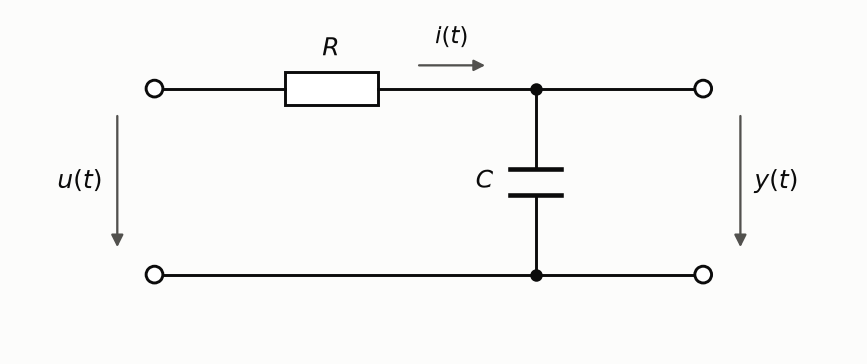

### Решение

1) Второй закон Кирхгофа:
$$u(t) = R\,i(t) + y(t),\qquad y(t) = \dfrac{1}{C}\int_0^t i(\tau)\,d\tau$$

2) Выразим ток через выход:
$$\dfrac{dy}{dt} = \dfrac{i(t)}{C} \;\Rightarrow\; i(t) = C\dfrac{dy}{dt}$$

3) Подставим:
$$RC\dfrac{dy}{dt} + y = u(t)$$

4) Сравним с $T\dfrac{dy}{dt} + y = ku$:
$$T = RC,\qquad k = 1,\qquad W(s) = \dfrac{1}{RCs + 1}$$

Примечание: в тетради это домашнее задание, решение не записано.

Ответ: $T = RC$, $k = 1$

## Задача 5

### Условие

Электрическая цепь: резистор $R$, катушка $L$ и конденсатор $C$ соединены последовательно, на вход подано напряжение $u(t)$, выход $y(t)$ — напряжение на конденсаторе. Составить уравнение цепи и найти параметры колебательного звена $T^2\dfrac{d^2y}{dt^2} + 2\xi T\dfrac{dy}{dt} + y = k\,u$.

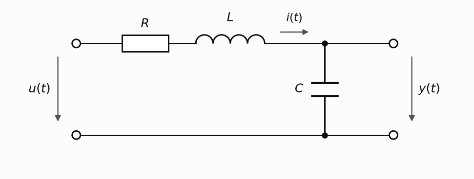

### Решение

1) Второй закон Кирхгофа:
$$u(t) = R\,i(t) + L\dfrac{di(t)}{dt} + \dfrac{1}{C}\int_0^t i(\tau)\,d\tau,\qquad y(t) = \dfrac{1}{C}\int_0^t i(\tau)\,d\tau$$

2) Выразим ток через выход:
$$\dfrac{dy}{dt} = \dfrac{i(t)}{C} \;\Rightarrow\; i(t) = C\dfrac{dy}{dt},\qquad \dfrac{di}{dt} = C\dfrac{d^2y}{dt^2}$$

3) Подставим:
$$u(t) = RC\dfrac{dy}{dt} + LC\dfrac{d^2y}{dt^2} + y(t)$$

4) Сравним с уравнением колебательного звена:
$$T^2 = LC \;\Rightarrow\; T = \sqrt{LC}$$
$$2\xi T = 2\xi\sqrt{LC} = RC \;\Rightarrow\; \xi = \dfrac{RC}{2\sqrt{LC}}$$
Коэффициент при $u(t)$ равен 1, значит $k = 1$. Звено колебательное при $\xi < 1$.

Ответ: $T = \sqrt{LC}$, $\xi = \dfrac{RC}{2\sqrt{LC}}$, $k = 1$

## Задача 6

### Условие

Найти переходную функцию $h(t)$, импульсную функцию $w(t)$ и частотные характеристики колебательного звена $W(s) = \dfrac{k}{T^2s^2 + 2\xi Ts + 1}$, $0 < \xi < 1$.

### Решение

1) Полюсы $\dfrac{W(s)}{s}$:
$$s\,(T^2s^2 + 2\xi Ts + 1) = 0 \;\Rightarrow\; s_1 = 0,\quad s_{2,3} = \dfrac{-2\xi T \pm \sqrt{4\xi^2T^2 - 4T^2}}{2T^2} = \dfrac{-\xi \pm \sqrt{\xi^2 - 1}}{T}$$
При $\xi < 1$ корень мнимый:
$$s_{2,3} = -\dfrac{\xi}{T} \pm i\,\dfrac{\sqrt{1-\xi^2}}{T} = -\lambda \pm i\beta,\qquad \lambda = \dfrac{\xi}{T},\quad \beta = \dfrac{\sqrt{1-\xi^2}}{T}$$
(в тетради $\beta$ обозначена $\omega$). Все полюсы простые, $T^2s^2 + 2\xi Ts + 1 = T^2(s+\lambda+i\beta)(s+\lambda-i\beta)$ и $T^2(\lambda^2 + \beta^2) = \xi^2 + 1 - \xi^2 = 1$.

2) Вычет в полюсе $s = 0$:
$$h(t) = L^{-1}\left\{\dfrac{W(s)}{s}\right\} = k\left[\,(1) + (2) + (3)\,\right]$$
$$(1) = \lim_{s\to 0}\dfrac{e^{st}}{T^2(s+\lambda+i\beta)(s+\lambda-i\beta)} = \dfrac{1}{T^2(\lambda^2+\beta^2)} = \dfrac{1}{\xi^2 + 1 - \xi^2} = 1$$

3) Вычеты в комплексных полюсах:
$$(2) = \lim_{s\to -\lambda-i\beta}\dfrac{e^{st}}{T^2s\,(s+\lambda-i\beta)} = \dfrac{e^{(-\lambda-i\beta)t}}{T^2(-\lambda-i\beta)(-2i\beta)}$$
$$(3) = \lim_{s\to -\lambda+i\beta}\dfrac{e^{st}}{T^2s\,(s+\lambda+i\beta)} = \dfrac{e^{(-\lambda+i\beta)t}}{T^2(-\lambda+i\beta)(2i\beta)}$$
Так как $\dfrac{1}{T^2(-\lambda\mp i\beta)} = -\lambda \pm i\beta$:
$$(2) = -\dfrac{1}{2}\left(1 + i\dfrac{\lambda}{\beta}\right)e^{-\lambda t}e^{-i\beta t},\qquad (3) = -\dfrac{1}{2}\left(1 - i\dfrac{\lambda}{\beta}\right)e^{-\lambda t}e^{i\beta t}$$

4) Сумма комплексных вычетов:
$$(2) + (3) = -e^{-\lambda t}\left[\dfrac{e^{i\beta t} + e^{-i\beta t}}{2} + \dfrac{\lambda}{\beta}\cdot\dfrac{e^{i\beta t} - e^{-i\beta t}}{2i}\right] = -e^{-\lambda t}\left(\cos\beta t + \dfrac{\lambda}{\beta}\sin\beta t\right)$$

5) Переходная функция:
$$h(t) = k\left[1 - e^{-\lambda t}\left(\cos\beta t + \dfrac{\lambda}{\beta}\sin\beta t\right)\right]$$
$$h(t) = k\left[1 - e^{-\frac{\xi}{T}t}\left(\cos\dfrac{\sqrt{1-\xi^2}}{T}t + \dfrac{\xi}{\sqrt{1-\xi^2}}\sin\dfrac{\sqrt{1-\xi^2}}{T}t\right)\right]$$
Проверка: $h(0) = k(1 - 1) = 0$, $h(\infty) = k$.

6) Импульсная функция $w(t) = h'(t)$:
$$w(t) = k\left[\lambda e^{-\lambda t}\left(\cos\beta t + \dfrac{\lambda}{\beta}\sin\beta t\right) - e^{-\lambda t}\left(-\beta\sin\beta t + \lambda\cos\beta t\right)\right]$$
Слагаемые с косинусом сокращаются:
$$w(t) = k\,e^{-\lambda t}\sin\beta t\left(\dfrac{\lambda^2}{\beta} + \beta\right) = k\,e^{-\lambda t}\sin\beta t\cdot\dfrac{\lambda^2 + \beta^2}{\beta} = \dfrac{k}{T^2\beta}\,e^{-\lambda t}\sin\beta t$$
$$w(t) = \dfrac{k}{T\sqrt{1-\xi^2}}\,e^{-\frac{\xi}{T}t}\sin\dfrac{\sqrt{1-\xi^2}}{T}t$$

7) Проверка: $w(t) = L^{-1}\{W(s)\}$ через вычеты:
$$w(t) = \lim_{s\to -\lambda-i\beta}\dfrac{k\,e^{st}}{T^2(s+\lambda-i\beta)} + \lim_{s\to -\lambda+i\beta}\dfrac{k\,e^{st}}{T^2(s+\lambda+i\beta)} = \dfrac{k\,e^{(-\lambda-i\beta)t}}{T^2(-2i\beta)} + \dfrac{k\,e^{(-\lambda+i\beta)t}}{T^2(2i\beta)}$$
$$w(t) = \dfrac{k\,e^{-\lambda t}}{T^2\beta}\cdot\dfrac{e^{i\beta t} - e^{-i\beta t}}{2i} = \dfrac{k}{T^2\beta}\,e^{-\lambda t}\sin\beta t$$
Совпадает с п. 6.

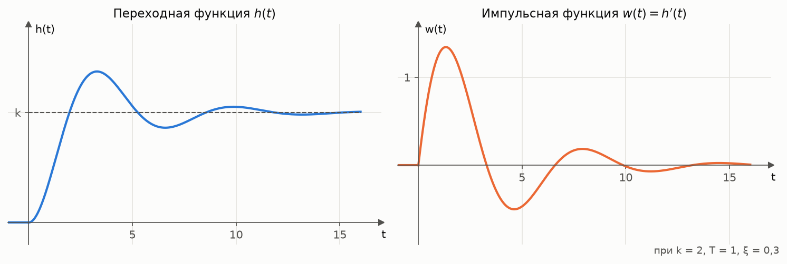

8) АФЧХ:
Подставим $s = i\omega$ и домножим на сопряжённое:
$$W(i\omega) = \dfrac{k}{-T^2\omega^2 + 2\xi Ti\omega + 1} = \dfrac{k}{(1 - T^2\omega^2) + i\,2\xi T\omega} = \dfrac{k\,(1 - T^2\omega^2 - 2i\xi T\omega)}{(1 - T^2\omega^2)^2 + 4\xi^2T^2\omega^2}$$
Знаменатель: $(1 - T^2\omega^2)^2 + 4\xi^2T^2\omega^2 = 1 - 2T^2\omega^2 + T^4\omega^4 + 4\xi^2T^2\omega^2 = 1 + T^2\omega^2(T^2\omega^2 + 4\xi^2 - 2)$:
$$U(\omega) = \dfrac{k(1 - T^2\omega^2)}{1 + T^2\omega^2(T^2\omega^2 + 4\xi^2 - 2)},\qquad V(\omega) = \dfrac{-2k\xi T\omega}{1 + T^2\omega^2(T^2\omega^2 + 4\xi^2 - 2)}$$

9) АЧХ:
$U^2 + V^2 = \dfrac{k^2\left[(1-T^2\omega^2)^2 + 4\xi^2T^2\omega^2\right]}{\left[(1-T^2\omega^2)^2 + 4\xi^2T^2\omega^2\right]^2}$, поэтому
$$A(\omega) = \sqrt{U^2(\omega) + V^2(\omega)} = \dfrac{k}{\sqrt{(1 - T^2\omega^2)^2 + 4\xi^2T^2\omega^2}}$$
$A(0) = k$, $A\!\left(\dfrac{1}{T}\right) = \dfrac{k}{2\xi}$, $A(\infty) = 0$.
Резонанс: подкоренное выражение наименьшее, когда его производная по $\omega^2$ равна нулю: $-2T^2(1 - T^2\omega^2) + 4\xi^2T^2 = 0$, т. е. $T^2\omega^2 = 1 - 2\xi^2$. Если $\xi < \dfrac{1}{\sqrt{2}}$, у АЧХ есть резонансный пик:
$$\omega_{\text{рез}} = \dfrac{\sqrt{1 - 2\xi^2}}{T},\qquad A_{\max} = \dfrac{k}{2\xi\sqrt{1 - \xi^2}}$$
При $\xi \ge \dfrac{1}{\sqrt{2}}$ АЧХ монотонно убывает.

10) ФЧХ:
$V(\omega) < 0$ при всех $\omega > 0$, четверть определяет знак $U$:
$$\varphi(\omega) = \begin{cases} -\operatorname{arctg}\dfrac{2\xi T\omega}{1 - T^2\omega^2}, & \omega < \dfrac{1}{T}\ (U > 0) \\ -\dfrac{\pi}{2}, & \omega = \dfrac{1}{T}\ (U = 0) \\ -\pi + \operatorname{arctg}\dfrac{2\xi T\omega}{T^2\omega^2 - 1}, & \omega > \dfrac{1}{T}\ (U < 0) \end{cases}$$
Фаза убывает от $0$ до $-\pi$. АФЧХ начинается в точке $(k;\ 0)$, при $\omega = \dfrac{1}{T}$ пересекает мнимую ось в точке $V = -\dfrac{k}{2\xi}$ и при $\omega \to \infty$ приходит в начало координат.

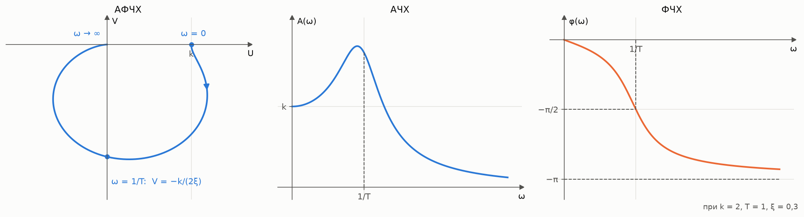

Примечание: в тетради при вычислении $A(\omega)$ ошибка: числитель под корнем записан как $k^2 - 2kT^2\omega^2 + T^4\omega^4 + 4k^2\xi^2T^2\omega^2$ (у второго и третьего слагаемых должен быть множитель $k^2$) и дробь не сокращена; получено $A = \dfrac{\sqrt{k^2 + T^2\omega^2(T^2\omega^2 + 4k^2\xi^2 - 2k)}}{1 + T^2\omega^2(T^2\omega^2 + 4\xi^2 - 2)}$, что неверно. ФЧХ в тетради не найдена.

Ответ: $h(t) = k\left[1 - e^{-\frac{\xi}{T}t}\left(\cos\dfrac{\sqrt{1-\xi^2}}{T}t + \dfrac{\xi}{\sqrt{1-\xi^2}}\sin\dfrac{\sqrt{1-\xi^2}}{T}t\right)\right]$; $w(t) = \dfrac{k}{T\sqrt{1-\xi^2}}e^{-\frac{\xi}{T}t}\sin\dfrac{\sqrt{1-\xi^2}}{T}t$; $A(\omega) = \dfrac{k}{\sqrt{(1-T^2\omega^2)^2 + 4\xi^2T^2\omega^2}}$

# Практика. Структурные преобразования

## Задача 1

### Условие

5.1 Найти передаточную функцию $W(s) = \dfrac{Y(s)}{U(s)}$ системы, заданной структурной схемой, двумя способами: I — преобразованием контуров, II — преобразованием сигналов.

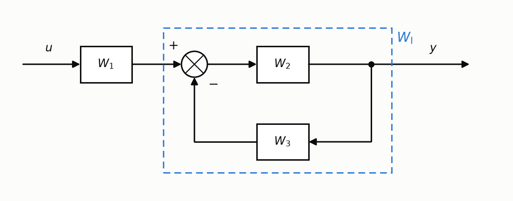

### Решение

1) Способ I. Свернём контур с обратной связью:
Звено $W_2$ в прямой цепи и $W_3$ в отрицательной обратной связи образуют контур (на схеме обведён пунктиром):
$$W_{\text{I}} = \dfrac{W_2}{1 + W_2W_3}$$

2) Последовательное соединение $W_1$ и $W_{\text{I}}$:

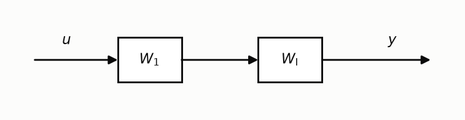

$$W = W_1\cdot W_{\text{I}} = \dfrac{W_1W_2}{1 + W_2W_3}$$
То есть числитель — произведение звеньев прямой цепи ($W_{1-2}$), знаменатель — $1 +$ произведение звеньев контура ($W_{2-3}$).

3) Способ II. Обозначим сигналы:

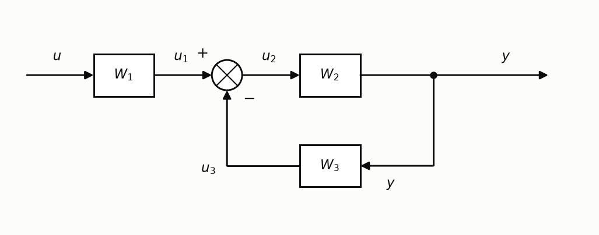

$$u_1 = uW_1,\qquad u_3 = yW_3,\qquad u_2 = u_1 - u_3,\qquad y = u_2W_2$$

4) Выразим $y$ через $u$:
$$y = u_2W_2 = W_2(u_1 - u_3) = W_2(uW_1 - yW_3)$$
$$uW_1W_2 - yW_2W_3 = y \;\Rightarrow\; y(1 + W_2W_3) = uW_1W_2$$

5) Передаточная функция:
$$W(s) = \dfrac{y}{u} = \dfrac{W_1W_2}{1 + W_2W_3}$$
Совпадает со способом I.

Ответ: $W(s) = \dfrac{W_1W_2}{1 + W_2W_3}$

## Задача 2

### Условие

5.2 Найти передаточную функцию $W(s) = \dfrac{Y(s)}{U(s)}$ системы, заданной структурной схемой: преобразованием схемы и проверить преобразованием сигналов.

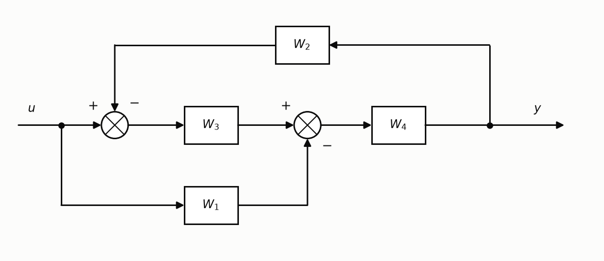

### Решение

1) Перенесём второй сумматор через $W_3$ против хода сигнала:
Сигнал $W_1u$ вычитается после звена $W_3$. Чтобы вычитать его до $W_3$, в его ветвь добавляем звено $W_3^{-1}$: $W_3\left(x - W_3^{-1}W_1u\right) = W_3x - W_1u$.

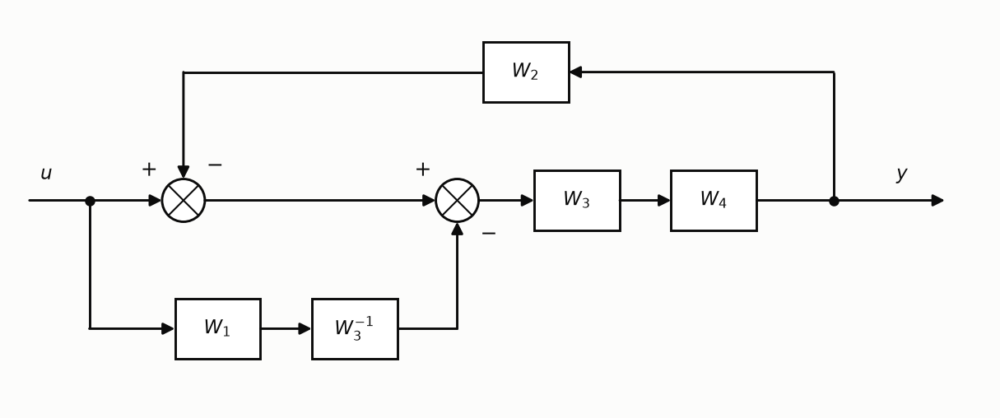

2) Переставим соседние сумматоры:
Два сумматора подряд можно поменять местами. Схема распадается на два последовательных участка $W_{\text{I}}$ и $W_{\text{II}}$:

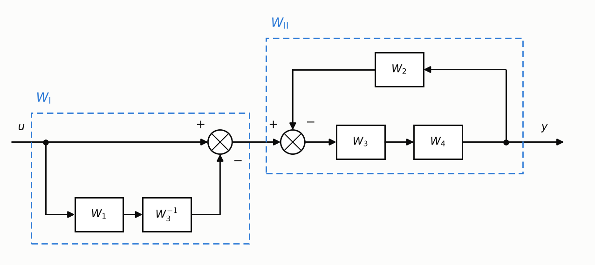

3) Участок $W_{\text{I}}$ — параллельное соединение:
Прямая ветвь с передаточной функцией 1 и ветвь $W_1W_3^{-1}$ со знаком «−»:

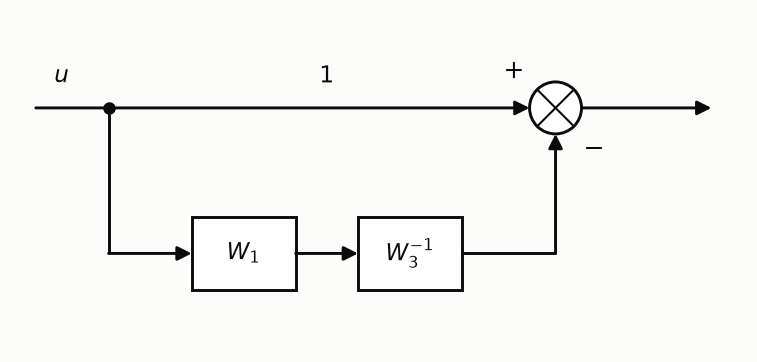

$$W_{\text{I}} = 1 - W_1W_3^{-1} = 1 - \dfrac{W_1}{W_3}$$

4) Участок $W_{\text{II}}$ — контур с отрицательной обратной связью:
Прямая цепь $W_3W_4$, обратная связь $W_2$:
$$W_{\text{II}} = \dfrac{W_3W_4}{1 + W_2W_3W_4}$$

5) Последовательное соединение участков:
$$W = W_{\text{I}}W_{\text{II}} = \left(1 - \dfrac{W_1}{W_3}\right)\dfrac{W_3W_4}{1 + W_2W_3W_4} = \dfrac{W_3W_4 - W_1W_4}{1 + W_2W_3W_4}$$

6) Проверка преобразованием сигналов:

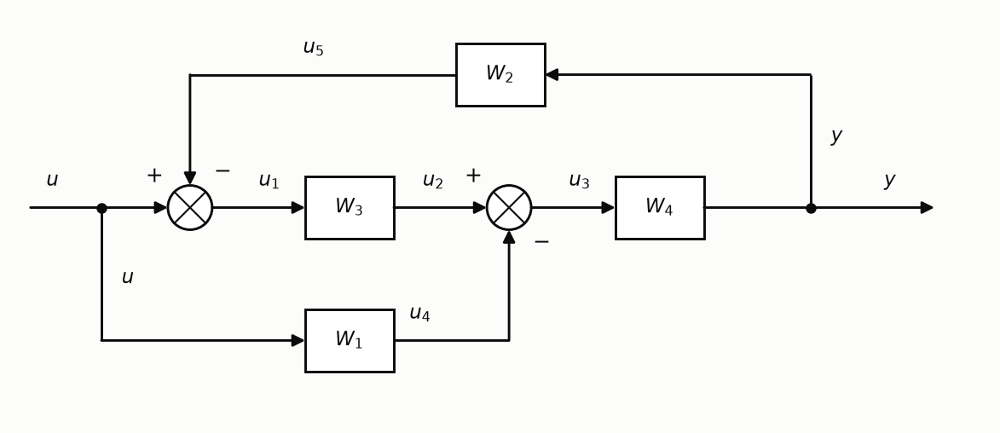

$$u_5 = yW_2,\quad u_1 = u - u_5,\quad u_2 = u_1W_3,\quad u_4 = uW_1,\quad u_3 = u_2 - u_4,\quad y = W_4u_3$$

7) Выразим $y$ через $u$:
$$y = W_4u_3 = W_4(u_2 - u_4) = W_4(u_1W_3 - uW_1) = W_4\left((u - yW_2)W_3 - uW_1\right)$$
$$y = uW_3W_4 - yW_2W_3W_4 - uW_1W_4 \;\Rightarrow\; u(W_3W_4 - W_1W_4) = y(1 + W_2W_3W_4)$$
$$W = \dfrac{y}{u} = \dfrac{W_3W_4 - W_1W_4}{1 + W_2W_3W_4}$$
Совпадает с п. 5.

Ответ: $W(s) = \dfrac{W_3W_4 - W_1W_4}{1 + W_2W_3W_4}$

## Задача 3

### Условие

5.3 Найти передаточную функцию $W(s) = \dfrac{Y(s)}{U(s)}$ системы, заданной структурной схемой, преобразованием сигналов.

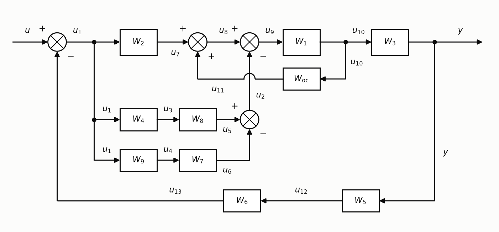

### Решение

1) Уравнения сигналов по схеме:
$$y = u_{10}W_3,\quad u_{10} = u_9W_1,\quad u_9 = u_8 - u_2,\quad u_8 = u_7 + u_{11},\quad u_{11} = u_{10}W_{\text{oc}},\quad u_7 = u_1W_2$$
$$u_2 = u_5 - u_6,\quad u_5 = u_3W_8,\quad u_3 = u_1W_4,\quad u_6 = u_4W_7,\quad u_4 = u_1W_9$$
$$u_1 = u - u_{13},\quad u_{13} = u_{12}W_6,\quad u_{12} = yW_5$$

2) Выразим $y$ через сигналы сумматоров:
$$y = u_{10}W_3 = W_1W_3\,u_9 = W_1W_3(u_8 - u_2) = W_1W_3(u_7 + u_{11} - u_5 + u_6)$$

3) Подставим сигналы ветвей:
$$y = W_1W_3\left(u_1W_2 + u_{10}W_{\text{oc}} - u_3W_8 + u_4W_7\right) = W_1W_3\left(u_1W_2 + u_{10}W_{\text{oc}} - u_1W_4W_8 + u_1W_7W_9\right)$$
Так как $u_{10} = \dfrac{y}{W_3}$, слагаемое $W_1W_3u_{10}W_{\text{oc}} = W_1W_{\text{oc}}\,y$:
$$y = W_1W_3(W_2 - W_4W_8 + W_7W_9)\,u_1 + W_1W_{\text{oc}}\,y$$

4) Подставим $u_1 = u - W_5W_6\,y$:
$$y = W_1W_3(W_2 - W_4W_8 + W_7W_9)(u - W_5W_6\,y) + W_1W_{\text{oc}}\,y$$

5) Соберём слагаемые с $u$ и с $y$:
$$u\left(W_1W_2W_3 - W_1W_3W_4W_8 + W_1W_3W_7W_9\right) = y\left(1 - W_1W_{\text{oc}} + W_1W_2W_3W_5W_6 - W_1W_3W_4W_5W_6W_8 + W_1W_3W_5W_6W_7W_9\right)$$

6) Передаточная функция:
$$W(s) = \dfrac{y}{u} = \dfrac{W_1W_2W_3 - W_1W_3W_4W_8 + W_1W_3W_7W_9}{1 - W_1W_{\text{oc}} + W_1W_2W_3W_5W_6 - W_1W_3W_4W_5W_6W_8 + W_1W_3W_5W_6W_7W_9}$$

Примечание: в тетради записано $u_1 = u_{13} + u$, хотя на схеме сигнал $u_{13}$ входит в первый сумматор со знаком «−»; при подстановке знак при $W_5W_6\,y$ взят то «+», то «−», и получен знаменатель $1 - W_1W_2W_3W_5W_6 - W_1W_{\text{oc}} + W_1W_3W_4W_5W_6W_8 + W_1W_3W_5W_6W_7W_9$ — он неверен при любом знаке. Числитель в тетради верный. Если бы $u_{13}$ входил со знаком «+», знаменатель был бы $1 - W_1W_{\text{oc}} - W_1W_3W_5W_6(W_2 - W_4W_8 + W_7W_9)$.

Ответ: $W(s) = \dfrac{W_1W_2W_3 - W_1W_3W_4W_8 + W_1W_3W_7W_9}{1 - W_1W_{\text{oc}} + W_1W_2W_3W_5W_6 - W_1W_3W_4W_5W_6W_8 + W_1W_3W_5W_6W_7W_9}$

# Практика. Алгебраические критерии устойчивости

## Задача 1

### Условие

6.1 а) Исследовать устойчивость системы с характеристическим уравнением $D(s) = s^6 + 6s^5 + 15s^4 + 20s^3 + 15s^2 + 6s + 1 = 0$ по критерию Рауса.

### Решение

1) Необходимое условие (теорема Стодолы):
Если система устойчива, все коэффициенты характеристического уравнения положительны. Здесь $a_0 = 1$, $a_1 = 6$, $a_2 = 15$, $a_3 = 20$, $a_4 = 15$, $a_5 = 6$, $a_6 = 1$ — все больше нуля, условие выполнено, проверяем по критерию.

2) Правило построения таблицы Рауса:
В первую строку пишут коэффициенты с чётными индексами, во вторую — с нечётными. Всего строк $n + 1 = 7$, остальные элементы:
$$c_{ik} = c_{i-2,\,k+1} - r_i\,c_{i-1,\,k+1}, \qquad r_i = \dfrac{c_{i-2,\,1}}{c_{i-1,\,1}}$$
Система устойчива, если все элементы первого столбца $c_{i1} > 0$.

3) Строки 3–7:
$$r_3 = \dfrac{1}{6}: \quad c_{31} = 15 - \dfrac{20}{6} = \dfrac{35}{3}, \quad c_{32} = 15 - \dfrac{6}{6} = 14, \quad c_{33} = 1$$
$$r_4 = \dfrac{6}{35/3} = \dfrac{18}{35}: \quad c_{41} = 20 - \dfrac{18}{35}\cdot 14 = \dfrac{64}{5}, \quad c_{42} = 6 - \dfrac{18}{35}\cdot 1 = \dfrac{192}{35}$$
$$r_5 = \dfrac{35/3}{64/5} = \dfrac{175}{192}: \quad c_{51} = 14 - \dfrac{175}{192}\cdot\dfrac{192}{35} = 9, \quad c_{52} = 1$$
$$r_6 = \dfrac{64/5}{9} = \dfrac{64}{45}: \quad c_{61} = \dfrac{192}{35} - \dfrac{64}{45}\cdot 1 = \dfrac{256}{63}$$
$$r_7 = \dfrac{9}{256/63} = \dfrac{567}{256}: \quad c_{71} = 1 - r_7\cdot 0 = 1$$

4) Таблица Рауса целиком:
$$\begin{array}{c|c|cccc} r_i & i & & & & \\ \hline & 1 & 1 & 15 & 15 & 1 \\ & 2 & 6 & 20 & 6 & 0 \\ \dfrac{1}{6} & 3 & \dfrac{35}{3} & 14 & 1 & \\ \dfrac{18}{35} & 4 & \dfrac{64}{5} & \dfrac{192}{35} & 0 & \\ \dfrac{175}{192} & 5 & 9 & 1 & & \\ \dfrac{64}{45} & 6 & \dfrac{256}{63} & 0 & & \\ \dfrac{567}{256} & 7 & 1 & & & \end{array}$$

5) Вывод:
Первый столбец $1,\ 6,\ \dfrac{35}{3},\ \dfrac{64}{5},\ 9,\ \dfrac{256}{63},\ 1$ — все элементы положительны, система устойчива.
Проверка: $D(s) = (s+1)^6$, все корни $s = -1$ лежат в левой полуплоскости.
Примечание: в тетради в 6-й строке записано $\dfrac{192}{35}$ (не вычтено $r_6 \cdot c_{52}$); верно $\dfrac{256}{63}$, на вывод это не влияет.

Ответ: система устойчива

## Задача 2

### Условие

6.1 б) Исследовать устойчивость системы с характеристическим уравнением $D(s) = 12s^4 + s^3 + 2s^2 + 4s + 50 = 0$ по критериям Рауса и Гурвица.

### Решение

1) Необходимое условие (теорема Стодолы):
Все коэффициенты $12,\ 1,\ 2,\ 4,\ 50$ положительны — условие выполнено, строим таблицу Рауса.

2) Первые две строки:
Чётные коэффициенты: $12,\ 2,\ 50$; нечётные: $1,\ 4,\ 0$.

3) Третья строка:
$$r_3 = \dfrac{12}{1} = 12: \quad c_{31} = 2 - 12\cdot 4 = -46, \quad c_{32} = 50 - 12\cdot 0 = 50$$
$$\begin{array}{c|c|ccc} r_i & i & & & \\ \hline & 1 & 12 & 2 & 50 \\ & 2 & 1 & 4 & 0 \\ 12 & 3 & -46 & 50 & \end{array}$$

4) Вывод:
$c_{31} = -46 < 0$ — система неустойчива, дальше таблицу можно не строить.
Если достроить, первый столбец будет $12,\ 1,\ -46,\ \dfrac{117}{23},\ 50$: две перемены знака, т. е. два корня в правой полуплоскости.

5) Критерий Гурвица:
Матрица $n \times n$ ($n = 4$): в первой строке — коэффициенты с нечётными индексами, во второй — с чётными, дальше те же строки со сдвигом на столбец:
$$H = \begin{pmatrix} a_1 & a_3 & 0 & 0 \\ a_0 & a_2 & a_4 & 0 \\ 0 & a_1 & a_3 & 0 \\ 0 & a_0 & a_2 & a_4 \end{pmatrix} = \begin{pmatrix} 1 & 4 & 0 & 0 \\ 12 & 2 & 50 & 0 \\ 0 & 1 & 4 & 0 \\ 0 & 12 & 2 & 50 \end{pmatrix}$$
Система устойчива, если все главные миноры положительны:
$$\Delta_1 = 1 > 0,\qquad \Delta_2 = \begin{vmatrix} 1 & 4 \\ 12 & 2 \end{vmatrix} = 2 - 48 = -46 < 0$$
$\Delta_2 < 0$ — по Гурвицу система тоже неустойчива.

Ответ: система неустойчива

## Задача 3

### Условие

6.2 а) Исследовать устойчивость замкнутой системы, заданной структурной схемой, по критериям Рауса и Гурвица.

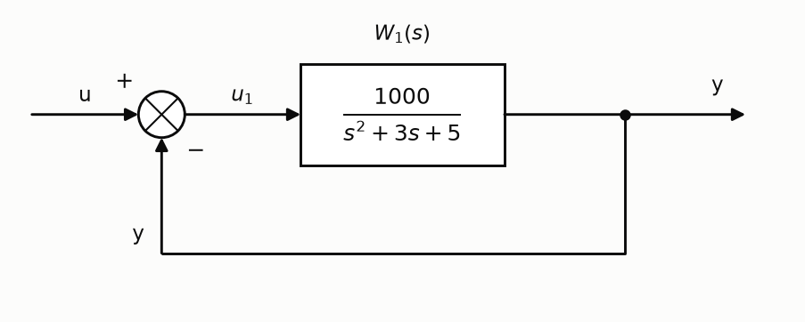

### Решение

1) Уравнения по схеме:
На выходе сумматора $u_1 = u - y$, на выходе звена $y = W_1 u_1$:
$$y = (u - y)\,W_1 \;\Rightarrow\; y\,(1 + W_1) = u\,W_1$$

2) Передаточная функция замкнутой системы:
$$W(s) = \dfrac{y}{u} = \dfrac{W_1}{1 + W_1} = \dfrac{\dfrac{1000}{s^2+3s+5}}{1 + \dfrac{1000}{s^2+3s+5}} = \dfrac{1000}{s^2+3s+1005}$$

3) Характеристический полином:
$$D(s) = s^2 + 3s + 1005$$
Все коэффициенты положительны (необходимое условие выполнено).

4) Таблица Рауса:
$$\begin{array}{c|c|cc} r_i & i & & \\ \hline & 1 & 1 & 1005 \\ & 2 & 3 & 0 \\ \dfrac{1}{3} & 3 & 1005 & 0 \end{array}$$
$c_{31} = 1005 - \dfrac{1}{3}\cdot 0 = 1005$.

5) Вывод по Раусу:
Первый столбец $1,\ 3,\ 1005$ — все элементы положительны, замкнутая система устойчива.

6) Проверка по критерию Гурвица:
$a_0 = 1$, $a_1 = 3$, $a_2 = 1005$; матрица Гурвица $2 \times 2$:
$$H = \begin{pmatrix} a_1 & 0 \\ a_0 & a_2 \end{pmatrix} = \begin{pmatrix} 3 & 0 \\ 1 & 1005 \end{pmatrix},\qquad \Delta_1 = 3 > 0,\qquad \Delta_2 = 3\cdot 1005 - 0 = 3015 > 0$$
Все главные миноры положительны — замкнутая система устойчива и по Гурвицу.
Примечание: в тетради числитель $W(s)$ записан как 10000; верно 1000 (на устойчивость это не влияет).

Ответ: система устойчива

## Задача 4

### Условие

6.2 б) Исследовать по критериям Рауса и Гурвица устойчивость замкнутой системы с единичной отрицательной обратной связью (схема как в 6.2 а), если передаточная функция прямой цепи $W_1(s) = \dfrac{10}{3s^3 + 5s^2 + 2s + 1}$.

### Решение

1) Передаточная функция замкнутой системы:
$$W(s) = \dfrac{\dfrac{10}{3s^3+5s^2+2s+1}}{1 + \dfrac{10}{3s^3+5s^2+2s+1}} = \dfrac{10}{3s^3+5s^2+2s+11}$$

2) Характеристический полином:
$$D(s) = 3s^3 + 5s^2 + 2s + 11$$
Все коэффициенты положительны (необходимое условие выполнено).

3) Таблица Рауса:
$$r_3 = \dfrac{3}{5}: \quad c_{31} = 2 - \dfrac{3}{5}\cdot 11 = -\dfrac{23}{5} = -4{,}6$$
$$\begin{array}{c|c|cc} r_i & i & & \\ \hline & 1 & 3 & 2 \\ & 2 & 5 & 11 \\ \dfrac{3}{5} & 3 & -\dfrac{23}{5} & 0 \\ -\dfrac{25}{23} & 4 & 11 & \end{array}$$

4) Вывод по Раусу:
$c_{31} = -4{,}6 < 0$ — замкнутая система неустойчива (в первом столбце две перемены знака — два корня в правой полуплоскости).

5) Проверка по критерию Гурвица:
$a_0 = 3$, $a_1 = 5$, $a_2 = 2$, $a_3 = 11$:
$$H = \begin{pmatrix} a_1 & a_3 & 0 \\ a_0 & a_2 & 0 \\ 0 & a_1 & a_3 \end{pmatrix} = \begin{pmatrix} 5 & 11 & 0 \\ 3 & 2 & 0 \\ 0 & 5 & 11 \end{pmatrix}$$
$$\Delta_1 = 5 > 0,\qquad \Delta_2 = 5\cdot 2 - 3\cdot 11 = -23 < 0$$
$\Delta_2 < 0$ — по Гурвицу замкнутая система тоже неустойчива.

Ответ: система неустойчива

## Задача 5

### Условие

6.4 а) Характеристическое уравнение замкнутой системы $(1 + T_1 s)(1 + T_2 s)(1 + T_3 s) + k = 0$, $T_1, T_2, T_3 > 0$. Найти условия устойчивости (допустимые значения $k$) по критерию Гурвица.

### Решение

1) Раскроем скобки:
$$D(s) = T_1T_2T_3\,s^3 + (T_1T_2 + T_2T_3 + T_1T_3)\,s^2 + (T_1 + T_2 + T_3)\,s + (1 + k)$$
Коэффициенты: $a_0 = T_1T_2T_3$, $a_1 = T_1T_2 + T_2T_3 + T_1T_3$, $a_2 = T_1 + T_2 + T_3$, $a_3 = 1 + k$.

2) Матрица Гурвица ($n = 3$):
В первой строке — коэффициенты с нечётными индексами, во второй — с чётными, дальше со сдвигом:
$$H = \begin{pmatrix} a_1 & a_3 & 0 \\ a_0 & a_2 & 0 \\ 0 & a_1 & a_3 \end{pmatrix}$$
Система устойчива, если $a_0 > 0$ и все главные миноры $\Delta_1, \Delta_2, \Delta_3$ положительны.

3) Первый минор:
$$\Delta_1 = a_1 = T_1T_2 + T_2T_3 + T_1T_3 > 0$$
Выполняется при любых $T_i > 0$.

4) Второй минор:
$$\Delta_2 = a_1a_2 - a_0a_3 = (T_1T_2 + T_2T_3 + T_1T_3)(T_1 + T_2 + T_3) - T_1T_2T_3\,(1 + k) > 0$$
Отсюда
$$k < \dfrac{(T_1T_2 + T_2T_3 + T_1T_3)(T_1 + T_2 + T_3) - T_1T_2T_3}{T_1T_2T_3}$$

5) Третий минор:
$$\Delta_3 = a_3\,\Delta_2 > 0$$
При $\Delta_2 > 0$ это требует $a_3 = 1 + k > 0$, т. е. $k > -1$.
Примечание: в тетради записано только верхнее ограничение (из $\Delta_2$); нижнее $k > -1$ следует из $\Delta_3 > 0$ и для положительного коэффициента усиления выполняется само.

Ответ: $-1 < k < \dfrac{(T_1T_2 + T_2T_3 + T_1T_3)(T_1 + T_2 + T_3) - T_1T_2T_3}{T_1T_2T_3}$

## Задача 6

### Условие

6.4 б) Исследовать устойчивость замкнутой системы с единичной отрицательной обратной связью, если передаточная функция разомкнутой системы $W_p(s) = \dfrac{k}{s^2(Ts + 1)}$, $k > 0$, $T > 0$.

### Решение

1) Передаточная функция замкнутой системы:
$$W(s) = \dfrac{\dfrac{k}{s^2(Ts+1)}}{1 + \dfrac{k}{s^2(Ts+1)}} = \dfrac{k}{Ts^3 + s^2 + k}$$

2) Характеристический полином:
$$D(s) = Ts^3 + s^2 + 0\cdot s + k$$
Коэффициенты: $a_0 = T$, $a_1 = 1$, $a_2 = 0$, $a_3 = k$.

3) Теорема Стодолы:
Необходимое условие устойчивости — все $a_i > 0$. Здесь $a_2 = 0$, условие нарушено: система неустойчива при любых $k$ и $T$ (структурно неустойчива).

4) Проверка по Гурвицу:
$$\Delta_2 = a_1a_2 - a_0a_3 = 1\cdot 0 - T\,k = -Tk < 0$$

Ответ: система неустойчива при любых $k > 0$, $T > 0$

# Практика. Критерий устойчивости Михайлова

## Задача 1

### Условие

6.1 а) Исследовать устойчивость системы с характеристическим уравнением $D(s) = s^6 + 6s^5 + 15s^4 + 20s^3 + 15s^2 + 6s + 1 = 0$ по критерию Михайлова.

### Решение

1) Критерий Михайлова:
Система $n$-го порядка устойчива тогда и только тогда, когда годограф $D(i\omega)$ при изменении $\omega$ от 0 до $\infty$ начинается на положительной вещественной полуоси и, нигде не обращаясь в нуль, проходит против часовой стрелки последовательно $n$ квадрантов. Здесь $n = 6$.

2) Подставим $s = i\omega$:
$$D(i\omega) = X(\omega) + i\,Y(\omega)$$
$$X(\omega) = -\omega^6 + 15\omega^4 - 15\omega^2 + 1, \qquad Y(\omega) = 6\omega^5 - 20\omega^3 + 6\omega$$

3) Нули $X(\omega)$:
Замена $\omega^2 = x \ge 0$:
$$-x^3 + 15x^2 - 15x + 1 = 0$$
$x = 1$ — корень ($-1 + 15 - 15 + 1 = 0$), значит $\omega = 1$. Делим многочлен на $x - 1$:
$$-x^3 + 15x^2 - 15x + 1 = (x - 1)(-x^2 + 14x - 1)$$
$$-x^2 + 14x - 1 = 0 \;\Rightarrow\; x = 7 \pm 4\sqrt{3}, \quad x_1 \approx 13{,}928, \quad x_2 \approx 0{,}072$$
Отсюда $\omega = 3{,}732$ и $\omega = 0{,}268$.

4) Нули $Y(\omega)$:
$$\omega\,(6\omega^4 - 20\omega^2 + 6) = 0$$
$\omega = 0$ или $\omega^2 = \dfrac{20 \pm 16}{12}$, т. е. $\omega^2 = 3$ или $\omega^2 = \dfrac{1}{3}$: $\omega = 1{,}732$ и $\omega = 0{,}577$.

5) Таблица точек пересечения с осями:
$$\begin{array}{c|c|c} \omega & X(\omega) & Y(\omega) \\ \hline 0 & 1 & 0 \\ 0{,}268 & 0 & 1{,}23 \\ 0{,}577 & -2{,}37 & 0 \\ 1 & 0 & -8 \\ 1{,}732 & 64 & 0 \\ 3{,}732 & 0 & 3327 \\ \infty & -\infty & +\infty \end{array}$$
Значение $Y(3{,}732) \approx 3327$ — при точном $\omega = 2 + \sqrt{3}$; в тетради 3316,54 — подсчитано при округлённом $\omega = 3{,}73$.

6) Годограф:
Нули $X$ и $Y$ чередуются; годограф начинается в точке $(1;\,0)$ и проходит квадранты I → II → III → IV → I → II.

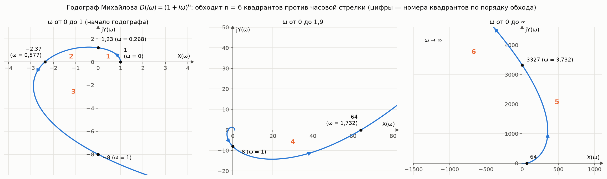

7) Вывод:
Годограф проходит против часовой стрелки $n = 6$ квадрантов — система устойчива.
Проверка: $D(s) = (s+1)^6$, $D(i\omega) = (1+\omega^2)^3 e^{6i\,\text{arctg}\,\omega}$ — аргумент растёт от 0 до $6\cdot\dfrac{\pi}{2}$.

Ответ: система устойчива

## Задача 2

### Условие

6.1 б) Исследовать устойчивость системы с характеристическим уравнением $D(s) = 12s^4 + 2s^2 + 4s + 50 = 0$ по критерию Михайлова.

### Решение

1) Подставим $s = i\omega$:
$$D(i\omega) = X(\omega) + i\,Y(\omega)$$
$$X(\omega) = 12\omega^4 - 2\omega^2 + 50, \qquad Y(\omega) = 4\omega$$

2) Нули $X(\omega)$:
Замена $\omega^2 = x \ge 0$:
$$12x^2 - 2x + 50 = 0, \qquad D = 4 - 2400 = -2396 < 0$$
Действительных корней нет: $X(\omega) > 0$ при всех $\omega$.

3) Нули $Y(\omega)$:
$4\omega = 0$, т. е. только $\omega = 0$.

4) Таблица:
$$\begin{array}{c|c|c} \omega & X(\omega) & Y(\omega) \\ \hline 0 & 50 & 0 \\ \infty & +\infty & +\infty \end{array}$$

5) Годограф:
Начинается в точке $(50;\,0)$ и уходит на бесконечность, не выходя из I квадранта.

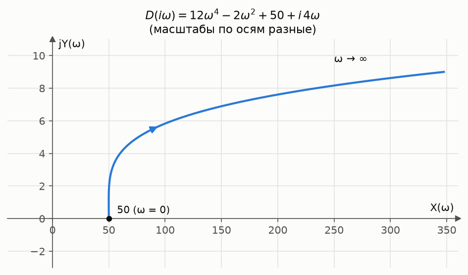

6) Вывод:
Для $n = 4$ годограф должен пройти 4 квадранта, а он проходит только один — система неустойчива. То же сразу видно по теореме Стодолы: коэффициент при $s^3$ равен нулю.
Примечание: в тетради это первый вариант решения 6.1 б, в котором при переписывании условия потерян член $s^3$ (в 6.1 б, см. критерий Рауса, $D(s) = 12s^4 + s^3 + 2s^2 + 4s + 50$). Решение для полного многочлена — в следующей задаче, вывод тот же.

Ответ: система неустойчива

## Задача 3

### Условие

6.1 б) Исследовать устойчивость системы с характеристическим уравнением $D(s) = 12s^4 + s^3 + 2s^2 + 4s + 50 = 0$ по критерию Михайлова.

### Решение

1) Подставим $s = i\omega$:
$(i\omega)^3 = -i\omega^3$, $(i\omega)^4 = \omega^4$:
$$D(i\omega) = X(\omega) + i\,Y(\omega)$$
$$X(\omega) = 12\omega^4 - 2\omega^2 + 50, \qquad Y(\omega) = -\omega^3 + 4\omega$$

2) Нули $X(\omega)$:
Замена $\omega^2 = x \ge 0$: $12x^2 - 2x + 50 = 0$, дискриминант $4 - 2400 < 0$ — действительных корней нет, $X(\omega) > 0$ всегда.

3) Нули $Y(\omega)$:
$$\omega\,(4 - \omega^2) = 0 \;\Rightarrow\; \omega_1 = 0, \quad \omega_2 = 2$$

4) Таблица:
$$\begin{array}{c|c|c} \omega & X(\omega) & Y(\omega) \\ \hline 0 & 50 & 0 \\ 2 & 234 & 0 \\ \infty & +\infty & -\infty \end{array}$$
$X(2) = 12\cdot 16 - 2\cdot 4 + 50 = 234$.

5) Годограф:
Из точки $(50;\,0)$ уходит в I квадрант (наибольшее $Y \approx 3{,}08$ при $\omega \approx 1{,}155$), при $\omega = 2$ возвращается на положительную полуось в точке 234 и уходит в IV квадрант.

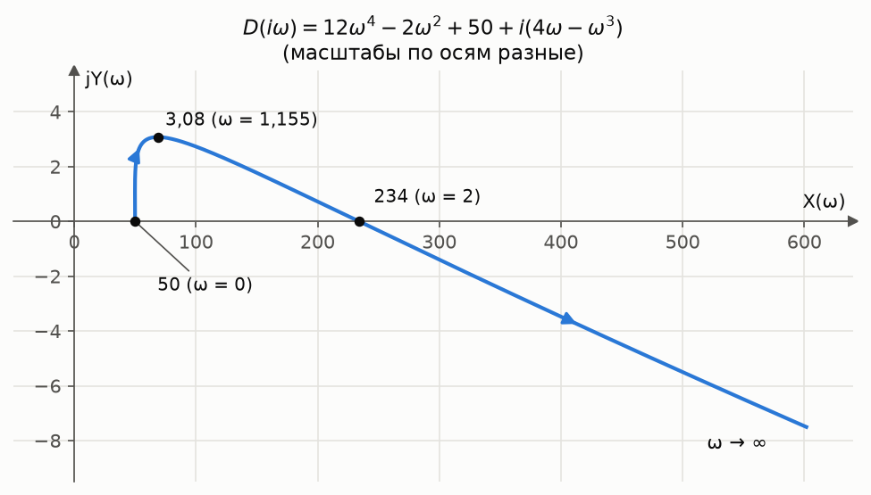

6) Вывод:
Годограф не обходит начало координат (итоговый поворот вектора равен 0 вместо $4\cdot\dfrac{\pi}{2}$) — система неустойчива. Поворот $(n - 2m)\dfrac{\pi}{2} = 0$ даёт $m = 2$ корня в правой полуплоскости, как и по критерию Рауса.

Ответ: система неустойчива

## Задача 4

### Условие

2) Исследовать устойчивость системы с характеристическим уравнением $D(s) = 2s^3 + 6s^2 + 10s + 15 = 0$ по критерию Михайлова.

### Решение

1) Подставим $s = i\omega$:
$$D(i\omega) = X(\omega) + i\,Y(\omega)$$
$$X(\omega) = 15 - 6\omega^2, \qquad Y(\omega) = 10\omega - 2\omega^3$$

2) Нули $X(\omega)$:
$$15 - 6\omega^2 = 0 \;\Rightarrow\; \omega^2 = 2{,}5, \quad \omega_1 = 1{,}58$$

3) Нули $Y(\omega)$:
$$\omega\,(10 - 2\omega^2) = 0 \;\Rightarrow\; \omega_2 = 0, \quad \omega_3 = \sqrt{5} = 2{,}24$$

4) Значения в этих точках:
$$Y(1{,}58) = \sqrt{2{,}5}\,(10 - 2\cdot 2{,}5) = 5\sqrt{2{,}5} \approx 7{,}91, \qquad X(2{,}24) = 15 - 6\cdot 5 = -15$$
$$\begin{array}{c|c|c} \omega & X(\omega) & Y(\omega) \\ \hline 0 & 15 & 0 \\ 1{,}58 & 0 & 7{,}91 \\ 2{,}24 & -15 & 0 \\ \infty & -\infty & -\infty \end{array}$$

5) Годограф:
Нули $X$ и $Y$ чередуются ($0 < 1{,}58 < 2{,}24$); годограф проходит квадранты I → II → III.

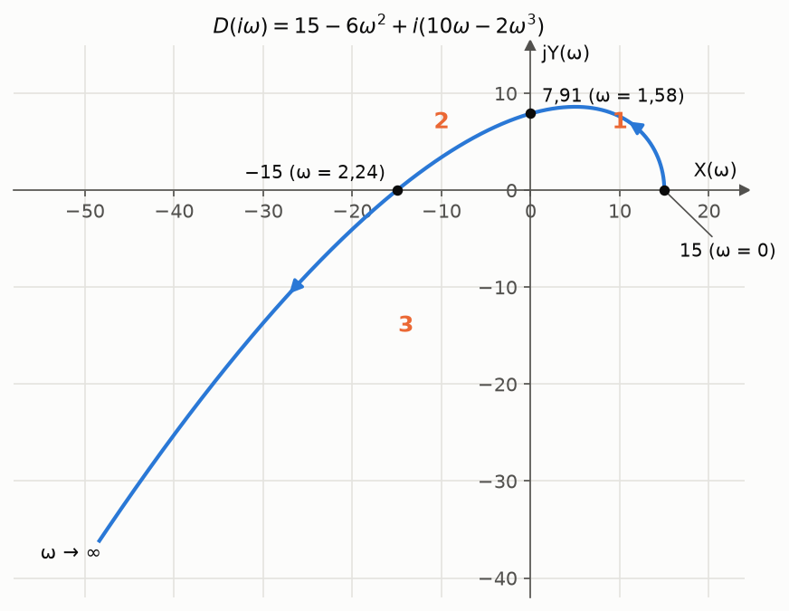

6) Вывод:
Годограф проходит против часовой стрелки $n = 3$ квадранта — система устойчива.
Проверка по Гурвицу: $a_1a_2 - a_0a_3 = 6\cdot 10 - 2\cdot 15 = 30 > 0$.
Примечание: в тетради $Y(1{,}58) = 12{,}64$ и $X(2{,}24) = -15{,}11$; верно $Y \approx 7{,}91$ и $X = -15$ (−15,11 получается при округлённом $\omega = 2{,}24$). Форма годографа и вывод от этого не меняются.

Ответ: система устойчива

# Практика. Критерий устойчивости Найквиста

## Задача 1

### Условие

6.2 а) Исследовать устойчивость замкнутой системы, заданной структурной схемой, по критерию Найквиста.

### Решение

1) Разомкнутая и замкнутая системы:
Разомкнём обратную связь:
$$W_p(s) = \dfrac{1000}{s^2 + 3s + 5}, \qquad W(s) = \dfrac{W_p(s)}{1 + W_p(s)}$$

2) Критерий Найквиста:
Если разомкнутая система устойчива, то замкнутая устойчива тогда и только тогда, когда АФЧХ разомкнутой системы $W_p(i\omega)$ при изменении $\omega$ от 0 до $\infty$ не охватывает точку $(-1;\,i0)$. Сначала проверяем устойчивость разомкнутой системы.

3) Устойчивость разомкнутой системы (по Михайлову):
$$D_p(s) = s^2 + 3s + 5, \qquad D_p(i\omega) = X(\omega) + i\,Y(\omega)$$
$$X(\omega) = 5 - \omega^2, \qquad Y(\omega) = 3\omega$$
$X = 0$ при $\omega_1 = \sqrt{5} \approx 2{,}24$; $Y = 0$ при $\omega_2 = 0$.
$$\begin{array}{c|c|c} \omega & X(\omega) & Y(\omega) \\ \hline 0 & 5 & 0 \\ 2{,}24 & 0 & 6{,}71 \\ \infty & -\infty & +\infty \end{array}$$
Годограф проходит I и II квадранты, $n = 2$ — разомкнутая система устойчива.

4) АФЧХ разомкнутой системы:
Умножим числитель и знаменатель на сопряжённое:
$$W_p(i\omega) = \dfrac{1000}{5 - \omega^2 + 3i\omega} = \dfrac{1000\,(5 - \omega^2)}{(5-\omega^2)^2 + 9\omega^2} - i\,\dfrac{3000\,\omega}{(5-\omega^2)^2 + 9\omega^2}$$
Характерные точки: $W_p(0) = 200$; при $\omega = \sqrt{5}$: $W_p = -i\,\dfrac{1000}{3\sqrt{5}} \approx -149\,i$; при $\omega \to \infty$: $W_p \to 0$.

5) Положение АФЧХ относительно точки $(-1;\,i0)$:
Мнимая часть $V(\omega) = -\dfrac{3000\,\omega}{(5-\omega^2)^2 + 9\omega^2} < 0$ при всех $\omega > 0$: АФЧХ лежит в нижней полуплоскости и ни разу не пересекает отрицательную вещественную полуось. Возле точки $-1$ она проходит ниже: $U = -1$ при $\omega \approx 31{,}6$, там $V \approx -0{,}096$.

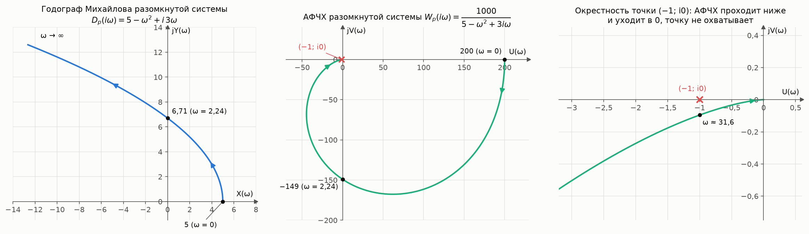

6) Вывод:
Разомкнутая система устойчива, её АФЧХ не охватывает точку $(-1;\,i0)$ — замкнутая система устойчива.
Проверка: характеристический полином замкнутой системы $s^2 + 3s + 1005$ (см. 6.2 а по Раусу) второго порядка с положительными коэффициентами.
Примечание: в тетради построен только годограф $D_p(i\omega)$ (левый график) и на нём же отмечена точка $(-1;\,i0)$; сама АФЧХ $W_p(i\omega)$ не строилась. Вывод в тетради тот же.

Ответ: замкнутая система устойчива

# Практика. Переходная матрица состояния

## Задача 1

### Условие

7.1 а) Найти переходную матрицу состояния $\Phi(t, \tau) = e^{A(t-\tau)}$ системы $\dot x_1 = x_1 + 2x_2$, $\dot x_2 = 4x_1 + 3x_2 + u$ по основной формуле (через матрицы $Z_{kj}$). Обозначение: $\delta = t - \tau$.

### Решение

1) Матрица системы и собственные числа:
$$A = \begin{pmatrix} 1 & 2 \\ 4 & 3 \end{pmatrix}, \qquad \det(A - \lambda I) = \begin{vmatrix} 1-\lambda & 2 \\ 4 & 3-\lambda \end{vmatrix} = \lambda^2 - 4\lambda - 5 = 0$$
$\lambda_1 = -1$, $\lambda_2 = 5$ — простые корни.

2) Основная формула:
Для простых корней $f(A) = f(\lambda_1)Z_{11} + f(\lambda_2)Z_{21}$. Переходная матрица — это $f(A)$ при $f(\lambda) = e^{\lambda\delta}$:
$$\Phi = e^{-\delta}Z_{11} + e^{5\delta}Z_{21}$$
Матрицы $Z$ от $f$ не зависят — находим их, подставляя простые функции.

3) Подставим $f(\lambda) = 1$ и $f(\lambda) = \lambda - 1$:
$f(\lambda) = 1$ даёт $f(A) = I$; $f(\lambda) = \lambda - 1$ даёт $f(A) = A - I$:
$$\begin{cases} Z_{11} + Z_{21} = I \\ (\lambda_1 - 1)Z_{11} + (\lambda_2 - 1)Z_{21} = -2Z_{11} + 4Z_{21} = A - I \end{cases}$$

4) Решим систему:
Сложим уравнения: $-Z_{11} + 5Z_{21} = A$, откуда $Z_{11} = 5Z_{21} - A$. Подставим в первое:
$$Z_{21} = I - 5Z_{21} + A \;\Rightarrow\; 6Z_{21} = I + A \;\Rightarrow\; Z_{21} = \dfrac{1}{6}I + \dfrac{1}{6}A$$
$$Z_{11} = 5Z_{21} - A = \dfrac{5}{6}I - \dfrac{1}{6}A$$

5) Матрицы $Z$ в числах:
$$Z_{11} = \begin{pmatrix} \dfrac{5}{6} & 0 \\ 0 & \dfrac{5}{6} \end{pmatrix} - \begin{pmatrix} \dfrac{1}{6} & \dfrac{2}{6} \\ \dfrac{4}{6} & \dfrac{3}{6} \end{pmatrix} = \dfrac{1}{6}\begin{pmatrix} 4 & -2 \\ -4 & 2 \end{pmatrix}$$
$$Z_{21} = \begin{pmatrix} \dfrac{1}{6} & 0 \\ 0 & \dfrac{1}{6} \end{pmatrix} + \begin{pmatrix} \dfrac{1}{6} & \dfrac{2}{6} \\ \dfrac{4}{6} & \dfrac{3}{6} \end{pmatrix} = \dfrac{1}{6}\begin{pmatrix} 2 & 2 \\ 4 & 4 \end{pmatrix}$$

6) Переходная матрица:
$$\Phi(t,\tau) = e^{-\delta}Z_{11} + e^{5\delta}Z_{21} = \dfrac{1}{6}\begin{pmatrix} 4e^{-\delta} + 2e^{5\delta} & -2e^{-\delta} + 2e^{5\delta} \\ -4e^{-\delta} + 4e^{5\delta} & 2e^{-\delta} + 4e^{5\delta} \end{pmatrix}$$
Проверка: при $\delta = 0$ получается $I$.

Ответ: $\Phi(t,\tau) = \dfrac{1}{6}\begin{pmatrix} 4e^{-\delta} + 2e^{5\delta} & -2e^{-\delta} + 2e^{5\delta} \\ -4e^{-\delta} + 4e^{5\delta} & 2e^{-\delta} + 4e^{5\delta} \end{pmatrix}$, $\delta = t - \tau$

## Задача 2

### Условие

7.1 а) Найти переходную матрицу состояния $\Phi(t, \tau) = e^{A(t-\tau)}$ системы $\dot x_1 = x_1 + 2x_2$, $\dot x_2 = 4x_1 + 3x_2 + u$ с помощью интерполяционного многочлена Лагранжа (Сильвестра). Обозначение: $\delta = t - \tau$.

### Решение

1) Собственные числа:
$$A = \begin{pmatrix} 1 & 2 \\ 4 & 3 \end{pmatrix}, \qquad \det(A - \lambda I) = \lambda^2 - 4\lambda - 5 = 0, \quad \lambda_1 = -1, \quad \lambda_2 = 5$$
$$\psi(\lambda) = (\lambda + 1)(\lambda - 5)$$

2) Интерполяционный многочлен:
Для простых корней
$$r(\lambda) = \sum_{k=1}^{2} \alpha_{k1}\,\psi_k(\lambda), \qquad \psi_k(\lambda) = \dfrac{\psi(\lambda)}{\lambda - \lambda_k}, \qquad \alpha_{k1} = \dfrac{1}{0!}\left[\dfrac{f(\lambda)}{\psi_k(\lambda)}\right]_{\lambda = \lambda_k}$$
Здесь $\psi_1(\lambda) = \lambda - 5$, $\psi_2(\lambda) = \lambda + 1$, $f(\lambda) = e^{\lambda\delta}$.

3) Коэффициенты:
$$\alpha_{11} = \dfrac{e^{\lambda\delta}}{\lambda - 5}\bigg|_{\lambda = -1} = \dfrac{e^{-\delta}}{-6} = -\dfrac{1}{6}e^{-\delta}$$
$$\alpha_{21} = \dfrac{e^{\lambda\delta}}{\lambda + 1}\bigg|_{\lambda = 5} = \dfrac{1}{6}e^{5\delta}$$

4) Многочлен:
$$r(\lambda) = -\dfrac{1}{6}e^{-\delta}(\lambda - 5) + \dfrac{1}{6}e^{5\delta}(\lambda + 1)$$

5) Подставим $\lambda \to A$:
$f(A) = r(A)$, где $A - 5I = \begin{pmatrix} -4 & 2 \\ 4 & -2 \end{pmatrix}$, $A + I = \begin{pmatrix} 2 & 2 \\ 4 & 4 \end{pmatrix}$:
$$\Phi = -\dfrac{1}{6}e^{-\delta}\begin{pmatrix} -4 & 2 \\ 4 & -2 \end{pmatrix} + \dfrac{1}{6}e^{5\delta}\begin{pmatrix} 2 & 2 \\ 4 & 4 \end{pmatrix} = \dfrac{1}{6}\begin{pmatrix} 2e^{5\delta} + 4e^{-\delta} & 2e^{5\delta} - 2e^{-\delta} \\ 4e^{5\delta} - 4e^{-\delta} & 4e^{5\delta} + 2e^{-\delta} \end{pmatrix}$$
Совпадает с результатом по основной формуле.

Ответ: $\Phi(t,\tau) = \dfrac{1}{6}\begin{pmatrix} 2e^{5\delta} + 4e^{-\delta} & 2e^{5\delta} - 2e^{-\delta} \\ 4e^{5\delta} - 4e^{-\delta} & 4e^{5\delta} + 2e^{-\delta} \end{pmatrix}$, $\delta = t - \tau$

## Задача 3

### Условие

7.1 а) Найти переходную матрицу состояния $\Phi(t, \tau) = e^{A(t-\tau)}$ системы $\dot x_1 = x_1 + 2x_2$, $\dot x_2 = 4x_1 + 3x_2 + u$ через жорданову форму матрицы $A$. Обозначение: $\delta = t - \tau$.

### Решение

1) Собственные числа:
$$A = \begin{pmatrix} 1 & 2 \\ 4 & 3 \end{pmatrix}, \qquad \det(A - \lambda I) = \lambda^2 - 4\lambda - 5 = 0, \quad \lambda_1 = -1, \quad \lambda_2 = 5$$

2) Собственный вектор для $\lambda_1 = -1$:
$$A - \lambda_1 I = \begin{pmatrix} 2 & 2 \\ 4 & 4 \end{pmatrix} \sim \begin{pmatrix} 1 & 1 \\ 0 & 0 \end{pmatrix}$$
$x_1 + x_2 = 0$, $e_1 = (1,\,-1)^T$.

3) Собственный вектор для $\lambda_2 = 5$:
$$A - \lambda_2 I = \begin{pmatrix} -4 & 2 \\ 4 & -2 \end{pmatrix} \sim \begin{pmatrix} -2 & 1 \\ 0 & 0 \end{pmatrix}$$
$-2x_1 + x_2 = 0$, $e_2 = (1,\,2)^T$.

4) Матрица собственных векторов и обратная:
$$P = \begin{pmatrix} 1 & 1 \\ -1 & 2 \end{pmatrix}, \qquad \det P = 3, \qquad P^{-1} = \dfrac{1}{3}\begin{pmatrix} 2 & -1 \\ 1 & 1 \end{pmatrix}$$

5) Функция от жордановой матрицы:
Корни простые, $J = \text{diag}(-1,\,5)$:
$$f(J) = \begin{pmatrix} e^{-\delta} & 0 \\ 0 & e^{5\delta} \end{pmatrix}$$

6) $\Phi = P\,f(J)\,P^{-1}$:
$$\Phi = \dfrac{1}{3}\begin{pmatrix} 1 & 1 \\ -1 & 2 \end{pmatrix}\begin{pmatrix} e^{-\delta} & 0 \\ 0 & e^{5\delta} \end{pmatrix}\begin{pmatrix} 2 & -1 \\ 1 & 1 \end{pmatrix} = \dfrac{1}{3}\begin{pmatrix} e^{-\delta} & e^{5\delta} \\ -e^{-\delta} & 2e^{5\delta} \end{pmatrix}\begin{pmatrix} 2 & -1 \\ 1 & 1 \end{pmatrix}$$
$$\Phi = \dfrac{1}{3}\begin{pmatrix} 2e^{-\delta} + e^{5\delta} & -e^{-\delta} + e^{5\delta} \\ -2e^{-\delta} + 2e^{5\delta} & e^{-\delta} + 2e^{5\delta} \end{pmatrix}$$
Это та же матрица, что и в двух других способах (там общий множитель $\dfrac{1}{6}$).

Ответ: $\Phi(t,\tau) = \dfrac{1}{3}\begin{pmatrix} 2e^{-\delta} + e^{5\delta} & -e^{-\delta} + e^{5\delta} \\ -2e^{-\delta} + 2e^{5\delta} & e^{-\delta} + 2e^{5\delta} \end{pmatrix}$, $\delta = t - \tau$

## Задача 4

### Условие

7.2 а) Система $\dot x_1 = x_1 + 2x_2 + u$, $\dot x_2 = 2x_1 + x_2$, выход $y = x_1 + x_2$. Найти переходную матрицу состояния, вектор состояния $x(t)$ и выход $y(t)$ при $u = e^t$ ($t > 0$) и начальном состоянии $x(0) = (1,\,-1)^T$.

### Решение

1) Матрицы системы:
$$A = \begin{pmatrix} 1 & 2 \\ 2 & 1 \end{pmatrix}, \qquad B = \begin{pmatrix} 1 \\ 0 \end{pmatrix}, \qquad C = \begin{pmatrix} 1 & 1 \end{pmatrix}$$
$B$ — коэффициенты при $u$ в уравнениях.

2) Собственные числа:
$$\det(A - \lambda I) = \begin{vmatrix} 1-\lambda & 2 \\ 2 & 1-\lambda \end{vmatrix} = (1-\lambda)^2 - 4 = 0, \qquad \lambda_1 = -1, \quad \lambda_2 = 3$$

3) Собственные векторы:
$$A - \lambda_1 I = \begin{pmatrix} 2 & 2 \\ 2 & 2 \end{pmatrix} \sim \begin{pmatrix} 1 & 1 \\ 0 & 0 \end{pmatrix}, \qquad e_1 = \begin{pmatrix} 1 \\ -1 \end{pmatrix}$$
$$A - \lambda_2 I = \begin{pmatrix} -2 & 2 \\ 2 & -2 \end{pmatrix} \sim \begin{pmatrix} -1 & 1 \\ 0 & 0 \end{pmatrix}, \qquad e_2 = \begin{pmatrix} 1 \\ 1 \end{pmatrix}$$

4) Переходная матрица через жорданову форму:
$$P = \begin{pmatrix} 1 & 1 \\ -1 & 1 \end{pmatrix}, \qquad P^{-1} = \dfrac{1}{2}\begin{pmatrix} 1 & -1 \\ 1 & 1 \end{pmatrix}$$
$$\Phi = P\,f(J)\,P^{-1} = \dfrac{1}{2}\begin{pmatrix} 1 & 1 \\ -1 & 1 \end{pmatrix}\begin{pmatrix} e^{-\delta} & 0 \\ 0 & e^{3\delta} \end{pmatrix}\begin{pmatrix} 1 & -1 \\ 1 & 1 \end{pmatrix} = \dfrac{1}{2}\begin{pmatrix} e^{-\delta} + e^{3\delta} & -e^{-\delta} + e^{3\delta} \\ -e^{-\delta} + e^{3\delta} & e^{-\delta} + e^{3\delta} \end{pmatrix}$$
где $\delta = t - \tau$.

5) Формула Коши ($t_0 = 0$):
$$x(t) = \Phi(t, 0)\,x(0) + \int_0^t \Phi(t, \tau)\,B\,u(\tau)\,d\tau, \qquad y(t) = C\,x(t)$$

6) Свободная составляющая:
$$\Phi(t,0)\begin{pmatrix} 1 \\ -1 \end{pmatrix} = \dfrac{1}{2}\begin{pmatrix} e^{-t} + e^{3t} + e^{-t} - e^{3t} \\ -e^{-t} + e^{3t} - e^{-t} - e^{3t} \end{pmatrix} = \begin{pmatrix} e^{-t} \\ -e^{-t} \end{pmatrix}$$

7) Подынтегральное выражение:
$B\,u(\tau) = (e^{\tau},\,0)^T$, поэтому берём первый столбец $\Phi(t,\tau)$:
$$\Phi(t,\tau)\,B\,e^{\tau} = \dfrac{1}{2}\begin{pmatrix} e^{-(t-\tau)} + e^{3(t-\tau)} \\ -e^{-(t-\tau)} + e^{3(t-\tau)} \end{pmatrix}e^{\tau} = \dfrac{1}{2}\begin{pmatrix} e^{-t}e^{2\tau} + e^{3t}e^{-2\tau} \\ -e^{-t}e^{2\tau} + e^{3t}e^{-2\tau} \end{pmatrix}$$

8) Интегрируем по $\tau$ от 0 до $t$:
$$\int_0^t e^{-t}e^{2\tau}\,d\tau = \dfrac{1}{2}e^{-t}\left(e^{2t} - 1\right) = \dfrac{1}{2}\left(e^{t} - e^{-t}\right)$$
$$\int_0^t e^{3t}e^{-2\tau}\,d\tau = -\dfrac{1}{2}e^{3t}\left(e^{-2t} - 1\right) = \dfrac{1}{2}\left(e^{3t} - e^{t}\right)$$
$$\int_0^t \Phi(t,\tau)\,B\,e^{\tau}\,d\tau = \dfrac{1}{4}\begin{pmatrix} e^{t} - e^{-t} + e^{3t} - e^{t} \\ -e^{t} + e^{-t} + e^{3t} - e^{t} \end{pmatrix} = \dfrac{1}{4}\begin{pmatrix} e^{3t} - e^{-t} \\ e^{3t} - 2e^{t} + e^{-t} \end{pmatrix}$$

9) Вектор состояния:
$$x(t) = \begin{pmatrix} e^{-t} \\ -e^{-t} \end{pmatrix} + \dfrac{1}{4}\begin{pmatrix} e^{3t} - e^{-t} \\ e^{3t} - 2e^{t} + e^{-t} \end{pmatrix} = \dfrac{1}{4}\begin{pmatrix} e^{3t} + 3e^{-t} \\ e^{3t} - 2e^{t} - 3e^{-t} \end{pmatrix}$$
Проверка: $x(0) = \dfrac{1}{4}(4,\,-4)^T = (1,\,-1)^T$.

10) Выход:
$$y(t) = x_1 + x_2 = \dfrac{1}{4}\left(2e^{3t} - 2e^{t}\right) = \dfrac{1}{2}\left(e^{3t} - e^{t}\right)$$
Примечание: в тетради во второй компоненте $x(t)$ стоит $+2e^{t}$ вместо $-2e^{t}$ (тогда $x_2(0) = 0$, а не $-1$), а выход записан как $\dfrac{1}{2}\left(2e^{3t} - 2e^{t}\right)$; верно — как выше.

Ответ: $x(t) = \dfrac{1}{4}\begin{pmatrix} e^{3t} + 3e^{-t} \\ e^{3t} - 2e^{t} - 3e^{-t} \end{pmatrix}$, $y(t) = \dfrac{1}{2}\left(e^{3t} - e^{t}\right)$

## Задача 5

### Условие

7.2 д) Система $\dot x_1 = -x_2 + u_1$, $\dot x_2 = x_1 + u_2$, выходы $y_1 = x_2$, $y_2 = x_1 + \dfrac{1}{2}x_2$. Входы: $u_1 = 2$, $u_2 = 1$ при $t > 0$ и $u_1 = u_2 = 0$ при $t \le 0$; начальное состояние $x_1(0) = -1$, $x_2(0) = 0$. Найти переходную матрицу состояния, вектор состояния $x(t)$ и выходы $y(t)$.

### Решение

1) Матрицы системы:
$$A = \begin{pmatrix} 0 & -1 \\ 1 & 0 \end{pmatrix}, \qquad B = I, \qquad C = \begin{pmatrix} 0 & 1 \\ 1 & \dfrac{1}{2} \end{pmatrix}, \qquad u = \begin{pmatrix} 2 \\ 1 \end{pmatrix}$$

2) Собственные числа:
$$\det(A - \lambda I) = \begin{vmatrix} -\lambda & -1 \\ 1 & -\lambda \end{vmatrix} = \lambda^2 + 1 = 0, \qquad \lambda_1 = i, \quad \lambda_2 = -i$$

3) Собственные векторы:
$$A - \lambda_1 I = \begin{pmatrix} -i & -1 \\ 1 & -i \end{pmatrix} \sim \begin{pmatrix} i & 1 \\ 0 & 0 \end{pmatrix}: \quad i x_1 + x_2 = 0, \quad x_2 = -i x_1, \quad e_1 = \begin{pmatrix} 1 \\ -i \end{pmatrix}$$
$$A - \lambda_2 I = \begin{pmatrix} i & -1 \\ 1 & i \end{pmatrix} \sim \begin{pmatrix} i & -1 \\ 0 & 0 \end{pmatrix}: \quad i x_1 - x_2 = 0, \quad x_2 = i x_1, \quad e_2 = \begin{pmatrix} 1 \\ i \end{pmatrix}$$

4) Матрица $P$ и обратная:
$$P = \begin{pmatrix} 1 & 1 \\ -i & i \end{pmatrix}, \qquad \det P = 2i, \qquad P^{-1} = \dfrac{1}{2}\begin{pmatrix} 1 & i \\ 1 & -i \end{pmatrix}$$

5) $\Phi = P\,f(J)\,P^{-1}$:
$$\Phi = \dfrac{1}{2}\begin{pmatrix} 1 & 1 \\ -i & i \end{pmatrix}\begin{pmatrix} e^{i\delta} & 0 \\ 0 & e^{-i\delta} \end{pmatrix}\begin{pmatrix} 1 & i \\ 1 & -i \end{pmatrix} = \dfrac{1}{2}\begin{pmatrix} e^{i\delta} & e^{-i\delta} \\ -ie^{i\delta} & ie^{-i\delta} \end{pmatrix}\begin{pmatrix} 1 & i \\ 1 & -i \end{pmatrix}$$
$$\Phi = \dfrac{1}{2}\begin{pmatrix} e^{i\delta} + e^{-i\delta} & i\left(e^{i\delta} - e^{-i\delta}\right) \\ -i\left(e^{i\delta} - e^{-i\delta}\right) & e^{i\delta} + e^{-i\delta} \end{pmatrix}$$

6) Переходим к тригонометрии:
По формулам Эйлера $e^{i\delta} + e^{-i\delta} = 2\cos\delta$, $e^{i\delta} - e^{-i\delta} = 2i\sin\delta$:
$$\Phi(t,\tau) = \begin{pmatrix} \cos\delta & -\sin\delta \\ \sin\delta & \cos\delta \end{pmatrix}, \qquad \delta = t - \tau$$

7) Свободная составляющая:
$$\Phi(t,0)\,x(0) = \begin{pmatrix} \cos t & -\sin t \\ \sin t & \cos t \end{pmatrix}\begin{pmatrix} -1 \\ 0 \end{pmatrix} = \begin{pmatrix} -\cos t \\ -\sin t \end{pmatrix}$$

8) Вынужденная составляющая:
$$\Phi(t,\tau)\,B\,u = \begin{pmatrix} 2\cos(t-\tau) - \sin(t-\tau) \\ 2\sin(t-\tau) + \cos(t-\tau) \end{pmatrix}$$
Замена $\theta = t - \tau$ (пределы $\theta$ от 0 до $t$):
$$\int_0^t \Phi(t,\tau)\,B\,u\,d\tau = \int_0^t \begin{pmatrix} 2\cos\theta - \sin\theta \\ 2\sin\theta + \cos\theta \end{pmatrix}d\theta = \begin{pmatrix} 2\sin t + \cos t - 1 \\ 2 - 2\cos t + \sin t \end{pmatrix}$$

9) Вектор состояния:
$$x(t) = \begin{pmatrix} -\cos t + 2\sin t + \cos t - 1 \\ -\sin t + 2 - 2\cos t + \sin t \end{pmatrix} = \begin{pmatrix} 2\sin t - 1 \\ 2 - 2\cos t \end{pmatrix}$$
Проверка: $x(0) = (-1,\,0)^T$; $\dot x_1 = 2\cos t = -x_2 + 2$, $\dot x_2 = 2\sin t = x_1 + 1$.

10) Выходы:
$$y_1 = x_2 = 2 - 2\cos t, \qquad y_2 = x_1 + \dfrac{1}{2}x_2 = 2\sin t - 1 + 1 - \cos t = 2\sin t - \cos t$$
Примечание: в тетради решение доведено только до $\Phi(t,\tau)$ (остальное задано на дом); $x(t)$ и $y(t)$ найдены здесь по формуле Коши так же, как в 7.2 а.

Ответ: $\Phi = \begin{pmatrix} \cos\delta & -\sin\delta \\ \sin\delta & \cos\delta \end{pmatrix}$; $x(t) = \begin{pmatrix} 2\sin t - 1 \\ 2 - 2\cos t \end{pmatrix}$; $y_1 = 2 - 2\cos t$, $y_2 = 2\sin t - \cos t$

# Практика. Дискретная модель системы в пространстве состояний

## Задача 1

### Условие

№1. Упрощённая модель управления самолётом по углу рыскания в горизонтальном полёте:
$$J\ddot\theta(t) = -k_1\varphi(t) + \omega_{\text{в}}(t),$$
где $\theta$ — угол рыскания (между осью самолёта и расчётным направлением движения), $\varphi$ — угол установки руля, $J$ — момент инерции самолёта, $k_1$ — коэффициент пропорциональности, $\omega_{\text{в}}(t)$ — момент, вызванный ветром. Перейти к уравнениям состояния (системе Коши) и построить дискретную модель $x(t_{k+1}) = \Phi\,x(t_k) + \Psi\,u(t_k) + \Gamma\,w(t_k)$ с шагом $T = t_{k+1} - t_k$.

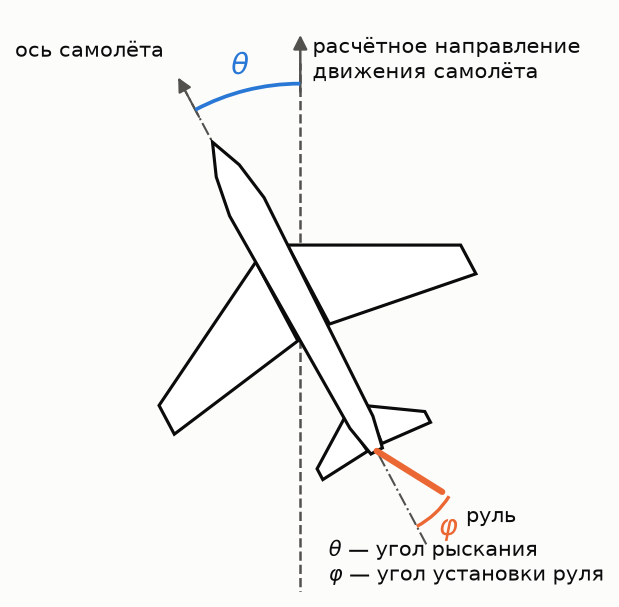

### Решение

1) Выделим управление и возмущение:
Разделим уравнение на $J$:
$$\ddot\theta(t) = -\dfrac{k_1}{J}\varphi(t) + \dfrac{1}{J}\omega_{\text{в}}(t) = b\,u(t) + w(t)$$
где $b = -\dfrac{k_1}{J}$, управление $u(t) = \varphi(t)$, возмущение $w(t) = \dfrac{\omega_{\text{в}}(t)}{J}$.

2) Переходим к системе Коши:
Переменные состояния $x_1 = \theta$, $x_2 = \dot\theta$, тогда $\dot x_1 = x_2$, $\dot x_2 = \ddot\theta$:
$$\begin{cases}\dot x_1 = x_2\\ \dot x_2 = b\,u(t) + w(t)\end{cases}$$
$$A = \begin{pmatrix}0 & 1\\ 0 & 0\end{pmatrix},\qquad B = \begin{pmatrix}0\\ b\end{pmatrix},\qquad G = \begin{pmatrix}0\\ 1\end{pmatrix}$$
$B$ — матрица управления, $G$ — матрица возмущений (шумов).

3) Формулы дискретной модели:
Управление и возмущение на шаге постоянны:
$$x(t_{k+1}) = \Phi(t_{k+1},t_k)\,x(t_k) + \Psi(t_{k+1},t_k)\,u(t_k) + \Gamma(t_{k+1},t_k)\,w(t_k)$$
$$\Psi(t_{k+1},t_k) = \int_{t_k}^{t_{k+1}}\Phi(t_{k+1},\tau)\,B\,d\tau,\qquad \Gamma(t_{k+1},t_k) = \int_{t_k}^{t_{k+1}}\Phi(t_{k+1},\tau)\,G\,d\tau$$
Здесь $\Phi(t,\tau) = e^{A(t-\tau)}$ — переходная матрица.

4) Собственные числа $A$:
$$\det(A - \lambda I) = \begin{vmatrix}-\lambda & 1\\ 0 & -\lambda\end{vmatrix} = \lambda^2 = 0$$
$\lambda = 0$, кратность 2.

5) Переходная матрица через интерполяционный многочлен:
$e^{A\delta} = r(A)$, $\delta = t - \tau$. Для кратного корня $\psi(\lambda) = \lambda^2$, $\psi_1(\lambda) = \dfrac{\psi(\lambda)}{\lambda^2} = 1$, $r(\lambda) = \alpha_{11} + \alpha_{12}\lambda$:
$$\alpha_{11} = \dfrac{1}{0!}\left[\dfrac{e^{\lambda\delta}}{1}\right]_{\lambda=0} = 1,\qquad \alpha_{12} = \dfrac{1}{1!}\left[\dfrac{e^{\lambda\delta}}{1}\right]'_{\lambda=0} = \delta e^{\lambda\delta}\Big|_{\lambda=0} = \delta$$
$$r(\lambda) = 1 + \delta\lambda \;\Rightarrow\; \Phi(t,\tau) = I + \delta A = \begin{pmatrix}1 & t-\tau\\ 0 & 1\end{pmatrix}$$

6) Матрица $\Psi$:
$$\Psi = \int_{t_k}^{t_{k+1}}\begin{pmatrix}1 & t_{k+1}-\tau\\ 0 & 1\end{pmatrix}\begin{pmatrix}0\\ b\end{pmatrix}d\tau = \int_{t_k}^{t_{k+1}}\begin{pmatrix}b(t_{k+1}-\tau)\\ b\end{pmatrix}d\tau$$
Замена $s = t_{k+1} - \tau$, $s$ меняется от 0 до $T$:
$$\Psi = \int_0^T\begin{pmatrix}bs\\ b\end{pmatrix}ds = \begin{pmatrix}\dfrac{bT^2}{2}\\ bT\end{pmatrix} = \dfrac{b}{2}\begin{pmatrix}T^2\\ 2T\end{pmatrix}$$

7) Матрица $\Gamma$:
То же с $G = \begin{pmatrix}0\\ 1\end{pmatrix}$, т. е. $b$ заменяется на 1:
$$\Gamma = \dfrac{1}{2}\begin{pmatrix}T^2\\ 2T\end{pmatrix}$$

8) Дискретная модель:
$$x(t_{k+1}) = \begin{pmatrix}1 & T\\ 0 & 1\end{pmatrix}x(t_k) + \begin{pmatrix}\dfrac{bT^2}{2}\\ bT\end{pmatrix}u(t_k) + \begin{pmatrix}\dfrac{T^2}{2}\\ T\end{pmatrix}w(t_k)$$

Ответ: $x(t_{k+1}) = \begin{pmatrix}1 & T\\ 0 & 1\end{pmatrix}x(t_k) + \begin{pmatrix}bT^2/2\\ bT\end{pmatrix}u(t_k) + \begin{pmatrix}T^2/2\\ T\end{pmatrix}w(t_k)$, $b = -\dfrac{k_1}{J}$

## Задача 2

### Условие

ДЗ к №1. Для дискретной модели самолёта из №1 построить графики $x_1(t_k)$ и $x_2(t_k)$ при $u(t_k) = 1$, $w(t_k) = 0$, $x(t_0) = \begin{pmatrix}1\\ -1\end{pmatrix}$, $t \in [0;\,5]$.

### Решение

1) Дискретная модель при $u = 1$, $w = 0$:
Из №1:
$$x_1(t_{k+1}) = x_1(t_k) + T\,x_2(t_k) + \dfrac{bT^2}{2},\qquad x_2(t_{k+1}) = x_2(t_k) + bT$$

2) Решаем рекуррентные соотношения:
$x_2$ за каждый шаг растёт на $bT$:
$$x_2(t_k) = -1 + bkT$$
Подставим в первое соотношение и просуммируем $k$ шагов:
$$x_1(t_k) = 1 + T\sum_{j=0}^{k-1}(-1 + bjT) + k\dfrac{bT^2}{2} = 1 - kT + \dfrac{bT^2k(k-1)}{2} + \dfrac{bT^2k}{2} = 1 - kT + \dfrac{b(kT)^2}{2}$$
Это значения непрерывного решения $x_1(t) = 1 - t + \dfrac{bt^2}{2}$, $x_2(t) = -1 + bt$ в моментах $t_k = kT$: при постоянном на шаге управлении дискретная модель точная.

3) Значения при $T = 1$, $b = 1$:
$t_k = 0, 1, 2, 3, 4, 5$:
$x_1 = 1;\ 0{,}5;\ 1;\ 2{,}5;\ 5;\ 8{,}5$, $x_2 = -1;\ 0;\ 1;\ 2;\ 3;\ 4$.

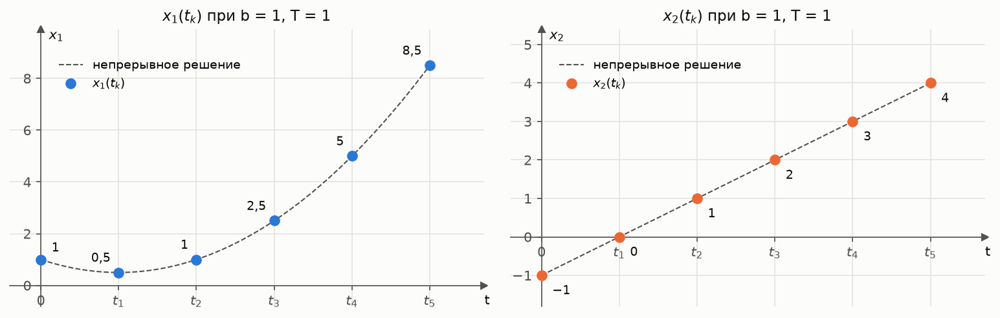

Примечание: в тетради это домашнее задание не решено — нарисованы только пустые оси $x_1$, $x_2$ с отметками $t_1, t_2, t_3$ (0, 1, 2, 3, …); $b$ не задано, поэтому для графиков взято $b = 1$.

Ответ: $x_1(t_k) = 1 - kT + \dfrac{b(kT)^2}{2}$, $x_2(t_k) = -1 + bkT$; при $b = 1$, $T = 1$: $x_1 = 1;\ 0{,}5;\ 1;\ 2{,}5;\ 5;\ 8{,}5$, $x_2 = -1;\ 0;\ 1;\ 2;\ 3;\ 4$

## Задача 3

### Условие

№2. Упрощённая модель управления космическим кораблём задана структурной схемой. $K_p = 1{,}65\cdot10^6$ — коэффициент усиления датчика положения, $K_r = 3{,}17\cdot10^5$ — коэффициент усиления датчика скорости, $J_{\text{д}} = 4{,}1822\cdot10^4$ — момент инерции корабля, $p$ — оператор дифференцирования ($\ddot y = p^2y$). Записать уравнения состояния и построить дискретную модель $x(t_{k+1}) = \Phi\,x(t_k) + \Psi\,u(t_k)$ с шагом $T$.

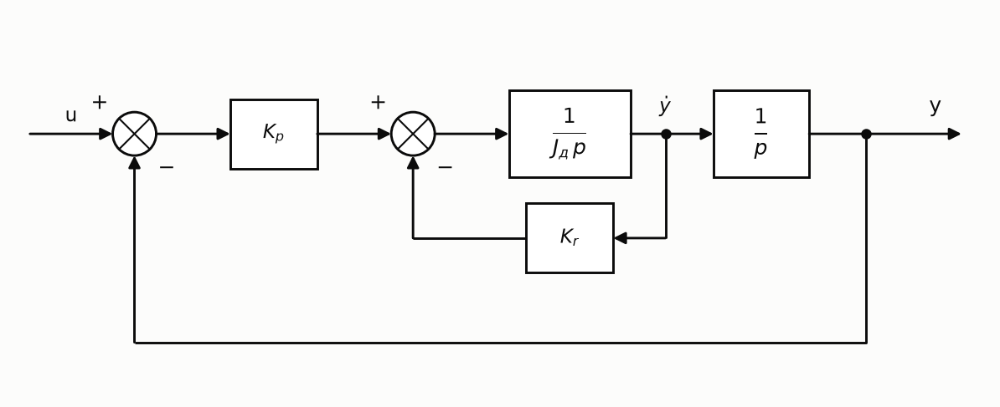

### Решение

1) Уравнение по схеме:
Выход звена $\dfrac{1}{J_{\text{д}}p}$ — скорость $\dot y$. На него действует $K_p(u - y)$ минус обратная связь $K_r\dot y$:
$$J_{\text{д}}\ddot y = K_p(u - y) - K_r\dot y \;\Rightarrow\; \ddot y + \dfrac{K_r}{J_{\text{д}}}\dot y + \dfrac{K_p}{J_{\text{д}}}y = \dfrac{K_p}{J_{\text{д}}}u$$

2) Уравнения состояния:
$x_1 = y$, $x_2 = \dot x_1 + \dfrac{K_r}{J_{\text{д}}}x_1$:
$$\begin{cases}\dot x_1 = -\dfrac{K_r}{J_{\text{д}}}x_1 + x_2\\ \dot x_2 = -\dfrac{K_p}{J_{\text{д}}}x_1 + \dfrac{K_p}{J_{\text{д}}}u\end{cases}$$

3) Числовые матрицы:
$\dfrac{K_r}{J_{\text{д}}} = \dfrac{3{,}17\cdot10^5}{4{,}1822\cdot10^4} \approx 7{,}58$, $\dfrac{K_p}{J_{\text{д}}} = \dfrac{1{,}65\cdot10^6}{4{,}1822\cdot10^4} \approx 39{,}45$:
$$A = \begin{pmatrix}-7{,}58 & 1\\ -39{,}45 & 0\end{pmatrix},\qquad B = \begin{pmatrix}0\\ 39{,}45\end{pmatrix}$$

4) Собственные числа:
$$\det(A - \lambda I) = \begin{vmatrix}-7{,}58 - \lambda & 1\\ -39{,}45 & -\lambda\end{vmatrix} = \lambda^2 + 7{,}58\lambda + 39{,}45 = 0$$
$$\lambda_{1,2} = \dfrac{-7{,}58 \pm 10{,}02i}{2} \approx -3{,}79 \pm 5{,}01i$$
Обозначим $\alpha = 3{,}79$, $\omega = 5{,}01$ (в тетради округлено до 5); $\alpha^2 + \omega^2 = \lambda_1\lambda_2 = 39{,}45$.

5) Формула Сильвестра:
Корни простые: $f(A) = f(\lambda_1)Z_{11} + f(\lambda_2)Z_{21}$. Подставим $f(\lambda) = \lambda - \lambda_1$ и $f(\lambda) = \lambda - \lambda_2$:
$$(\lambda_2 - \lambda_1)Z_{21} = A - \lambda_1I,\qquad (\lambda_1 - \lambda_2)Z_{11} = A - \lambda_2I$$
$\lambda_1 - \lambda_2 = 2\omega i \approx 10i$:
$$Z_{11} = \dfrac{1}{2\omega i}\begin{pmatrix}-\alpha + \omega i & 1\\ -39{,}45 & \alpha + \omega i\end{pmatrix},\qquad Z_{21} = -\dfrac{1}{2\omega i}\begin{pmatrix}-\alpha - \omega i & 1\\ -39{,}45 & \alpha - \omega i\end{pmatrix}$$

6) Переходная матрица:
$f(\lambda) = e^{\lambda\delta}$, $\delta = t - \tau$:
$$\Phi(t,\tau) = e^{(-\alpha + \omega i)\delta}Z_{11} + e^{(-\alpha - \omega i)\delta}Z_{21}$$
Собираем по формулам Эйлера $\dfrac{e^{i\omega\delta} - e^{-i\omega\delta}}{2i} = \sin\omega\delta$, $\dfrac{e^{i\omega\delta} + e^{-i\omega\delta}}{2} = \cos\omega\delta$:
$$\Phi(t,\tau) = e^{-\alpha\delta}\begin{pmatrix}\cos\omega\delta - \dfrac{\alpha}{\omega}\sin\omega\delta & \dfrac{1}{\omega}\sin\omega\delta\\ -\dfrac{39{,}45}{\omega}\sin\omega\delta & \cos\omega\delta + \dfrac{\alpha}{\omega}\sin\omega\delta\end{pmatrix}$$
Численно $\dfrac{\alpha}{\omega} \approx 0{,}757$, $\dfrac{1}{\omega} \approx 0{,}2$, $\dfrac{39{,}45}{\omega} \approx 7{,}88$.

7) Матрица $\Psi$:
$$\Psi(t_{k+1},t_k) = \int_{t_k}^{t_{k+1}}\Phi(t_{k+1},\tau)B\,d\tau = 39{,}45\int_0^T\begin{pmatrix}\Phi_{12}(\delta)\\ \Phi_{22}(\delta)\end{pmatrix}d\delta$$
Интегралы с экспонентой:
$$\int_0^T e^{-\alpha\delta}\sin\omega\delta\,d\delta = \dfrac{\omega - e^{-\alpha T}(\alpha\sin\omega T + \omega\cos\omega T)}{\alpha^2 + \omega^2}$$
$$\int_0^T e^{-\alpha\delta}\cos\omega\delta\,d\delta = \dfrac{\alpha + e^{-\alpha T}(\omega\sin\omega T - \alpha\cos\omega T)}{\alpha^2 + \omega^2}$$
Так как $\alpha^2 + \omega^2 = 39{,}45$, множитель 39,45 сокращается:
$$\Psi = \begin{pmatrix}1 - e^{-\alpha T}\left(\cos\omega T + \dfrac{\alpha}{\omega}\sin\omega T\right)\\ 2\alpha - e^{-\alpha T}\left(2\alpha\cos\omega T - \dfrac{\omega^2 - \alpha^2}{\omega}\sin\omega T\right)\end{pmatrix} \approx \begin{pmatrix}1 - e^{-3{,}79T}(\cos 5{,}01T + 0{,}757\sin 5{,}01T)\\ 7{,}58 - e^{-3{,}79T}(7{,}58\cos 5{,}01T - 2{,}14\sin 5{,}01T)\end{pmatrix}$$
Проверка: при $T \to \infty$ $\Psi \to \begin{pmatrix}1\\ 7{,}58\end{pmatrix}$ — установившееся состояние при $u = 1$: $y = 1$ (статический коэффициент 1), $x_2 = 7{,}58x_1$.

8) Дискретная модель:
$$x(t_{k+1}) = \Phi(T)\,x(t_k) + \Psi(T)\,u(t_k)$$
$$\Phi(T) = e^{-3{,}79T}\begin{pmatrix}\cos 5{,}01T - 0{,}757\sin 5{,}01T & 0{,}2\sin 5{,}01T\\ -7{,}88\sin 5{,}01T & \cos 5{,}01T + 0{,}757\sin 5{,}01T\end{pmatrix}$$
Например, при $T = 0{,}1$: $\Phi \approx \begin{pmatrix}0{,}352 & 0{,}066\\ -2{,}589 & 0{,}849\end{pmatrix}$, $\Psi \approx \begin{pmatrix}0{,}151\\ 3{,}732\end{pmatrix}$ (совпадает с численным $e^{AT}$).

Примечание: в тетради при интегрировании $\Phi(t_{k+1},\tau)B$ потерян множитель $e^{-3{,}79(t_{k+1}-\tau)}$; там получено $\Psi = \begin{pmatrix}1{,}578(1 - \cos 5T)\\ 4{,}58(1 - \cos 5T) + 7{,}89\sin 5T\end{pmatrix}$ (к тому же без экспоненты коэффициент был бы $\frac{3{,}79\cdot39{,}45}{25} \approx 5{,}98$, а не 4,58), и в матрице $\Phi(T)$ итоговой модели тоже нет множителя $e^{-3{,}79T}$.

Ответ: $x(t_{k+1}) = e^{-3{,}79T}\begin{pmatrix}\cos 5{,}01T - 0{,}757\sin 5{,}01T & 0{,}2\sin 5{,}01T\\ -7{,}88\sin 5{,}01T & \cos 5{,}01T + 0{,}757\sin 5{,}01T\end{pmatrix}x(t_k) + \begin{pmatrix}1 - e^{-3{,}79T}(\cos 5{,}01T + 0{,}757\sin 5{,}01T)\\ 7{,}58 - e^{-3{,}79T}(7{,}58\cos 5{,}01T - 2{,}14\sin 5{,}01T)\end{pmatrix}u(t_k)$

# Практика. Управляемость и наблюдаемость

## Задача 1

### Условие

№1. Исследовать управляемость системы
$$\begin{cases}\dot x_1 = x_2\\ \dot x_2 = -x_1 + u\end{cases}$$

### Решение

1) Матрицы системы:
$$A = \begin{pmatrix}0 & 1\\ -1 & 0\end{pmatrix},\qquad B = \begin{pmatrix}0\\ 1\end{pmatrix},\qquad n = 2$$

2) Критерий управляемости:
Система (пара $A$, $B$) полностью управляема тогда и только тогда, когда матрица управляемости $Q = \left[B \mid AB \mid A^2B \mid \dots \mid A^{n-1}B\right]$ имеет $\mathrm{rank}\,Q = n$. При $0 < \mathrm{rank}\,Q < n$ система частично управляема, при $\mathrm{rank}\,Q = 0$ — полностью неуправляема.

3) Матрица управляемости:
$$AB = \begin{pmatrix}0 & 1\\ -1 & 0\end{pmatrix}\begin{pmatrix}0\\ 1\end{pmatrix} = \begin{pmatrix}1\\ 0\end{pmatrix},\qquad Q = \begin{pmatrix}0 & 1\\ 1 & 0\end{pmatrix}$$
$\det Q = -1 \ne 0$, значит $\mathrm{rank}\,Q = 2 = n$.

Ответ: $\mathrm{rank}\,Q = 2 = n$ — система полностью управляема

## Задача 2

### Условие

№2. Исследовать управляемость системы
$$\begin{cases}\dot x_1 = x_1\\ \dot x_2 = -x_2 - u\\ \dot x_3 = -2x_3 + u\end{cases}$$

### Решение

1) Матрицы системы:
$$A = \begin{pmatrix}1 & 0 & 0\\ 0 & -1 & 0\\ 0 & 0 & -2\end{pmatrix},\qquad B = \begin{pmatrix}0\\ -1\\ 1\end{pmatrix},\qquad n = 3$$

2) Столбцы матрицы управляемости:
$$AB = \begin{pmatrix}0\\ 1\\ -2\end{pmatrix},\qquad A^2 = \begin{pmatrix}1 & 0 & 0\\ 0 & 1 & 0\\ 0 & 0 & 4\end{pmatrix},\qquad A^2B = \begin{pmatrix}0\\ -1\\ 4\end{pmatrix}$$

3) Ранг $Q = [B \mid AB \mid A^2B]$:
$$Q = \begin{pmatrix}0 & 0 & 0\\ -1 & 1 & -1\\ 1 & -2 & 4\end{pmatrix}$$
Первая строка нулевая, поэтому $\mathrm{rank}\,Q \le 2$. Минор из 2-й и 3-й строк, 1-го и 2-го столбцов: $(-1)(-2) - 1\cdot1 = 1 \ne 0$, значит $\mathrm{rank}\,Q = 2 < n = 3$.
На $x_1$ управление не действует: $\dot x_1 = x_1$ не содержит $u$ и не связано с $x_2$, $x_3$.

Ответ: $\mathrm{rank}\,Q = 2 < 3$ — система частично управляема

## Задача 3

### Условие

№3. Исследовать управляемость и наблюдаемость системы
$$\begin{cases}\dot x_1 = -3x_2\\ \dot x_2 = u\end{cases},\qquad y = x_2$$

### Решение

1) Матрицы системы:
$$A = \begin{pmatrix}0 & -3\\ 0 & 0\end{pmatrix},\qquad B = \begin{pmatrix}0\\ 1\end{pmatrix},\qquad C = \begin{pmatrix}0 & 1\end{pmatrix},\qquad C^T = \begin{pmatrix}0\\ 1\end{pmatrix}$$

2) Управляемость:
$$AB = \begin{pmatrix}-3\\ 0\end{pmatrix},\qquad Q = [B \mid AB] = \begin{pmatrix}0 & -3\\ 1 & 0\end{pmatrix}$$
$\det Q = 3 \ne 0$, $\mathrm{rank}\,Q = 2 = n$ — полностью управляема.

3) Критерий наблюдаемости:
Пара $(A, C)$ полностью наблюдаема тогда и только тогда, когда матрица наблюдаемости $N = \left[C^T \mid A^TC^T \mid \dots \mid (A^T)^{n-1}C^T\right]$ имеет $\mathrm{rank}\,N = n$; при $0 < \mathrm{rank}\,N < n$ — частично наблюдаема, при $\mathrm{rank}\,N = 0$ — полностью ненаблюдаема.

4) Наблюдаемость:
$$A^T = \begin{pmatrix}0 & 0\\ -3 & 0\end{pmatrix},\qquad A^TC^T = \begin{pmatrix}0\\ 0\end{pmatrix},\qquad N = \begin{pmatrix}0 & 0\\ 1 & 0\end{pmatrix}$$
$\mathrm{rank}\,N = 1 < 2$ — частично наблюдаема: выход $y = x_2$ и уравнение $\dot x_2 = u$ не содержат $x_1$, поэтому $x_1$ по выходу не восстановить.

Примечание: в тетради решение не закончено — найдены только $A^T$ и $AB$; выводы о рангах $Q$ и $N$ добавлены.

Ответ: $\mathrm{rank}\,Q = 2$ — полностью управляема; $\mathrm{rank}\,N = 1$ — частично наблюдаема

# Практика. Статистическая линеаризация

## Задача 1

### Условие

№11.1. Выполнить статистическую линеаризацию нелинейного элемента $y = f(u) = a_1u + a_3u^3$ ($a_1 > 0$), на вход которого подаётся нормальный случайный сигнал с нулевым математическим ожиданием и плотностью $p(u) = \dfrac{1}{\sqrt{2\pi}\,\sigma_u}e^{-\frac{u^2}{2\sigma_u^2}}$: найти $m_y$ и коэффициент усиления по случайной составляющей первым способом ($k_s$) и вторым способом ($k_v$).

### Решение

1) Моменты нормального распределения:
$m_u = 0$; центральные моменты $\mu_k = M\left[(u - m_u)^k\right]$: $\mu_{2k} = 1\cdot3\cdot\ldots\cdot(2k-1)\,\sigma_u^{2k}$, $\mu_{2k+1} = 0$. Нужны
$$\int_{-\infty}^{\infty}u^2p(u)\,du = \sigma_u^2,\qquad \int_{-\infty}^{\infty}u^4p(u)\,du = 3\sigma_u^4,\qquad \int_{-\infty}^{\infty}u^6p(u)\,du = 15\sigma_u^6$$

2) Математическое ожидание выхода:
$$m_y = \int_{-\infty}^{\infty}(a_1u + a_3u^3)\,p(u)\,du = a_1\int_{-\infty}^{\infty}u\,p(u)\,du + a_3\int_{-\infty}^{\infty}u^3p(u)\,du = 0$$
Нечётные моменты равны нулю.

3) Первый способ — равенство дисперсий:
$$k_s = \pm\dfrac{1}{\sigma_u}\left[\int_{-\infty}^{\infty}f^2(u)\,p(u)\,du - m_y^2\right]^{1/2},\qquad f^2(u) = a_1^2u^2 + 2a_1a_3u^4 + a_3^2u^6$$
$$k_s = \pm\dfrac{1}{\sigma_u}\left[a_1^2\sigma_u^2 + 2a_1a_3\cdot3\sigma_u^4 + a_3^2\cdot15\sigma_u^6\right]^{1/2} = \pm\left[a_1^2 + 6a_1a_3\sigma_u^2 + 15a_3^2\sigma_u^4\right]^{1/2}$$
Знак: $\mathrm{sign}\,k_s = \mathrm{sign}\left(\dfrac{dy}{du}\right)\Big|_{u=m_u=0} = \mathrm{sign}\,a_1 = +$.

4) Второй способ — минимум среднеквадратичной ошибки:
Из условия $M\left[(y - \tilde y)^2\right] \to \min$:
$$k_v = \dfrac{1}{\sigma_u^2}\int_{-\infty}^{\infty}(u - m_u)f(u)\,p(u)\,du = \dfrac{1}{\sigma_u^2}\int_{-\infty}^{\infty}(a_1u^2 + a_3u^4)\,p(u)\,du = \dfrac{a_1\sigma_u^2 + 3a_3\sigma_u^4}{\sigma_u^2} = a_1 + 3a_3\sigma_u^2$$

Примечание: в тетради в итоговой формуле для $k_s$ записано $15a_3^2\sigma^3$ — должно быть $15a_3^2\sigma_u^4$ (из $\dfrac{15a_3^2\sigma_u^6}{\sigma_u^2}$).

Ответ: $m_y = 0$, $k_s = \sqrt{a_1^2 + 6a_1a_3\sigma_u^2 + 15a_3^2\sigma_u^4}$, $k_v = a_1 + 3a_3\sigma_u^2$

## Задача 2

### Условие

№11.2. Выполнить статистическую линеаризацию идеального реле $y = l\cdot\mathrm{sign}\,x$ при нормальном входном сигнале $x$ с математическим ожиданием $m_x$ и средним квадратичным отклонением $\sigma_x$: найти $m_y$, $k_s$ (первый способ) и $k_v$ (второй способ). Ответ выразить через функцию Лапласа $\Phi(z) = \dfrac{1}{\sqrt{2\pi}}\int_0^z e^{-\frac{t^2}{2}}dt$.

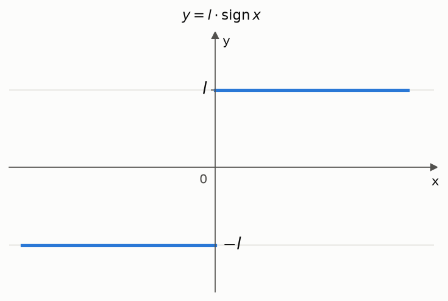

### Решение

1) Математическое ожидание выхода:
$$m_y = k_m m_x = \int_{-\infty}^{\infty}f(x)\,p(x)\,dx = -l\int_{-\infty}^{0}p(x)\,dx + l\int_0^{\infty}p(x)\,dx,\qquad p(x) = \dfrac{1}{\sqrt{2\pi}\,\sigma_x}e^{-\frac{(x - m_x)^2}{2\sigma_x^2}}$$

2) Замена $x - m_x = t\sigma_x$:
$dx = \sigma_x\,dt$, точке $x = 0$ соответствует $t = -\dfrac{m_x}{\sigma_x}$:
$$m_y = \dfrac{l}{\sqrt{2\pi}}\left[-\int_{-\infty}^{-m_x/\sigma_x}e^{-\frac{t^2}{2}}dt + \int_{-m_x/\sigma_x}^{\infty}e^{-\frac{t^2}{2}}dt\right]$$

3) Через функцию Лапласа:
При $z = \dfrac{m_x}{\sigma_x}$: $\dfrac{1}{\sqrt{2\pi}}\int_{-\infty}^{-z}e^{-\frac{t^2}{2}}dt = \dfrac{1}{2} - \Phi(z)$, $\dfrac{1}{\sqrt{2\pi}}\int_{-z}^{\infty}e^{-\frac{t^2}{2}}dt = \dfrac{1}{2} + \Phi(z)$:
$$m_y = l\left[-\dfrac{1}{2} + \Phi(z) + \dfrac{1}{2} + \Phi(z)\right] = 2l\,\Phi\!\left(\dfrac{m_x}{\sigma_x}\right),\qquad k_m = \dfrac{2l}{m_x}\Phi\!\left(\dfrac{m_x}{\sigma_x}\right)$$
Проверка: при $m_x \gg \sigma_x$ почти всегда $x > 0$, и $m_y \to 2l\cdot\dfrac{1}{2} = l$.

4) Первый способ:
$f^2(x) = l^2$, а $\int_{-\infty}^{\infty}p(x)\,dx = 1$:
$$k_s = \dfrac{1}{\sigma_x}\left[l^2\int_{-\infty}^{\infty}p(x)\,dx - m_y^2\right]^{1/2} = \dfrac{1}{\sigma_x}\sqrt{l^2 - \left(2l\,\Phi\!\left(\dfrac{m_x}{\sigma_x}\right)\right)^2}$$
Знак «+»: характеристика неубывающая.

5) Второй способ:
$$k_v = \dfrac{1}{\sigma_x^2}\int_{-\infty}^{\infty}(x - m_x)f(x)\,p(x)\,dx = \dfrac{l}{\sigma_x^2}\left[-\int_{-\infty}^{0}(x - m_x)p(x)\,dx + \int_0^{\infty}(x - m_x)p(x)\,dx\right]$$
После той же замены $(x - m_x)p(x)\,dx = \dfrac{\sigma_x}{\sqrt{2\pi}}\,t\,e^{-\frac{t^2}{2}}dt$:
$$k_v = \dfrac{l}{\sigma_x\sqrt{2\pi}}\left[-\int_{-\infty}^{-m_x/\sigma_x}t\,e^{-\frac{t^2}{2}}dt + \int_{-m_x/\sigma_x}^{\infty}t\,e^{-\frac{t^2}{2}}dt\right]$$
Так как $\int t\,e^{-\frac{t^2}{2}}dt = -e^{-\frac{t^2}{2}}$, первый интеграл равен $-e^{-\frac{m_x^2}{2\sigma_x^2}}$, второй $e^{-\frac{m_x^2}{2\sigma_x^2}}$:
$$k_v = \dfrac{2l}{\sigma_x\sqrt{2\pi}}e^{-\frac{m_x^2}{2\sigma_x^2}}$$

Примечание: в тетради получено $m_y = 2l\,\Phi\!\left(-\dfrac{m_x}{\sigma}\right)$ — знак аргумента неверный (при $m_x > 0$ реле чаще выдаёт $+l$, и $m_y > 0$); в формуле $k_s$ в тетради уже стоит $\Phi\!\left(\dfrac{m_x}{\sigma}\right)$. Кроме того, рядом с $\Phi(z)$ в тетради записано $\dfrac{2}{\sqrt\pi}\int_0^z e^{-t^2}dt$ — это другая функция ($\mathrm{erf}\,z = 2\Phi(z\sqrt2)$); в решении используется $\Phi(z) = \dfrac{1}{\sqrt{2\pi}}\int_0^z e^{-\frac{t^2}{2}}dt$.

Ответ: $m_y = 2l\,\Phi\!\left(\dfrac{m_x}{\sigma_x}\right)$, $k_s = \dfrac{1}{\sigma_x}\sqrt{l^2 - m_y^2}$, $k_v = \dfrac{2l}{\sigma_x\sqrt{2\pi}}e^{-\frac{m_x^2}{2\sigma_x^2}}$

# Практика. Гармоническая линеаризация

## Задача 1

### Условие

№12.1. Выполнить гармоническую линеаризацию нелинейного элемента $y = \ddot u - \varepsilon(1 - u^2)\dot u + u$ при входе $u(t) = U\sin\omega t$: найти коэффициенты $X(U,\omega)$ и $Y(U,\omega)$ в зависимости $\hat y = X\,u + \dfrac{Y}{\omega}\dot u$.

### Решение

1) Метод:
Выход раскладываем в ряд Фурье и оставляем первую гармонику: $\hat y = A_0 + A_1\cos\omega t + B_1\sin\omega t = A_0 + X\,u + \dfrac{Y}{\omega}\dot u$, так как $U\sin\omega t = u$, $U\cos\omega t = \dfrac{\dot u}{\omega}$. Гармоники $3\omega$ и выше отбрасываем.

2) Производные входа:
$$u = U\sin\omega t,\qquad \dot u = U\omega\cos\omega t,\qquad \ddot u = -U\omega^2\sin\omega t$$

3) Подставим в уравнение элемента:
$$y = -\omega^2U\sin\omega t - \varepsilon\left(1 - U^2\sin^2\omega t\right)\omega U\cos\omega t + U\sin\omega t$$

4) Понижаем степень:
$\sin^2\omega t = \dfrac{1 - \cos2\omega t}{2}$:
$$y = -\omega^2U\sin\omega t - \varepsilon\left(1 - \dfrac{U^2}{2} + \dfrac{U^2}{2}\cos2\omega t\right)\omega U\cos\omega t + U\sin\omega t$$
$$y = -\omega^2U\sin\omega t - \varepsilon\omega U\cos\omega t + \dfrac{\varepsilon\omega U^3}{2}\cos\omega t - \dfrac{\varepsilon\omega U^3}{2}\cos2\omega t\cos\omega t + U\sin\omega t$$

5) Произведение косинусов:
$\cos2\omega t\cos\omega t = \dfrac{1}{2}\left(\cos\omega t + \cos3\omega t\right)$:
$$y = \sin\omega t\left[U - \omega^2U\right] + \cos\omega t\left[\dfrac{\varepsilon\omega U^3}{4} - \varepsilon\omega U\right] - \dfrac{\varepsilon\omega U^3}{4}\cos3\omega t$$

6) Отбрасываем третью гармонику:
$$\hat y = u\left[1 - \omega^2\right] + \dfrac{\dot u}{\omega}\left[\dfrac{\varepsilon\omega U^2}{4} - \varepsilon\omega\right]$$
$A_0 = 0$, $X = 1 - \omega^2$, $Y = \varepsilon\omega\left(\dfrac{U^2}{4} - 1\right)$.

Ответ: $X = 1 - \omega^2$, $Y = \varepsilon\omega\left(\dfrac{U^2}{4} - 1\right)$, т. е. $\hat y = (1 - \omega^2)u + \varepsilon\left(\dfrac{U^2}{4} - 1\right)\dot u$

## Задача 2

### Условие

№12.2. Выполнить гармоническую линеаризацию нелинейного элемента (однополупериодного выпрямителя)
$$y = f(u) = \begin{cases}u, & u \ge 0\\ 0, & u < 0\end{cases}$$
при входе $u = U\sin\omega t$.

### Решение

1) Выход за период:
$\tau = \omega t$. На $[0, \pi]$ вход $u \ge 0$ и $y = U\sin\tau$, на $[\pi, 2\pi]$ $y = 0$.

![Характеристика y = f(u) и вход u = U sin ωt, на отрезке [0, π] выход y = u (заштриховано)](mmus-tasks/pr3-05.png)

2) Коэффициенты ряда Фурье:
$$A_0 = \dfrac{1}{2\pi}\int_0^{2\pi}f(U\sin\tau)\,d\tau,\qquad A_1 = \dfrac{1}{\pi}\int_0^{2\pi}f(U\sin\tau)\cos\tau\,d\tau,\qquad B_1 = \dfrac{1}{\pi}\int_0^{2\pi}f(U\sin\tau)\sin\tau\,d\tau$$
$\hat y = A_0 + X u + \dfrac{Y}{\omega}\dot u$, где $X = \dfrac{B_1}{U}$, $Y = \dfrac{A_1}{U}$.

3) Постоянная составляющая:
$$A_0 = \dfrac{1}{2\pi}\int_0^{\pi}U\sin\tau\,d\tau = \dfrac{U}{2\pi}\left(-\cos\pi + \cos0\right) = \dfrac{U}{\pi}$$

4) Первая гармоника:
$$A_1 = \dfrac{U}{\pi}\int_0^{\pi}\sin\tau\cos\tau\,d\tau = \dfrac{U}{2\pi}\int_0^{\pi}\sin2\tau\,d\tau = 0$$
$$B_1 = \dfrac{U}{\pi}\int_0^{\pi}\sin^2\tau\,d\tau = \dfrac{U}{\pi}\int_0^{\pi}\dfrac{1 - \cos2\tau}{2}\,d\tau = \dfrac{U}{\pi}\cdot\dfrac{\pi}{2} = \dfrac{U}{2}$$

5) Линеаризованная зависимость:
$$\hat y(t) = \dfrac{U}{\pi} + \dfrac{U}{2}\sin\omega t = \dfrac{U}{\pi} + \dfrac{1}{2}u + 0\cdot\dot u$$
$X = \dfrac{1}{2}$, $Y = 0$.

Ответ: $\hat y = \dfrac{U}{\pi} + \dfrac{1}{2}u$; $X = \dfrac{1}{2}$, $Y = 0$

## Задача 3

### Условие

№12.3 а). Выполнить гармоническую линеаризацию реле с зоной нечувствительности: $y = 1$ при $u \ge 1$, $y = 0$ при $|u| < 1$, $y = -1$ при $u \le -1$; вход $u = U\sin\omega t$, $U > 1$.

### Решение

1) Интервалы срабатывания реле:
$\tau = \omega t$. Реле срабатывает, когда $|U\sin\tau| \ge 1$. Из $U\sin\alpha = 1$: $\alpha = \arcsin\dfrac{1}{U}$. Выход $y = 1$ при $\tau \in [\alpha,\ \pi - \alpha]$, $y = -1$ при $\tau \in [\pi + \alpha,\ 2\pi - \alpha]$, иначе $y = 0$.

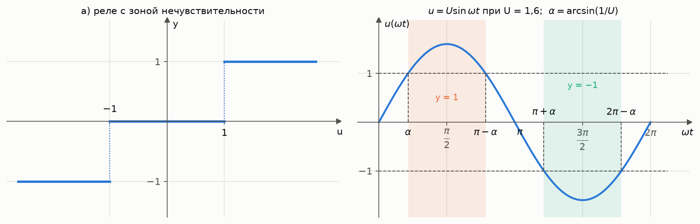

2) Постоянная составляющая:
$$A_0 = \dfrac{1}{2\pi}\left[\int_\alpha^{\pi-\alpha}d\tau - \int_{\pi+\alpha}^{2\pi-\alpha}d\tau\right] = \dfrac{1}{2\pi}\left[\pi - \alpha - \alpha - 2\pi + \alpha + \pi + \alpha\right] = 0$$

3) Коэффициент $A_1$:
$$A_1 = \dfrac{1}{\pi}\left[\int_\alpha^{\pi-\alpha}\cos\tau\,d\tau - \int_{\pi+\alpha}^{2\pi-\alpha}\cos\tau\,d\tau\right] = \dfrac{1}{\pi}\left[\sin(\pi - \alpha) - \sin\alpha - \sin(2\pi - \alpha) + \sin(\pi + \alpha)\right]$$
$\sin(\pi - \alpha) = \sin\alpha$, $\sin(2\pi - \alpha) = -\sin\alpha$, $\sin(\pi + \alpha) = -\sin\alpha$:
$$A_1 = \dfrac{1}{\pi}\left[\sin\alpha - \sin\alpha + \sin\alpha - \sin\alpha\right] = 0$$

4) Коэффициент $B_1$:
$$B_1 = \dfrac{1}{\pi}\left[\int_\alpha^{\pi-\alpha}\sin\tau\,d\tau - \int_{\pi+\alpha}^{2\pi-\alpha}\sin\tau\,d\tau\right] = -\dfrac{1}{\pi}\left[\cos(\pi - \alpha) - \cos\alpha - \cos(2\pi - \alpha) + \cos(\pi + \alpha)\right]$$
$\cos(\pi - \alpha) = -\cos\alpha$, $\cos(2\pi - \alpha) = \cos\alpha$, $\cos(\pi + \alpha) = -\cos\alpha$:
$$B_1 = -\dfrac{1}{\pi}\left[-4\cos\alpha\right] = \dfrac{4}{\pi}\cos\alpha$$

5) Выразим через амплитуду:
$\sin\alpha = \dfrac{1}{U}$, $\cos(\arcsin x) = \sqrt{1 - x^2}$:
$$B_1 = \dfrac{4}{\pi}\cos\left(\arcsin\dfrac{1}{U}\right) = \dfrac{4}{\pi}\sqrt{1 - \dfrac{1}{U^2}}$$

6) Линеаризованная зависимость:
$$\hat y(t) = \dfrac{4}{\pi}\sqrt{1 - \dfrac{1}{U^2}}\,\sin\omega t = \dfrac{4}{\pi U}\sqrt{1 - \dfrac{1}{U^2}}\cdot u + 0\cdot\dot u$$
При $U < 1$ реле не срабатывает, $y \equiv 0$ и $X = 0$.

Ответ: $X = \dfrac{4}{\pi U}\sqrt{1 - \dfrac{1}{U^2}}$, $Y = 0$

# Практика. Линеаризация относительно положения равновесия

## Задача 1

### Условие

№12.4. Линеаризовать относительно положения равновесия систему
$$\begin{cases}\dot V(t) = F_1(t) + F_2(t) - k\sqrt{\dfrac{V(t)}{S}}\\ \dot C(t) = \dfrac{c_1 - C(t)}{V(t)}F_1(t) + \dfrac{c_2 - C(t)}{V(t)}F_2(t)\end{cases}$$
Переменные состояния $x_1 = V$, $x_2 = C$, управления $u_1 = F_1$, $u_2 = F_2$.

### Решение

1) Отклонения от равновесия:
$$V = V_e + \xi_1,\qquad C = C_e + \xi_2,\qquad F_1 = F_{1e} + \mu_1,\qquad F_2 = F_{2e} + \mu_2$$
В равновесии $f(x_e, u_e) = 0$. Линеаризованная система: $\dot\xi = A\xi + B\mu$, где $A = \dfrac{\partial f}{\partial x}\Big|_{e}$, $B = \dfrac{\partial f}{\partial u}\Big|_{e}$.

2) Положение равновесия:
$$\begin{cases}F_{1e} + F_{2e} - k\sqrt{\dfrac{V_e}{S}} = 0\\ \dfrac{c_1 - C_e}{V_e}F_{1e} + \dfrac{c_2 - C_e}{V_e}F_{2e} = 0\end{cases}$$
Из второго: $(c_1 - C_e)F_{1e} + (c_2 - C_e)F_{2e} = 0$, т. е. $c_1F_{1e} - C_eF_{1e} + c_2F_{2e} - C_eF_{2e} = 0$:
$$C_e = \dfrac{c_1F_{1e} + c_2F_{2e}}{F_{1e} + F_{2e}}$$
Из первого: $k^2\dfrac{V_e}{S} = (F_{1e} + F_{2e})^2$:
$$V_e = \dfrac{S(F_{1e} + F_{2e})^2}{k^2}$$

3) Матрица $A$:
$$A = \begin{pmatrix}-\dfrac{k}{2\sqrt{S}\sqrt{V}} & 0\\ \dfrac{(C - c_1)F_1 + (C - c_2)F_2}{V^2} & -\dfrac{F_1 + F_2}{V}\end{pmatrix}_{V = V_e,\ C = C_e}$$

4) Упростим с учётом равновесия:
$a_{21}$: $(C_e - c_1)F_{1e} + (C_e - c_2)F_{2e} = C_e(F_{1e} + F_{2e}) - (c_1F_{1e} + c_2F_{2e}) = 0$.
$a_{22}$: $F_{1e} + F_{2e} = k\sqrt{\dfrac{V_e}{S}}$, поэтому $-\dfrac{F_{1e} + F_{2e}}{V_e} = -\dfrac{k}{\sqrt{S}\sqrt{V_e}}$:
$$A = \begin{pmatrix}-\dfrac{k}{2\sqrt{S}\sqrt{V_e}} & 0\\ 0 & -\dfrac{k}{\sqrt{S}\sqrt{V_e}}\end{pmatrix}$$

5) Матрица $B$:
$$B = \begin{pmatrix}1 & 1\\ \dfrac{c_1 - C_e}{V_e} & \dfrac{c_2 - C_e}{V_e}\end{pmatrix}$$

6) Линеаризованная модель:
$$\begin{cases}\dot\xi_1 = -\dfrac{k}{2\sqrt{S}\sqrt{V_e}}\,\xi_1(t) + \mu_1(t) + \mu_2(t)\\ \dot\xi_2 = -\dfrac{k}{\sqrt{S}\sqrt{V_e}}\,\xi_2(t) + \dfrac{c_1 - C_e}{V_e}\mu_1(t) + \dfrac{c_2 - C_e}{V_e}\mu_2(t)\end{cases}$$

Примечание: в тетради в промежуточной записи матрицы $A$ у элемента $a_{11}$ потерян знак минус ($\dfrac{k}{2\sqrt S}\cdot\dfrac{1}{\sqrt{V_e}}$); в итоговых уравнениях знак верный.

Ответ: $\dot\xi_1 = -\dfrac{k}{2\sqrt{SV_e}}\xi_1 + \mu_1 + \mu_2$, $\dot\xi_2 = -\dfrac{k}{\sqrt{SV_e}}\xi_2 + \dfrac{c_1 - C_e}{V_e}\mu_1 + \dfrac{c_2 - C_e}{V_e}\mu_2$, где $C_e = \dfrac{c_1F_{1e} + c_2F_{2e}}{F_{1e} + F_{2e}}$, $V_e = \dfrac{S(F_{1e} + F_{2e})^2}{k^2}$

## Задача 2

### Условие

№12.6. Линеаризовать относительно положения равновесия уравнение
$$m\dfrac{d^2l}{dt^2} + k_v\dfrac{dl}{dt} + k_cl^3 = k\omega,$$
где $l(t)$ — выходная переменная, $\omega(t)$ — входное воздействие.

### Решение

1) Отклонения от равновесия:
$$l(t) = l_e + \xi(t),\qquad \omega(t) = \omega_e + \mu(t)$$
$l_e$, $\omega_e$ — постоянные, поэтому $\dot l = \dot\xi$, $\ddot l = \ddot\xi$.

2) Подставим в уравнение:
$(l_e + \xi)^3 = l_e^3 + 3l_e^2\xi + 3l_e\xi^2 + \xi^3$:
$$m\ddot\xi(t) + k_v\dot\xi(t) + k_cl_e^3 + 3k_cl_e^2\xi(t) + 3k_cl_e\xi^2(t) + k_c\xi^3(t) = k\omega_e + k\mu(t)$$

3) Группируем слагаемые:
$$\left(k_cl_e^3 - k\omega_e\right) + \left(3k_cl_e^2\xi + k_v\dot\xi + m\ddot\xi - k\mu\right) + \left(3k_cl_e\xi^2 + k_c\xi^3\right) = 0$$
Группа без $\xi$ и $\mu$ задаёт положение равновесия, группа линейных слагаемых — движение в отклонениях, слагаемые $\xi^2$, $\xi^3$ (второго порядка малости и выше) отбрасываем.

4) Результат:
Равновесие:
$$k\omega_e = k_cl_e^3\;\Rightarrow\; l_e = \sqrt[3]{\dfrac{k\omega_e}{k_c}}$$
Уравнение в отклонениях:
$$k\mu(t) = 3k_cl_e^2\xi(t) + k_v\dot\xi(t) + m\ddot\xi(t)$$

Ответ: равновесие $k\omega_e = k_cl_e^3$; линеаризованное уравнение $m\ddot\xi + k_v\dot\xi + 3k_cl_e^2\xi = k\mu$

# Домашка (ДЗ 1). Преобразование Лапласа

## Задача 1

### Условие

1.2 в) Найти изображение по Лапласу степенной функции $f(t) = t^n$.

### Решение

1) Определение преобразования Лапласа:
$$F(s) = \mathcal{L}\{f(t)\} = \int_0^{\infty} f(t)\,e^{-st}\,dt = \int_0^{\infty} t^n e^{-st}\,dt$$

2) Интегрируем по частям:
$u = t^n$, $dv = e^{-st}dt$, тогда $du = n\,t^{n-1}dt$, $v = -\dfrac{1}{s}e^{-st}$:
$$F(s) = \left[-\dfrac{t^n e^{-st}}{s}\right]_0^{\infty} + \dfrac{n}{s}\int_0^{\infty} t^{n-1}e^{-st}\,dt$$
Внеинтегральное слагаемое равно 0: при $\text{Re}\,s > 0$ экспонента убывает быстрее любой степени $t$, а при $t = 0$ множитель $t^n = 0$.

3) Ещё раз по частям:
$u = t^{n-1}$, $du = (n-1)\,t^{n-2}dt$, $v = -\dfrac{1}{s}e^{-st}$; внеинтегральное слагаемое снова равно 0:
$$F(s) = \dfrac{n}{s}\left[-\dfrac{t^{n-1}e^{-st}}{s}\right]_0^{\infty} + \dfrac{n(n-1)}{s^2}\int_0^{\infty} t^{n-2}e^{-st}\,dt = \dfrac{n(n-1)}{s^2}\int_0^{\infty} t^{n-2}e^{-st}\,dt$$

4) Повторяем интегрирование по частям $n$ раз:
Каждый раз степень $t$ понижается на 1 и выносится множитель $\dfrac{k}{s}$. В конце остаётся интеграл от одной экспоненты:
$$F(s) = \dfrac{n!}{s^n}\int_0^{\infty} e^{-st}\,dt = \dfrac{n!}{s^n}\left[-\dfrac{e^{-st}}{s}\right]_0^{\infty} = \dfrac{n!}{s^{n+1}}$$

Ответ: $\dfrac{n!}{s^{n+1}}$

## Задача 2

### Условие

1.3 в) Найти изображение по Лапласу затухающего синуса $f(t) = e^{-\alpha t}\sin\omega t$.

### Решение

1) Формула Эйлера:
$$f(t) = e^{-\alpha t}\cdot\dfrac{e^{i\omega t} - e^{-i\omega t}}{2i} = \dfrac{1}{2i}\left(e^{(i\omega-\alpha)t} - e^{(-i\omega-\alpha)t}\right)$$

2) Изображение каждой экспоненты:
По линейности $F(s) = \dfrac{1}{2i}\left(\mathcal{L}\{e^{(i\omega-\alpha)t}\} - \mathcal{L}\{e^{(-i\omega-\alpha)t}\}\right)$. Изображение экспоненты:
$$\mathcal{L}\{e^{at}\} = \dfrac{1}{s-a}$$
Здесь $a = i\omega - \alpha$ и $a = -i\omega - \alpha$:
$$F(s) = \dfrac{1}{2i}\left(\dfrac{1}{s - i\omega + \alpha} - \dfrac{1}{s + i\omega + \alpha}\right) = \dfrac{1}{2i}\left(\dfrac{1}{(s+\alpha) - i\omega} - \dfrac{1}{(s+\alpha) + i\omega}\right)$$

3) Общий знаменатель:
$\bigl((s+\alpha) - i\omega\bigr)\bigl((s+\alpha) + i\omega\bigr) = (s+\alpha)^2 + \omega^2$, числитель равен $2i\omega$:
$$F(s) = \dfrac{1}{2i}\cdot\dfrac{2i\omega}{(s+\alpha)^2 + \omega^2} = \dfrac{\omega}{(s+\alpha)^2 + \omega^2}$$

Ответ: $\dfrac{\omega}{(s+\alpha)^2+\omega^2}$

## Задача 3

### Условие

1.3 г) Найти изображение по Лапласу затухающего косинуса $f(t) = e^{-\alpha t}\cos\omega t$.

### Решение

1) Формула Эйлера:
$$f(t) = e^{-\alpha t}\cdot\dfrac{e^{i\omega t} + e^{-i\omega t}}{2} = \dfrac{1}{2}\left(e^{(i\omega-\alpha)t} + e^{(-i\omega-\alpha)t}\right)$$

2) Изображение каждой экспоненты:
Вычисления аналогичны 1.3 в, по формуле $\mathcal{L}\{e^{at}\} = \dfrac{1}{s-a}$:
$$F(s) = \dfrac{1}{2}\left(\dfrac{1}{(s+\alpha) - i\omega} + \dfrac{1}{(s+\alpha) + i\omega}\right)$$

3) Общий знаменатель:
Числитель равен $2(s+\alpha)$:
$$F(s) = \dfrac{1}{2}\cdot\dfrac{2(s+\alpha)}{(s+\alpha)^2 + \omega^2} = \dfrac{s+\alpha}{(s+\alpha)^2 + \omega^2}$$

Ответ: $\dfrac{s+\alpha}{(s+\alpha)^2+\omega^2}$

## Задача 4

### Условие

1.4 б) Найти изображение по Лапласу последовательности ступенек $f(t) = A\left[1(t) + 1(t-\tau) + 1(t-2\tau) + \dots\right]$.

### Решение

1) Запишем функцию суммой и построим график:
$$f(t) = A\sum_{i=0}^{\infty} 1(t - i\tau)$$
В каждый момент $t = i\tau$ добавляется ступенька высоты $A$.

![Лестница ступенек f(t) = A[1(t) + 1(t − τ) + 1(t − 2τ) + …]](mmus-tasks/hw-01.png)

Примечание: в тетради сумма записана как $A\sum 1(t + i\tau)$ — описка, сдвиг вправо даёт $1(t - i\tau)$.

2) Изображение каждой ступеньки:
Изображение единичной ступеньки $1(t) \to \dfrac{1}{s}$, по теореме запаздывания $1(t - i\tau) \to \dfrac{1}{s}e^{-is\tau}$:
$$F(s) = A\left[\dfrac{1}{s} + \dfrac{1}{s}e^{-s\tau} + \dfrac{1}{s}e^{-2s\tau} + \dots\right]$$

3) Сумма геометрической прогрессии:
Знаменатель прогрессии $q = e^{-s\tau}$, при $\text{Re}\,s > 0$ $|q| < 1$ — прогрессия сходится, её сумма $\dfrac{1}{1-q}$:
$$F(s) = \dfrac{A}{s}\cdot\dfrac{1}{1 - e^{-s\tau}}$$

Ответ: $\dfrac{A}{s}\cdot\dfrac{1}{1-e^{-s\tau}}$

## Задача 5

### Условие

1.5 а) Найти изображение по Лапласу кусочной функции: $f(t) = at + b$ при $t < t_2$; $f(t) = at_2 + b$ при $t_2 \le t < t_3$; $f(t) = 0$ при $t \ge t_3$.

### Решение

1) График и интеграл Лапласа:
При $t \ge t_3$ функция равна 0, поэтому интеграл разбивается на два:
$$F(s) = \int_0^{t_2}(at+b)\,e^{-st}\,dt + \int_{t_2}^{t_3}(at_2+b)\,e^{-st}\,dt = (1) + (2)$$

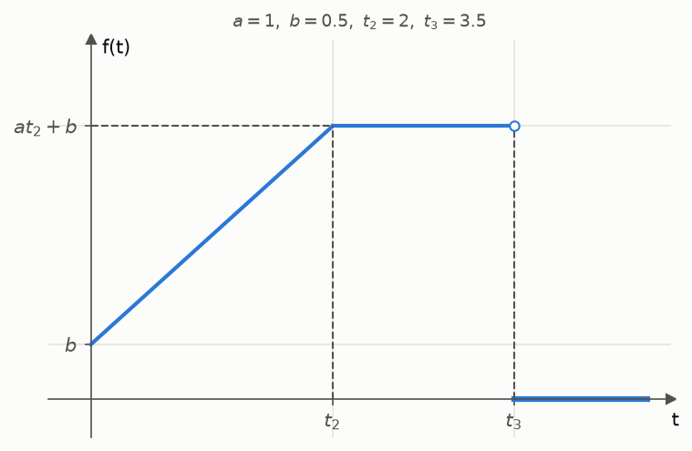

2) Первый интеграл:
$$(1) = a\int_0^{t_2} t\,e^{-st}\,dt + b\int_0^{t_2} e^{-st}\,dt$$
По частям $\int t\,e^{-st}dt = -\dfrac{t}{s}e^{-st} - \dfrac{1}{s^2}e^{-st}$:
$$(1) = a\left[-\dfrac{t}{s}e^{-st} - \dfrac{1}{s^2}e^{-st}\right]_0^{t_2} + b\left[-\dfrac{1}{s}e^{-st}\right]_0^{t_2}$$
$$(1) = a\left(-\dfrac{t_2}{s}e^{-st_2} - \dfrac{1}{s^2}e^{-st_2} + \dfrac{1}{s^2}\right) + b\left(\dfrac{1}{s} - \dfrac{1}{s}e^{-st_2}\right)$$

3) Второй интеграл:
$$(2) = (at_2+b)\left[-\dfrac{1}{s}e^{-st}\right]_{t_2}^{t_3} = -\dfrac{at_2+b}{s}\left(e^{-st_3} - e^{-st_2}\right)$$
$$(2) = -\dfrac{a}{s}\left(t_2e^{-st_3} - t_2e^{-st_2}\right) - \dfrac{b}{s}\left(e^{-st_3} - e^{-st_2}\right)$$

4) Складываем:
Слагаемые $\pm\dfrac{at_2}{s}e^{-st_2}$ и $\pm\dfrac{b}{s}e^{-st_2}$ взаимно уничтожаются:
$$F(s) = a\left(-\dfrac{t_2}{s}e^{-st_3} - \dfrac{1}{s^2}e^{-st_2} + \dfrac{1}{s^2}\right) + b\left(\dfrac{1}{s} - \dfrac{1}{s}e^{-st_3}\right)$$
$$F(s) = -\dfrac{1}{s}\left[a\left(t_2e^{-st_3} + \dfrac{e^{-st_2}}{s} - \dfrac{1}{s}\right) + b\left(e^{-st_3} - 1\right)\right]$$

Ответ: $-\dfrac{1}{s}\left[a\left(t_2e^{-st_3} + \dfrac{e^{-st_2}}{s} - \dfrac{1}{s}\right) + b\left(e^{-st_3} - 1\right)\right]$

## Задача 6

### Условие

1.5 б) Найти изображение по Лапласу полуволны синуса: $f(t) = \sin\omega t$ при $0 \le t \le \dfrac{\pi}{\omega}$, $f(t) = 0$ при $t > \dfrac{\pi}{\omega}$.

### Решение

1) График и разложение по формуле Эйлера:
$\sin\omega t = \dfrac{1}{2i}\left(e^{i\omega t} - e^{-i\omega t}\right)$, интеграл берётся только до $\dfrac{\pi}{\omega}$:
$$F(s) = \dfrac{1}{2i}\left(\int_0^{\pi/\omega} e^{(i\omega - s)t}\,dt - \int_0^{\pi/\omega} e^{(-i\omega - s)t}\,dt\right) = \dfrac{1}{2i}\bigl((1) - (2)\bigr)$$

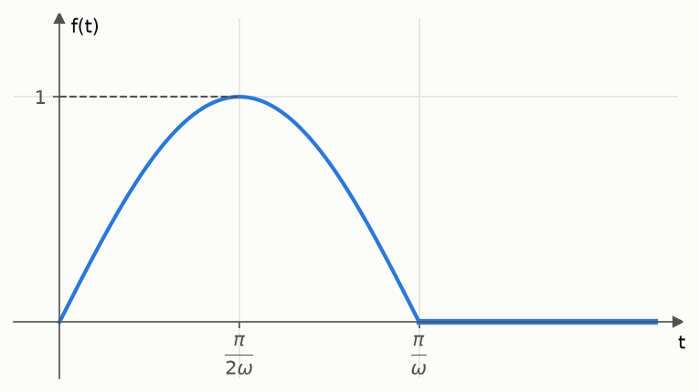

2) Первый интеграл:
Учитываем $e^{i\pi} = -1$:
$$(1) = \left.\dfrac{e^{(i\omega - s)t}}{i\omega - s}\right|_0^{\pi/\omega} = \dfrac{e^{i\pi}e^{-s\pi/\omega} - 1}{i\omega - s} = -\dfrac{e^{-s\pi/\omega} + 1}{i\omega - s}$$

3) Второй интеграл:
Учитываем $e^{-i\pi} = -1$:
$$(2) = \left.\dfrac{e^{(-i\omega - s)t}}{-i\omega - s}\right|_0^{\pi/\omega} = \dfrac{e^{-i\pi}e^{-s\pi/\omega} - 1}{-i\omega - s} = -\dfrac{e^{-s\pi/\omega} + 1}{-i\omega - s}$$

4) Разность и ответ:
$\dfrac{1}{i\omega - s} - \dfrac{1}{-i\omega - s} = \dfrac{-2i\omega}{(i\omega - s)(-i\omega - s)} = \dfrac{-2i\omega}{s^2 + \omega^2}$, поэтому:
$$F(s) = \dfrac{1}{2i}\cdot\dfrac{2i\omega}{s^2+\omega^2}\left(1 + e^{-s\pi/\omega}\right) = \dfrac{\omega}{s^2+\omega^2}\left(1 + e^{-\frac{\pi}{\omega}s}\right)$$
Примечание: в тетради в ответе знаменатель записан как $s^2 + \omega$ — описка, верно $s^2 + \omega^2$.

Ответ: $\dfrac{\omega}{s^2+\omega^2}\left(1 + e^{-\frac{\pi}{\omega}s}\right)$

# Домашка (ДЗ 2). Решение систем дифференциальных уравнений операционным методом

## Задача 1

### Условие

2.3. Решить операционным методом систему $\dfrac{dx}{dt} = x - 2y - 2z$, $\dfrac{dy}{dt} = 2x + 7y + 5z$, $\dfrac{dz}{dt} = -2x - 4y - 2z$ при начальных условиях $x(0) = 0$, $y(0) = 3$, $z(0) = -2$.

### Решение

1) Переходим к изображениям:
$x \to X(s)$, $\dfrac{dx}{dt} \to sX - x(0)$, и так же для $y$, $z$:
$$\begin{cases} sX = X - 2Y - 2Z \\ sY - 3 = 2X + 7Y + 5Z \\ sZ + 2 = -2X - 4Y - 2Z \end{cases}$$

2) Линейная алгебраическая система:
$$\begin{cases} (s-1)X + 2Y + 2Z = 0 \\ -2X + (s-7)Y - 5Z = 3 \\ 2X + 4Y + (s+2)Z = -2 \end{cases}$$

3) Главный определитель:
$$\Delta = \begin{vmatrix} s-1 & 2 & 2 \\ -2 & s-7 & -5 \\ 2 & 4 & s+2 \end{vmatrix} = (s^2-8s+7)(s+2) - 20 - 16 - 4(s-7) + 4(s+2) + 20(s-1)$$
$$\Delta = s^3 - 6s^2 + 11s - 6 = (s-1)(s-2)(s-3)$$

4) Определители Крамера:
$$\Delta_x = \begin{vmatrix} 0 & 2 & 2 \\ 3 & s-7 & -5 \\ -2 & 4 & s+2 \end{vmatrix} = 4 - 2s$$
$$\Delta_y = \begin{vmatrix} s-1 & 0 & 2 \\ -2 & 3 & -5 \\ 2 & -2 & s+2 \end{vmatrix} = 3(s^2+s-2) + 8 - 12 - 10(s-1) = 3s^2 - 7s$$
$$\Delta_z = \begin{vmatrix} s-1 & 2 & 0 \\ -2 & s-7 & 3 \\ 2 & 4 & -2 \end{vmatrix} = -2(s^2-8s+7) + 12 - 12(s-1) - 8 = -2s^2 + 4s + 2$$

5) Изображения:
$$X(s) = \dfrac{\Delta_x}{\Delta} = \dfrac{-2(s-2)}{(s-1)(s-2)(s-3)} = \dfrac{-2}{(s-1)(s-3)}$$
$$Y(s) = \dfrac{\Delta_y}{\Delta} = \dfrac{s(3s-7)}{(s-1)(s-2)(s-3)}, \qquad Z(s) = \dfrac{\Delta_z}{\Delta} = \dfrac{-2s^2 + 4s + 2}{(s-1)(s-2)(s-3)}$$
Примечание: в тетради числитель $Y(s)$ записан как $s\left(s - \dfrac{7}{3}\right)$ — потерян множитель 3; дальнейшие коэффициенты в тетради посчитаны верно.

6) Оригиналы по вычетам:
Все полюсы простые, поэтому $f(t) = \sum\limits_k \lim\limits_{s \to s_k}(s - s_k)F(s)\,e^{st}$.
Для $X(s)$ полюсы $s_1 = 1$, $s_2 = 3$:
$$x(t) = \left.\dfrac{-2}{s-3}\right|_{s=1}e^{t} + \left.\dfrac{-2}{s-1}\right|_{s=3}e^{3t} = e^{t} - e^{3t}$$
Для $Y(s)$ полюсы $1$, $2$, $3$:
$$y(t) = \dfrac{1\cdot(-4)}{(-1)(-2)}e^{t} + \dfrac{2\cdot(-1)}{1\cdot(-1)}e^{2t} + \dfrac{3\cdot 2}{2\cdot 1}e^{3t} = -2e^{t} + 2e^{2t} + 3e^{3t}$$
Для $Z(s)$:
$$z(t) = \dfrac{4}{(-1)(-2)}e^{t} + \dfrac{2}{1\cdot(-1)}e^{2t} + \dfrac{-4}{2\cdot 1}e^{3t} = 2e^{t} - 2e^{2t} - 2e^{3t}$$

7) Проверка:
$x(0) = 0$, $y(0) = -2 + 2 + 3 = 3$, $z(0) = 2 - 2 - 2 = -2$ — начальные условия выполнены; подстановка в исходную систему даёт тождества.

Ответ: $x(t) = e^{t} - e^{3t}$, $y(t) = -2e^{t} + 2e^{2t} + 3e^{3t}$, $z(t) = 2e^{t} - 2e^{2t} - 2e^{3t}$

# Домашка (ДЗ 3). Математическая модель электрической цепи

## Задача 1

### Условие

Составить дифференциальное уравнение RC-цепи (вход — напряжение $u(t)$, выход — напряжение $y(t)$ на конденсаторе) и определить тип звена.

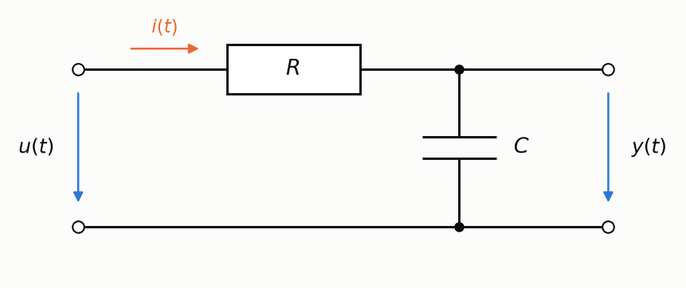

### Решение

1) Второй закон Кирхгофа для контура:
Ток $i(t)$ течёт через $R$ и $C$:
$$u(t) = R\,i(t) + \dfrac{1}{C}\int_0^t i(\tau)\,d\tau$$

2) Выходное напряжение — напряжение на конденсаторе:
$$y(t) = \dfrac{1}{C}\int_0^t i(\tau)\,d\tau \quad\Rightarrow\quad \dfrac{dy}{dt} = \dfrac{i(t)}{C} \quad\Rightarrow\quad i(t) = C\,\dfrac{dy}{dt}$$

3) Подставляем ток в первое уравнение:
$$u(t) = RC\,\dfrac{dy}{dt} + y(t)$$

4) Тип звена:
Уравнение имеет вид $T\dfrac{dy}{dt} + y = k\,u$ с $T = RC$, $k = 1$ — апериодическое звено 1-го порядка. Его передаточная функция:
$$W(s) = \dfrac{1}{RCs + 1}$$

Ответ: $RC\,\dfrac{dy}{dt} + y = u$ — апериодическое звено 1-го порядка, $T = RC$, $k = 1$

# Домашка (ДЗ 5). Передаточная функция по структурной схеме

## Задача 1

### Условие

5.4 (1) Найти передаточную функцию $W(s) = \dfrac{Y(s)}{U(s)}$ системы по структурной схеме, последовательно выражая сигналы. Обозначение: $W_{a-b} = W_aW_{a+1}\cdots W_b$.

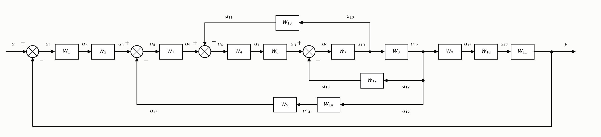

### Решение

1) Уравнения звеньев и сумматоров:
$u_1 = u - y$, $u_2 = W_1u_1$, $u_3 = W_2u_2$, $u_4 = u_3 - u_{15}$, $u_5 = W_3u_4$, $u_6 = u_5 - u_{11}$, $u_7 = W_4u_6$, $u_8 = W_6u_7$, $u_9 = u_8 - u_{13}$, $u_{10} = W_7u_9$, $u_{11} = W_{13}u_{10}$, $u_{12} = W_8u_{10}$, $u_{13} = W_{12}u_{12}$, $u_{14} = W_{14}u_{12}$, $u_{15} = W_5u_{14}$, $u_{16} = W_9u_{12}$, $u_{17} = W_{10}u_{16}$, $y = W_{11}u_{17}$.

2) Сигналы точек съёма через выход:
Идём от $y$ назад по прямой цепи:
$$u_{12} = \dfrac{y}{W_{9-11}}, \qquad u_{10} = \dfrac{u_{12}}{W_8} = \dfrac{y}{W_{8-11}}$$
Отсюда сигналы обратных связей:
$$u_{13} = \dfrac{W_{12}\,y}{W_{9-11}}, \qquad u_{11} = \dfrac{W_{13}\,y}{W_{8-11}}, \qquad u_{15} = \dfrac{W_5W_{14}\,y}{W_{9-11}}$$

3) Выражаем $y$, проходя сумматоры справа налево:
$$y = u_{17}W_{11} = u_{16}W_{10-11} = u_{12}W_{9-11} = u_{10}W_{8-11} = u_9W_{7-11} = (u_8 - u_{13})W_{7-11}$$
$$y = u_7W_{6-11} - yW_{7-8}W_{12} = (u_5 - u_{11})W_4W_{6-11} - yW_{7-8}W_{12}$$
$$y = u_4W_{3-4}W_{6-11} - yW_4W_{6-7}W_{13} - yW_{7-8}W_{12}$$
$$y = (u_3 - u_{15})W_{3-4}W_{6-11} - \dots = u_1W_{1-4}W_{6-11} - yW_{3-8}W_{14} - yW_4W_{6-7}W_{13} - yW_{7-8}W_{12}$$
Здесь $W_{3-8} = W_3W_4W_5W_6W_7W_8$ — в контур входит и $W_5$ из обратной связи.

4) Подставляем $u_1 = u - y$:
$$y = uW_{1-4}W_{6-11} - yW_{1-4}W_{6-11} - yW_{3-8}W_{14} - yW_4W_{6-7}W_{13} - yW_{7-8}W_{12}$$

5) Собираем слагаемые с $y$:
$$W(s) = \dfrac{y}{u} = \dfrac{W_{1-4}W_{6-11}}{1 + W_{1-4}W_{6-11} + W_{3-8}W_{14} + W_4W_{6-7}W_{13} + W_{7-8}W_{12}}$$

Ответ: $W(s) = \dfrac{W_{1-4}W_{6-11}}{1 + W_{1-4}W_{6-11} + W_{3-8}W_{14} + W_4W_{6-7}W_{13} + W_{7-8}W_{12}}$

## Задача 2

### Условие

5.5 (1) Найти передаточную функцию $W(s) = \dfrac{Y(s)}{U(s)}$ системы по структурной схеме, последовательно выражая сигналы. Обозначение: $W_{a-b} = W_aW_{a+1}\cdots W_b$.

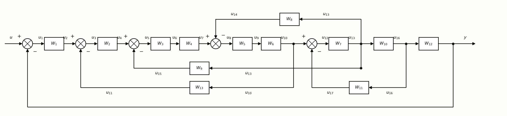

### Решение

1) Уравнения звеньев и сумматоров:
$u_1 = u - y$, $u_2 = W_1u_1$, $u_3 = u_2 - u_{11}$, $u_4 = W_2u_3$, $u_5 = u_4 - u_{15}$, $u_6 = W_3u_5$, $u_7 = W_4u_6$, $u_8 = u_7 - u_{14}$, $u_9 = W_5u_8$, $u_{10} = W_6u_9$, $u_{11} = W_{13}u_{10}$, $u_{12} = u_{10} - u_{17}$, $u_{13} = W_7u_{12}$, $u_{14} = W_8u_{13}$, $u_{15} = W_9u_{13}$, $u_{16} = W_{10}u_{13}$, $u_{17} = W_{11}u_{16}$, $y = W_{12}u_{16}$.

2) Сигналы точек съёма через выход:
$$u_{16} = \dfrac{y}{W_{12}}, \qquad u_{13} = \dfrac{y}{W_{10}W_{12}}, \qquad u_{12} = \dfrac{y}{W_7W_{10}W_{12}}, \qquad u_{17} = \dfrac{W_{11}\,y}{W_{12}}$$
$$u_{10} = u_{12} + u_{17} = \dfrac{y}{W_7W_{10}W_{12}} + \dfrac{W_{11}\,y}{W_{12}}$$
Примечание: в тетради в этой вспомогательной выкладке вместо $u_{17}$ написано $u_{14}$ — описка, на результат не влияет.

3) Выражаем $y$, проходя сумматоры перед $W_7$ и перед $W_5$:
$$y = u_{16}W_{12} = u_{13}W_{10}W_{12} = u_{12}W_7W_{10}W_{12} = (u_{10} - u_{17})W_7W_{10}W_{12}$$
$$y = u_9W_{6-7}W_{10}W_{12} - yW_7W_{10-11} = u_8W_{5-7}W_{10}W_{12} - yW_7W_{10-11}$$
$$y = (u_7 - u_{14})W_{5-7}W_{10}W_{12} - yW_7W_{10-11} = u_7W_{5-7}W_{10}W_{12} - yW_{5-8} - yW_7W_{10-11}$$

4) Через сумматор перед $W_3$:
$u_{15} = W_9u_{13} = \dfrac{W_9\,y}{W_{10}W_{12}}$:
$$y = u_5W_{3-7}W_{10}W_{12} - yW_{5-8} - yW_7W_{10-11} = u_4W_{3-7}W_{10}W_{12} - yW_{3-7}W_9 - yW_{5-8} - yW_7W_{10-11}$$

5) Через сумматор перед $W_2$:
$u_{11} = W_{13}u_{10}$, поэтому $u_{11}W_{2-7}W_{10}W_{12} = yW_{2-6}W_{13} + yW_{2-7}W_{10-11}W_{13}$:
$$y = u_2W_{2-7}W_{10}W_{12} - yW_{2-6}W_{13} - yW_{2-7}W_{10-11}W_{13} - yW_{3-7}W_9 - yW_{5-8} - yW_7W_{10-11}$$

6) Через входной сумматор, $u_2 = W_1(u - y)$:
$$y = uW_{1-7}W_{10}W_{12} - yW_{1-7}W_{10}W_{12} - yW_{2-6}W_{13} - yW_{2-7}W_{10-11}W_{13} - yW_{3-7}W_9 - yW_{5-8} - yW_7W_{10-11}$$
$$W(s) = \dfrac{W_{1-7}W_{10}W_{12}}{1 + W_{1-7}W_{10}W_{12} + W_{2-6}W_{13} + W_{2-7}W_{10-11}W_{13} + W_{3-7}W_9 + W_{5-8} + W_7W_{10-11}}$$
Проверка по формуле Мэйсона: контуры $W_{2-6}W_{13}$ и $W_7W_{10-11}$ не касаются друг друга, их произведение $W_{2-7}W_{10-11}W_{13}$ входит в знаменатель — совпадает.

Ответ: $W(s) = \dfrac{W_{1-7}W_{10}W_{12}}{1 + W_{1-7}W_{10}W_{12} + W_{2-6}W_{13} + W_{2-7}W_{10-11}W_{13} + W_{3-7}W_9 + W_{5-8} + W_7W_{10-11}}$

## Задача 3

### Условие

5.6 (1) Найти передаточную функцию $W(s) = \dfrac{Y(s)}{U(s)}$ системы по структурной схеме, последовательно выражая сигналы. Обозначение: $W_{a-b} = W_aW_{a+1}\cdots W_b$.

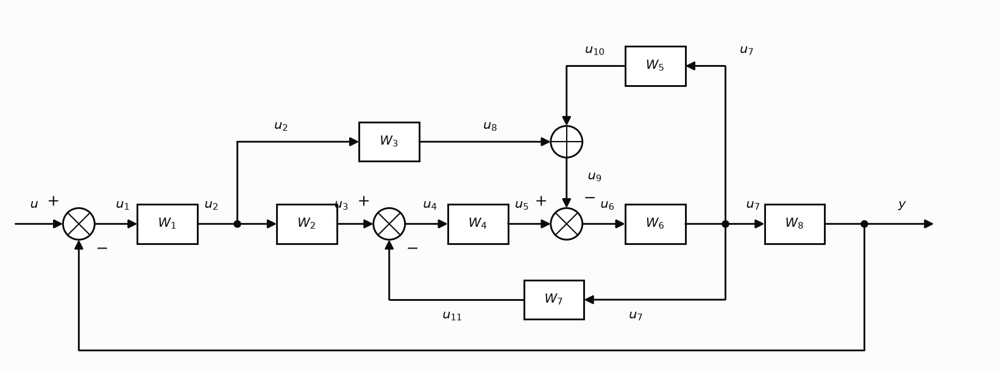

### Решение

1) Уравнения звеньев и сумматоров:
$u_1 = u - y$, $u_2 = W_1u_1$, $u_3 = W_2u_2$, $u_4 = u_3 - u_{11}$, $u_5 = W_4u_4$, $u_6 = u_5 - u_9$, $u_7 = W_6u_6$, $y = W_8u_7$, $u_8 = W_3u_2$, $u_{10} = W_5u_7$, $u_9 = u_8 + u_{10}$, $u_{11} = W_7u_7$.

2) Сигналы через выход:
$$u_7 = \dfrac{y}{W_8}, \qquad u_{10} = \dfrac{W_5\,y}{W_8}, \qquad u_{11} = \dfrac{W_7\,y}{W_8}$$

3) Выражаем $y$:
$$y = u_7W_8 = u_6W_6W_8 = (u_5 - u_9)W_6W_8 = u_4W_4W_6W_8 - (u_8 + u_{10})W_6W_8$$
$$y = u_4W_4W_6W_8 - u_2W_3W_6W_8 - yW_{5-6}$$
$$y = (u_3 - u_{11})W_4W_6W_8 - u_1W_1W_3W_6W_8 - yW_{5-6} = u_1W_{1-2}W_4W_6W_8 - yW_4W_{6-7} - u_1W_1W_3W_6W_8 - yW_{5-6}$$

4) Подставляем $u_1 = u - y$:
$$y = uW_{1-2}W_4W_6W_8 - yW_{1-2}W_4W_6W_8 - yW_4W_{6-7} - uW_1W_3W_6W_8 + yW_1W_3W_6W_8 - yW_{5-6}$$
$$u\left(W_{1-2}W_4W_6W_8 - W_1W_3W_6W_8\right) = y\left(1 + W_4W_{6-7} + W_{1-2}W_4W_6W_8 - W_1W_3W_6W_8 + W_{5-6}\right)$$

5) Передаточная функция:
$$W(s) = \dfrac{W_{1-2}W_4W_6W_8 - W_1W_3W_6W_8}{1 + W_4W_{6-7} + W_{1-2}W_4W_6W_8 - W_1W_3W_6W_8 + W_{5-6}}$$

Ответ: $W(s) = \dfrac{W_{1-2}W_4W_6W_8 - W_1W_3W_6W_8}{1 + W_4W_{6-7} + W_{1-2}W_4W_6W_8 - W_1W_3W_6W_8 + W_{5-6}}$

## Задача 4

### Условие

5.4. Найти передаточную функцию системы из 5.4 (1) методом структурных преобразований. Обозначение: $W_{a-b} = W_aW_{a+1}\cdots W_b$.

### Решение

1) Переносим точку съёма для $W_{13}$ через $W_8$:
Сигнал для $W_{13}$ берётся между $W_7$ и $W_8$. Переносим точку съёма за $W_8$ — в ветвь добавляется $W_8^{-1}$. Теперь $W_7$, $W_8$ с обратной связью $W_{12}$ образуют отдельный контур:

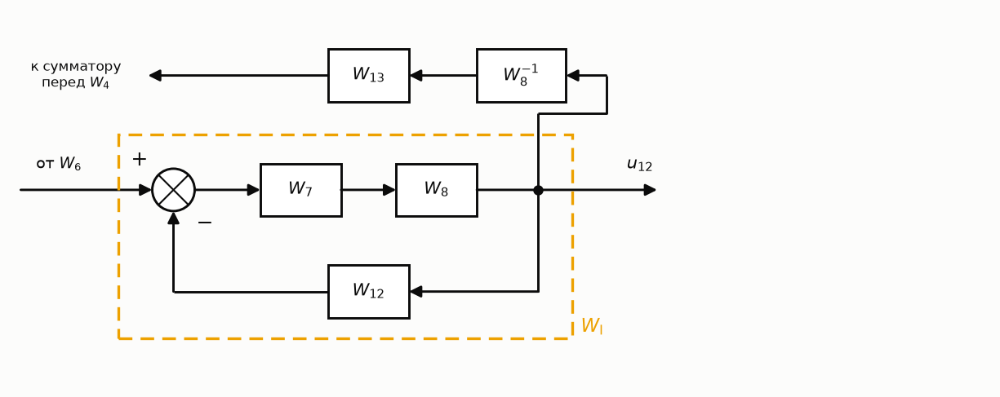

$$W_{\rm I} = \dfrac{W_7W_8}{1 + W_7W_8W_{12}}$$

2) Контур с $W_4$, $W_6$, $W_{\rm I}$ и обратной связью $W_8^{-1}W_{13}$:

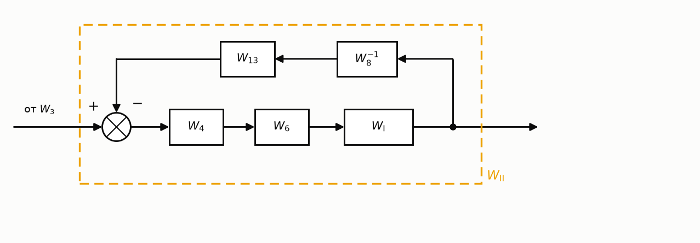

$$W_{\rm II} = \dfrac{W_4W_6W_{\rm I}}{1 + W_{13}W_8^{-1}W_4W_6W_{\rm I}} = \dfrac{W_4W_6\dfrac{W_{7-8}}{1 + W_{7-8}W_{12}}}{1 + \dfrac{W_4W_{6-7}W_{13}}{1 + W_{7-8}W_{12}}} = \dfrac{W_4W_{6-8}}{1 + W_{7-8}W_{12} + W_4W_{6-7}W_{13}}$$

3) Контур с $W_3$, $W_{\rm II}$ и обратной связью $W_{14}W_5$:

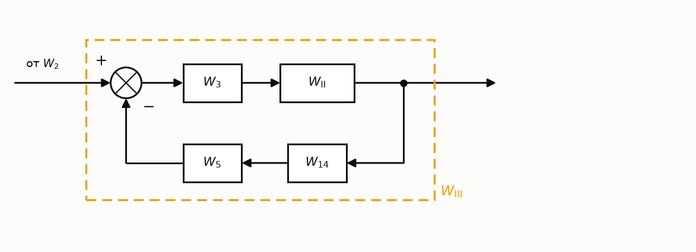

$$W_{\rm III} = \dfrac{W_3W_{\rm II}}{1 + W_3W_{\rm II}W_5W_{14}} = \dfrac{W_{3-4}W_{6-8}}{1 + W_{7-8}W_{12} + W_4W_{6-7}W_{13} + W_{3-8}W_{14}} = \dfrac{W_{3-4}W_{6-8}}{\alpha}$$
где $\alpha = 1 + W_{7-8}W_{12} + W_4W_{6-7}W_{13} + W_{3-8}W_{14}$.

4) Главный контур с единичной обратной связью:
Последовательно $W_1$, $W_2$, $W_{\rm III}$, $W_9$, $W_{10}$, $W_{11}$:

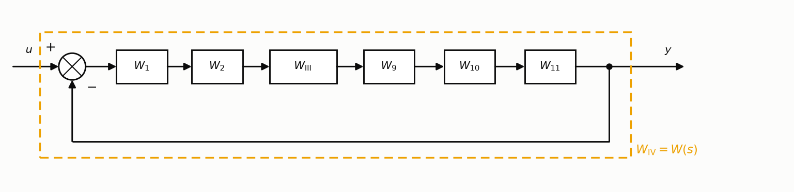

$$W_{\rm IV} = W(s) = \dfrac{\dfrac{W_{1-4}W_{6-8}W_9W_{10-11}}{\alpha}}{1 + \dfrac{W_{1-4}W_{6-8}W_9W_{10-11}}{\alpha}} = \dfrac{W_{1-4}W_{6-11}}{\alpha + W_{1-4}W_{6-11}}$$
Результат совпадает с 5.4 (1).

Ответ: $W(s) = \dfrac{W_{1-4}W_{6-11}}{1 + W_{7-8}W_{12} + W_4W_{6-7}W_{13} + W_{3-8}W_{14} + W_{1-4}W_{6-11}}$

## Задача 5

### Условие

5.5. Найти передаточную функцию системы из 5.5 (1) методом структурных преобразований. Обозначение: $W_{a-b} = W_aW_{a+1}\cdots W_b$.

### Решение

1) Переносим точку съёма для $W_{11}$ через $W_{10}$ назад:
Сигнал для $W_{11}$ берётся после $W_{10}$. Переносим точку съёма на вход $W_{10}$ — в обратную связь добавляется $W_{10}$. Получаем контур $W_7$ с обратной связью $W_{10}W_{11}$, а $W_{10}$ остаётся в прямой цепи:

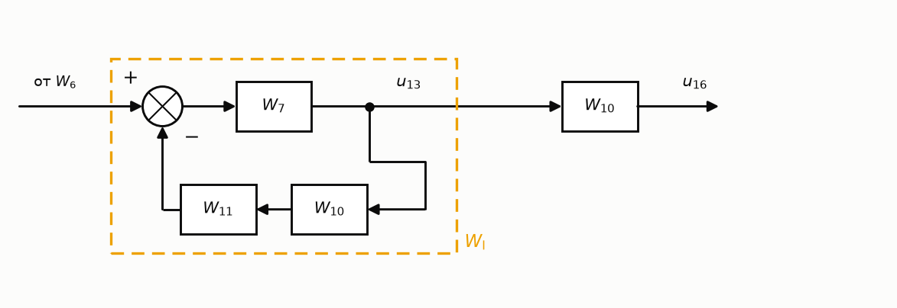

$$W_{\rm I} = \dfrac{W_7}{1 + W_7W_{10-11}}$$

2) Переносим точку съёма для $W_{13}$ через $W_{\rm I}$ вперёд:
После шага 1 сигнал для $W_{13}$ берётся на входе $W_{\rm I}$ (отмечено крестиком):

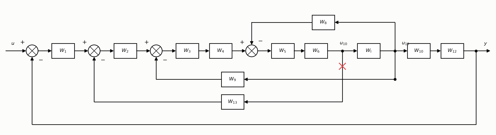

Переносим её на выход $W_{\rm I}$ — в ветвь добавляется $W_{\rm I}^{-1}$. Теперь контуры вложены друг в друга:

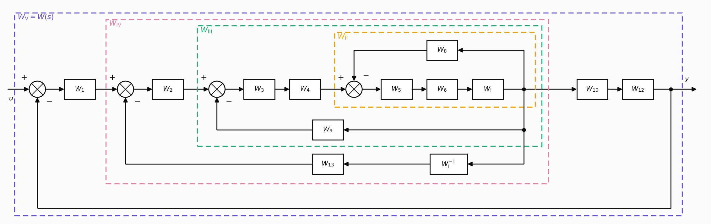

3) Сворачиваем контуры изнутри наружу:
$$W_{\rm II} = \dfrac{W_{5-6}W_{\rm I}}{1 + W_{5-6}W_8W_{\rm I}}, \qquad W_{\rm III} = \dfrac{W_{3-4}W_{\rm II}}{1 + W_{3-4}W_9W_{\rm II}}$$
$$W_{\rm IV} = \dfrac{W_2W_{\rm III}}{1 + W_2W_{13}W_{\rm I}^{-1}W_{\rm III}}, \qquad W_{\rm V} = \dfrac{W_1W_{\rm IV}W_{10}W_{12}}{1 + W_1W_{10}W_{12}W_{\rm IV}} = W(s)$$

4) Подставляем по очереди $W_{\rm IV}$, $W_{\rm III}$, $W_{\rm II}$:
$$W(s) = \dfrac{W_{1-2}W_{10}W_{\rm III}W_{12}}{1 + W_{1-2}W_{10}W_{12}W_{\rm III} + W_2W_{13}W_{\rm I}^{-1}W_{\rm III}}$$
$$W(s) = \dfrac{W_{1-4}W_{10}W_{12}W_{\rm II}}{1 + W_{1-4}W_{10}W_{12}W_{\rm II} + W_{2-4}W_{13}W_{\rm I}^{-1}W_{\rm II} + W_{3-4}W_9W_{\rm II}}$$
$$W(s) = \dfrac{W_{1-6}W_{10}W_{12}W_{\rm I}}{1 + W_{1-6}W_{10}W_{12}W_{\rm I} + W_{2-6}W_{13} + W_{3-6}W_9W_{\rm I} + W_{5-6}W_8W_{\rm I}}$$

5) Подставляем $W_{\rm I}$:
Умножаем числитель и знаменатель на $1 + W_7W_{10-11}$; слагаемое $W_{2-6}W_{13}$ не содержит $W_{\rm I}$, поэтому оно тоже умножается на $1 + W_7W_{10-11}$:
$$W(s) = \dfrac{W_{1-7}W_{10}W_{12}}{1 + W_7W_{10-11} + W_{1-7}W_{10}W_{12} + W_{2-6}W_{13}\left(1 + W_7W_{10-11}\right) + W_{3-7}W_9 + W_{5-8}}$$
Результат совпадает с 5.5 (1).
Примечание: в тетради при последней подстановке $W_{2-6}W_{13}$ не умножено на $1 + W_7W_{10-11}$, и в ответе нет слагаемого $W_{2-7}W_{10-11}W_{13}$; верный ответ — как в 5.5 (1).

Ответ: $W(s) = \dfrac{W_{1-7}W_{10}W_{12}}{1 + W_{1-7}W_{10}W_{12} + W_{2-6}W_{13} + W_{2-7}W_{10-11}W_{13} + W_{3-7}W_9 + W_{5-8} + W_7W_{10-11}}$

# Домашка (ДЗ 6). Алгебраические критерии устойчивости

## Задача 1

### Условие

6.1 б) Исследовать устойчивость системы с характеристическим уравнением $D(s) = 12s^4 + 2s^2 + 4s + 50 = 0$.

### Решение

1) Необходимое условие устойчивости (теорема Стодолы):
Если система устойчива, все коэффициенты характеристического уравнения положительны.

2) Проверяем коэффициенты:
$a_0 = 12$, $a_1 = 0$ (нет слагаемого с $s^3$), $a_2 = 2$, $a_3 = 4$, $a_4 = 50$. Коэффициент $a_1 = 0$ — необходимое условие не выполнено, система неустойчива.

3) Те же критерии, что и для полного многочлена:
Таблица Рауса: первая строка $12,\ 2,\ 50$, вторая $0,\ 4,\ 0$ — в первом столбце ноль, $r_3 = \dfrac{12}{0}$ не существует, условие «все $c_{i1} > 0$» нарушено.
Гурвиц: $\Delta_1 = a_1 = 0$ — не больше нуля; $\Delta_2 = a_1a_2 - a_0a_3 = 0 - 48 = -48 < 0$. Система неустойчива.
Проверка: корни $D(s)$ равны $-0.99 \pm 0.99i$ и $0.99 \pm 1.07i$ — пара корней в правой полуплоскости.

Ответ: система неустойчива ($a_1 = 0$, не выполнено необходимое условие Стодолы)

## Задача 2

### Условие

6.1 г) Исследовать устойчивость системы с характеристическим уравнением $D(s) = 2s^3 + 6s^2 + 10s + 15 = 0$ по критериям Рауса и Гурвица.

### Решение

1) Правило построения таблицы Рауса:
В первую строку пишут коэффициенты $a_0, a_2, \dots$, во вторую — $a_1, a_3, \dots$; остальные элементы:
$$c_{ik} = c_{i-2,\,k+1} - r_i\,c_{i-1,\,k+1}, \qquad r_i = \dfrac{c_{i-2,\,1}}{c_{i-1,\,1}}$$
Система устойчива, если все элементы первого столбца положительны.

2) Строки 3 и 4:
$$r_3 = \dfrac{2}{6} = \dfrac{1}{3}: \quad c_{31} = 10 - \dfrac{1}{3}\cdot 15 = 5$$
$$r_4 = \dfrac{6}{5}: \quad c_{41} = 15 - \dfrac{6}{5}\cdot 0 = 15$$

3) Таблица Рауса:
$$\begin{array}{c|c|cc} r_i & i & & \\ \hline & 1 & 2 & 10 \\ & 2 & 6 & 15 \\ \dfrac{1}{3} & 3 & 5 & 0 \\ \dfrac{6}{5} & 4 & 15 & 0 \end{array}$$

4) Вывод по Раусу:
Первый столбец $2,\ 6,\ 5,\ 15$ — все элементы положительны, система устойчива по критерию Рауса.

5) Критерий Гурвица:
$a_0 = 2$, $a_1 = 6$, $a_2 = 10$, $a_3 = 15$:
$$H = \begin{pmatrix} a_1 & a_3 & 0 \\ a_0 & a_2 & 0 \\ 0 & a_1 & a_3 \end{pmatrix} = \begin{pmatrix} 6 & 15 & 0 \\ 2 & 10 & 0 \\ 0 & 6 & 15 \end{pmatrix}$$
$$\Delta_1 = 6 > 0,\qquad \Delta_2 = 6\cdot 10 - 2\cdot 15 = 30 > 0,\qquad \Delta_3 = a_3\Delta_2 = 15\cdot 30 = 450 > 0$$
Все главные миноры положительны — система устойчива и по Гурвицу.

Ответ: система устойчива

## Задача 3

### Условие

6.1 д) Исследовать устойчивость системы с характеристическим уравнением $D(s) = 12s^4 + 3s^3 + 2s^2 + 4s + 50 = 0$ по критериям Рауса и Гурвица.

### Решение

1) Таблица Рауса:
Все коэффициенты положительны (необходимое условие выполнено). Первая строка — $a_0, a_2, a_4$: $12,\ 2,\ 50$; вторая — $a_1, a_3$: $3,\ 4,\ 0$.
$$r_3 = \dfrac{12}{3} = 4: \quad c_{31} = 2 - 4\cdot 4 = -14, \quad c_{32} = 50 - 4\cdot 0 = 50$$
$$r_4 = \dfrac{3}{-14}: \quad c_{41} = 4 + \dfrac{3}{14}\cdot 50 = \dfrac{103}{7}, \qquad r_5 = \dfrac{-14}{103/7} = -\dfrac{98}{103}: \quad c_{51} = 50$$
$$\begin{array}{c|c|ccc} r_i & i & & & \\ \hline & 1 & 12 & 2 & 50 \\ & 2 & 3 & 4 & 0 \\ 4 & 3 & -14 & 50 & \\ -\dfrac{3}{14} & 4 & \dfrac{103}{7} & 0 & \\ -\dfrac{98}{103} & 5 & 50 & & \end{array}$$
Первый столбец $12,\ 3,\ -14,\ \dfrac{103}{7},\ 50$ — есть отрицательный элемент (две перемены знака, два корня в правой полуплоскости): система неустойчива.

2) Матрица Гурвица:
$a_0 = 12$, $a_1 = 3$, $a_2 = 2$, $a_3 = 4$, $a_4 = 50$:
$$H = \begin{pmatrix} a_1 & a_3 & 0 & 0 \\ a_0 & a_2 & a_4 & 0 \\ 0 & a_1 & a_3 & 0 \\ 0 & a_0 & a_2 & a_4 \end{pmatrix} = \begin{pmatrix} 3 & 4 & 0 & 0 \\ 12 & 2 & 50 & 0 \\ 0 & 3 & 4 & 0 \\ 0 & 12 & 2 & 50 \end{pmatrix}$$
Система устойчива, если все диагональные миноры положительны.

3) Миноры:
$$\Delta_1 = 3 > 0, \qquad \Delta_2 = \begin{vmatrix} 3 & 4 \\ 12 & 2 \end{vmatrix} = 6 - 48 = -42 < 0$$

4) Вывод:
$\Delta_2 < 0$ — критерий Гурвица не выполнен, система неустойчива; дальше миноры можно не считать. Оба критерия дают один результат.

Ответ: система неустойчива

## Задача 4

### Условие

6.2 б) Исследовать устойчивость замкнутой системы по критериям Рауса и Гурвица.

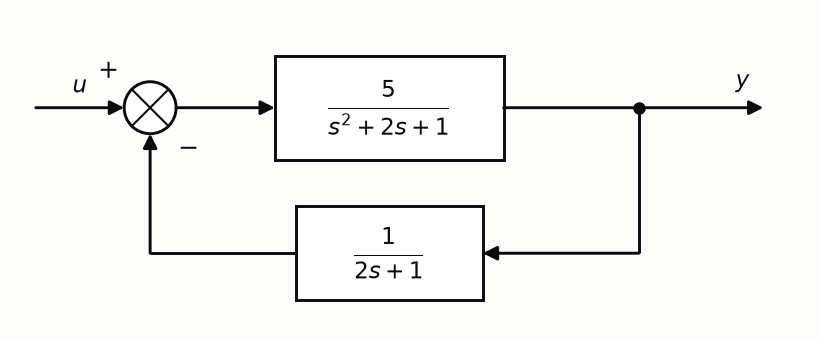

### Решение

1) Передаточная функция замкнутой системы:
$$W(s) = \dfrac{\dfrac{5}{s^2+2s+1}}{1 + \dfrac{5}{(s^2+2s+1)(2s+1)}} = \dfrac{5}{(s+1)^2}\cdot\dfrac{(s+1)^2(2s+1)}{(s+1)^2(2s+1) + 5}$$
$$W(s) = \dfrac{5(2s+1)}{2s^3 + 5s^2 + 4s + 6} = \dfrac{M(s)}{D(s)}$$

2) Характеристический полином:
$$D(s) = 2s^3 + 5s^2 + 4s + 6$$

3) Таблица Рауса:
$$r_3 = \dfrac{2}{5}: \quad c_{31} = 4 - \dfrac{2}{5}\cdot 6 = \dfrac{8}{5}, \qquad r_4 = \dfrac{5}{8/5} = \dfrac{25}{8}: \quad c_{41} = 6$$
$$\begin{array}{c|c|cc} r_i & i & & \\ \hline & 1 & 2 & 4 \\ & 2 & 5 & 6 \\ \dfrac{2}{5} & 3 & \dfrac{8}{5} & 0 \\ \dfrac{25}{8} & 4 & 6 & 0 \end{array}$$

4) Вывод по Раусу:
Первый столбец $2,\ 5,\ \dfrac{8}{5},\ 6$ — все элементы положительны, система устойчива по критерию Рауса.

5) Критерий Гурвица:
$a_0 = 2$, $a_1 = 5$, $a_2 = 4$, $a_3 = 6$:
$$H = \begin{pmatrix} 5 & 6 & 0 \\ 2 & 4 & 0 \\ 0 & 5 & 6 \end{pmatrix},\qquad \Delta_1 = 5 > 0,\qquad \Delta_2 = 5\cdot 4 - 2\cdot 6 = 8 > 0,\qquad \Delta_3 = 6\cdot 8 = 48 > 0$$
Все главные миноры положительны — замкнутая система устойчива и по Гурвицу.

Ответ: замкнутая система устойчива

## Задача 5

### Условие

6.3. Исследовать по критериям Рауса и Гурвица устойчивость системы $W(s) = \dfrac{3s+1}{s^3+3s^2+2s+1}$, замкнутой единичной отрицательной обратной связью.

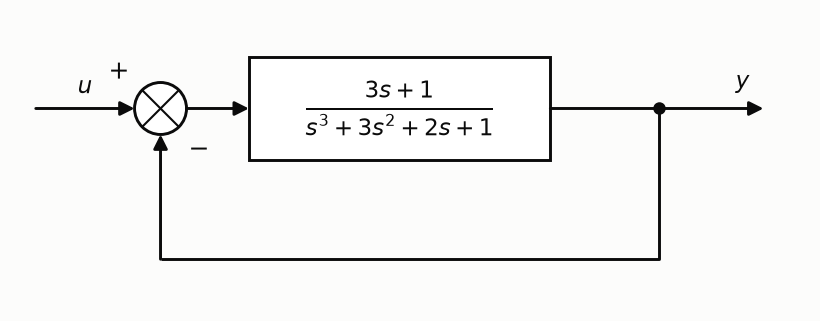

### Решение

1) Передаточная функция замкнутой системы:
$$W(s) = \dfrac{M(s)}{D(s)} = \dfrac{\dfrac{3s+1}{s^3+3s^2+2s+1}}{1 + \dfrac{3s+1}{s^3+3s^2+2s+1}} = \dfrac{3s+1}{s^3 + 3s^2 + 5s + 2}$$

2) Характеристический полином:
$$D(s) = s^3 + 3s^2 + 5s + 2$$

3) Таблица Рауса:
$$r_3 = \dfrac{1}{3}: \quad c_{31} = 5 - \dfrac{1}{3}\cdot 2 = \dfrac{13}{3}, \qquad r_4 = \dfrac{3}{13/3} = \dfrac{9}{13}: \quad c_{41} = 2$$
$$\begin{array}{c|c|cc} r_i & i & & \\ \hline & 1 & 1 & 5 \\ & 2 & 3 & 2 \\ \dfrac{1}{3} & 3 & \dfrac{13}{3} & 0 \\ \dfrac{9}{13} & 4 & 2 & 0 \end{array}$$

4) Вывод по Раусу:
Первый столбец $1,\ 3,\ \dfrac{13}{3},\ 2$ — все элементы положительны, замкнутая система устойчива.

5) Критерий Гурвица:
$a_0 = 1$, $a_1 = 3$, $a_2 = 5$, $a_3 = 2$:
$$H = \begin{pmatrix} 3 & 2 & 0 \\ 1 & 5 & 0 \\ 0 & 3 & 2 \end{pmatrix},\qquad \Delta_1 = 3 > 0,\qquad \Delta_2 = 3\cdot 5 - 1\cdot 2 = 13 > 0,\qquad \Delta_3 = 2\cdot 13 = 26 > 0$$
Все главные миноры положительны — замкнутая система устойчива и по Гурвицу.

Ответ: замкнутая система устойчива

## Задача 6

### Условие

6.3. Исследовать по критериям Рауса и Гурвица устойчивость системы $W(s) = \dfrac{3s+1}{s^3+3s^2+2s+1}$ в разомкнутом состоянии.

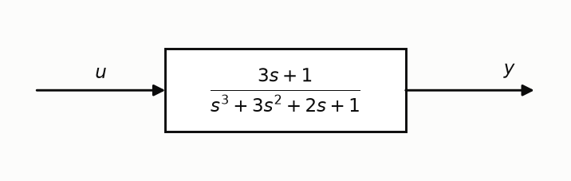

### Решение

1) Характеристический полином разомкнутой системы:
$$D(s) = s^3 + 3s^2 + 2s + 1$$

2) Таблица Рауса:
$$r_3 = \dfrac{1}{3}: \quad c_{31} = 2 - \dfrac{1}{3}\cdot 1 = \dfrac{5}{3}, \qquad r_4 = \dfrac{3}{5/3} = \dfrac{9}{5}: \quad c_{41} = 1$$
$$\begin{array}{c|c|cc} r_i & i & & \\ \hline & 1 & 1 & 2 \\ & 2 & 3 & 1 \\ \dfrac{1}{3} & 3 & \dfrac{5}{3} & 0 \\ \dfrac{9}{5} & 4 & 1 & 0 \end{array}$$
Примечание: в тетради $r_4 = \dfrac{9}{4}$ — описка, верно $\dfrac{9}{5}$; на вывод не влияет.

3) Вывод по Раусу:
Первый столбец $1,\ 3,\ \dfrac{5}{3},\ 1$ — все элементы положительны, разомкнутая система устойчива.

4) Критерий Гурвица:
$a_0 = 1$, $a_1 = 3$, $a_2 = 2$, $a_3 = 1$:
$$H = \begin{pmatrix} 3 & 1 & 0 \\ 1 & 2 & 0 \\ 0 & 3 & 1 \end{pmatrix},\qquad \Delta_1 = 3 > 0,\qquad \Delta_2 = 3\cdot 2 - 1\cdot 1 = 5 > 0,\qquad \Delta_3 = 1\cdot 5 = 5 > 0$$
Все главные миноры положительны — разомкнутая система устойчива и по Гурвицу.

Ответ: разомкнутая система устойчива

## Задача 7

### Условие

6.4 б) Найти, при каких значениях $k$ замкнутая система устойчива (критерий Гурвица).

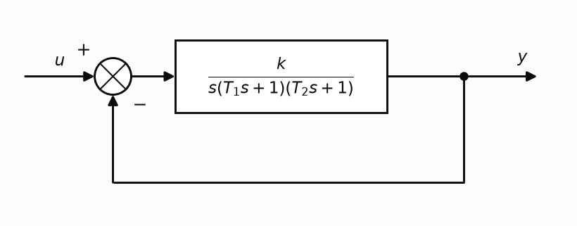

### Решение

1) Передаточная функция замкнутой системы:
$$W(s) = \dfrac{\dfrac{k}{s(T_1s+1)(T_2s+1)}}{1 + \dfrac{k}{s(T_1s+1)(T_2s+1)}} = \dfrac{k}{T_1T_2s^3 + (T_1+T_2)s^2 + s + k}$$

2) Характеристический полином:
$$D(s) = T_1T_2s^3 + (T_1+T_2)s^2 + s + k$$
$a_0 = T_1T_2$, $a_1 = T_1 + T_2$, $a_2 = 1$, $a_3 = k$.

3) Определители Гурвица:
$$\Delta_1 = T_1 + T_2 > 0, \qquad \Delta_2 = \begin{vmatrix} T_1 + T_2 & k \\ T_1T_2 & 1 \end{vmatrix} = T_1 + T_2 - T_1T_2k > 0$$
Кроме того, $\Delta_3 = k\Delta_2 > 0$, т. е. нужно $k > 0$.

4) Условие устойчивости:
$$0 < k < \dfrac{T_1 + T_2}{T_1T_2}$$
Примечание: в тетради записано только $k < \dfrac{T_1+T_2}{T_1T_2}$, условие $k > 0$ не указано.

Ответ: $0 < k < \dfrac{T_1+T_2}{T_1T_2}$

# Домашка (ДЗ 7). Частотные критерии устойчивости

## Задача 1

### Условие

6.2 а) Исследовать устойчивость замкнутой системы по критерию Михайлова.

### Решение

1) Передаточная функция замкнутой системы:
$$W(s) = \dfrac{\dfrac{1000}{s^2+3s+5}}{1 + \dfrac{1000}{s^2+3s+5}} = \dfrac{1000}{s^2 + 3s + 1005} = \dfrac{M(s)}{D(s)}$$

2) Характеристический полином при $s = i\omega$:
$$D(i\omega) = \underbrace{1005 - \omega^2}_{X} + i\,\underbrace{3\omega}_{Y}$$

3) Точки пересечения с осями:
$X = 0$: $\omega^2 = 1005$, $\omega_1 = 31.70$. $Y = 0$: $\omega_2 = 0$.
$$\begin{array}{c|c|c} \omega & X & Y \\ \hline 0 & 1005 & 0 \\ 31.70 & 0 & 95.11 \\ +\infty & -\infty & +\infty \end{array}$$

4) Годограф Михайлова:

5) Вывод:
Степень $n = 2$. Годограф начинается на положительной вещественной полуоси и проходит последовательно против часовой стрелки 2 квадранта (I и II) — система устойчива.

Ответ: замкнутая система устойчива

## Задача 2

### Условие

6.2 б) Исследовать устойчивость замкнутой системы по критерию Михайлова.

### Решение

1) Передаточная функция замкнутой системы:
$$W(s) = \dfrac{10}{3s^3 + 5s^2 + 2s + 1 + 10} = \dfrac{10}{3s^3 + 5s^2 + 2s + 11}$$

2) Характеристический полином при $s = i\omega$:
$$D(i\omega) = \underbrace{11 - 5\omega^2}_{X} + i\,\underbrace{(2\omega - 3\omega^3)}_{Y}$$

3) Точки пересечения с осями:
$X = 0$: $\omega^2 = \dfrac{11}{5}$, $\omega_1 = 1.483$. $Y = \omega(2 - 3\omega^2) = 0$: $\omega_2 = 0$, $\omega_3 = \sqrt{2/3} = 0.816$.
$$\begin{array}{c|c|c} \omega & X & Y \\ \hline 0 & 11 & 0 \\ 0.816 & 7.67 & 0 \\ 1.483 & 0 & -6.82 \\ +\infty & -\infty & -\infty \end{array}$$
Между $\omega = 0$ и $0.816$ годограф поднимается над осью $X$ не выше $Y \approx 0.63$ (при $\omega = 0.5$ $Y = 0.625$).

4) Годограф Михайлова:

5) Вывод:
Степень $n = 3$. Годограф снова пересекает положительную вещественную полуось ($X = 7.67$) и уходит в IV и III квадранты — квадранты обходятся по часовой стрелке, система неустойчива.
Проверка по Раусу: $c_{31} = 2 - \dfrac{3}{5}\cdot 11 = -4.6 < 0$ — неустойчива.

Ответ: замкнутая система неустойчива

## Задача 3

### Условие

6.2 б) Исследовать устойчивость той же замкнутой системы по критерию Найквиста.

### Решение

1) Разомкнутая система:
$$W_p(s) = \dfrac{10}{3s^3 + 5s^2 + 2s + 1}$$
Сначала проверяем её устойчивость по Михайлову: $D_p(s) = 3s^3 + 5s^2 + 2s + 1$.

2) Годограф Михайлова для $D_p$:
$$D_p(i\omega) = \underbrace{1 - 5\omega^2}_{X} + i\,\underbrace{(2\omega - 3\omega^3)}_{Y}$$
$X = 0$: $\omega_1 = \dfrac{1}{\sqrt 5} = 0.447$. $Y = 0$: $\omega_2 = 0$, $\omega_3 = 0.816$.
$$\begin{array}{c|c|c} \omega & X & Y \\ \hline 0 & 1 & 0 \\ 0.447 & 0 & 0.63 \\ 0.816 & -2.33 & 0 \\ \infty & -\infty & -\infty \end{array}$$
Годограф проходит против часовой стрелки 3 квадранта ($n = 3$) — разомкнутая система устойчива.

3) АФЧХ разомкнутой системы:
$$W_p(i\omega) = \dfrac{10}{D_p(i\omega)} = \dfrac{10(X - iY)}{X^2 + Y^2}$$
При $\omega = 0$ $W_p = 10$; при $\omega = 0.447$ $W_p = \dfrac{10}{0.63i} \approx -16i$; вещественную ось АФЧХ пересекает там, где $Y = 0$, т. е. при $\omega = 0.816$:
$$W_p(i\cdot 0.816) = \dfrac{10}{-2.33} = -4.29$$

4) Критерий Найквиста:
Разомкнутая система устойчива, поэтому замкнутая устойчива, если АФЧХ не охватывает точку $(-1;\ i0)$. АФЧХ пересекает вещественную ось в точке $-4.29 < -1$, т. е. охватывает точку $(-1;\ i0)$ — замкнутая система неустойчива (что совпадает с результатом по Михайлову).
Примечание: в тетради точка $(-1;\ i0)$ отмечена прямо на годографе Михайлова знаменателя $D_p(i\omega)$ (пересечение $-2.33$), а не на АФЧХ; вывод в тетради тот же.

Ответ: разомкнутая система устойчива, замкнутая — неустойчива

## Задача 4

### Условие

6.2 б) (продолжение) Исследовать по критерию Михайлова устойчивость системы с характеристическим полиномом $D(s) = 3s^3 + s^2 + 2s + 1$.

### Решение

1) Полином при $s = i\omega$:
$$D(i\omega) = \underbrace{1 - \omega^2}_{X} + i\,\underbrace{(2\omega - 3\omega^3)}_{Y}$$
Примечание: в тетради этот полином записан сразу после решения по Найквисту без пояснения, откуда он взят; характеристический полином замкнутой системы из 6.2 б — $3s^3 + 5s^2 + 2s + 11$ (см. выше).

2) Точки пересечения с осями:
$X = 0$: $\omega_1 = 1$. $Y = 0$: $\omega_2 = 0$, $\omega_3 = 0.816$.
$$\begin{array}{c|c|c} \omega & X & Y \\ \hline 0 & 1 & 0 \\ 0.816 & 0.33 & 0 \\ 1 & 0 & -1 \\ \infty & -\infty & -\infty \end{array}$$

3) Годограф Михайлова:

4) Вывод:
Годограф после выхода в I квадрант возвращается на положительную вещественную полуось ($X = 0.33$) и уходит в IV и III квадранты — обход по часовой стрелке, система неустойчива.
Проверка по Раусу: $c_{31} = 2 - 3\cdot 1 = -1 < 0$ — неустойчива.

Ответ: система неустойчива

# Домашка (ДЗ 7). Переходная матрица линейной системы

## Задача 1

### Условие

7.1 б) Для системы $\dot x_1 = x_2$, $\dot x_2 = -x_1 - 2x_2 + u$ найти переходную матрицу $\Phi(t,\tau) = e^{A\delta}$, $\delta = t - \tau$, двумя способами.

### Решение

1) Матрица системы и собственные числа:
$$A = \begin{pmatrix} 0 & 1 \\ -1 & -2 \end{pmatrix}, \qquad \det(A - \lambda I) = \begin{vmatrix} -\lambda & 1 \\ -1 & -2-\lambda \end{vmatrix} = \lambda^2 + 2\lambda + 1 = 0$$
$\lambda_1 = -1$, кратность $m_1 = 2$.

2) Способ 3 — разложение по компонентам матрицы:
Для одного собственного числа кратности 2:
$$f(A) = \sum_k\left[f(\lambda_k)Z_{k1} + f'(\lambda_k)Z_{k2}\right] = f(\lambda_1)Z_{11} + f'(\lambda_1)Z_{12}$$

3) Находим $Z_{11}$, $Z_{12}$ на простых функциях:
$f(\lambda) = 1$: $f(A) = I = 1\cdot Z_{11} + 0\cdot Z_{12}$, значит $Z_{11} = I$.
$f(\lambda) = \lambda - 1$: $f(A) = A - I = (\lambda_1 - 1)Z_{11} + 1\cdot Z_{12} = -2Z_{11} + Z_{12}$:
$$Z_{12} = A - I + 2I = A + I = \begin{pmatrix} 1 & 1 \\ -1 & -1 \end{pmatrix}, \qquad Z_{11} = \begin{pmatrix} 1 & 0 \\ 0 & 1 \end{pmatrix}$$

4) Переходная матрица:
$f(\lambda) = e^{\lambda\delta}$, $f'(\lambda) = \delta e^{\lambda\delta}$:
$$\Phi = e^{-\delta}Z_{11} + \delta e^{-\delta}Z_{12} = \begin{pmatrix} e^{-\delta} + \delta e^{-\delta} & \delta e^{-\delta} \\ -\delta e^{-\delta} & e^{-\delta} - \delta e^{-\delta} \end{pmatrix}$$

5) Способ 2 — интерполяционный полином Лагранжа–Сильвестра:
$\psi(\lambda) = (\lambda + 1)^2$, $r(\lambda) = \left[\alpha_{11} + \alpha_{12}(\lambda + 1)\right]\psi_1(\lambda)$, где $\psi_1(\lambda) = \dfrac{(\lambda+1)^2}{(\lambda+1)^2} = 1$:
$$\alpha_{11} = \dfrac{1}{0!}\left[\dfrac{e^{\lambda\delta}}{1}\right]_{\lambda=-1} = e^{-\delta}, \qquad \alpha_{12} = \dfrac{1}{1!}\left[\dfrac{e^{\lambda\delta}}{1}\right]'_{\lambda=-1} = \delta e^{-\delta}$$
Заменяем $\lambda \to A$: $r(A) = e^{-\delta}I + \delta e^{-\delta}(A + I)$ — та же матрица, что в способе 3.

Ответ: $\Phi(t,\tau) = e^{-\delta}\begin{pmatrix} 1 + \delta & \delta \\ -\delta & 1 - \delta \end{pmatrix}$, $\delta = t - \tau$

# Домашка (ДЗ 8). Решение уравнений состояния

## Задача 1

### Условие

7.2 б) Найти $x(t)$ и $y(t)$ для системы $\dot x_1 = -x_2 + u_1$, $\dot x_2 = x_1 + u_2$ с выходами $y_1 = x_2$, $y_2 = x_1 + \dfrac{1}{2}x_2$, входами $u_1 = 2\cdot 1(t)$, $u_2 = 1(t)$ и начальными условиями $x_1(0) = -1$, $x_2(0) = 0$.

### Решение

1) Матрицы системы:
$$A = \begin{pmatrix} 0 & -1 \\ 1 & 0 \end{pmatrix}, \quad B = \begin{pmatrix} 1 & 0 \\ 0 & 1 \end{pmatrix}, \quad u = \begin{pmatrix} 2 \\ 1 \end{pmatrix}, \quad C = \begin{pmatrix} 0 & 1 \\ 1 & \frac{1}{2} \end{pmatrix}, \quad x(0) = \begin{pmatrix} -1 \\ 0 \end{pmatrix}$$

2) Переходная матрица:
$\det(A - \lambda I) = \lambda^2 + 1 = 0$, $\lambda = \pm i$. Ищем $e^{A\delta} = \alpha_0 I + \alpha_1 A$: из $e^{\pm i\delta} = \alpha_0 \pm i\alpha_1$ получаем $\alpha_0 = \cos\delta$, $\alpha_1 = \sin\delta$:
$$\Phi(t,\tau) = \cos\delta\,I + \sin\delta\,A = \begin{pmatrix} \cos\delta & -\sin\delta \\ \sin\delta & \cos\delta \end{pmatrix}, \quad \delta = t - \tau$$
Примечание: в тетради вывод $\Phi$ пропущен («…»), записан только результат.

3) Формула Коши:
$$x(t) = \Phi(t,t_0)\,x(t_0) + \int_{t_0}^{t}\Phi(t,\tau)B(\tau)u(\tau)\,d\tau, \qquad y(t) = C(t)\,x(t)$$

4) Свободное движение:
$$\Phi(t,0)\,x(0) = \begin{pmatrix} \cos t & -\sin t \\ \sin t & \cos t \end{pmatrix}\begin{pmatrix} -1 \\ 0 \end{pmatrix} = \begin{pmatrix} -\cos t \\ -\sin t \end{pmatrix}$$

5) Вынужденное движение:
$$\Phi(t,\tau)Bu = \begin{pmatrix} 2\cos(t-\tau) - \sin(t-\tau) \\ 2\sin(t-\tau) + \cos(t-\tau) \end{pmatrix}$$
С учётом $\int_0^t\cos(t-\tau)\,d\tau = \sin t$, $\int_0^t\sin(t-\tau)\,d\tau = 1 - \cos t$:
$$\int_0^t\Phi(t,\tau)Bu\,d\tau = \begin{pmatrix} 2\sin t + \cos t - 1 \\ -2\cos t + \sin t + 2 \end{pmatrix}$$

6) Состояние и выход:
$$x(t) = \begin{pmatrix} -\cos t + 2\sin t + \cos t - 1 \\ -\sin t - 2\cos t + \sin t + 2 \end{pmatrix} = \begin{pmatrix} 2\sin t - 1 \\ 2 - 2\cos t \end{pmatrix}$$
$$y_1 = x_2 = 2 - 2\cos t, \qquad y_2 = x_1 + \dfrac{1}{2}x_2 = 2\sin t - 1 + 1 - \cos t = 2\sin t - \cos t$$
Проверка: $\dot x_1 = 2\cos t = -x_2 + 2$, $\dot x_2 = 2\sin t = x_1 + 1$, $x(0) = (-1;\ 0)$ — верно.

Ответ: $x(t) = \begin{pmatrix} 2\sin t - 1 \\ 2 - 2\cos t \end{pmatrix}$, $y(t) = \begin{pmatrix} 2 - 2\cos t \\ 2\sin t - \cos t \end{pmatrix}$

## Задача 2

### Условие

7.2 в) Найти $x(t)$ и $y(t)$ для системы $\dot x_1 = -x_1 + u$, $\dot x_2 = x_1 - 2x_2$ с выходом $y = 4x_2$, входом $u = 1(t)$ и нулевыми начальными условиями $x(0) = 0$.

### Решение

1) Матрицы и собственные числа:
$$A = \begin{pmatrix} -1 & 0 \\ 1 & -2 \end{pmatrix}, \qquad \det(A - \lambda I) = (-1-\lambda)(-2-\lambda) = 0$$
$\lambda_1 = -1$, $\lambda_2 = -2$, оба простые ($m_k = 1$).
Примечание: в тетради второе уравнение записано как $\dot x_2 = x_2 - 2x_2$ — описка; матрица $A$ в тетради соответствует $\dot x_2 = x_1 - 2x_2$.

2) Интерполяционный полином:
$\psi(\lambda) = (\lambda+1)(\lambda+2)$, $r(\lambda) = \alpha_{11}\psi_1(\lambda) + \alpha_{21}\psi_2(\lambda)$, где $\psi_1 = \lambda + 2$, $\psi_2 = \lambda + 1$:
$$\alpha_{11} = \dfrac{1}{0!}\left[\dfrac{e^{\lambda\delta}}{\lambda+2}\right]_{\lambda=-1} = e^{-\delta}, \qquad \alpha_{21} = \dfrac{1}{0!}\left[\dfrac{e^{\lambda\delta}}{\lambda+1}\right]_{\lambda=-2} = -e^{-2\delta}$$
$$r(\lambda) = e^{-\delta}(\lambda + 2) - e^{-2\delta}(\lambda + 1)$$

3) Заменяем $\lambda \to A$:
$$A + 2I = \begin{pmatrix} 1 & 0 \\ 1 & 0 \end{pmatrix}, \qquad A + I = \begin{pmatrix} 0 & 0 \\ 1 & -1 \end{pmatrix}$$
$$\Phi(t,\tau) = \begin{pmatrix} e^{-\delta} & 0 \\ e^{-\delta} - e^{-2\delta} & e^{-2\delta} \end{pmatrix}, \quad \delta = t - \tau$$

4) Решение по формуле Коши:
$x(0) = 0$, $B = \begin{pmatrix} 1 \\ 0 \end{pmatrix}$, $u = 1$, $C = \begin{pmatrix} 0 & 4 \end{pmatrix}$; остаётся только интеграл:
$$\Phi(t,\tau)Bu = \begin{pmatrix} e^{-t}e^{\tau} \\ e^{-t}e^{\tau} - e^{-2t}e^{2\tau} \end{pmatrix}, \qquad \int_0^t\Phi(t,\tau)Bu\,d\tau = \begin{pmatrix} 1 - e^{-t} \\ (1 - e^{-t}) - \dfrac{1}{2}(1 - e^{-2t}) \end{pmatrix}$$

5) Состояние и выход:
$$x(t) = \begin{pmatrix} 1 - e^{-t} \\ \dfrac{1}{2}\left(1 - 2e^{-t} + e^{-2t}\right) \end{pmatrix}, \qquad y(t) = 4x_2 = 2 - 4e^{-t} + 2e^{-2t}$$

Ответ: $x(t) = \begin{pmatrix} 1 - e^{-t} \\ \frac{1}{2}\left(1 - 2e^{-t} + e^{-2t}\right) \end{pmatrix}$, $y(t) = 2 - 4e^{-t} + 2e^{-2t}$

# Домашка (ДЗ 9). Дискретные модели

## Задача 1

### Условие

Дискретная модель $x(t_{k+1}) = \begin{pmatrix} 1 & T \\ 0 & 1 \end{pmatrix}x(t_k) + b\begin{pmatrix} T^2/2 \\ T \end{pmatrix}u(t_k) + \begin{pmatrix} T^2/2 \\ T \end{pmatrix}w(t_k)$. Рассчитать $x(t_k)$ на интервале $t \in [0, 5]$ при $u(t) = 1(t)$, $w(t_k) = 0$, $b = 1$, $T = 1$, $x(t_0) = \begin{pmatrix} 1 \\ -1 \end{pmatrix}$ и построить графики $x_1(t)$, $x_2(t)$.

### Решение

1) Подставляем значения:
С учётом всех значений формула для $x(t_{k+1})$ принимает вид:
$$x(t_{k+1}) = \begin{pmatrix} 1 & 1 \\ 0 & 1 \end{pmatrix}x(t_k) + \begin{pmatrix} 1/2 \\ 1 \end{pmatrix}$$
т. е. $x_1(k+1) = x_1(k) + x_2(k) + 0.5$, $x_2(k+1) = x_2(k) + 1$.

2) Шаги рекурсии:
$k = 0 \to 1$: $x_1 = 1 - 1 + 0.5 = 0.5$, $x_2 = -1 + 1 = 0$.
$k = 1 \to 2$: $x_1 = 0.5 + 0 + 0.5 = 1.0$, $x_2 = 1$.
$k = 2 \to 3$: $x_1 = 1 + 1 + 0.5 = 2.5$, $x_2 = 2$.
$k = 3 \to 4$: $x_1 = 2.5 + 2 + 0.5 = 5.0$, $x_2 = 3$.
$k = 4 \to 5$: $x_1 = 5 + 3 + 0.5 = 8.5$, $x_2 = 4$.

3) Таблица значений:
$$\begin{array}{c|cccccc} t & 0 & 1 & 2 & 3 & 4 & 5 \\ \hline x_1 & 1.0 & 0.5 & 1.0 & 2.5 & 5.0 & 8.5 \\ x_2 & -1 & 0 & 1 & 2 & 3 & 4 \end{array}$$
Проверка: в общем виде $x_2(k) = k - 1$, $x_1(k) = \dfrac{k^2}{2} - k + 1$ — совпадает с таблицей.

4) Графики:

Ответ: $x_1 = 1.0;\ 0.5;\ 1.0;\ 2.5;\ 5.0;\ 8.5$, $x_2 = -1;\ 0;\ 1;\ 2;\ 3;\ 4$ при $t = 0, 1, \dots, 5$

## Задача 2

### Условие

Упрощённая модель управления космическим кораблём задана переходной матрицей $\Phi(t,\tau) = e^{-3.79\delta}\begin{pmatrix} -\frac{3.79}{5}\sin 5\delta + \cos 5\delta & \frac{1}{5}\sin 5\delta \\ -\frac{39.45}{5}\sin 5\delta & \frac{3.79}{5}\sin 5\delta + \cos 5\delta \end{pmatrix}$, $\delta = t - \tau$, и матрицей входа $B = \begin{pmatrix} 0 \\ 39.45 \end{pmatrix}$. Получить дискретную модель с шагом $T = t_{k+1} - t_k$ (возмущение $w$ не учитывать).

### Решение

1) Общий вид дискретной модели:
$$x(t_{k+1}) = \Phi(t_{k+1},t_k)\,x(t_k) + \Psi(t_{k+1},t_k)\,u(t_k) + \Gamma(t_{k+1},t_k)\,w(t_k)$$
$$\Psi = \int_{t_k}^{t_{k+1}}\Phi(t_{k+1},\tau)B(\tau)\,d\tau, \qquad \Gamma = \int_{t_k}^{t_{k+1}}\Phi(t_{k+1},\tau)G(\tau)\,d\tau$$
При $w = 0$ слагаемое с $\Gamma$ пропадает.

2) Замена переменной:
$\theta = t_{k+1} - \tau$ меняется от $T$ до 0:
$$\Psi = \int_0^T\Phi(\theta)B\,d\theta = 39.45\int_0^T e^{-3.79\theta}\begin{pmatrix} \frac{1}{5}\sin 5\theta \\ \frac{3.79}{5}\sin 5\theta + \cos 5\theta \end{pmatrix}d\theta$$

3) Табличные интегралы:
Обозначим $\sigma = 3.79$, $\omega = 5$, $\sigma^2 + \omega^2 = 39.364$:
$$I_s = \int_0^T e^{-\sigma\theta}\sin\omega\theta\,d\theta = \dfrac{\omega - e^{-\sigma T}(\sigma\sin\omega T + \omega\cos\omega T)}{\sigma^2+\omega^2}$$
$$I_c = \int_0^T e^{-\sigma\theta}\cos\omega\theta\,d\theta = \dfrac{\sigma + e^{-\sigma T}(\omega\sin\omega T - \sigma\cos\omega T)}{\sigma^2+\omega^2}$$

4) Элементы $\Psi$:
$$\Psi_1 = \dfrac{39.45}{5}I_s = 1.0022 - e^{-3.79T}\left(1.0022\cos 5T + 0.7597\sin 5T\right)$$
$$\Psi_2 = 39.45\left(\dfrac{\sigma}{\omega}I_s + I_c\right) = \dfrac{39.45\left[2\sigma - e^{-\sigma T}\left(2\sigma\cos\omega T + \frac{\sigma^2-\omega^2}{\omega}\sin\omega T\right)\right]}{\sigma^2+\omega^2}$$
$$\Psi_2 = 7.5965 - e^{-3.79T}\left(7.5965\cos 5T - 2.1318\sin 5T\right)$$
Примечание: в тетради при вычислении $\Psi$ под интегралом потерян множитель $e^{-3.79\theta}$; там получено $\Psi = \begin{pmatrix} \frac{39.45}{25}(1 - \cos 5T) \\ \frac{3.79\cdot 39.45}{25}(1 - \cos 5T) + \frac{39.45}{5}\sin 5T \end{pmatrix}$, а в итоговой формуле у первого слагаемого второй строки знак сменился на «−».

5) Дискретная модель:
$$x(t_{k+1}) = e^{-3.79T}\begin{pmatrix} \cos 5T - 0.758\sin 5T & 0.2\sin 5T \\ -7.89\sin 5T & \cos 5T + 0.758\sin 5T \end{pmatrix}x(t_k) + \begin{pmatrix} \Psi_1(T) \\ \Psi_2(T) \end{pmatrix}u(t_k)$$

Ответ: $x(t_{k+1}) = \Phi(T)\,x(t_k) + \Psi(T)\,u(t_k)$, где $\Phi(T)$ — заданная матрица при $\delta = T$, $\Psi_1 = 1.0022 - e^{-3.79T}(1.0022\cos 5T + 0.7597\sin 5T)$, $\Psi_2 = 7.5965 - e^{-3.79T}(7.5965\cos 5T - 2.1318\sin 5T)$

# Домашка (ДЗ 10). Гармоническая линеаризация

## Задача 1

### Условие

12.3 б) Найти первую гармонику $\hat y(t)$ выходного сигнала двухпозиционного реле с гистерезисом (выход $\pm 1$, переключение при $u = \pm 1$) при входном сигнале $u = U\sin\omega t$, $U > 1$.

### Решение

1) Выход реле за период:
Реле переключается на $+1$, когда вход растёт до $u = 1$, и на $-1$, когда вход падает до $u = -1$. Момент первого переключения $U\sin\alpha = 1$, $\alpha = \arcsin\dfrac{1}{U}$:
$y = -1$ при $0 \le \omega t < \alpha$; $y = +1$ при $\alpha \le \omega t < \pi + \alpha$; $y = -1$ при $\pi + \alpha \le \omega t < 2\pi$.

2) Ряд Фурье, первая гармоника:
$$\hat y(t) = A_0 + A_1\cos\omega t + B_1\sin\omega t$$

3) Постоянная составляющая:
$$A_0 = \dfrac{1}{2\pi}\left(\int_0^{\alpha}(-1)\,d\omega t + \int_{\alpha}^{\pi+\alpha}1\,d\omega t + \int_{\pi+\alpha}^{2\pi}(-1)\,d\omega t\right) = \dfrac{1}{2\pi}\bigl(-\alpha + \pi - (\pi - \alpha)\bigr) = 0$$

4) Коэффициент при косинусе:
$$A_1 = \dfrac{1}{\pi}\left(-\int_0^{\alpha}\cos\omega t\,d\omega t + \int_{\alpha}^{\pi+\alpha}\cos\omega t\,d\omega t - \int_{\pi+\alpha}^{2\pi}\cos\omega t\,d\omega t\right)$$
$$A_1 = \dfrac{1}{\pi}\left(-\sin\omega t\Big|_0^{\alpha} + \sin\omega t\Big|_{\alpha}^{\pi+\alpha} - \sin\omega t\Big|_{\pi+\alpha}^{2\pi}\right) = \dfrac{1}{\pi}\bigl(-\sin\alpha - 2\sin\alpha - \sin\alpha\bigr) = -\dfrac{4}{\pi}\sin\alpha$$
(использовано $\sin(\pi + \alpha) = -\sin\alpha$).

5) Коэффициент при синусе:
$$B_1 = \dfrac{1}{\pi}\left(-\int_0^{\alpha}\sin\omega t\,d\omega t + \int_{\alpha}^{\pi+\alpha}\sin\omega t\,d\omega t - \int_{\pi+\alpha}^{2\pi}\sin\omega t\,d\omega t\right)$$
$$B_1 = \dfrac{1}{\pi}\left(\cos\omega t\Big|_0^{\alpha} - \cos\omega t\Big|_{\alpha}^{\pi+\alpha} + \cos\omega t\Big|_{\pi+\alpha}^{2\pi}\right) = \dfrac{1}{\pi}\bigl((\cos\alpha - 1) + 2\cos\alpha + (1 + \cos\alpha)\bigr) = \dfrac{4}{\pi}\cos\alpha$$

6) Выражаем через амплитуду:
$$\sin\alpha = \dfrac{1}{U}, \qquad \cos\alpha = \cos\left(\arcsin\dfrac{1}{U}\right) = \dfrac{\sqrt{U^2 - 1}}{U}$$
$$\hat y(t) = -\dfrac{4}{\pi U}\cos\omega t + \dfrac{4\sqrt{U^2-1}}{\pi U}\sin\omega t$$
Коэффициенты гармонической линеаризации: $q = \dfrac{B_1}{U} = \dfrac{4\sqrt{U^2-1}}{\pi U^2}$, $q' = \dfrac{A_1}{U} = -\dfrac{4}{\pi U^2}$.

Ответ: $\hat y(t) = -\dfrac{4}{\pi U}\cos\omega t + \dfrac{4\sqrt{U^2-1}}{\pi U}\sin\omega t$

# Домашка (ДЗ 11). Линеаризация нелинейных моделей

## Задача 1

### Условие

12.4 б) Линеаризованная модель бака-смесителя в отклонениях от равновесного режима: $\dot\xi_1 = -\dfrac{k}{2}\cdot\dfrac{1}{\sqrt{V_eS}}\,\xi_1 + \mu_1 + \mu_2$, $\dot\xi_2 = -\dfrac{k}{\sqrt{V_eS}}\,\xi_2 + \dfrac{C_1 - C_e}{V_e}\mu_1 + \dfrac{C_2 - C_e}{V_e}\mu_2$. Записать её в матричной форме и найти числовые матрицы при $F_{1e} = 0.15$, $F_{2e} = 0.005$, $V_e = 1$, $C_1 = 1$, $C_2 = 2$.

### Решение

1) Матричная форма:
$$\begin{pmatrix} \dot\xi_1 \\ \dot\xi_2 \end{pmatrix} = \begin{pmatrix} -\dfrac{k}{2}\cdot\dfrac{1}{\sqrt{V_eS}} & 0 \\ 0 & -\dfrac{k}{\sqrt{V_eS}} \end{pmatrix}\begin{pmatrix} \xi_1 \\ \xi_2 \end{pmatrix} + \begin{pmatrix} 1 & 1 \\ \dfrac{C_1 - C_e}{V_e} & \dfrac{C_2 - C_e}{V_e} \end{pmatrix}\begin{pmatrix} \mu_1 \\ \mu_2 \end{pmatrix} \quad (*)$$

2) Равновесие по объёму:
Такие уравнения получаются линеаризацией модели $\dot V = F_1 + F_2 - k\sqrt{V/S}$. В равновесии приток равен стоку:
$$F_{1e} + F_{2e} - k\sqrt{\dfrac{V_e}{S}} = 0 \quad\Rightarrow\quad \dfrac{k}{\sqrt S}\cdot 1 = 0.15 + 0.005 \quad\Rightarrow\quad \dfrac{k}{\sqrt S} = 0.155$$
Примечание: в тетради равновесие записано как $F_{1e} + F_{2e} + k\sqrt{V_e/S} = 0$, откуда $\dfrac{k}{\sqrt S} = -0.155$ и диагональ матрицы $A$ получилась положительной ($0.0775$; $0.155$). Это противоречит самим уравнениям: коэффициент при $\xi_2$ равен $-\dfrac{F_{1e}+F_{2e}}{V_e} = -0.155$.

3) Равновесие по концентрации:
$$\dfrac{C_1 - C_e}{V_e}F_{1e} + \dfrac{C_2 - C_e}{V_e}F_{2e} = 0 \quad\Rightarrow\quad (1 - C_e)\cdot 0.15 + (2 - C_e)\cdot 0.005 = 0$$
$$0.15 - 0.15C_e + 0.01 - 0.005C_e = 0 \quad\Rightarrow\quad C_e = \dfrac{0.15 + 0.01}{0.155} = 1.032$$

4) Числовые коэффициенты:
$$-\dfrac{k}{2\sqrt{V_eS}} = -\dfrac{0.155}{2} = -0.0775, \qquad -\dfrac{k}{\sqrt{V_eS}} = -0.155$$
$$\dfrac{C_1 - C_e}{V_e} = 1 - 1.032 = -0.03, \qquad \dfrac{C_2 - C_e}{V_e} = 2 - 1.032 = 0.97$$

5) Подставляем в (*):
$$\begin{pmatrix} \dot\xi_1 \\ \dot\xi_2 \end{pmatrix} = \begin{pmatrix} -0.0775 & 0 \\ 0 & -0.155 \end{pmatrix}\begin{pmatrix} \xi_1 \\ \xi_2 \end{pmatrix} + \begin{pmatrix} 1 & 1 \\ -0.03 & 0.97 \end{pmatrix}\begin{pmatrix} \mu_1 \\ \mu_2 \end{pmatrix}$$

Ответ: $A = \begin{pmatrix} -0.0775 & 0 \\ 0 & -0.155 \end{pmatrix}$, $B = \begin{pmatrix} 1 & 1 \\ -0.03 & 0.97 \end{pmatrix}$

## Задача 2

### Условие

12.5. Линеаризовать уравнения Эйлера вращения твёрдого тела $\dot\omega_1 = -\dfrac{J_3 - J_2}{J_1}\omega_2\omega_3 + \dfrac{u_1}{J_1}$, $\dot\omega_2 = -\dfrac{J_1 - J_3}{J_2}\omega_1\omega_3 + \dfrac{u_2}{J_2}$, $\dot\omega_3 = -\dfrac{J_2 - J_1}{J_3}\omega_2\omega_1 + \dfrac{u_3}{J_3}$ относительно равновесного режима $\omega_{1e}$, $\omega_{2e}$, $\omega_{3e}$ и записать модель в отклонениях в матричной форме.

### Решение

1) Отклонения от равновесия:
$$\omega_i(t) = \omega_{ie} + \xi_i(t), \qquad u_i(t) = u_{ie} + \mu_i(t), \quad i = 1, 2, 3$$

2) Равновесный режим:
Равновесные величины сами удовлетворяют уравнениям (в тетради выписаны и затем зачёркнуты как сокращающиеся):
$$-\dfrac{J_3 - J_2}{J_1}\omega_{2e}\omega_{3e} + \dfrac{u_{1e}}{J_1} = 0, \quad -\dfrac{J_1 - J_3}{J_2}\omega_{1e}\omega_{3e} + \dfrac{u_{2e}}{J_2} = 0, \quad -\dfrac{J_2 - J_1}{J_3}\omega_{2e}\omega_{1e} + \dfrac{u_{3e}}{J_3} = 0$$

3) Линеаризация произведений:
$$\omega_2\omega_3 = (\omega_{2e} + \xi_2)(\omega_{3e} + \xi_3) \approx \omega_{2e}\omega_{3e} + \omega_{3e}\xi_2 + \omega_{2e}\xi_3$$
Слагаемое $\xi_2\xi_3$ — второго порядка малости, отбрасываем; так же для $\omega_1\omega_3$ и $\omega_1\omega_2$.

4) Уравнения в отклонениях:
Вычитаем уравнения равновесия:
$$\dot\xi_1 = -\dfrac{J_3 - J_2}{J_1}\omega_{3e}\,\xi_2 - \dfrac{J_3 - J_2}{J_1}\omega_{2e}\,\xi_3 + \dfrac{1}{J_1}\mu_1$$
$$\dot\xi_2 = -\dfrac{J_1 - J_3}{J_2}\omega_{3e}\,\xi_1 - \dfrac{J_1 - J_3}{J_2}\omega_{1e}\,\xi_3 + \dfrac{1}{J_2}\mu_2$$
$$\dot\xi_3 = -\dfrac{J_2 - J_1}{J_3}\omega_{2e}\,\xi_1 - \dfrac{J_2 - J_1}{J_3}\omega_{1e}\,\xi_2 + \dfrac{1}{J_3}\mu_3$$

5) Матричная форма:
$$\begin{pmatrix} \dot\xi_1 \\ \dot\xi_2 \\ \dot\xi_3 \end{pmatrix} = \begin{pmatrix} 0 & -\dfrac{J_3-J_2}{J_1}\omega_{3e} & -\dfrac{J_3-J_2}{J_1}\omega_{2e} \\ -\dfrac{J_1-J_3}{J_2}\omega_{3e} & 0 & -\dfrac{J_1-J_3}{J_2}\omega_{1e} \\ -\dfrac{J_2-J_1}{J_3}\omega_{2e} & -\dfrac{J_2-J_1}{J_3}\omega_{1e} & 0 \end{pmatrix}\begin{pmatrix} \xi_1 \\ \xi_2 \\ \xi_3 \end{pmatrix} + \begin{pmatrix} \dfrac{1}{J_1} & 0 & 0 \\ 0 & \dfrac{1}{J_2} & 0 \\ 0 & 0 & \dfrac{1}{J_3} \end{pmatrix}\begin{pmatrix} \mu_1 \\ \mu_2 \\ \mu_3 \end{pmatrix}$$

Ответ: $A = \begin{pmatrix} 0 & -\frac{J_3-J_2}{J_1}\omega_{3e} & -\frac{J_3-J_2}{J_1}\omega_{2e} \\ -\frac{J_1-J_3}{J_2}\omega_{3e} & 0 & -\frac{J_1-J_3}{J_2}\omega_{1e} \\ -\frac{J_2-J_1}{J_3}\omega_{2e} & -\frac{J_2-J_1}{J_3}\omega_{1e} & 0 \end{pmatrix}$, $B = \text{diag}\left(\dfrac{1}{J_1}, \dfrac{1}{J_2}, \dfrac{1}{J_3}\right)$

## Задача 3

### Условие

12.7. Линеаризовать уравнение движения тела переменной массы $m(t)\dfrac{d^2h}{dt^2} + k_v\left(\dfrac{dh}{dt}\right)^2 + m(t)\,g = k\,\dfrac{dm(t)}{dt}$ относительно номинального движения $m_{\text{н}}(t)$, $h_{\text{н}}(t)$.

### Решение

1) Отклонения от номинала:
$$m(t) = m_{\text{н}}(t) + \xi(t), \qquad h(t) = h_{\text{н}}(t) + \mu(t)$$

2) Подставляем в уравнение:
$$(m_{\text{н}} + \xi)(\ddot h_{\text{н}} + \ddot\mu) + k_v\left(\dot h_{\text{н}}^2 + 2\dot h_{\text{н}}\dot\mu + \dot\mu^2\right) + (m_{\text{н}} + \xi)\,g = k\dot m_{\text{н}} + k\dot\xi$$

3) Раскрываем скобки:
$$m_{\text{н}}\ddot h_{\text{н}} + \xi\ddot h_{\text{н}} + m_{\text{н}}\ddot\mu + \xi\ddot\mu + k_v\dot h_{\text{н}}^2 + 2k_v\dot h_{\text{н}}\dot\mu + k_v\dot\mu^2 + m_{\text{н}}g + \xi g = k\dot m_{\text{н}} + k\dot\xi$$
Слагаемые $\xi\ddot\mu$ и $k_v\dot\mu^2$ — второго порядка малости, отбрасываем.

4) Разделяем номинальное движение и отклонения:
Номинальные величины удовлетворяют исходному уравнению, поэтому оставшееся распадается на два уравнения:
$$\begin{cases} m_{\text{н}}\ddot h_{\text{н}} + k_v\dot h_{\text{н}}^2 + m_{\text{н}}g = k\dot m_{\text{н}} \\ \xi\ddot h_{\text{н}} + m_{\text{н}}\ddot\mu + 2k_v\dot h_{\text{н}}\dot\mu + \xi g = k\dot\xi \end{cases}$$

Ответ: $m_{\text{н}}(t)\ddot\mu + 2k_v\dot h_{\text{н}}(t)\dot\mu + \left(\ddot h_{\text{н}}(t) + g\right)\xi = k\dot\xi$

# Звенья. Типовые звенья

## Задача 1

### Условие

Найти передаточную функцию, временные ($h(t)$, $w(t)$) и частотные (АФЧХ, $A(\omega)$, $\varphi(\omega)$) характеристики пропорционального (безынерционного, усилительного) звена, заданного уравнением $y(t) = k\,u(t)$, $k > 0$.

### Решение

1) Преобразование Лапласа уравнения:
$$Y(s) = k\,U(s)$$

2) Передаточная функция:
$$W(s) = \dfrac{Y(s)}{U(s)} = k$$

3) Переходная функция:
Это реакция на единичную ступеньку $u = 1(t)$, $U(s) = \dfrac{1}{s}$:
$$h(t) = L^{-1}\left\{\dfrac{W(s)}{s}\right\} = L^{-1}\left\{\dfrac{k}{s}\right\} = k\,L^{-1}\left\{\dfrac{1}{s}\right\} = k\cdot 1(t)$$

4) Весовая (импульсная) функция:
$$w(t) = h'(t) = \left(k\cdot 1(t)\right)' = k\,\delta(t)$$

5) Частотные характеристики, $s \to i\omega$:
$$W(i\omega) = k,\qquad U(\omega) = k,\qquad V(\omega) = 0$$

6) АЧХ и ФЧХ:
$$A(\omega) = \sqrt{U^2 + V^2} = \sqrt{k^2 + 0^2} = k$$
$$\varphi(\omega) = \mathrm{arctg}\,\dfrac{V(\omega)}{U(\omega)} = \mathrm{arctg}\,0 = 0$$
АФЧХ вырождается в одну точку $(k;\,0)$ на вещественной оси.

Ответ: $W(s) = k$; $h(t) = k\cdot 1(t)$; $w(t) = k\,\delta(t)$; $W(i\omega) = k$, $A(\omega) = k$, $\varphi(\omega) = 0$.

## Задача 2

### Условие

Найти передаточную функцию, временные ($h(t)$, $w(t)$) и частотные (АФЧХ, $A(\omega)$, $\varphi(\omega)$) характеристики интегрирующего звена, заданного уравнением $\dfrac{dy}{dt} = k\,u$, $k > 0$, при нулевых начальных условиях.

### Решение

1) Преобразование Лапласа уравнения:
Производная переходит в $sY(s) - y(0)$, а $y(0) = 0$:
$$sY(s) = k\,U(s)$$

2) Передаточная функция:
$$W(s) = \dfrac{Y(s)}{U(s)} = \dfrac{k}{s}$$

3) Переходная функция:
$$h(t) = L^{-1}\left\{\dfrac{W(s)}{s}\right\} = L^{-1}\left\{\dfrac{k}{s^2}\right\}$$
Один полюс $s = 0$ кратности 2, по формуле вычетов:
$$h(t) = k\lim_{s\to 0}\dfrac{d}{ds}\left[\dfrac{s^2}{s^2}\,e^{st}\right] = k\lim_{s\to 0} t\,e^{st} = kt$$

4) Весовая функция:
$$w(t) = h'(t) = k\cdot 1(t)$$

5) Частотные характеристики, $s \to i\omega$:
$$W(i\omega) = \dfrac{k}{i\omega} = i\left(-\dfrac{k}{\omega}\right),\qquad U(\omega) = 0,\qquad V(\omega) = -\dfrac{k}{\omega}$$

6) АЧХ и ФЧХ:
$$A(\omega) = \sqrt{0^2 + \left(-\dfrac{k}{\omega}\right)^2} = \dfrac{k}{\omega}$$
$U = 0$, $V < 0$, поэтому вектор направлен вниз по мнимой оси:
$$\varphi(\omega) = \mathrm{arctg}\,\dfrac{V}{0} = \mathrm{arctg}(-\infty) = -\dfrac{\pi}{2}$$
АФЧХ — отрицательная мнимая полуось: при $\omega \to 0$ уходит в $-i\infty$, при $\omega \to \infty$ приходит в начало координат.

Ответ: $W(s) = \dfrac{k}{s}$; $h(t) = kt$; $w(t) = k\cdot 1(t)$; $W(i\omega) = -i\dfrac{k}{\omega}$, $A(\omega) = \dfrac{k}{\omega}$, $\varphi(\omega) = -\dfrac{\pi}{2}$.

## Задача 3

### Условие

Найти передаточную функцию, временные ($h(t)$, $w(t)$) и частотные (АФЧХ, $A(\omega)$, $\varphi(\omega)$) характеристики дифференцирующего звена, заданного уравнением $y = k\,\dfrac{du}{dt}$, $k > 0$, при нулевых начальных условиях.

### Решение

1) Преобразование Лапласа уравнения:
$\dfrac{du}{dt}$ переходит в $sU(s) - u(0)$, $u(0) = 0$:
$$Y(s) = ks\,U(s)$$

2) Передаточная функция:
$$W(s) = \dfrac{Y(s)}{U(s)} = ks$$

3) Переходная функция:
$$h(t) = L^{-1}\left\{\dfrac{W(s)}{s}\right\} = L^{-1}\left\{\dfrac{ks}{s}\right\} = L^{-1}\{k\} = k\,L^{-1}\{1\} = k\,\delta(t)$$

4) Весовая функция:
$$w(t) = h'(t) = k\,\dfrac{d\delta(t)}{dt}$$

5) Частотные характеристики, $s \to i\omega$:
$$W(i\omega) = i\,k\omega,\qquad U(\omega) = 0,\qquad V(\omega) = k\omega$$

6) АЧХ и ФЧХ:
$$A(\omega) = \sqrt{0^2 + (k\omega)^2} = k\omega$$
$$\varphi(\omega) = \mathrm{arctg}\,\dfrac{V}{0} = \mathrm{arctg}(+\infty) = \dfrac{\pi}{2}$$
АФЧХ — положительная мнимая полуось от начала координат ($\omega = 0$) до $+i\infty$.

Ответ: $W(s) = ks$; $h(t) = k\,\delta(t)$; $w(t) = k\,\delta'(t)$; $W(i\omega) = ik\omega$, $A(\omega) = k\omega$, $\varphi(\omega) = \dfrac{\pi}{2}$.

## Задача 4

### Условие

Найти передаточную функцию, временные ($h(t)$, $w(t)$) и частотные (АФЧХ, $A(\omega)$, $\varphi(\omega)$) характеристики апериодического звена 1-го порядка, заданного уравнением $T\dfrac{dy}{dt} + y = k\,u$, $T > 0$, $k > 0$, при нулевых начальных условиях.

### Решение

1) Преобразование Лапласа уравнения:
$\dfrac{dy}{dt}$ переходит в $sY(s) - y(0) = sY(s)$:
$$Ts\,Y(s) + Y(s) = k\,U(s),\qquad [Ts + 1]\,Y(s) = k\,U(s)$$

2) Передаточная функция:
$$W(s) = \dfrac{Y(s)}{U(s)} = \dfrac{k}{Ts + 1}$$

3) Переходная функция:
$$h(t) = L^{-1}\left\{\dfrac{W(s)}{s}\right\} = \dfrac{k}{T}\,L^{-1}\left\{\dfrac{1}{\left(s + \frac{1}{T}\right)s}\right\}$$
Два простых полюса $s_1 = 0$, $s_2 = -\dfrac{1}{T}$; сумма вычетов:
$$h(t) = \dfrac{k}{T}\left[\lim_{s\to 0}\dfrac{e^{st}}{s + \frac{1}{T}} + \lim_{s\to -\frac{1}{T}}\dfrac{e^{st}}{s}\right] = \dfrac{k}{T}\left(T - T\,e^{-t/T}\right) = k\left(1 - e^{-t/T}\right)$$

4) Весовая функция:
$$w(t) = h'(t) = \dfrac{k}{T}\,e^{-t/T}$$

5) Частотные характеристики, $s \to i\omega$:
Умножим числитель и знаменатель на сопряжённое $1 - i\omega T$:
$$W(i\omega) = \dfrac{k}{i\omega T + 1} = \dfrac{k(1 - i\omega T)}{1 + \omega^2T^2} = \dfrac{k}{1 + \omega^2T^2} + i\,\dfrac{-kT\omega}{1 + \omega^2T^2}$$
$$U(\omega) = \dfrac{k}{1 + \omega^2T^2},\qquad V(\omega) = -\dfrac{kT\omega}{1 + \omega^2T^2}$$

6) АЧХ:
$$A(\omega) = \sqrt{\dfrac{k^2 + k^2T^2\omega^2}{(1 + \omega^2T^2)^2}} = \sqrt{\dfrac{k^2(1 + \omega^2T^2)}{(1 + \omega^2T^2)^2}} = \dfrac{k}{\sqrt{1 + \omega^2T^2}}$$

7) ФЧХ:
$U > 0$, поэтому
$$\varphi(\omega) = \mathrm{arctg}\,\dfrac{V}{U} = \mathrm{arctg}(-T\omega) = -\mathrm{arctg}\,T\omega$$
При $\omega = \dfrac{1}{T}$: $A = \dfrac{k}{\sqrt{2}}$, $\varphi = -\dfrac{\pi}{4}$; при $\omega \to \infty$: $A \to 0$, $\varphi \to -\dfrac{\pi}{2}$. АФЧХ — полуокружность с центром $\left(\dfrac{k}{2};\,0\right)$ и радиусом $\dfrac{k}{2}$ в нижней полуплоскости: $\left(U - \dfrac{k}{2}\right)^2 + V^2 = \dfrac{k^2}{4}$.

Ответ: $W(s) = \dfrac{k}{Ts + 1}$; $h(t) = k\left(1 - e^{-t/T}\right)$; $w(t) = \dfrac{k}{T}e^{-t/T}$; $A(\omega) = \dfrac{k}{\sqrt{1 + \omega^2T^2}}$, $\varphi(\omega) = -\mathrm{arctg}\,T\omega$.

## Задача 5

### Условие

Найти передаточную функцию, временные ($h(t)$, $w(t)$) и частотные (АФЧХ, $A(\omega)$, $\varphi(\omega)$) характеристики изодромного звена, заданного уравнением $\dfrac{dy}{dt} = k\,u + k_1\dfrac{du}{dt}$, $k > 0$, $k_1 > 0$, $k_1 = kT$, при нулевых начальных условиях.

### Решение

1) Преобразование Лапласа уравнения:
$\dfrac{dy}{dt} \to sY(s)$, $\dfrac{du}{dt} \to sU(s)$ (начальные условия нулевые):
$$sY(s) = kU(s) + kTs\,U(s) = \left[k(Ts + 1)\right]U(s)$$

2) Передаточная функция:
$$W(s) = \dfrac{Y(s)}{U(s)} = \dfrac{k(Ts + 1)}{s}$$

3) Переходная функция:
Разделим дробь на табличные изображения $L^{-1}\left\{\dfrac{1}{s^2}\right\} = t$, $L^{-1}\left\{\dfrac{1}{s}\right\} = 1(t)$:
$$h(t) = L^{-1}\left\{\dfrac{k(1 + Ts)}{s^2}\right\} = k\,L^{-1}\left\{\dfrac{1}{s^2}\right\} + kT\,L^{-1}\left\{\dfrac{1}{s}\right\} = kt + kT\cdot 1(t)$$
Постоянное слагаемое $kT$ появляется в момент $t = 0$, поэтому оно домножается на $1(t)$.
Проверка по вычетам (полюс $s = 0$ кратности 2):
$$h(t) = k\lim_{s\to 0}\dfrac{d}{ds}\left[(Ts + 1)\,e^{st}\right] = k\lim_{s\to 0}\left(Te^{st} + Ts\,t\,e^{st} + t\,e^{st}\right) = k(T + t),\quad t \ge 0$$

4) Весовая функция:
$$w(t) = L^{-1}\left\{\dfrac{k(1 + Ts)}{s}\right\} = k\,L^{-1}\left\{\dfrac{1}{s}\right\} + kT\,L^{-1}\{1\} = k\cdot 1(t) + kT\,\delta(t)$$
То же даёт $w(t) = h'(t)$: в момент $t = 0$ переходная функция скачком меняется от 0 до $kT$, отсюда дельта-функция.
Примечание: в тетради записано $w(t) = k\cdot 1(t) + T\delta(t)$ — у дельта-функции потерян множитель $k$, и на графике $w(t)$ она не показана.

5) Частотные характеристики, $s \to i\omega$:
$$W(i\omega) = \dfrac{k(Ti\omega + 1)}{i\omega} = -\dfrac{ik - kT\omega}{\omega} = kT - i\,\dfrac{k}{\omega}$$
$$U(\omega) = kT,\qquad V(\omega) = -\dfrac{k}{\omega}$$

6) АЧХ:
$$A(\omega) = \sqrt{k^2T^2 + \left(-\dfrac{k}{\omega}\right)^2} = \sqrt{\left(\dfrac{k}{\omega}\right)^2\left(T^2\omega^2 + 1\right)} = \dfrac{k}{\omega}\sqrt{1 + T^2\omega^2}$$

7) ФЧХ:
$$\varphi(\omega) = \mathrm{arctg}\,\dfrac{V}{U} = \mathrm{arctg}\left(-\dfrac{1}{T\omega}\right) = -\mathrm{arctg}\,\dfrac{1}{T\omega}$$
При $\omega \to 0$: $\varphi \to -\dfrac{\pi}{2}$, $A \to \infty$; при $\omega = \dfrac{1}{T}$: $\varphi = -\dfrac{\pi}{4}$; при $\omega \to \infty$: $\varphi \to 0$, $A \to kT$. АФЧХ — луч $U = kT$, $V < 0$: при $\omega \to 0$ уходит в $-i\infty$, при $\omega \to \infty$ приходит в точку $(kT;\,0)$.
Примечание: в тетради $\varphi(\omega) = \mathrm{arctg}(-T\omega) = -\mathrm{arctg}\,T\omega$, и график ФЧХ нарисован как у апериодического звена (от 0 к $-\pi/2$); верно $\dfrac{V}{U} = -\dfrac{1}{T\omega}$, ФЧХ растёт от $-\pi/2$ к 0. Пунктирная ветвь АФЧХ для $\omega < 0$ в тетради проведена через $U = -kT$; на самом деле она лежит на той же прямой $U = kT$ в верхней полуплоскости.

Ответ: $W(s) = \dfrac{k(Ts + 1)}{s}$; $h(t) = kt + kT\cdot 1(t)$; $w(t) = k\cdot 1(t) + kT\,\delta(t)$; $A(\omega) = \dfrac{k}{\omega}\sqrt{1 + T^2\omega^2}$, $\varphi(\omega) = -\mathrm{arctg}\,\dfrac{1}{T\omega}$.

## Задача 6

### Условие

Найти передаточную функцию, временные ($h(t)$, $w(t)$) и частотные (АФЧХ, $A(\omega)$, $\varphi(\omega)$) характеристики дифференцирующего звена с замедлением, заданного уравнением $T\dfrac{dy}{dt} + y = k\,\dfrac{du}{dt}$, $T > 0$, $k > 0$, при нулевых начальных условиях.

### Решение

1) Преобразование Лапласа уравнения:
$$Ts\,Y(s) + Y(s) = ks\,U(s),\qquad [Ts + 1]\,Y(s) = ks\,U(s)$$

2) Передаточная функция:
$$W(s) = \dfrac{Y(s)}{U(s)} = \dfrac{ks}{Ts + 1}$$

3) Переходная функция:
$$h(t) = L^{-1}\left\{\dfrac{W(s)}{s}\right\} = L^{-1}\left\{\dfrac{k}{T}\cdot\dfrac{1}{s + \frac{1}{T}}\right\}$$
Один простой полюс $s = -\dfrac{1}{T}$:
$$h(t) = \dfrac{k}{T}\lim_{s\to -\frac{1}{T}} e^{st} = \dfrac{k}{T}\,e^{-t/T}\cdot 1(t)$$

4) Весовая функция:
В момент $t = 0$ функция $h(t)$ скачком меняется от 0 до $\dfrac{k}{T}$, поэтому
$$w(t) = h'(t) = -\dfrac{k}{T^2}\,e^{-t/T}\cdot 1(t) + \dfrac{k}{T}\,\delta(t)$$

5) Частотные характеристики, $s \to i\omega$:
$$W(i\omega) = \dfrac{ik\omega}{i\omega T + 1} = \dfrac{ik\omega(1 - i\omega T)}{1 + \omega^2T^2} = \dfrac{kT\omega^2 + ik\omega}{1 + \omega^2T^2}$$
$$U(\omega) = \dfrac{kT\omega^2}{1 + \omega^2T^2},\qquad V(\omega) = \dfrac{k\omega}{1 + \omega^2T^2}$$

6) АЧХ:
$$A(\omega) = \sqrt{\left(\dfrac{kT\omega^2}{1 + \omega^2T^2}\right)^2 + \left(\dfrac{k\omega}{1 + \omega^2T^2}\right)^2} = \sqrt{(k\omega)^2\,\dfrac{1 + \omega^2T^2}{(1 + \omega^2T^2)^2}} = \dfrac{k\omega}{\sqrt{1 + \omega^2T^2}}$$

7) ФЧХ:
$U > 0$, поэтому
$$\varphi(\omega) = \mathrm{arctg}\,\dfrac{V}{U} = \mathrm{arctg}\,\dfrac{k\omega}{kT\omega^2} = \mathrm{arctg}\,\dfrac{1}{T\omega} = \dfrac{\pi}{2} - \mathrm{arctg}\,T\omega$$
При $\omega \to 0$: $A \to 0$, $\varphi \to \dfrac{\pi}{2}$; при $\omega = \dfrac{1}{T}$: $A = \dfrac{k}{T\sqrt{2}}$, $\varphi = \dfrac{\pi}{4}$; при $\omega \to \infty$: $A \to \dfrac{k}{T}$, $\varphi \to 0$. АФЧХ — полуокружность в верхней полуплоскости от 0 до $\dfrac{k}{T}$ с центром $\left(\dfrac{k}{2T};\,0\right)$.
Примечание: в тетради $\varphi(\omega) = \mathrm{arctg}\,T\omega$, и график ФЧХ растёт от 0 до $\pi/2$; верно $\dfrac{V}{U} = \dfrac{1}{T\omega}$, ФЧХ убывает от $\pi/2$ до 0. Кроме того, конечная точка АФЧХ и асимптота АЧХ в тетради подписаны $k$, а верно $\dfrac{k}{T}$.

Ответ: $W(s) = \dfrac{ks}{Ts + 1}$; $h(t) = \dfrac{k}{T}e^{-t/T}$; $w(t) = -\dfrac{k}{T^2}e^{-t/T} + \dfrac{k}{T}\delta(t)$; $A(\omega) = \dfrac{k\omega}{\sqrt{1 + \omega^2T^2}}$, $\varphi(\omega) = \mathrm{arctg}\,\dfrac{1}{T\omega}$.

## Задача 7

### Условие

Найти передаточную функцию, временные ($h(t)$, $w(t)$) и частотные (АФЧХ, $A(\omega)$, $\varphi(\omega)$) характеристики колебательного звена, заданного уравнением $T^2\dfrac{d^2y}{dt^2} + 2\xi T\dfrac{dy}{dt} + y = k\,u$, $T > 0$, $k > 0$, $0 < \xi < 1$, при нулевых начальных условиях.

### Решение

1) Преобразование Лапласа уравнения:
$\dfrac{d^2y}{dt^2} \to s^2Y(s) - sy(0) - y'(0) = s^2Y(s)$, $\dfrac{dy}{dt} \to sY(s)$:
$$T^2s^2Y(s) + 2\xi Ts\,Y(s) + Y(s) = kU(s),\qquad \left[T^2s^2 + 2\xi Ts + 1\right]Y(s) = kU(s)$$

2) Передаточная функция:
$$W(s) = \dfrac{Y(s)}{U(s)} = \dfrac{k}{T^2s^2 + 2\xi Ts + 1}$$

3) Полюсы:
$$T^2s^2 + 2\xi Ts + 1 = 0,\qquad s_{1,2} = \dfrac{-2\xi T \pm \sqrt{4T^2\xi^2 - 4T^2}}{2T^2} = \dfrac{-\xi \pm i\sqrt{1 - \xi^2}}{T} = -\lambda \pm i\beta$$
где $\lambda = \dfrac{\xi}{T}$, $\beta = \dfrac{\sqrt{1 - \xi^2}}{T}$ (в тетради $\beta$ обозначено $\omega$). Заметим, что $T^2(\lambda^2 + \beta^2) = \xi^2 + 1 - \xi^2 = 1$.

4) Переходная функция — сумма трёх вычетов:
$$h(t) = L^{-1}\left\{\dfrac{k}{T^2(s + \lambda + i\beta)(s + \lambda - i\beta)\,s}\right\} = k\left[(1) + (2) + (3)\right]$$
$$(1) = \lim_{s\to 0}\dfrac{e^{st}}{T^2(s + \lambda + i\beta)(s + \lambda - i\beta)} = \dfrac{1}{T^2(\lambda^2 + \beta^2)} = 1$$
$$(2) = \lim_{s\to -\lambda - i\beta}\dfrac{e^{st}}{T^2 s(s + \lambda - i\beta)} = \dfrac{e^{-\lambda t}e^{-i\beta t}}{T^2(-\lambda - i\beta)(-2i\beta)} = \dfrac{e^{-\lambda t}}{2i\beta T^2}\cdot\dfrac{e^{-i\beta t}}{\lambda + i\beta}$$
$$(3) = \lim_{s\to -\lambda + i\beta}\dfrac{e^{st}}{T^2 s(s + \lambda + i\beta)} = \dfrac{e^{-\lambda t}e^{i\beta t}}{T^2(-\lambda + i\beta)(2i\beta)} = \dfrac{e^{-\lambda t}}{2i\beta T^2}\cdot\dfrac{-e^{i\beta t}}{\lambda - i\beta}$$

5) Складываем (2) и (3):
Приводим к общему знаменателю $(\lambda + i\beta)(\lambda - i\beta) = \lambda^2 + \beta^2$ и учитываем $T^2(\lambda^2 + \beta^2) = 1$:
$$(2) + (3) = \dfrac{e^{-\lambda t}}{2i\beta}\left[e^{-i\beta t}(\lambda - i\beta) - e^{i\beta t}(\lambda + i\beta)\right] = \dfrac{e^{-\lambda t}}{2i\beta}\left[-\lambda\left(e^{i\beta t} - e^{-i\beta t}\right) - i\beta\left(e^{i\beta t} + e^{-i\beta t}\right)\right]$$
По формулам Эйлера $e^{i\beta t} - e^{-i\beta t} = 2i\sin\beta t$, $e^{i\beta t} + e^{-i\beta t} = 2\cos\beta t$:
$$(2) + (3) = -e^{-\lambda t}\left(\cos\beta t + \dfrac{\lambda}{\beta}\sin\beta t\right)$$
$$h(t) = k\left[1 - e^{-\xi t/T}\left(\cos\dfrac{\sqrt{1 - \xi^2}}{T}t + \dfrac{\xi}{\sqrt{1 - \xi^2}}\sin\dfrac{\sqrt{1 - \xi^2}}{T}t\right)\right]$$

6) Весовая функция:
$$w(t) = h'(t) = k\left[\lambda e^{-\lambda t}\left(\cos\beta t + \dfrac{\lambda}{\beta}\sin\beta t\right) - e^{-\lambda t}\left(-\beta\sin\beta t + \lambda\cos\beta t\right)\right] = k\,e^{-\lambda t}\left(\dfrac{\lambda^2}{\beta} + \beta\right)\sin\beta t$$
$\dfrac{\lambda^2}{\beta} + \beta = \dfrac{\lambda^2 + \beta^2}{\beta} = \dfrac{1}{T^2\beta} = \dfrac{1}{T\sqrt{1 - \xi^2}}$:
$$w(t) = \dfrac{k}{T\sqrt{1 - \xi^2}}\,e^{-\xi t/T}\sin\dfrac{\sqrt{1 - \xi^2}}{T}t$$
Примечание: в тетради в предпоследней строке между $\dfrac{\xi^2}{T\sqrt{1-\xi^2}}$ и $\dfrac{\sqrt{1-\xi^2}}{T}$ стоит минус вместо плюса, а в итоговой формуле опечатки ($e^{-\xi T/t}$ и потерян множитель $t$ у синуса); итоговый коэффициент $\dfrac{1}{T\sqrt{1-\xi^2}}$ верный.

7) Частотные характеристики, $s \to i\omega$:
$$W(i\omega) = \dfrac{k}{-T^2\omega^2 + i\,2\xi T\omega + 1} = \dfrac{k}{(1 - T^2\omega^2) + i(2\xi T\omega)} = \dfrac{k\left((1 - T^2\omega^2) - i(2\xi T\omega)\right)}{(1 - T^2\omega^2)^2 + (2\xi T\omega)^2}$$
Знаменатель: $1 - 2T^2\omega^2 + T^4\omega^4 + 4\xi^2T^2\omega^2 = 1 + T^2\omega^2(T^2\omega^2 + 4\xi^2 - 2)$:
$$U(\omega) = \dfrac{k(1 - T^2\omega^2)}{1 + T^2\omega^2(T^2\omega^2 + 4\xi^2 - 2)},\qquad V(\omega) = \dfrac{-2k\xi T\omega}{1 + T^2\omega^2(T^2\omega^2 + 4\xi^2 - 2)}$$

8) АЧХ:
$$A(\omega) = \sqrt{U^2 + V^2} = \dfrac{k\sqrt{1 + T^2\omega^2(T^2\omega^2 + 4\xi^2 - 2)}}{1 + T^2\omega^2(T^2\omega^2 + 4\xi^2 - 2)} = \dfrac{k}{\sqrt{1 + T^2\omega^2(T^2\omega^2 + 4\xi^2 - 2)}} = \dfrac{k}{\sqrt{(1 - T^2\omega^2)^2 + 4\xi^2T^2\omega^2}}$$
Резонанс: подкоренное выражение наименьшее при $T^2\omega^2 = 1 - 2\xi^2$ (производная по $\omega^2$: $-2T^2(1 - T^2\omega^2) + 4\xi^2T^2 = 0$). Если $\xi < \dfrac{1}{\sqrt{2}}$, у АЧХ есть резонансный пик:
$$\omega_{\text{рез}} = \dfrac{\sqrt{1 - 2\xi^2}}{T},\qquad A_{\max} = \dfrac{k}{2\xi\sqrt{1 - \xi^2}}$$
При $\xi \ge \dfrac{1}{\sqrt{2}}$ АЧХ монотонно убывает от $k$.

9) ФЧХ:
$$\dfrac{V}{U} = -\dfrac{2\xi T\omega}{1 - T^2\omega^2}$$
При $\omega < \dfrac{1}{T}$ ($U > 0$): $\varphi(\omega) = -\mathrm{arctg}\,\dfrac{2\xi T\omega}{1 - T^2\omega^2}$; при $\omega = \dfrac{1}{T}$ ($U = 0$, $V < 0$): $\varphi = -\dfrac{\pi}{2}$; при $\omega > \dfrac{1}{T}$ ($U < 0$): $\varphi(\omega) = -\pi - \mathrm{arctg}\,\dfrac{2\xi T\omega}{1 - T^2\omega^2}$. ФЧХ убывает от 0 до $-\pi$.
Примечание: в тетради в итоговой формуле $\varphi(\omega) = \mathrm{arctg}\left(-\dfrac{2T\omega}{1 - T^2\omega^2}\right)$ потерян множитель $\xi$, и не оговорено, что при $\omega > 1/T$ к арктангенсу нужно добавить $-\pi$ (на графике в тетради это учтено).

Ответ: $W(s) = \dfrac{k}{T^2s^2 + 2\xi Ts + 1}$; $h(t) = k\left[1 - e^{-\xi t/T}\left(\cos\dfrac{\sqrt{1-\xi^2}}{T}t + \dfrac{\xi}{\sqrt{1-\xi^2}}\sin\dfrac{\sqrt{1-\xi^2}}{T}t\right)\right]$; $w(t) = \dfrac{k}{T\sqrt{1-\xi^2}}e^{-\xi t/T}\sin\dfrac{\sqrt{1-\xi^2}}{T}t$; $A(\omega) = \dfrac{k}{\sqrt{(1 - T^2\omega^2)^2 + 4\xi^2T^2\omega^2}}$, $\varphi(\omega) = -\mathrm{arctg}\,\dfrac{2\xi T\omega}{1 - T^2\omega^2}$ при $\omega < \dfrac{1}{T}$ (и минус $\pi$ при $\omega > \dfrac{1}{T}$).

## Задача 8

### Условие

Найти передаточную функцию, временные ($h(t)$, $w(t)$) и частотные (АФЧХ, $A(\omega)$, $\varphi(\omega)$) характеристики консервативного звена, заданного уравнением $T^2\dfrac{d^2y}{dt^2} + y = k\,u$, $T > 0$, $k > 0$, при нулевых начальных условиях.

### Решение

1) Преобразование Лапласа уравнения:
$\dfrac{d^2y}{dt^2} \to s^2Y(s) - sy(0) - y'(0) = s^2Y(s)$:
$$T^2s^2Y(s) + Y(s) = kU(s),\qquad \left[T^2s^2 + 1\right]Y(s) = kU(s)$$

2) Передаточная функция:
$$W(s) = \dfrac{Y(s)}{U(s)} = \dfrac{k}{T^2s^2 + 1}$$

3) Полюсы:
$$T^2s^2 + 1 = 0,\qquad s^2 = -\dfrac{1}{T^2},\qquad s_{1,2} = \pm i\,\dfrac{1}{T} = \pm i\omega_0,\quad \omega_0 = \dfrac{1}{T}$$

4) Переходная функция — сумма трёх вычетов:
$$h(t) = L^{-1}\left\{\dfrac{k}{T^2(s + i\omega_0)(s - i\omega_0)\,s}\right\} = k\left\{\lim_{s\to 0}\dfrac{e^{st}}{T^2(s + i\omega_0)(s - i\omega_0)} + \lim_{s\to -i\omega_0}\dfrac{e^{st}}{T^2s(s - i\omega_0)} + \lim_{s\to i\omega_0}\dfrac{e^{st}}{T^2s(s + i\omega_0)}\right\}$$
$$h(t) = k\left[\dfrac{1}{T^2\omega_0^2} + \dfrac{e^{-i\omega_0 t}}{-2T^2\omega_0^2} + \dfrac{e^{i\omega_0 t}}{-2T^2\omega_0^2}\right]$$
Так как $T^2\omega_0^2 = 1$:
$$h(t) = k\left(1 - \dfrac{e^{-i\omega_0 t} + e^{i\omega_0 t}}{2}\right) = k\left(1 - \cos\omega_0 t\right) = k\left(1 - \cos\dfrac{t}{T}\right)$$

5) Весовая функция:
$$w(t) = h'(t) = \dfrac{k}{T}\sin\dfrac{t}{T}$$
Колебания незатухающие: $h(t)$ меняется от 0 до $2k$ около уровня $k$.

6) Частотные характеристики, $s \to i\omega$:
$$W(i\omega) = \dfrac{k}{1 - T^2\omega^2},\qquad U(\omega) = \dfrac{k}{1 - T^2\omega^2},\qquad V(\omega) = 0$$

7) АЧХ и ФЧХ:
$$A(\omega) = \sqrt{\left(\dfrac{k}{1 - T^2\omega^2}\right)^2 + 0^2} = \dfrac{k}{\left|1 - T^2\omega^2\right|}$$
При $\omega \to \dfrac{1}{T}$ амплитуда неограниченно растёт (резонанс). Вектор $W(i\omega)$ всё время лежит на вещественной оси: при $\omega < \dfrac{1}{T}$ $U > 0$ и $\varphi = 0$; при $\omega > \dfrac{1}{T}$ $U < 0$, $V = 0$ и
$$\varphi(\omega) = -\pi + \mathrm{arctg}\,\dfrac{V}{U} = -\pi$$
АФЧХ занимает луч $[k;\,+\infty)$ при $0 \le \omega < \dfrac{1}{T}$ и луч $(-\infty;\,0)$ при $\omega > \dfrac{1}{T}$.
Примечание: в тетради $A = \dfrac{k}{1 - T^2\omega^2}$ записано без модуля (при $\omega > 1/T$ это отрицательное число), а $\varphi = -\pi$ — без оговорки, что это значение только при $\omega > 1/T$; на графике в тетради показаны обе ветви, 0 и $-\pi$.

Ответ: $W(s) = \dfrac{k}{T^2s^2 + 1}$; $h(t) = k\left(1 - \cos\dfrac{t}{T}\right)$; $w(t) = \dfrac{k}{T}\sin\dfrac{t}{T}$; $A(\omega) = \dfrac{k}{|1 - T^2\omega^2|}$, $\varphi(\omega) = 0$ при $\omega < \dfrac{1}{T}$ и $\varphi(\omega) = -\pi$ при $\omega > \dfrac{1}{T}$.

## Задача 9

### Условие

Найти передаточную функцию, временные ($h(t)$, $w(t)$) и частотные характеристики апериодического звена 2-го порядка, заданного уравнением $T^2\dfrac{d^2y}{dt^2} + 2\xi T\dfrac{dy}{dt} + y = k\,u$, $T > 0$, $k > 0$, $\xi \ge 1$, при нулевых начальных условиях.

### Решение

1) Преобразование Лапласа уравнения:
Так же, как для колебательного звена:
$$\left[T^2s^2 + 2\xi Ts + 1\right]Y(s) = kU(s)$$

2) Передаточная функция:
$$W(s) = \dfrac{Y(s)}{U(s)} = \dfrac{k}{T^2s^2 + 2\xi Ts + 1}$$

3) Полюсы:
$$s_{1,2} = \dfrac{-2\xi T \pm \sqrt{4T^2\xi^2 - 4T^2}}{2T^2} = \dfrac{-\xi \pm \sqrt{\xi^2 - 1}}{T} = -\lambda \pm \beta$$
где $\lambda = \dfrac{\xi}{T}$, $\beta = \dfrac{\sqrt{\xi^2 - 1}}{T}$ (в тетради $\beta$ обозначено $\omega$). Оба корня вещественные и отрицательные, $T^2(\lambda^2 - \beta^2) = 1$.

4) Переходная функция — сумма трёх вычетов (при $\xi > 1$ все полюсы простые):
$$h(t) = k\left\{\lim_{s\to 0}\dfrac{e^{st}}{T^2(s + \lambda + \beta)(s + \lambda - \beta)} + \lim_{s\to -\lambda - \beta}\dfrac{e^{st}}{T^2s(s + \lambda - \beta)} + \lim_{s\to -\lambda + \beta}\dfrac{e^{st}}{T^2s(s + \lambda + \beta)}\right\}$$
$$h(t) = k\left[1 + \dfrac{e^{-\lambda t}e^{-\beta t}}{T^2}\cdot\dfrac{1}{2\beta(\lambda + \beta)} + \dfrac{e^{-\lambda t}e^{\beta t}}{T^2}\cdot\dfrac{1}{-2\beta(\lambda - \beta)}\right]$$

5) Упрощаем:
Так как $T^2(\lambda + \beta)(\lambda - \beta) = 1$, то $\dfrac{1}{T^2(\lambda + \beta)} = \lambda - \beta$ и $\dfrac{1}{T^2(\lambda - \beta)} = \lambda + \beta$:
$$h(t) = k + \dfrac{k}{2\beta}\left[(\lambda - \beta)\,e^{(-\lambda - \beta)t} - (\lambda + \beta)\,e^{(-\lambda + \beta)t}\right]$$
Проверка: $h(0) = k + \dfrac{k}{2\beta}(-2\beta) = 0$, $h(\infty) = k$.

6) Весовая функция:
$$w(t) = h'(t) = \dfrac{k}{2\beta}\left[(\beta^2 - \lambda^2)\,e^{(-\lambda - \beta)t} - (\beta^2 - \lambda^2)\,e^{(-\lambda + \beta)t}\right] = \dfrac{k(\lambda^2 - \beta^2)}{2\beta}\left[e^{-(\lambda - \beta)t} - e^{-(\lambda + \beta)t}\right]$$
$\lambda^2 - \beta^2 = \dfrac{1}{T^2}$:
$$w(t) = \dfrac{k}{2T\sqrt{\xi^2 - 1}}\left[e^{-(\lambda - \beta)t} - e^{-(\lambda + \beta)t}\right]$$
Примечание: в тетради вывод $w(t)$ не доведён до конца, а коэффициент при первой экспоненте записан как $(-\omega^2 - \lambda^2)$; верно $\omega^2 - \lambda^2$ (здесь $\beta^2 - \lambda^2$).
При $\xi = 1$ корни сливаются ($\beta \to 0$), и предел даёт $h(t) = k\left[1 - \left(1 + \dfrac{t}{T}\right)e^{-t/T}\right]$, $w(t) = \dfrac{k}{T^2}\,t\,e^{-t/T}$.

7) Частотные характеристики:
Они аналогичны характеристикам колебательного звена (те же формулы при $\xi \ge 1$):
$$U(\omega) = \dfrac{k(1 - T^2\omega^2)}{(1 - T^2\omega^2)^2 + 4\xi^2T^2\omega^2},\qquad V(\omega) = \dfrac{-2k\xi T\omega}{(1 - T^2\omega^2)^2 + 4\xi^2T^2\omega^2}$$
$$A(\omega) = \dfrac{k}{\sqrt{(1 - T^2\omega^2)^2 + 4\xi^2T^2\omega^2}}$$
АЧХ монотонно убывает от $k$: резонанс возможен только при $\xi < \dfrac{1}{\sqrt{2}}$, а здесь $\xi \ge 1$.

8) ФЧХ — по четверти, в которой лежит $W(i\omega)$:
$V(\omega) < 0$ при всех $\omega > 0$; знак $U$ задаёт множитель $1 - T^2\omega^2$, $\dfrac{V}{U} = -\dfrac{2\xi T\omega}{1 - T^2\omega^2}$:
$$\varphi(\omega) = \begin{cases} -\mathrm{arctg}\,\dfrac{2\xi T\omega}{1 - T^2\omega^2}, & \omega < \dfrac{1}{T}\ (U > 0,\ \text{IV четверть}) \\ -\dfrac{\pi}{2}, & \omega = \dfrac{1}{T}\ (U = 0) \\ -\pi + \mathrm{arctg}\,\dfrac{2\xi T\omega}{T^2\omega^2 - 1}, & \omega > \dfrac{1}{T}\ (U < 0,\ V < 0,\ \text{III четверть}) \end{cases}$$
ФЧХ убывает от 0 до $-\pi$, АФЧХ идёт из точки $(k;\,0)$ через IV и III четверти в начало координат.
Проверка: корни вещественные, $W(s) = \dfrac{k}{(T_1s + 1)(T_2s + 1)}$, $T_{1,2} = T\left(\xi \pm \sqrt{\xi^2 - 1}\right)$, $T_1 + T_2 = 2\xi T$, $T_1T_2 = T^2$, поэтому та же фаза равна $-\mathrm{arctg}\,T_1\omega - \mathrm{arctg}\,T_2\omega$.

Ответ: $W(s) = \dfrac{k}{T^2s^2 + 2\xi Ts + 1}$; $h(t) = k + \dfrac{k}{2\beta}\left[(\lambda - \beta)e^{-(\lambda + \beta)t} - (\lambda + \beta)e^{-(\lambda - \beta)t}\right]$, $w(t) = \dfrac{k}{2T\sqrt{\xi^2 - 1}}\left[e^{-(\lambda - \beta)t} - e^{-(\lambda + \beta)t}\right]$, где $\lambda = \dfrac{\xi}{T}$, $\beta = \dfrac{\sqrt{\xi^2 - 1}}{T}$; $A(\omega) = \dfrac{k}{\sqrt{(1 - T^2\omega^2)^2 + 4\xi^2T^2\omega^2}}$, $\varphi(\omega) = -\mathrm{arctg}\,\dfrac{2\xi T\omega}{1 - T^2\omega^2}$ при $\omega < \dfrac{1}{T}$, $-\dfrac{\pi}{2}$ при $\omega = \dfrac{1}{T}$, $-\pi + \mathrm{arctg}\,\dfrac{2\xi T\omega}{T^2\omega^2 - 1}$ при $\omega > \dfrac{1}{T}$.

## Задача 10

### Условие

Найти передаточную функцию, временные ($h(t)$, $w(t)$) и частотные (АФЧХ, $A(\omega)$, $\varphi(\omega)$) характеристики интегрирующего звена с замедлением, заданного уравнением $T\dfrac{d^2y}{dt^2} + \dfrac{dy}{dt} = k\,u$, $T > 0$, $k > 0$, при нулевых начальных условиях.

### Решение

1) Преобразование Лапласа уравнения:
$\dfrac{d^2y}{dt^2} \to s^2Y(s)$, $\dfrac{dy}{dt} \to sY(s)$:
$$Ts^2Y(s) + sY(s) = kU(s),\qquad \left[Ts^2 + s\right]Y(s) = kU(s)$$

2) Передаточная функция:
$$W(s) = \dfrac{Y(s)}{U(s)} = \dfrac{k}{s(Ts + 1)}$$

3) Переходная функция:
$$h(t) = L^{-1}\left\{\dfrac{k}{s^2(Ts + 1)}\right\}$$
Полюсы: $s_1 = 0$ кратности 2 и $s_2 = -\dfrac{1}{T}$ простой:
$$h(t) = k\left\{\lim_{s\to -\frac{1}{T}}\dfrac{e^{st}}{Ts^2} + \lim_{s\to 0}\dfrac{d}{ds}\left[\dfrac{e^{st}}{Ts + 1}\right]\right\}$$
Первый вычет: $\dfrac{e^{-t/T}}{T\cdot\frac{1}{T^2}} = Te^{-t/T}$. Второй:
$$\lim_{s\to 0}\dfrac{t\,e^{st}(Ts + 1) - Te^{st}}{(Ts + 1)^2} = t - T$$
$$h(t) = k\left(t - T + Te^{-t/T}\right)$$
При больших $t$ $h(t) \approx k(t - T)$ — асимптота пересекает ось времени в точке $t = T$.
Примечание: в тетради первый вычет записан как $T^2e^{-t/T}$ (верно $Te^{-t/T}$), а предел в точке $s = 0$ ошибочно принят равным нулю (верно $t - T$), поэтому там получено $h(t) = kT^2e^{-t/T}$ и $w(t) = -kTe^{-t/T}$. Графики в тетради (асимптота $h(t)$ через точку $T$, $w(t)$ с выходом на постоянный уровень) соответствуют верным формулам.

4) Весовая функция:
$$w(t) = h'(t) = k\left(1 - e^{-t/T}\right)$$

5) Частотные характеристики, $s \to i\omega$:
$$W(i\omega) = \dfrac{k}{i\omega(iT\omega + 1)} = \dfrac{k(1 - iT\omega)}{i\omega(1 + \omega^2T^2)} = \dfrac{-kT}{1 + \omega^2T^2} + i\,\dfrac{-k}{\omega(1 + \omega^2T^2)}$$
$$U(\omega) = -\dfrac{kT}{1 + \omega^2T^2},\qquad V(\omega) = -\dfrac{k}{\omega(1 + \omega^2T^2)}$$

6) АЧХ:
$$A(\omega) = \sqrt{U^2 + V^2} = \dfrac{k\sqrt{T^2\omega^2 + 1}}{\omega(1 + \omega^2T^2)} = \dfrac{k}{\omega\sqrt{1 + \omega^2T^2}}$$

7) ФЧХ:
$U < 0$, $V < 0$ — третья четверть, поэтому к арктангенсу добавляем $-\pi$:
$$\varphi(\omega) = -\pi + \mathrm{arctg}\,\dfrac{V}{U} = -\pi + \mathrm{arctg}\,\dfrac{1}{\omega T} = -\dfrac{\pi}{2} - \mathrm{arctg}\,T\omega$$
При $\omega \to 0$: $U \to -kT$, $V \to -\infty$ (асимптота $U = -kT$), $\varphi \to -\dfrac{\pi}{2}$; при $\omega = \dfrac{1}{T}$: $A = \dfrac{kT}{\sqrt{2}}$, $\varphi = -\dfrac{3\pi}{4}$; при $\omega \to \infty$: $A \to 0$, $\varphi \to -\pi$.
Примечание: в тетради $\varphi(\omega) = \pi - \mathrm{arctg}\,\dfrac{1}{\omega T}$ — ошибка в знаке (график ФЧХ от $-\pi/2$ к $-\pi$ в тетради верный). Пунктирная ветвь АФЧХ для $\omega < 0$ — зеркальное отражение относительно оси $U$, она лежит во второй четверти.

Ответ: $W(s) = \dfrac{k}{s(Ts + 1)}$; $h(t) = k\left(t - T + Te^{-t/T}\right)$; $w(t) = k\left(1 - e^{-t/T}\right)$; $A(\omega) = \dfrac{k}{\omega\sqrt{1 + \omega^2T^2}}$, $\varphi(\omega) = -\dfrac{\pi}{2} - \mathrm{arctg}\,T\omega$.

# Лекции. Преобразование Лапласа

## Задача 1

### Условие

Пример (с. 5). Найти изображение по Лапласу единичной ступенчатой функции $f(t) = 1(t)$.

### Решение

1) Определение преобразования Лапласа:
$$F(s) = L\{1(t)\} = \int_0^{+\infty} 1(t)\,e^{-st}\,dt = \int_0^{+\infty} e^{-st}\,dt$$

2) Вычисляем интеграл:
При $\mathrm{Re}\,s > 0$ на верхнем пределе $e^{-st} \to 0$:
$$F(s) = -\dfrac{1}{s}\,e^{-st}\Big|_0^{+\infty} = \dfrac{1}{s},\qquad \mathrm{Re}\,s > 0$$

Ответ: $\dfrac{1}{s}$

## Задача 2

### Условие

Упражнение 1 (с. 5). Найти изображение по Лапласу оригинала $f(t) = e^{\alpha t}$ при $t \ge 0$, $f(t) = 0$ при $t < 0$.

### Решение

1) Подставим в определение:
$$F(s) = \int_0^{+\infty} e^{\alpha t}e^{-st}\,dt = \int_0^{+\infty} e^{-(s - \alpha)t}\,dt$$

2) Вычисляем интеграл:
При $\mathrm{Re}\,s > \mathrm{Re}\,\alpha$ экспонента на бесконечности стремится к нулю:
$$F(s) = -\dfrac{1}{s - \alpha}\,e^{-(s - \alpha)t}\Big|_0^{+\infty} = \dfrac{1}{s - \alpha}$$
Примечание: в лекции дан только ответ, решение составлено по определению преобразования Лапласа.

Ответ: $\dfrac{1}{s - \alpha}$

## Задача 3

### Условие

Упражнение 2 (с. 5). Найти изображение по Лапласу оригинала $f(t) = t$ при $t \ge 0$, $f(t) = 0$ при $t < 0$.

### Решение

1) Подставим в определение:
$$F(s) = \int_0^{+\infty} t\,e^{-st}\,dt$$

2) Интегрируем по частям:
$u = t$, $dv = e^{-st}dt$, $du = dt$, $v = -\dfrac{e^{-st}}{s}$:
$$F(s) = -\dfrac{t\,e^{-st}}{s}\Big|_0^{+\infty} + \dfrac{1}{s}\int_0^{+\infty} e^{-st}\,dt = 0 + \dfrac{1}{s}\cdot\dfrac{1}{s} = \dfrac{1}{s^2}$$
Примечание: в лекции дан только ответ, решение составлено по определению преобразования Лапласа.

Ответ: $\dfrac{1}{s^2}$

## Задача 4

### Условие

Упражнение 1 (с. 6). Найти изображение по Лапласу оригинала $f(t) = \sin\omega t$ при $t \ge 0$, $f(t) = 0$ при $t < 0$.

### Решение

1) Формула Эйлера:
$$\sin\omega t = \dfrac{e^{i\omega t} - e^{-i\omega t}}{2i}$$

2) Линейность (теорема 4) и изображение экспоненты $\dfrac{1}{s - \alpha}$ при $\alpha = \pm i\omega$:
$$F(s) = \dfrac{1}{2i}\left(\dfrac{1}{s - i\omega} - \dfrac{1}{s + i\omega}\right) = \dfrac{1}{2i}\cdot\dfrac{2i\omega}{s^2 + \omega^2} = \dfrac{\omega}{s^2 + \omega^2}$$
Примечание: в лекции дан только ответ, решение составлено по свойствам из лекции.

Ответ: $\dfrac{\omega}{s^2 + \omega^2}$

## Задача 5

### Условие

Упражнение 2 (с. 6). Найти изображение по Лапласу оригинала $f(t) = \cos\omega t$ при $t \ge 0$, $f(t) = 0$ при $t < 0$.

### Решение

1) Формула Эйлера:
$$\cos\omega t = \dfrac{e^{i\omega t} + e^{-i\omega t}}{2}$$

2) Линейность и изображение экспоненты:
$$F(s) = \dfrac{1}{2}\left(\dfrac{1}{s - i\omega} + \dfrac{1}{s + i\omega}\right) = \dfrac{1}{2}\cdot\dfrac{2s}{s^2 + \omega^2} = \dfrac{s}{s^2 + \omega^2}$$
Примечание: в лекции дан только ответ, решение составлено по свойствам из лекции.

Ответ: $\dfrac{s}{s^2 + \omega^2}$

## Задача 6

### Условие

Упражнение 3 (с. 6). Найти изображение по Лапласу оригинала $f(t) = e^{-\alpha t}\sin\omega t$ при $t \ge 0$, $f(t) = 0$ при $t < 0$ ($\alpha > 0$).

### Решение

1) Подставим в определение:
Множитель $e^{-\alpha t}$ объединяется с ядром $e^{-st}$:
$$F(s) = \int_0^{+\infty} \sin\omega t\,e^{-(s + \alpha)t}\,dt$$

2) Это изображение синуса с заменой $s$ на $s + \alpha$:
По упражнению 1 $\int_0^{+\infty}\sin\omega t\,e^{-st}dt = \dfrac{\omega}{s^2 + \omega^2}$, поэтому
$$F(s) = \dfrac{\omega}{(s + \alpha)^2 + \omega^2}$$
Примечание: в лекции дан только ответ, решение составлено по определению преобразования Лапласа.

Ответ: $\dfrac{\omega}{(s + \alpha)^2 + \omega^2}$

## Задача 7

### Условие

Упражнение 4 (с. 6). Найти изображение по Лапласу оригинала $f(t) = e^{-\alpha t}\cos\omega t$ при $t \ge 0$, $f(t) = 0$ при $t < 0$ ($\alpha > 0$).

### Решение

1) Подставим в определение:
$$F(s) = \int_0^{+\infty} \cos\omega t\,e^{-(s + \alpha)t}\,dt$$

2) Это изображение косинуса с заменой $s$ на $s + \alpha$:
По упражнению 2:
$$F(s) = \dfrac{s + \alpha}{(s + \alpha)^2 + \omega^2}$$
Примечание: в лекции дан только ответ, решение составлено по определению преобразования Лапласа.

Ответ: $\dfrac{s + \alpha}{(s + \alpha)^2 + \omega^2}$

## Задача 8

### Условие

Упражнение 1 (с. 7). Найти изображение по Лапласу оригинала $f(t) = (t - \tau)^2$ при $t \ge \tau$, $f(t) = 0$ при $t < \tau$ ($\tau > 0$).

### Решение

1) Изображение $t^2$:
Интегрируем по частям, $u = t^2$, $v = -\dfrac{e^{-st}}{s}$; внеинтегральное слагаемое равно 0, а $\int_0^{+\infty} t\,e^{-st}dt = \dfrac{1}{s^2}$:
$$L\{t^2\} = \int_0^{+\infty} t^2e^{-st}\,dt = \dfrac{2}{s}\int_0^{+\infty} t\,e^{-st}\,dt = \dfrac{2}{s^3}$$

2) Теорема запаздывания (теорема 7):
$f(t)$ — это $t^2$, сдвинутая вправо на $\tau$, поэтому $L\{f(t - \tau)\} = e^{-\tau s}F(s)$:
$$F(s) = e^{-s\tau}\cdot\dfrac{2}{s^3} = \dfrac{2e^{-s\tau}}{s^3}$$
Примечание: в лекции дан только ответ, решение составлено по теоремам лекции.

Ответ: $\dfrac{2e^{-s\tau}}{s^3}$

## Задача 9

### Условие

Упражнение 2 (с. 7). Найти изображение по Лапласу оригинала $f(t) = A\left[1(t) + 1(t - \tau) + 1(t - 2\tau) + \ldots\right]$, $\tau > 0$.

### Решение

1) Изображение каждого слагаемого:
По теореме запаздывания $L\{1(t - n\tau)\} = \dfrac{e^{-n\tau s}}{s}$:
$$F(s) = \dfrac{A}{s}\left(1 + e^{-s\tau} + e^{-2s\tau} + \ldots\right)$$

2) Сумма геометрической прогрессии:
При $\mathrm{Re}\,s > 0$ знаменатель прогрессии $|e^{-s\tau}| < 1$:
$$F(s) = \dfrac{A}{s}\cdot\dfrac{1}{1 - e^{-s\tau}} = \dfrac{A}{s\left(1 - e^{-s\tau}\right)}$$
Примечание: в лекции дан только ответ, решение составлено по теоремам лекции.

Ответ: $\dfrac{A}{s\left(1 - e^{-s\tau}\right)}$

## Задача 10

### Условие

Пример (с. 8). Найти оригинал для изображения $F(s) = \dfrac{1}{(s + \alpha)^2}$.

### Решение

1) Полюсы:
Один полюс $s_1 = -\alpha$ кратности $k_1 = 2$.

2) Формула вычетов (2.13):
$$f(t) = \dfrac{1}{(k_1 - 1)!}\lim_{s\to -\alpha}\dfrac{d}{ds}\left[\dfrac{1}{(s + \alpha)^2}(s + \alpha)^2e^{st}\right] = \lim_{s\to -\alpha}\dfrac{d}{ds}e^{st} = \lim_{s\to -\alpha} t\,e^{st} = t\,e^{-\alpha t},\qquad t \ge 0$$

Ответ: $f(t) = t\,e^{-\alpha t}$, $t \ge 0$

## Задача 11

### Условие

Упражнение 1 (с. 8). Найти оригинал $f(t)$, соответствующий изображению $F(s) = \dfrac{s}{(s + 1)(s + 2)(s + 3)}$.

### Решение

1) Полюсы:
Три простых полюса: $\nu = 3$; $s_1 = -1$, $s_2 = -2$, $s_3 = -3$; $k_1 = k_2 = k_3 = 1$.

2) Формула обращения через вычеты:
$$f(t) = \sum_{i=1}^{\nu}\dfrac{1}{(k_i-1)!}\lim_{s\to s_i}\dfrac{d^{\,k_i-1}}{ds^{\,k_i-1}}\left[F(s)\,(s-s_i)^{k_i}\,e^{st}\right]$$
При $k_i = 1$ производная не нужна:
$$f(t) = \lim_{s\to -1}\dfrac{s(s+1)}{(s+1)(s+2)(s+3)}e^{st} + \lim_{s\to -2}\dfrac{s(s+2)}{(s+1)(s+2)(s+3)}e^{st} + \lim_{s\to -3}\dfrac{s(s+3)}{(s+1)(s+2)(s+3)}e^{st}$$

3) Вычислим пределы:
$$f(t) = \dfrac{-1}{1\cdot 2}e^{-t} + \dfrac{-2}{(-1)\cdot 1}e^{-2t} + \dfrac{-3}{(-2)(-1)}e^{-3t} = -\dfrac{1}{2}e^{-t} + 2e^{-2t} - \dfrac{3}{2}e^{-3t}$$
Проверка: $f(0) = -\dfrac{1}{2} + 2 - \dfrac{3}{2} = 0$, что согласуется с $\lim_{s\to\infty} sF(s) = 0$.
Примечание: в лекции дан только ответ, решение составлено по формуле вычетов, как на практике (2.1 б).

Ответ: $f(t) = -\dfrac{1}{2}e^{-t} + 2e^{-2t} - \dfrac{3}{2}e^{-3t}$, $t \ge 0$

## Задача 12

### Условие

Упражнение 2 (с. 8). Найти оригинал $f(t)$, изображение которого $F(s) = \dfrac{1}{s^2 + s + 1}$.

### Решение

1) Полюсы:
$$s^2 + s + 1 = 0,\qquad s_{1,2} = -\dfrac{1}{2} \pm i\dfrac{\sqrt{3}}{2}$$
Два простых полюса: $\nu = 2$, $k_1 = k_2 = 1$, $s^2 + s + 1 = (s - s_1)(s - s_2)$.

2) Формула обращения через вычеты (простые полюсы):
$$f(t) = \lim_{s\to s_1}\left[\dfrac{(s - s_1)\,e^{st}}{(s - s_1)(s - s_2)}\right] + \lim_{s\to s_2}\left[\dfrac{(s - s_2)\,e^{st}}{(s - s_1)(s - s_2)}\right] = \dfrac{e^{s_1t}}{s_1 - s_2} + \dfrac{e^{s_2t}}{s_2 - s_1}$$
$s_1 - s_2 = i\sqrt{3}$:
$$f(t) = \dfrac{e^{-t/2}}{i\sqrt{3}}\left(e^{i\frac{\sqrt{3}}{2}t} - e^{-i\frac{\sqrt{3}}{2}t}\right)$$

3) Формула Эйлера $e^{i\varphi} - e^{-i\varphi} = 2i\sin\varphi$:
$$f(t) = \dfrac{e^{-t/2}}{i\sqrt{3}}\cdot 2i\sin\dfrac{\sqrt{3}}{2}t = \dfrac{2}{\sqrt{3}}\,e^{-t/2}\sin\dfrac{\sqrt{3}}{2}t$$
Проверка: $f(0) = 0 = \lim\limits_{s\to\infty} sF(s)$.
Примечание: в лекции дан только ответ, решение составлено по формуле вычетов, как на практике (2.1 в).

Ответ: $f(t) = \dfrac{2}{\sqrt{3}}e^{-\frac{1}{2}t}\sin\dfrac{\sqrt{3}}{2}t$, $t \ge 0$

# Лекции. Решение дифференциальных уравнений операторным методом

## Задача 1

### Условие

Упражнение 3 (с. 8). Найти решение уравнения $x''(t) + 3x'(t) + 2x(t) = 0$, $x(0) = 0$, $x'(0) = 1$.

### Решение

1) Преобразование Лапласа по формулам (2.7), (2.8):
$$s^2X(s) - s\,x(0) - x'(0) + 3\left(sX(s) - x(0)\right) + 2X(s) = 0$$
$$(s^2 + 3s + 2)X(s) = 1,\qquad X(s) = \dfrac{1}{(s + 1)(s + 2)}$$

2) Полюсы:
$\nu = 2$; $s_1 = -1$, $s_2 = -2$; $k_1 = k_2 = 1$.

3) Оригинал по вычетам:
$$x(t) = \lim_{s\to -1}\dfrac{(s+1)\,e^{st}}{(s+1)(s+2)} + \lim_{s\to -2}\dfrac{(s+2)\,e^{st}}{(s+1)(s+2)} = \dfrac{e^{-t}}{1} + \dfrac{e^{-2t}}{-1} = e^{-t} - e^{-2t}$$
Проверка: $x(0) = 0$, $x'(0) = -1 + 2 = 1$.
Примечание: в лекции дан только ответ, решение составлено по формуле вычетов, как на практике (2.2 а).

Ответ: $x(t) = e^{-t} - e^{-2t}$, $t \ge 0$

## Задача 2

### Условие

Упражнение 4 (с. 8). Выполнить интегрирование дифференциального уравнения $x''(t) + 5x'(t) + 6x(t) = 1$, $x(0) = 3$, $x'(0) = -2$.

### Решение

1) Преобразование Лапласа:
Изображение правой части $1 \to \dfrac{1}{s}$:
$$s^2X(s) - 3s + 2 + 5\left(sX(s) - 3\right) + 6X(s) = \dfrac{1}{s}$$
$$(s^2 + 5s + 6)X(s) = 3s + 13 + \dfrac{1}{s},\qquad X(s) = \dfrac{3s^2 + 13s + 1}{s(s + 2)(s + 3)}$$

2) Полюсы:
$\nu = 3$; $s_1 = 0$, $s_2 = -2$, $s_3 = -3$; все $k_i = 1$.

3) Оригинал по вычетам:
$$x(t) = \lim_{s\to 0}\dfrac{3s^2+13s+1}{(s+2)(s+3)}e^{st} + \lim_{s\to -2}\dfrac{3s^2+13s+1}{s(s+3)}e^{st} + \lim_{s\to -3}\dfrac{3s^2+13s+1}{s(s+2)}e^{st}$$
$$x(t) = \dfrac{1}{2\cdot 3} + \dfrac{12 - 26 + 1}{(-2)\cdot 1}e^{-2t} + \dfrac{27 - 39 + 1}{(-3)(-1)}e^{-3t} = \dfrac{1}{6} + \dfrac{13}{2}e^{-2t} - \dfrac{11}{3}e^{-3t}$$
Проверка: $x(0) = \dfrac{1}{6} + \dfrac{13}{2} - \dfrac{11}{3} = 3$, $x'(0) = -13 + 11 = -2$.
Примечание: в лекции дан только ответ, решение составлено по формуле вычетов, как на практике (2.2 б).

Ответ: $x(t) = \dfrac{1}{6} - \dfrac{11}{3}e^{-3t} + \dfrac{13}{2}e^{-2t}$, $t \ge 0$

## Задача 3

### Условие

Упражнение 5 (с. 8). Решить систему дифференциальных уравнений $x' = x - 2y - 2z$, $y' = 2x + 7y + 5z$, $z' = -2x - 4y - 2z$ при начальных условиях $x(0) = 0$, $y(0) = 3$, $z(0) = -2$.

### Решение

1) Преобразование Лапласа:
$$sX = X - 2Y - 2Z,\qquad sY - 3 = 2X + 7Y + 5Z,\qquad sZ + 2 = -2X - 4Y - 2Z$$
$$\begin{cases}(s - 1)X + 2Y + 2Z = 0\\ -2X + (s - 7)Y - 5Z = 3\\ 2X + 4Y + (s + 2)Z = -2\end{cases}$$

2) Определитель системы:
$$\Delta = (s - 1)\left[(s - 7)(s + 2) + 20\right] - 2\left[-2(s + 2) + 10\right] + 2\left[-8 - 2(s - 7)\right] = (s - 1)(s - 2)(s - 3)$$

3) Решение по Крамеру:
$$\Delta_x = -2(s - 2),\qquad \Delta_y = s(3s - 7),\qquad \Delta_z = -2(s^2 - 2s - 1)$$
$$X = \dfrac{-2}{(s - 1)(s - 3)},\qquad Y = \dfrac{s(3s - 7)}{(s - 1)(s - 2)(s - 3)},\qquad Z = \dfrac{-2(s^2 - 2s - 1)}{(s - 1)(s - 2)(s - 3)}$$

4) Оригиналы по вычетам в простых полюсах $1$, $2$, $3$:
$$x(t) = \dfrac{-2}{1 - 3}e^{t} + \dfrac{-2}{3 - 1}e^{3t} = e^{t} - e^{3t}$$
$$y(t) = \dfrac{1\cdot(-4)}{(-1)(-2)}e^{t} + \dfrac{2\cdot(-1)}{1\cdot(-1)}e^{2t} + \dfrac{3\cdot 2}{2\cdot 1}e^{3t} = -2e^{t} + 2e^{2t} + 3e^{3t}$$
$$z(t) = \dfrac{4}{2}e^{t} + \dfrac{2}{-1}e^{2t} + \dfrac{-4}{2}e^{3t} = 2e^{t} - 2e^{2t} - 2e^{3t}$$
Проверка начальных условий: $x(0) = 0$, $y(0) = 3$, $z(0) = -2$.
Примечание: в лекции дан только ответ, решение составлено по методу лекции.

Ответ: $x(t) = e^{t} - e^{3t}$, $y(t) = -2e^{t} + 2e^{2t} + 3e^{3t}$, $z(t) = 2e^{t} - 2e^{2t} - 2e^{3t}$, $t \ge 0$

# Лекции. Структурные схемы и графы

## Задача 1

### Условие

Пример (с. 22). Построить эквивалентный граф прохождения сигналов для структурной схемы:

### Решение

1) Правило перехода:
Каждому прямоугольнику (звену) соответствует ребро графа с той же передаточной функцией, каждой линии передачи сигнала — вершина (переменная). Сигналы, приходящие на сумматор, — рёбра в одну вершину с весами $+1$ или $-1$ по знакам входов; точка разветвления — несколько рёбер из одной вершины.

2) Вершины графа:
$u,\ x_1,\ x_2,\ x_3,\ x_4,\ x_5,\ x_6,\ y$.

3) Уравнения связей по схеме:
$$x_1 = u - y,\quad x_2 = W_1x_1,\quad x_3 = x_2 - x_6,\quad x_4 = W_2x_3,\quad x_5 = W_4x_4,\quad x_6 = W_3x_4,\quad y = x_5 + x_4$$

4) Рёбра — по одному на каждое слагаемое:
$u \to x_1$ (1), $y \to x_1$ ($-1$), $x_1 \to x_2$ ($W_1$), $x_2 \to x_3$ (1), $x_6 \to x_3$ ($-1$), $x_3 \to x_4$ ($W_2$), $x_4 \to x_5$ ($W_4$), $x_4 \to x_6$ ($W_3$), $x_5 \to y$ (1), $x_4 \to y$ (1).

Ответ: граф с вершинами $u, x_1, \ldots, x_6, y$ и рёбрами $u \to x_1$ (1), $x_1 \to x_2$ ($W_1$), $x_2 \to x_3$ (1), $x_3 \to x_4$ ($W_2$), $x_4 \to x_5$ ($W_4$), $x_4 \to x_6$ ($W_3$), $x_6 \to x_3$ ($-1$), $x_4 \to y$ (1), $x_5 \to y$ (1), $y \to x_1$ ($-1$).

# Лекции. Алгебраические критерии устойчивости

## Задача 1

### Условие

Упражнение 1 а) (с. 30). Определить, при каких значениях параметра $\alpha$ устойчив многочлен $s^2 + (2 - \alpha^2)s + \alpha$.

### Решение

1) Коэффициенты:
$a_0 = 1$, $a_1 = 2 - \alpha^2$, $a_2 = \alpha$.

2) Критерий Гурвица для $n = 2$:
$$\Delta_1 = a_1 > 0,\qquad \Delta_2 = a_2\Delta_1 > 0\ \Rightarrow\ a_2 > 0$$
$$2 - \alpha^2 > 0,\qquad \alpha > 0$$

3) Пересечение условий:
$-\sqrt{2} < \alpha < \sqrt{2}$ и $\alpha > 0$ дают $0 < \alpha < \sqrt{2}$.
Примечание: в лекции дан только ответ, решение составлено по критерию Гурвица.

Ответ: $0 < \alpha < \sqrt{2}$

## Задача 2

### Условие

Упражнение 1 б) (с. 30). Определить, при каких значениях параметра $\alpha$ устойчив многочлен $s^3 + s^2 + \alpha^2 s + 5\alpha$.

### Решение

1) Коэффициенты:
$a_0 = 1$, $a_1 = 1$, $a_2 = \alpha^2$, $a_3 = 5\alpha$.

2) Определители Гурвица:
$$\Delta_1 = a_1 = 1 > 0$$
$$\Delta_2 = \begin{vmatrix} a_1 & a_3\\ a_0 & a_2\end{vmatrix} = a_1a_2 - a_0a_3 = \alpha^2 - 5\alpha > 0$$
$$\Delta_3 = a_3\Delta_2 > 0\ \Rightarrow\ a_3 = 5\alpha > 0$$

3) Решаем систему:
$\alpha > 0$ и $\alpha(\alpha - 5) > 0$, откуда $\alpha > 5$.
Примечание: в лекции дан только ответ, решение составлено по критерию Гурвица.

Ответ: $\alpha > 5$

## Задача 3

### Условие

Упражнение 2 а) (с. 30). Пользуясь критериями Рауса и Льенара–Шипара, исследовать на устойчивость многочлен $s^4 + 7s^3 + 19s^2 + 23s + 10$.

### Решение

1) Таблица Рауса:
В первую строку — коэффициенты с чётными индексами, во вторую — с нечётными; остальные по формуле $c_{ik} = c_{i-2,k+1} - \dfrac{c_{i-2,1}}{c_{i-1,1}}c_{i-1,k+1}$:
$$\begin{array}{c|ccc} 1 & 1 & 19 & 10\\ 2 & 7 & 23 & 0\\ 3 & 19 - \frac{23}{7} = \frac{110}{7} & 10 & \\ 4 & 23 - \frac{49}{110}\cdot 10 = \frac{204}{11} & 0 & \\ 5 & 10 & & \end{array}$$

2) Критерий Рауса:
Первый столбец $1,\ 7,\ \dfrac{110}{7},\ \dfrac{204}{11},\ 10$ — все положительны, значит, многочлен устойчив.

3) Критерий Льенара–Шипара:
Все коэффициенты положительны; проверяем определители Гурвица с нечётными индексами:
$$\Delta_1 = 7 > 0,\qquad \Delta_3 = \begin{vmatrix} 7 & 23 & 0\\ 1 & 19 & 10\\ 0 & 7 & 23\end{vmatrix} = 7(19\cdot 23 - 70) - 23\cdot 23 = 2569 - 529 = 2040 > 0$$
Многочлен устойчив. Проверка: $s^4 + 7s^3 + 19s^2 + 23s + 10 = (s + 1)(s + 2)(s^2 + 4s + 5)$, корни $-1$, $-2$, $-2 \pm i$.
Примечание: в лекции дан только ответ, решение составлено по критериям лекции.

Ответ: устойчив

## Задача 4

### Условие

Упражнение 2 б) (с. 30). Пользуясь критериями Рауса и Льенара–Шипара, исследовать на устойчивость многочлен $s^5 + 7s^4 + 33s^3 + 88s^2 + 122s + 60$.

### Решение

1) Таблица Рауса:
$$\begin{array}{c|ccc} 1 & 1 & 33 & 122\\ 2 & 7 & 88 & 60\\ 3 & \frac{143}{7} & \frac{794}{7} & 0\\ 4 & \frac{7026}{143} & 60 & \\ 5 & \frac{103612}{1171} & 0 & \\ 6 & 60 & & \end{array}$$
Например, $c_{31} = 33 - \dfrac{1}{7}\cdot 88 = \dfrac{143}{7}$, $c_{32} = 122 - \dfrac{1}{7}\cdot 60 = \dfrac{794}{7}$, $c_{41} = 88 - \dfrac{49}{143}\cdot\dfrac{794}{7} = \dfrac{7026}{143}$.

2) Критерий Рауса:
Все элементы первого столбца положительны ($\dfrac{103612}{1171} \approx 88{,}5$), многочлен устойчив.

3) Критерий Льенара–Шипара:
Все коэффициенты положительны; проверяем определители Гурвица с чётными индексами:
$$\Delta_2 = \begin{vmatrix} 7 & 88\\ 1 & 33\end{vmatrix} = 231 - 88 = 143 > 0$$
$$\Delta_4 = \begin{vmatrix} 7 & 88 & 60 & 0\\ 1 & 33 & 122 & 0\\ 0 & 7 & 88 & 60\\ 0 & 1 & 33 & 122\end{vmatrix} = 621672 > 0$$
Многочлен устойчив.
Примечание: в лекции дан только ответ, решение составлено по критериям лекции.

Ответ: устойчив

# Лекции. Критерий Михайлова

## Задача 1

### Условие

Упражнение а) (с. 33). Построить кривую Михайлова для характеристического многочлена $2s^3 + 6s^2 + 10s + 15$, сделать вывод об устойчивости САУ.

### Решение

1) Вещественная и мнимая части $D(i\omega)$:
$a_0 = 2$, $a_1 = 6$, $a_2 = 10$, $a_3 = 15$; по формулам $X = a_n - a_{n-2}\omega^2 + \ldots$, $Y = \omega(a_{n-1} - a_{n-3}\omega^2 + \ldots)$:
$$X(\omega) = 15 - 6\omega^2,\qquad Y(\omega) = \omega(10 - 2\omega^2)$$

2) Точки пересечения с осями:
$X = 0$ при $\omega = \sqrt{2{,}5} \approx 1{,}58$ (там $Y \approx 7{,}91$); $Y = 0$ при $\omega = 0$ ($X = 15$) и $\omega = \sqrt{5} \approx 2{,}24$ (там $X = -15$).

3) Ход кривой:
Кривая начинается на положительной вещественной полуоси в точке $a_3 = 15$, против часовой стрелки проходит I четверть, пересекает ось $Y$, затем ось $X$ слева от нуля и уходит в бесконечность в III четверти. Корни $X$ и $Y$ чередуются: $0 < 1{,}58 < 2{,}24$.

4) Вывод:
Кривая последовательно обходит $n = 3$ четверти против часовой стрелки — система устойчива (проверка по Гурвицу: $a_1a_2 - a_0a_3 = 60 - 30 > 0$).
Примечание: в лекции дан только ответ, построение выполнено по формулам лекции.

Ответ: устойчива

## Задача 2

### Условие

Упражнение б) (с. 33). Построить кривую Михайлова для характеристического многочлена $12s^4 + 3s^3 + 2s^2 + 4s + 50$, сделать вывод об устойчивости САУ.

### Решение

1) Вещественная и мнимая части $D(i\omega)$:
$a_0 = 12$, $a_1 = 3$, $a_2 = 2$, $a_3 = 4$, $a_4 = 50$:
$$X(\omega) = 50 - 2\omega^2 + 12\omega^4,\qquad Y(\omega) = \omega(4 - 3\omega^2)$$

2) Точки пересечения с осями:
У $X(\omega)$ нет вещественных корней (дискриминант $4 - 4\cdot 12\cdot 50 < 0$), т. е. $X > 0$ при всех $\omega$. $Y = 0$ при $\omega = 0$ ($X = 50$) и $\omega = \dfrac{2}{\sqrt{3}} \approx 1{,}15$ (там $X \approx 68{,}7$).

3) Ход кривой:
Кривая начинается в точке $a_4 = 50$, уходит в I четверть, возвращается на положительную вещественную полуось при $\omega \approx 1{,}15$ и уходит в бесконечность в IV четверти, ни разу не попадая в левую полуплоскость.

4) Вывод:
Для устойчивости кривая должна пройти $n = 4$ четверти против часовой стрелки, а она проходит только I и уходит в IV — система неустойчива (по Гурвицу $\Delta_2 = a_1a_2 - a_0a_3 = 6 - 48 < 0$).
Примечание: в лекции дан только ответ, построение выполнено по формулам лекции.

Ответ: неустойчива

## Задача 3

### Условие

Упражнение в) (с. 33). Построить кривую Михайлова для характеристического многочлена $3s^5 + 10s^4 + 5s^3 - 7s^2 + s + 100$, сделать вывод об устойчивости САУ.

### Решение

1) Вещественная и мнимая части $D(i\omega)$:
$a_0 = 3$, $a_1 = 10$, $a_2 = 5$, $a_3 = -7$, $a_4 = 1$, $a_5 = 100$:
$$X(\omega) = a_5 - a_3\omega^2 + a_1\omega^4 = 100 + 7\omega^2 + 10\omega^4$$
$$Y(\omega) = \omega(a_4 - a_2\omega^2 + a_0\omega^4) = \omega(1 - 5\omega^2 + 3\omega^4)$$

2) Точки пересечения с осями:
$X(\omega) > 0$ при всех $\omega$. $Y = 0$ при $\omega = 0$ и $\omega^2 = \dfrac{5 \pm \sqrt{13}}{6}$, т. е. $\omega \approx 0{,}48$ ($X \approx 102{,}2$) и $\omega \approx 1{,}20$ ($X \approx 130{,}6$).

3) Ход кривой:
Из точки $a_5 = 100$ кривая уходит в I четверть, при $\omega \approx 0{,}48$ переходит в IV, при $\omega \approx 1{,}20$ возвращается в I и уходит в бесконечность, всё время оставаясь в правой полуплоскости.

4) Вывод:
Кривая не обходит последовательно $n = 5$ четвертей — система неустойчива. Это видно и из необходимого условия: коэффициент $a_3 = -7 < 0$.
Примечание: в лекции дан только ответ, построение выполнено по формулам лекции.

Ответ: неустойчива

## Задача 4

### Условие

Упражнение г) (с. 33). Построить кривую Михайлова для характеристического многочлена $s^6 + 6s^5 + 15s^4 + 20s^3 + 15s^2 + 6s + 1$, сделать вывод об устойчивости САУ.

### Решение

1) Подставим $s = i\omega$:
$(i\omega)^2 = -\omega^2$, $(i\omega)^3 = -i\omega^3$, $(i\omega)^4 = \omega^4$, $(i\omega)^5 = i\omega^5$, $(i\omega)^6 = -\omega^6$:
$$D(i\omega) = -\omega^6 + 6i\omega^5 + 15\omega^4 - 20i\omega^3 - 15\omega^2 + 6i\omega + 1 = X(\omega) + i\,Y(\omega)$$
$$X(\omega) = -\omega^6 + 15\omega^4 - 15\omega^2 + 1,\qquad Y(\omega) = 6\omega^5 - 20\omega^3 + 6\omega$$

2) Нули $X(\omega)$:
Замена $\omega^2 = t \ge 0$: $-t^3 + 15t^2 - 15t + 1 = 0$. Корень $t = 1$ ($-1 + 15 - 15 + 1 = 0$), делим на $t - 1$:
$$(t - 1)(-t^2 + 14t - 1) = 0 \;\Rightarrow\; t = 1,\quad t = 7 \pm 4\sqrt{3}$$
$\omega = 1$, $\omega = \sqrt{7 - 4\sqrt{3}} = 2 - \sqrt{3} \approx 0{,}268$, $\omega = 2 + \sqrt{3} \approx 3{,}732$.

3) Нули $Y(\omega)$:
$$2\omega\,(3\omega^4 - 10\omega^2 + 3) = 0 \;\Rightarrow\; \omega = 0;\quad 3t^2 - 10t + 3 = 0,\ t = \dfrac{1}{3},\ t = 3$$
$\omega = \dfrac{1}{\sqrt{3}} \approx 0{,}577$ и $\omega = \sqrt{3} \approx 1{,}732$.

4) Таблица точек пересечения с осями:
$$\begin{array}{c|c|c} \omega & X(\omega) & Y(\omega) \\ \hline 0 & 1 & 0 \\ 0{,}268 & 0 & 1{,}23 \\ 0{,}577 & -2{,}37 & 0 \\ 1 & 0 & -8 \\ 1{,}732 & 64 & 0 \\ 3{,}732 & 0 & 3327 \\ \infty & -\infty & +\infty \end{array}$$
Нули $X$ и $Y$ чередуются: $0 < 0{,}268 < 0{,}577 < 1 < 1{,}732 < 3{,}732$.

5) Вывод:
Кривая начинается в точке $a_6 = 1$ на положительной вещественной полуоси и последовательно обходит против часовой стрелки $n = 6$ четвертей (I → II → III → IV → I → II) — система устойчива.
Проверка: многочлен равен $(s + 1)^6$, все корни равны $-1$.
Примечание: в лекции дан только ответ, построение выполнено так же, как на практике (7.1 а).

Ответ: устойчива

# Лекции. Пространство состояний

## Задача 1

### Условие

Пример (с. 38–39). Перейти от структурной схемы системы управления космическим кораблём к уравнениям состояния. $K_p = 1{,}65\cdot 10^6$ — коэффициент усиления датчика положения, $K_r = 3{,}17\cdot 10^5$ — коэффициент усиления датчика скорости, $J_v = 4{,}1822\cdot 10^4$ — момент инерции корабля.

### Решение

1) Передаточная функция разомкнутой системы:
Звено $\dfrac{1}{J_vp}$, охваченное отрицательной обратной связью $K_r$, даёт $\dfrac{1}{J_vp + K_r}$; последовательно с ним $K_p$ и $\dfrac{1}{p}$:
$$W_p(p) = \dfrac{K_p}{p(J_vp + K_r)}$$

2) Передаточная функция замкнутой системы:
$$W_З(p) = \dfrac{W_p(p)}{1 + W_p(p)} = \dfrac{K_p}{J_vp^2 + K_rp + K_p} = \dfrac{y}{u}$$

3) Запись через интеграторы:
Из $(J_vp^2 + K_rp + K_p)\,y = K_pu$ делением на $J_vp^2$:
$$y = \dfrac{1}{p}\left[\left(-\dfrac{K_r}{J_v}\right)y + \dfrac{1}{p}\left(\dfrac{K_p}{J_v}u - \dfrac{K_p}{J_v}y\right)\right]$$
Это позволяет преобразовать структурную схему: два интегратора $\dfrac{1}{p}$, на выходах которых фазовые переменные $x_2$ и $x_1 = y$.

4) Уравнения для фазовых переменных:
По схеме: вход второго интегратора $\dot x_1 = x_2 - \dfrac{K_r}{J_v}x_1$, вход первого $\dot x_2 = \dfrac{K_p}{J_v}u - \dfrac{K_p}{J_v}x_1$, выход $y = x_1$.

5) Матричная форма:
$$\begin{pmatrix}\dot x_1(t)\\ \dot x_2(t)\end{pmatrix} = \begin{pmatrix}-\dfrac{K_r}{J_v} & 1\\ -\dfrac{K_p}{J_v} & 0\end{pmatrix}\begin{pmatrix}x_1(t)\\ x_2(t)\end{pmatrix} + \begin{pmatrix}0\\ \dfrac{K_p}{J_v}\end{pmatrix}u(t),\qquad y(t) = (1,\ 0)\begin{pmatrix}x_1(t)\\ x_2(t)\end{pmatrix}$$
Численно $\dfrac{K_r}{J_v} \approx 7{,}58$, $\dfrac{K_p}{J_v} \approx 39{,}45$.

Ответ: $\dot x = Fx + Cu$, $y = Hx$, где $F = \begin{pmatrix}-K_r/J_v & 1\\ -K_p/J_v & 0\end{pmatrix} \approx \begin{pmatrix}-7{,}58 & 1\\ -39{,}45 & 0\end{pmatrix}$, $C = \begin{pmatrix}0\\ K_p/J_v\end{pmatrix}$, $H = (1,\ 0)$.

# Лекции. Гармоническая линеаризация

## Задача 1

### Условие

Задача 1 (с. 52). Найти описывающую функцию нелинейного элемента, характеризующегося дифференциальным уравнением Ван дер Поля $y = \ddot u - \varepsilon(1 - u^2)\,\dot u + u$.

### Решение

1) Синусоидальный вход:
$u = U\sin\omega t$; обозначим $\theta = \omega t$:
$$\dot u = U\omega\cos\theta,\qquad \ddot u = -U\omega^2\sin\theta$$

2) Выход элемента:
$$y = -U\omega^2\sin\theta - \varepsilon U\omega\cos\theta + \varepsilon U^3\omega\sin^2\theta\cos\theta + U\sin\theta$$

3) Выделяем основную гармонику:
$\sin^2\theta\cos\theta = \dfrac{\cos\theta - \cos 3\theta}{4}$, третья гармоника отбрасывается:
$$y_1 = U(1 - \omega^2)\sin\theta + \varepsilon U\omega\left(\dfrac{U^2}{4} - 1\right)\cos\theta$$
Значит, $A_0 = 0$, $B_1 = U(1 - \omega^2)$, $A_1 = \varepsilon U\omega\left(\dfrac{U^2}{4} - 1\right)$.

4) Описывающая функция:
$$X(U,\omega) = \dfrac{B_1}{U} = 1 - \omega^2,\qquad Y(U,\omega) = \dfrac{A_1}{U} = \varepsilon\omega\left(\dfrac{U^2}{4} - 1\right)$$
Примечание: в лекции дан только ответ, решение составлено по методу описывающих функций из лекции.

Ответ: $Z(U, i\omega) = (1 - \omega^2) + i\varepsilon\omega\left(\dfrac{U^2}{4} - 1\right)$

## Задача 2

### Условие

Задача 2 (с. 52). Выполнить гармоническую линеаризацию и найти описывающую функцию нелинейного элемента $y = f(u) = u$ при $u \ge 0$, $y = 0$ при $u < 0$.

### Решение

1) Выход при синусоидальном входе:
$u = U\sin\theta$, $\theta = \omega t$: $y = U\sin\theta$ при $0 \le \theta \le \pi$ и $y = 0$ при $\pi < \theta < 2\pi$ (однополупериодное выпрямление).

2) Коэффициенты Фурье:
$$A_0 = \dfrac{1}{2\pi}\int_0^{\pi} U\sin\theta\,d\theta = \dfrac{U}{\pi}$$
$$A_1 = \dfrac{1}{\pi}\int_0^{\pi} U\sin\theta\cos\theta\,d\theta = 0,\qquad B_1 = \dfrac{1}{\pi}\int_0^{\pi} U\sin^2\theta\,d\theta = \dfrac{U}{2}$$

3) Линеаризованный выход и описывающая функция:
$$\tilde y(t) = A_0 + B_1\sin\omega t = \dfrac{U}{\pi} + \dfrac{U}{2}\sin\omega t$$
$$Z(U, i\omega) = \dfrac{B_1}{U} + i\,\dfrac{A_1}{U} = \dfrac{1}{2}$$
Примечание: в лекции дан только ответ, решение составлено по методу описывающих функций из лекции.

Ответ: $\tilde y(t) = \dfrac{U}{\pi} + \dfrac{U}{2}\sin\omega t$; $Z(U, i\omega) = \dfrac{1}{2}$

# Лекции. Статистическая линеаризация

## Задача 1

### Условие

Задача (с. 55). Определить $m_{\tilde y}$, $k_s$, $k_v$ для элемента, заданного нелинейным уравнением $y = f(u) = a_1u + a_3u^3$ ($a_1 > 0$), при нормально распределённом входном сигнале с нулевым математическим ожиданием: $p(u) = \dfrac{1}{\sqrt{2\pi}\,\sigma_u}\exp\left(-\dfrac{u^2}{2\sigma_u^2}\right)$.

### Решение

1) Моменты нормального распределения с нулевым средним:
Нечётные моменты равны нулю;
$$\int u^2p(u)\,du = \sigma_u^2,\qquad \int u^4p(u)\,du = 3\sigma_u^4,\qquad \int u^6p(u)\,du = 15\sigma_u^6$$

2) Среднее значение выхода:
$$m_{\tilde y} = \int_{-\infty}^{+\infty}(a_1u + a_3u^3)\,p(u)\,du = 0$$

3) Коэффициент $k_s$:
$$\int f^2(u)\,p(u)\,du = a_1^2\sigma_u^2 + 2a_1a_3\cdot 3\sigma_u^4 + a_3^2\cdot 15\sigma_u^6$$
$$k_s = \dfrac{1}{\sigma_u}\left[\int f^2(u)\,p(u)\,du - m_{\tilde y}^2\right]^{1/2} = \sqrt{a_1^2 + 6a_1a_3\sigma_u^2 + 15a_3^2\sigma_u^4}$$
Знак перед корнем берём «+», как в ответе лекции.

4) Коэффициент $k_v$:
$$k_v = \dfrac{1}{\sigma_u^2}\int_{-\infty}^{+\infty}(u - m_u)\,f(u)\,p(u)\,du = \dfrac{1}{\sigma_u^2}\left(a_1\sigma_u^2 + 3a_3\sigma_u^4\right) = a_1 + 3a_3\sigma_u^2$$
Примечание: в лекции дан только ответ, решение составлено по формулам лекции.

Ответ: $m_{\tilde y} = 0$; $k_s = \sqrt{a_1^2 + 6a_1a_3\sigma_u^2 + 15a_3^2\sigma_u^4}$; $k_v = a_1 + 3a_3\sigma_u^2$

# Лекции. Наблюдаемость и управляемость

## Задача 1

### Условие

Упражнение (с. 57). Показать, что система управления космическим кораблём из главы 6 ($\dot x = Fx + Cu$, $y = Hx$, $F = \begin{pmatrix}-K_r/J_v & 1\\ -K_p/J_v & 0\end{pmatrix}$, $C = \begin{pmatrix}0\\ K_p/J_v\end{pmatrix}$, $H = (1,\ 0)$) является полностью наблюдаемой.

### Решение

1) Критерий наблюдаемости:
Стационарная система полностью наблюдаема тогда и только тогда, когда матрица $\left[H^{\mathrm T}\,|\,F^{\mathrm T}H^{\mathrm T}\,|\,\ldots\,|\,(F^{\mathrm T})^{n-1}H^{\mathrm T}\right]$ имеет ранг $n$; здесь $n = 2$.

2) Составляем матрицу:
$$H^{\mathrm T} = \begin{pmatrix}1\\ 0\end{pmatrix},\qquad F^{\mathrm T}H^{\mathrm T} = \begin{pmatrix}-K_r/J_v & -K_p/J_v\\ 1 & 0\end{pmatrix}\begin{pmatrix}1\\ 0\end{pmatrix} = \begin{pmatrix}-K_r/J_v\\ 1\end{pmatrix}$$
$$\left[H^{\mathrm T}\,|\,F^{\mathrm T}H^{\mathrm T}\right] = \begin{pmatrix}1 & -K_r/J_v\\ 0 & 1\end{pmatrix}$$

3) Ранг:
Определитель равен $1 \ne 0$, ранг равен $2 = n$ при любых параметрах.
Примечание: в лекции решения нет, оно составлено по критерию из лекции.

Ответ: ранг матрицы наблюдаемости равен 2, система полностью наблюдаема.

## Задача 2

### Условие

Упражнение (с. 61). Показать, что система управления космическим кораблём из главы 6 ($\dot x = Fx + Cu$, $F = \begin{pmatrix}-K_r/J_v & 1\\ -K_p/J_v & 0\end{pmatrix}$, $C = \begin{pmatrix}0\\ K_p/J_v\end{pmatrix}$) является полностью управляемой.

### Решение

1) Критерий управляемости:
Система полностью управляема тогда и только тогда, когда матрица $\left[C\,|\,FC\,|\,\ldots\,|\,F^{n-1}C\right]$ имеет ранг $n = 2$.

2) Составляем матрицу:
$$FC = \begin{pmatrix}-K_r/J_v & 1\\ -K_p/J_v & 0\end{pmatrix}\begin{pmatrix}0\\ K_p/J_v\end{pmatrix} = \begin{pmatrix}K_p/J_v\\ 0\end{pmatrix},\qquad \left[C\,|\,FC\right] = \begin{pmatrix}0 & K_p/J_v\\ K_p/J_v & 0\end{pmatrix}$$

3) Ранг:
Определитель равен $-\left(\dfrac{K_p}{J_v}\right)^2 \ne 0$ (так как $K_p \ne 0$), ранг равен $2 = n$.
Примечание: в лекции решения нет, оно составлено по критерию из лекции.

Ответ: ранг матрицы управляемости равен 2, система полностью управляема.

# КР 1. Вариант 1

## Задача 1

### Условие

1. Найти и построить частотные и временные характеристики динамического элемента по передаточной функции
$$W(s) = \dfrac{5}{s(10s+1)}$$

### Решение

1) Частотная передаточная функция:
Подставим $s = j\omega$ и умножим числитель и знаменатель на сопряжённое к знаменателю:
$$W(j\omega) = \dfrac{5}{j\omega(10j\omega+1)} = \dfrac{5}{-10\omega^2 + j\omega} = \dfrac{5(-10\omega^2 - j\omega)}{100\omega^4 + \omega^2}$$

2) Вещественная и мнимая частотные характеристики:
Сократим на $\omega^2$ и на $\omega$:
$$U(\omega) = -\dfrac{50}{100\omega^2+1} < 0, \qquad V(\omega) = -\dfrac{5}{100\omega^3+\omega} < 0$$

3) Монотонность U и V:
$$U'(\omega) = \dfrac{-50\cdot(-200\omega)}{(100\omega^2+1)^2} = \dfrac{10000\,\omega}{(100\omega^2+1)^2}, \qquad V'(\omega) = \dfrac{5(300\omega^2+1)}{(100\omega^3+\omega)^2}$$
При $\omega > 0$ обе производные положительны: $U$ и $V$ монотонно растут, экстремумов нет.
Примечание: в тетради $V' = \dfrac{-300\cdot(-5)\,\omega^2}{(100\omega^3+\omega)^2}$ — в числителе потеряно слагаемое $5$ (производная от $\omega$), поэтому получилось «$V' = 0$ при $\omega = 0$». На вид годографа это не влияет.

4) Таблица и годограф АФЧХ:
| $\omega$ | $U$ | $V$ |
|:---:|:---:|:---:|
| $0$ | $-50$ | $-\infty$ |
| $0{,}1$ | $-25$ | $-25$ |
| $+\infty$ | $0$ | $0$ |
При $\omega \to 0$ годограф уходит вниз вдоль асимптоты $U = -50$, при $\omega \to \infty$ приходит в начало координат из третьего квадранта.

5) АЧХ:
$$A(\omega) = \sqrt{U^2(\omega)+V^2(\omega)} = \dfrac{\sqrt{2500 + \dfrac{25}{\omega^2}}}{100\omega^2+1} = \dfrac{5\sqrt{100\omega^2+1}}{\omega(100\omega^2+1)} = \dfrac{5}{\omega\sqrt{100\omega^2+1}}$$
$A(0) = +\infty$, $A(+\infty) = 0$, функция монотонно убывает.

6) ФЧХ:
Точка $W(j\omega)$ лежит в третьем квадранте ($U < 0$, $V < 0$), поэтому к арктангенсу добавляем $-\pi$:
$$\varphi(\omega) = \operatorname{arctg}\dfrac{V}{U} - \pi = \operatorname{arctg}\dfrac{-5/\omega}{-50} - \pi = \operatorname{arctg}\dfrac{1}{10\omega} - \pi$$
| $\omega$ | $\varphi$ |
|:---:|:---:|
| $0$ | $-\dfrac{\pi}{2}$ |
| $\dfrac{1}{10}$ | $-\dfrac{3\pi}{4}$ |
| $+\infty$ | $-\pi$ |

7) Переходная функция:
$$h(t) = L^{-1}\left\{\dfrac{W(s)}{s}\right\} = L^{-1}\left\{\dfrac{5}{s^2(10s+1)}\right\} = L^{-1}\left\{\dfrac{1}{2\,s^2\left(s+\frac{1}{10}\right)}\right\}$$
Простой полюс $s = -\frac{1}{10}$ и двукратный полюс $s = 0$, считаем вычеты:
$$h(t) = \dfrac{1}{2}\left(\lim_{s\to-\frac{1}{10}}\dfrac{e^{st}}{s^2} + \lim_{s\to0}\left(\dfrac{e^{st}}{s+\frac{1}{10}}\right)'_s\right) = \dfrac{1}{2}\cdot100e^{-\frac{t}{10}} + \dfrac{1}{2}\lim_{s\to0}\left(\dfrac{t\,e^{st}}{s+\frac{1}{10}} - \dfrac{e^{st}}{\left(s+\frac{1}{10}\right)^2}\right)$$
$$h(t) = 50e^{-\frac{t}{10}} + \dfrac{10t}{2} - \dfrac{100}{2} = 50e^{-\frac{t}{10}} + 5t - 50$$

8) Весовая функция:
$h(0) = 0$, скачка нет, поэтому
$$w(t) = h'(t) = 5 - 5e^{-\frac{t}{10}}$$

9) Значения для графиков:
| $t$ | $h$ | $w$ |
|:---:|:---:|:---:|
| $0$ | $0$ | $0$ |
| $10$ | $18{,}4$ | $3{,}16$ |
| $+\infty$ | $+\infty$ | $5$ |
$h(10) = 50e^{-1} \approx 18{,}4$, $w(10) = 5 - 5e^{-1} \approx 3{,}16$ (в тетради округлено до 3,2), $w(t) \to 5$.

Ответ: $U(\omega) = -\dfrac{50}{100\omega^2+1}$, $V(\omega) = -\dfrac{5}{100\omega^3+\omega}$, $A(\omega) = \dfrac{5}{\omega\sqrt{100\omega^2+1}}$, $\varphi(\omega) = \operatorname{arctg}\dfrac{1}{10\omega} - \pi$, $h(t) = 5t - 50 + 50e^{-t/10}$, $w(t) = 5 - 5e^{-t/10}$

## Задача 2

### Условие

2. Найти все положительные значения параметра $k$, при которых замкнутая система устойчива, если передаточная функция разомкнутой системы
$$W(s) = \dfrac{2k-3}{(s^2+3s+1)(s+1)}$$

### Решение

1) Замыкаем систему единичной отрицательной обратной связью:

$$W_{\text{замк}}(s) = \dfrac{W(s)}{1+W(s)} = \dfrac{2k-3}{(s^2+3s+1)(s+1) + 2k - 3}$$

2) Характеристический полином:
$$D(s) = s^3 + s^2 + 3s^2 + 3s + s + 1 + 2k - 3 = s^3 + 4s^2 + 4s + (2k-2)$$

3) Критерий Гурвица:
$a_0 = 1$, $a_1 = 4$, $a_2 = 4$, $a_3 = 2k-2$. Матрица Гурвица:
$$\begin{vmatrix} 4 & 2k-2 & 0 \\ 1 & 4 & 0 \\ 0 & 4 & 2k-2 \end{vmatrix}$$

4) Условия устойчивости:
Все коэффициенты положительны и $\Delta_2 > 0$ ($\Delta_3 = a_3\Delta_2$ тогда тоже положителен):
$$2k - 2 > 0 \;\Rightarrow\; k > 1$$
$$\Delta_2 = 4\cdot4 - 1\cdot(2k-2) = 18 - 2k > 0 \;\Rightarrow\; k < 9$$

Ответ: $k \in (1;\,9)$

## Задача 3

### Условие

3. Построить годограф Михайлова и проанализировать устойчивость САУ, имеющей характеристическое уравнение
$$D(s) = 2s^3 + 4s^2 + s + 2$$

### Решение

1) Подставим $s = j\omega$:
$$D(j\omega) = -2j\omega^3 - 4\omega^2 + j\omega + 2$$

2) Вещественная и мнимая части:
$$X(\omega) = -4\omega^2 + 2, \qquad Y(\omega) = \omega(-2\omega^2 + 1)$$

3) Точки пересечения с осями:
$X = 0$ при $\omega = \sqrt{\dfrac{1}{2}} \approx 0{,}707$; $Y = 0$ при $\omega = 0$ и $\omega = \sqrt{\dfrac{1}{2}}$.
| $\omega$ | $X$ | $Y$ |
|:---:|:---:|:---:|
| $0$ | $2$ | $0$ |
| $0{,}707$ | $0$ | $0$ |

4) Годограф:
Начинается в точке $(2;\,0)$, при $\omega = 0{,}707$ проходит через начало координат и уходит в третий квадрант.

5) Вывод:
Годограф проходит через начало координат: $D(j\omega) = 0$ при $\omega = 0{,}707$, то есть у полинома есть пара чисто мнимых корней. Действительно, $D(s) = (s+2)(2s^2+1)$, корни $-2$ и $\pm j\,0{,}707$. Система не является асимптотически устойчивой — она на колебательной границе устойчивости (по Гурвицу $a_1a_2 - a_0a_3 = 4\cdot1 - 2\cdot2 = 0$).

Ответ: система неустойчива (находится на колебательной границе устойчивости)

## Задача 4

### Условие

4. Выполнить структурные преобразования для следующей САУ и записать передаточную функцию в расчетном виде

### Решение

1) Параллельное соединение $W_3$ и $W_4$:
$$W_I = W_3 + W_4$$

2) Параллельно с ним — прямая линия с выхода $W_1$ на выходной сумматор (передача 1):
$$W_{II} = W_I + 1 = 1 + W_3 + W_4$$

3) Переставим сумматоры:
Два сумматора стоят подряд, их можно поменять местами. Тогда обратная связь через $W_2$ замыкается на сумматор, стоящий сразу перед точкой съёма: прямой путь — 1, обратная связь — $W_2$, знак минус:
$$W_{III} = \dfrac{1}{1+W_2}$$

4) Получили одноконтурную систему:

$$W = \dfrac{W_{III}\,W_1\,W_{II}}{1 + W_1W_{II}W_{III}} = \dfrac{\dfrac{W_1}{1+W_2}(1+W_3+W_4)}{1 + \dfrac{W_1}{1+W_2}(1+W_3+W_4)}$$

5) Умножим числитель и знаменатель на $1 + W_2$:
$$W = \dfrac{W_1(1+W_3+W_4)}{1 + W_2 + W_1(1+W_3+W_4)}$$

Ответ: $W = \dfrac{W_1(1+W_3+W_4)}{1+W_2+W_1(1+W_3+W_4)}$

# КР 1. Вариант 2

## Задача 1

### Условие

1. Найти и построить частотные и временные характеристики динамической системы, заданной дифференциальным уравнением
$$2y'(t) + y(t) = 5u'(t)$$

### Решение

1) Передаточная функция:
Преобразуем по Лапласу при нулевых начальных условиях:
$$2sY(s) + Y(s) = 5sU(s) \;\Rightarrow\; W(s) = \dfrac{Y(s)}{U(s)} = \dfrac{5s}{2s+1}$$

2) Частотная передаточная функция:
$$W(j\omega) = \dfrac{5j\omega}{2j\omega+1} = \dfrac{5j\omega(1-2j\omega)}{1+4\omega^2} = \dfrac{10\omega^2 + 5j\omega}{1+4\omega^2}$$
$$U(\omega) = \dfrac{10\omega^2}{1+4\omega^2} \ge 0, \qquad V(\omega) = \dfrac{5\omega}{1+4\omega^2} \ge 0$$

3) Производные:
$$U' = \dfrac{20\omega}{1+4\omega^2} - \dfrac{80\omega^3}{(1+4\omega^2)^2} = \dfrac{20\omega + 80\omega^3 - 80\omega^3}{(1+4\omega^2)^2} = \dfrac{20\omega}{(1+4\omega^2)^2}$$
$U' = 0$ только при $\omega = 0$, дальше $U$ растёт.
$$V' = \dfrac{5}{1+4\omega^2} - \dfrac{40\omega^2}{(1+4\omega^2)^2} = \dfrac{5 + 20\omega^2 - 40\omega^2}{(1+4\omega^2)^2} = \dfrac{5 - 20\omega^2}{(1+4\omega^2)^2}$$
$V' = 0$ при $\omega = \sqrt{\dfrac{1}{4}} = 0{,}5$ — максимум $V$.

4) Таблица и годограф АФЧХ:
| $\omega$ | $U$ | $V$ |
|:---:|:---:|:---:|
| $0$ | $0$ | $0$ |
| $0{,}5$ | $1{,}25$ | $1{,}25$ |
| $1$ | $2$ | $1$ |
| $+\infty$ | $2{,}5$ | $0$ |
Годограф — полуокружность в первом квадранте от $(0;\,0)$ до $(2{,}5;\,0)$ с вершиной $(1{,}25;\,1{,}25)$.

5) АЧХ и ФЧХ:
$$A(\omega) = \sqrt{U^2+V^2} = \dfrac{5\omega}{\sqrt{1+4\omega^2}}, \qquad \varphi(\omega) = \operatorname{arctg}\dfrac{V}{U} = \operatorname{arctg}\dfrac{1}{2\omega}$$
$A$ растёт от 0 до 2,5; $\varphi$ убывает от $\dfrac{\pi}{2}$ до 0.
Примечание: в тетради для этого варианта $A(\omega)$ и $\varphi(\omega)$ не выписаны — они получены из $U$ и $V$ выше.

6) Переходная функция:
$$h(t) = L^{-1}\left\{\dfrac{W(s)}{s}\right\} = L^{-1}\left\{\dfrac{5}{2s+1}\right\} = \dfrac{5}{2}\lim_{s\to-\frac{1}{2}} e^{st} = 2{,}5\,e^{-\frac{t}{2}}$$

7) Весовая функция:
В момент $t = 0$ функция $h(t)$ скачком меняется от 0 до 2,5, поэтому её производная содержит дельта-функцию:
$$w(t) = h'(t) = 2{,}5\,\delta(t) - 1{,}25\,e^{-\frac{t}{2}}$$
То же даёт $L^{-1}\{W(s)\} = L^{-1}\left\{2{,}5 - \dfrac{1{,}25}{s+0{,}5}\right\}$.
Примечание: в тетради $w(t) = -1{,}25\,e^{-t/2}$ — без слагаемого $2{,}5\,\delta(t)$.

8) Значения для графиков:
| $t$ | $h$ | $w$ |
|:---:|:---:|:---:|
| $0$ | $2{,}5$ | $-1{,}25\ (t \to +0)$ |
| $+\infty$ | $0$ | $0$ |

Ответ: $W(s) = \dfrac{5s}{2s+1}$, $U(\omega) = \dfrac{10\omega^2}{1+4\omega^2}$, $V(\omega) = \dfrac{5\omega}{1+4\omega^2}$, $A(\omega) = \dfrac{5\omega}{\sqrt{1+4\omega^2}}$, $\varphi(\omega) = \operatorname{arctg}\dfrac{1}{2\omega}$, $h(t) = 2{,}5\,e^{-t/2}$, $w(t) = 2{,}5\,\delta(t) - 1{,}25\,e^{-t/2}$

## Задача 2

### Условие

2. Определить $\tau$ и $k$ из условия устойчивости САУ ($\tau, k > 0$, $k = k_1k_2$)

### Решение

1) Передаточная функция разомкнутой системы:
Блок $\tau s$ включён параллельно прямой линии — это $1 + \tau s$; дальше последовательно два звена:
$$W_p(s) = (1+\tau s)\cdot\dfrac{k_1}{1+0{,}5s}\cdot\dfrac{k_2}{8s^2+1}$$

2) Замкнутая система (единичная отрицательная обратная связь):
$$W(s) = \dfrac{W_p}{1+W_p} = \dfrac{k_1k_2(1+\tau s)}{(1+0{,}5s)(8s^2+1) + k_1k_2(1+\tau s)}$$

3) Характеристический полином при $k = k_1k_2$:
$$D(s) = 8s^2 + 1 + 4s^3 + 0{,}5s + k + k\tau s = 4s^3 + 8s^2 + (0{,}5 + k\tau)s + (k+1)$$

4) Критерий Гурвица:
$$\begin{vmatrix} 8 & k+1 & 0 \\ 4 & 0{,}5+k\tau & 0 \\ 0 & 8 & k+1 \end{vmatrix}$$
Коэффициенты: $0{,}5 + k\tau > 0$, $k + 1 > 0$ — при $\tau, k > 0$ выполняются.
$$\Delta_2 = 8(0{,}5 + k\tau) - 4(k+1) = 4 + 8k\tau - 4k - 4 = 4(2k\tau - k) = 4k(2\tau - 1) > 0$$

5) Решаем неравенство $k(2\tau - 1) > 0$:
Либо $k > 0$ и $\tau > \dfrac{1}{2}$, либо $k < 0$ и $\tau < \dfrac{1}{2}$. Второй случай не подходит: по условию $k > 0$.

Ответ: $k > 0$, $\tau > \dfrac{1}{2}$

## Задача 3

### Условие

3. Построить годограф Михайлова и проанализировать устойчивость САУ, имеющей характеристическое уравнение
$$D(s) = s^3 + 6s^2 + 6s + 1$$

### Решение

1) Подставим $s = j\omega$:
$$D(j\omega) = -j\omega^3 - 6\omega^2 + 6j\omega + 1$$

2) Вещественная и мнимая части:
$$X(\omega) = -6\omega^2 + 1, \qquad Y(\omega) = \omega(-\omega^2 + 6)$$

3) Точки пересечения с осями:
$X = 0$ при $\omega = \sqrt{\dfrac{1}{6}} \approx 0{,}41$; $Y = 0$ при $\omega = 0$ и $\omega = \sqrt{6} \approx 2{,}45$.
| $\omega$ | $X$ | $Y$ |
|:---:|:---:|:---:|
| $0$ | $1$ | $0$ |
| $0{,}41$ | $0$ | $2{,}38$ |
| $2{,}45$ | $-35$ | $0$ |
$Y\left(\frac{1}{\sqrt6}\right) = \dfrac{35}{6\sqrt6} \approx 2{,}38$ (в тетради 2,39 — из-за округления $\omega$ до 0,41).

4) Годограф:
Начинается на положительной вещественной полуоси в точке $(1;\,0)$ и при росте $\omega$ последовательно проходит против часовой стрелки три квадранта (I → II → III) — столько, какова степень полинома $n = 3$.

5) Проверка по Гурвицу:
$a_1a_2 - a_0a_3 = 6\cdot6 - 1\cdot1 = 35 > 0$, все коэффициенты положительны.

Ответ: система устойчива

## Задача 4

### Условие

4. Выполнить структурные преобразования для следующей САУ и записать передаточную функцию в расчетном виде

### Решение

1) Параллельное соединение $W_3$ и $W_4$:
$$W_I = W_3 + W_4$$

2) Перенос точки съёма через $W_1$:
Ветвь $W_I$ начинается на входе $W_1$. Переносим точку съёма на выход $W_1$; чтобы сигнал в ветви не изменился, добавляем в неё $W_1^{-1}$:

Ветвь $W_IW_1^{-1}$ и прямая линия соединены параллельно:
$$W_{II} = 1 + W_1^{-1}(W_3 + W_4)$$

3) Внутренний контур:
$W_1$, охваченное отрицательной обратной связью $W_2$:
$$W_{III} = \dfrac{W_1}{1+W_1W_2}$$

4) Последовательное соединение:
$$W_{III}W_{II} = \dfrac{W_1}{1+W_1W_2}\left(1 + \dfrac{W_3+W_4}{W_1}\right) = \dfrac{W_1+W_3+W_4}{1+W_1W_2}$$

5) Главная отрицательная обратная связь:
$$W = \dfrac{W_{III}W_{II}}{1 + W_{III}W_{II}} = \dfrac{\dfrac{W_1+W_3+W_4}{1+W_1W_2}}{1 + \dfrac{W_1+W_3+W_4}{1+W_1W_2}} = \dfrac{W_1+W_3+W_4}{1+W_1W_2+W_1+W_3+W_4}$$

Ответ: $W = \dfrac{W_1+W_3+W_4}{1+W_1W_2+W_1+W_3+W_4}$

# КР 1. Вариант 3

## Задача 1

### Условие

1. Найти и построить частотные и временные характеристики динамического элемента по передаточной функции
$$W(s) = \dfrac{10}{s(2s+1)}$$

### Решение

1) Частотная передаточная функция:
$$W(j\omega) = \dfrac{10}{j\omega(2j\omega+1)} = \dfrac{10}{-2\omega^2 + j\omega} = \dfrac{10(-2\omega^2 - j\omega)}{4\omega^4 + \omega^2}$$

2) Вещественная и мнимая частотные характеристики:
$$U(\omega) = -\dfrac{20}{4\omega^2+1} < 0, \qquad V(\omega) = -\dfrac{10}{4\omega^3+\omega} < 0$$

3) Монотонность U и V:
$$U'(\omega) = \dfrac{160\,\omega}{(4\omega^2+1)^2}, \qquad V'(\omega) = \dfrac{10(12\omega^2+1)}{(4\omega^3+\omega)^2}$$
При $\omega > 0$ обе производные положительны: $U$ и $V$ монотонно растут.
Примечание: в тетради $V'(\omega) = \dfrac{120\omega^2}{(4\omega^3+\omega)^2}$ — потеряно слагаемое $10$ (производная от $\omega$); вывод о монотонности от этого не меняется.

4) Таблица и годограф АФЧХ:
| $\omega$ | $U$ | $V$ |
|:---:|:---:|:---:|
| $0$ | $-20$ | $-\infty$ |
| $0{,}5$ | $-10$ | $-10$ |
| $1$ | $-4$ | $-2$ |
| $+\infty$ | $0$ | $0$ |
Примечание: в тетради в таблице $V(0) = +\infty$ — ошибка знака: $V < 0$ при всех $\omega > 0$, поэтому $V \to -\infty$ (на графике в тетради годограф и нарисован уходящим вниз).
При $\omega \to 0$ годограф уходит вниз вдоль асимптоты $U = -20$, при $\omega \to \infty$ приходит в начало координат из третьего квадранта.

5) АЧХ:
$$A(\omega) = \sqrt{U^2+V^2} = \dfrac{10\sqrt{4\omega^2+1}}{(4\omega^2+1)\,\omega} = \dfrac{10}{\omega\sqrt{4\omega^2+1}}$$
$A(0) = +\infty$, $A(1) = \dfrac{10}{\sqrt5} \approx 4{,}47$, $A(+\infty) = 0$.
Примечание: в тетради $A(1) = 2$ — неверно: $A(1) = \sqrt{(-4)^2 + (-2)^2} = \sqrt{20} \approx 4{,}47$.

6) ФЧХ:
Третий квадрант, поэтому добавляем $-\pi$:
$$\varphi(\omega) = \operatorname{arctg}\dfrac{1}{2\omega} - \pi$$
| $\omega$ | $\varphi$ |
|:---:|:---:|
| $0$ | $-\dfrac{\pi}{2}$ |
| $0{,}5$ | $-\dfrac{3\pi}{4}$ |
| $+\infty$ | $-\pi$ |

7) Переходная функция:
$$h(t) = L^{-1}\left\{\dfrac{10}{s^2(2s+1)}\right\} = 5\,L^{-1}\left\{\dfrac{1}{s^2\left(s+\frac{1}{2}\right)}\right\} = 5\left(\lim_{s\to0}\left(\dfrac{e^{st}}{s+\frac{1}{2}}\right)'_s + \lim_{s\to-\frac{1}{2}}\dfrac{e^{st}}{s^2}\right)$$
$$h(t) = 5\left(\lim_{s\to0}\left(\dfrac{t\,e^{st}}{s+\frac{1}{2}} - \dfrac{e^{st}}{\left(s+\frac{1}{2}\right)^2}\right) + 4e^{-\frac{t}{2}}\right) = 5\left(2t - 4 + 4e^{-\frac{t}{2}}\right) = 10t - 20 + 20e^{-\frac{t}{2}}$$

8) Весовая функция:
$h(0) = 0$, поэтому
$$w(t) = h'(t) = 10 - 10e^{-\frac{t}{2}}$$

9) Значения для графиков:
| $t$ | $h$ | $w$ |
|:---:|:---:|:---:|
| $0$ | $0$ | $0$ |
| $2$ | $7{,}36$ | $6{,}32$ |
| $+\infty$ | $+\infty$ | $10$ |
Примечание: на графике $w(t)$ в тетради подписано 6,36 — описка, в таблице верно 6,32.

Ответ: $U(\omega) = -\dfrac{20}{4\omega^2+1}$, $V(\omega) = -\dfrac{10}{4\omega^3+\omega}$, $A(\omega) = \dfrac{10}{\omega\sqrt{4\omega^2+1}}$, $\varphi(\omega) = \operatorname{arctg}\dfrac{1}{2\omega} - \pi$, $h(t) = 10t - 20 + 20e^{-t/2}$, $w(t) = 10 - 10e^{-t/2}$

## Задача 2

### Условие

2. Найти все положительные значения параметра $k$, при которых замкнутая система устойчива, если передаточная функция разомкнутой системы
$$W(s) = \dfrac{3k-4}{(s^2+s+3)(s+1)}$$

### Решение

1) Передаточная функция замкнутой системы:
Единичная отрицательная обратная связь:
$$W_{\text{замк}}(s) = \dfrac{3k-4}{(s^2+s+3)(s+1) + 3k - 4}$$

2) Характеристический полином:
$$D(s) = s^3 + 2s^2 + 4s + 3 + 3k - 4 = s^3 + 2s^2 + 4s + (3k-1)$$

3) Критерий Гурвица:
$$\begin{vmatrix} 2 & 3k-1 & 0 \\ 1 & 4 & 0 \\ 0 & 2 & 3k-1 \end{vmatrix}$$
$$3k - 1 > 0 \;\Rightarrow\; k > \dfrac{1}{3}$$
$$\Delta_2 = 2\cdot4 - (3k-1) = 9 - 3k > 0 \;\Rightarrow\; k < 3$$

Ответ: $k \in \left(\dfrac{1}{3};\,3\right)$

## Задача 3

### Условие

3. Построить годограф Михайлова и проанализировать устойчивость САУ, имеющей характеристическое уравнение
$$D(s) = 2s^3 + 4s^2 + 4s + 2$$

### Решение

1) Подставим $s = j\omega$:
$$D(j\omega) = -2j\omega^3 - 4\omega^2 + 4j\omega + 2$$

2) Вещественная и мнимая части:
$$X(\omega) = -4\omega^2 + 2, \qquad Y(\omega) = \omega(-2\omega^2 + 4)$$

3) Точки пересечения с осями:
$X = 0$ при $\omega = \sqrt{\dfrac{1}{2}} \approx 0{,}707$; $Y = 0$ при $\omega = 0$ и $\omega = \sqrt2 \approx 1{,}414$.
| $\omega$ | $X$ | $Y$ |
|:---:|:---:|:---:|
| $0$ | $2$ | $0$ |
| $0{,}707$ | $0$ | $2{,}121$ |
| $1{,}414$ | $-6$ | $0$ |

4) Годограф:
Начинается в точке $(2;\,0)$ и последовательно проходит против часовой стрелки три квадранта (I → II → III), $n = 3$.

Ответ: система устойчива

## Задача 4

### Условие

4. Выполнить структурные преобразования для следующей САУ и записать передаточную функцию в расчетном виде

### Решение

1) Параллельное соединение $W_2$ и $W_4$:
$$W_I = W_2 + W_4$$
Примечание: в тетради записано $W_I = W_2 + W_3$ — описка: параллельно соединены $W_2$ и $W_4$, и дальше в тетради используется $W_{II} = 1 + W_2 + W_4$.

2) Вместе с прямой линией с выхода $W_3$ на выходной сумматор:
$$W_{II} = 1 + W_2 + W_4$$

3) Переставим сумматоры:
После перестановки обратная связь через $W_1$ замыкается на сумматор, стоящий сразу перед точкой съёма: прямой путь — 1, обратная связь — $W_1$:
$$W_{III} = \dfrac{1}{1+W_1}$$

4) Одноконтурная система:

$$W = \dfrac{W_{III}\,W_3\,W_{II}}{1 + W_3W_{II}W_{III}} = \dfrac{\dfrac{W_3(1+W_2+W_4)}{1+W_1}}{1 + \dfrac{W_3(1+W_2+W_4)}{1+W_1}} = \dfrac{W_3(1+W_2+W_4)}{1+W_1+W_3(1+W_2+W_4)}$$

Ответ: $W = \dfrac{W_3(1+W_2+W_4)}{1+W_1+W_3(1+W_2+W_4)}$

# КР 1. Вариант 4

## Задача 1

### Условие

1. Найти и построить частотные и временные характеристики динамической системы, заданной дифференциальным уравнением
$$y'(t) + 10y(t) = 5u'(t)$$

### Решение

1) Передаточная функция:
$$sY(s) + 10Y(s) = 5sU(s) \;\Rightarrow\; W(s) = \dfrac{Y(s)}{U(s)} = \dfrac{5s}{s+10}$$

2) Частотная передаточная функция:
$$W(j\omega) = \dfrac{5j\omega}{j\omega+10} = \dfrac{5j\omega(10-j\omega)}{100+\omega^2} = \dfrac{5\omega^2 + 50j\omega}{100+\omega^2}$$
$$U(\omega) = \dfrac{5\omega^2}{100+\omega^2} \ge 0, \qquad V(\omega) = \dfrac{50\omega}{100+\omega^2} \ge 0$$

3) Производные:
$$U' = \dfrac{10\omega}{100+\omega^2} - \dfrac{10\omega^3}{(100+\omega^2)^2} = \dfrac{1000\omega + 10\omega^3 - 10\omega^3}{(100+\omega^2)^2} = \dfrac{1000\omega}{(100+\omega^2)^2}$$
$U' = 0$ при $\omega = 0$ (и $U' \to 0$ при $\omega \to +\infty$), между ними $U$ растёт.
$$V' = \dfrac{50}{100+\omega^2} - \dfrac{100\omega^2}{(100+\omega^2)^2} = \dfrac{5000 - 50\omega^2}{(100+\omega^2)^2}$$
$V' = 0$ при $\omega = 10$ — максимум $V$.

4) Таблица и годограф АФЧХ:
| $\omega$ | $U$ | $V$ |
|:---:|:---:|:---:|
| $0$ | $0$ | $0$ |
| $10$ | $2{,}5$ | $2{,}5$ |
| $+\infty$ | $5$ | $0$ |
Годограф — полуокружность в первом квадранте от $(0;\,0)$ до $(5;\,0)$.

5) АЧХ и ФЧХ:
$$A(\omega) = \sqrt{U^2+V^2} = \dfrac{5\omega\sqrt{\omega^2+100}}{100+\omega^2} = \dfrac{5\omega}{\sqrt{100+\omega^2}}, \qquad \varphi(\omega) = \operatorname{arctg}\dfrac{V}{U} = \operatorname{arctg}\dfrac{10}{\omega}$$
| $\omega$ | $A$ | $\varphi$ |
|:---:|:---:|:---:|
| $0$ | $0$ | $\dfrac{\pi}{2}$ |
| $10$ | $3{,}54$ | $\dfrac{\pi}{4}$ |
| $+\infty$ | $5$ | $0$ |

6) Переходная функция:
$$h(t) = L^{-1}\left\{\dfrac{W(s)}{s}\right\} = L^{-1}\left\{\dfrac{5}{s+10}\right\} = \lim_{s\to-10} 5e^{st} = 5e^{-10t}$$

7) Весовая функция:
$h(t)$ скачком меняется от 0 до 5 при $t = 0$, поэтому
$$w(t) = h'(t) = 5\,\delta(t) - 50\,e^{-10t}$$
Примечание: в тетради $w(t) = -50e^{-10t}$ — без слагаемого $5\,\delta(t)$.

8) Значения для графиков:
| $t$ | $h$ | $w$ |
|:---:|:---:|:---:|
| $0$ | $5$ | $-50\ (t \to +0)$ |
| $0{,}1$ | $1{,}84$ | $-18{,}4$ |
| $+\infty$ | $0$ | $0$ |

Ответ: $W(s) = \dfrac{5s}{s+10}$, $U(\omega) = \dfrac{5\omega^2}{100+\omega^2}$, $V(\omega) = \dfrac{50\omega}{100+\omega^2}$, $A(\omega) = \dfrac{5\omega}{\sqrt{100+\omega^2}}$, $\varphi(\omega) = \operatorname{arctg}\dfrac{10}{\omega}$, $h(t) = 5e^{-10t}$, $w(t) = 5\,\delta(t) - 50e^{-10t}$

## Задача 2

### Условие

2. Определить $\tau$ и $k$ из условия устойчивости САУ ($\tau, k > 0$, $k = k_1k_2$)

### Решение

1) Передаточная функция разомкнутой системы:
$$W_I(s) = \dfrac{(1+\tau s)\,k_1k_2}{(1+0{,}5s)(8s^2-1)}$$

2) Замкнутая система:
$$W(s) = \dfrac{W_I}{1+W_I} = \dfrac{(1+\tau s)k}{(1+0{,}5s)(8s^2-1) + (1+\tau s)k}$$

3) Характеристический полином:
$$D(s) = 8s^2 - 1 + 4s^3 - 0{,}5s + k + k\tau s = 4s^3 + 8s^2 + (\tau k - 0{,}5)s + (k-1)$$

4) Критерий Гурвица:
$$\begin{vmatrix} 8 & k-1 & 0 \\ 4 & \tau k-0{,}5 & 0 \\ 0 & 8 & k-1 \end{vmatrix}$$
Коэффициенты: $k - 1 > 0 \Rightarrow k > 1$; $\tau k - 0{,}5 > 0$.
$$\Delta_2 = 8(\tau k - 0{,}5) - 4(k-1) = 8\tau k - 4 - 4k + 4 = 4k(2\tau - 1) > 0$$
При $k > 0$ отсюда $\tau > \dfrac{1}{2}$. Тогда при $k > 1$ и $\tau > \dfrac12$ условие $\tau k > 0{,}5$ выполняется автоматически.
Примечание: в тетради $\Delta_2 = 8\tau k - 4 - 4 + 4 = 4(2\tau k - 1)$ — потерян множитель $k$ в слагаемом $4(k-1)$. Из этого получено $\tau k > \dfrac12$ и затем «$k > 1 \Rightarrow \tau > \dfrac12$» (такой переход сам по себе не следует). Итоговый ответ совпал с верным.

Ответ: $k > 1$, $\tau > \dfrac{1}{2}$

## Задача 3

### Условие

3. Построить годограф Михайлова и проанализировать устойчивость САУ, имеющей характеристическое уравнение
$$D(s) = 2s^3 + 6s^2 + s + 6$$

### Решение

1) Подставим $s = j\omega$:
$$D(j\omega) = -2j\omega^3 - 6\omega^2 + j\omega + 6$$

2) Вещественная и мнимая части:
$$X(\omega) = -6\omega^2 + 6, \qquad Y(\omega) = \omega(-2\omega^2 + 1)$$

3) Точки пересечения с осями:
$X = 0$ при $\omega = 1$; $Y = 0$ при $\omega = 0$ и $\omega = \sqrt{\dfrac{1}{2}} \approx 0{,}707$.
| $\omega$ | $X$ | $Y$ |
|:---:|:---:|:---:|
| $0$ | $6$ | $0$ |
| $0{,}707$ | $3$ | $0$ |
| $1$ | $0$ | $-1$ |

4) Годограф:
Из точки $(6;\,0)$ годограф уходит в первый квадрант, при $\omega = 0{,}707$ возвращается на положительную вещественную полуось в точке $(3;\,0)$, затем уходит в четвёртый квадрант, пересекает мнимую ось в точке $-1$ при $\omega = 1$ и уходит в третий. Последовательность квадрантов нарушена: годограф не обходит три квадранта против часовой стрелки.

5) Проверка по Гурвицу:
$a_1a_2 - a_0a_3 = 6\cdot1 - 2\cdot6 = -6 < 0$.

Ответ: система неустойчива

## Задача 4

### Условие

4. Выполнить структурные преобразования для следующей САУ и записать передаточную функцию в расчетном виде

### Решение

1) Параллельное соединение $W_1$ и $W_2$:
$$W_I = W_1 + W_2$$

2) Перенос точки съёма через $W_4$:
Ветвь $W_I$ начинается на входе $W_4$. Переносим точку съёма на выход $W_4$ и добавляем в ветвь $W_4^{-1}$:

3) Внутренний контур:
$W_4$, охваченное отрицательной обратной связью $W_3$ (съём с выхода $W_4$):
$$\dfrac{W_4}{1+W_3W_4}$$

4) Последовательно с параллельным соединением $1 + W_IW_4^{-1}$:
$$W_{II} = \dfrac{W_4}{1+W_3W_4}\left(1 + W_IW_4^{-1}\right) = \dfrac{W_4 + W_1 + W_2}{1+W_3W_4}$$

5) Главная отрицательная обратная связь:
$$W = \dfrac{W_{II}}{1+W_{II}} = \dfrac{W_1+W_2+W_4}{1+W_3W_4+W_1+W_2+W_4}$$
Примечание: в тетради на преобразованной схеме обратная связь через $W_3$ нарисована со входа $W_4$ (на исходной схеме — с выхода $W_4$), поэтому там $W_{II} = W_4\cdot\dfrac{1}{1+W_3}\left(1 + W_IW_4^{-1}\right) = \dfrac{W_1+W_2+W_4}{1+W_3}$ и ответ $W = \dfrac{W_1+W_2+W_4}{1+W_1+W_2+W_3+W_4}$. По исходной схеме (она того же вида, что в варианте 2) внутренний контур равен $\dfrac{W_4}{1+W_3W_4}$.

Ответ: $W = \dfrac{W_1+W_2+W_4}{1+W_1+W_2+W_4+W_3W_4}$

# КР 1. Лист с фото (номер варианта не виден)

## Задача 1

### Условие

1. Найти и построить частотные и временные характеристики динамической системы, заданной дифференциальным уравнением
$$10y'(t) + y(t) = 5u(t)$$

### Решение

1) Передаточная функция:
Преобразуем по Лапласу при нулевых начальных условиях:
$$10sY(s) + Y(s) = 5U(s) \;\Rightarrow\; W(s) = \dfrac{Y(s)}{U(s)} = \dfrac{5}{10s+1}$$

2) Частотная передаточная функция:
$$W(j\omega) = \dfrac{5}{10j\omega+1} = \dfrac{5(1-10j\omega)}{1+100\omega^2} = \dfrac{5 - 50j\omega}{1+100\omega^2}$$
$$U(\omega) = \dfrac{5}{1+100\omega^2} > 0, \qquad V(\omega) = -\dfrac{50\omega}{1+100\omega^2} \le 0$$

3) Производные:
$$U' = \dfrac{-5\cdot200\omega}{(1+100\omega^2)^2} = -\dfrac{1000\,\omega}{(1+100\omega^2)^2}$$
При $\omega > 0$ $U' < 0$ — $U$ убывает.
$$V' = -\dfrac{50(1+100\omega^2) - 50\omega\cdot200\omega}{(1+100\omega^2)^2} = -\dfrac{50 - 5000\omega^2}{(1+100\omega^2)^2}$$
$V' = 0$ при $\omega = \sqrt{\dfrac{1}{100}} = 0{,}1$ — минимум $V$.

4) Таблица и годограф АФЧХ:
| $\omega$ | $U$ | $V$ |
|:---:|:---:|:---:|
| $0$ | $5$ | $0$ |
| $0{,}1$ | $2{,}5$ | $-2{,}5$ |
| $+\infty$ | $0$ | $0$ |
Годограф — полуокружность в четвёртом квадранте от $(5;\,0)$ до $(0;\,0)$ с нижней точкой $(2{,}5;\,-2{,}5)$.

5) АЧХ и ФЧХ:
$$A(\omega) = \sqrt{U^2+V^2} = \dfrac{\sqrt{25 + 2500\omega^2}}{1+100\omega^2} = \dfrac{5}{\sqrt{1+100\omega^2}}$$
Точка $W(j\omega)$ лежит в четвёртом квадранте ($U > 0$, $V \le 0$), поправка к арктангенсу не нужна:
$$\varphi(\omega) = \operatorname{arctg}\dfrac{V}{U} = \operatorname{arctg}(-10\omega) = -\operatorname{arctg}10\omega$$
| $\omega$ | $A$ | $\varphi$ |
|:---:|:---:|:---:|
| $0$ | $5$ | $0$ |
| $0{,}1$ | $3{,}54$ | $-\dfrac{\pi}{4}$ |
| $+\infty$ | $0$ | $-\dfrac{\pi}{2}$ |

6) Переходная функция:
$$h(t) = L^{-1}\left\{\dfrac{W(s)}{s}\right\} = L^{-1}\left\{\dfrac{5}{s(10s+1)}\right\} = L^{-1}\left\{\dfrac{1}{2\,s\left(s+\frac{1}{10}\right)}\right\}$$
Два простых полюса $s = 0$ и $s = -\frac{1}{10}$, считаем вычеты:
$$h(t) = \dfrac{1}{2}\left(\lim_{s\to0}\dfrac{e^{st}}{s+\frac{1}{10}} + \lim_{s\to-\frac{1}{10}}\dfrac{e^{st}}{s}\right) = \dfrac{1}{2}\left(10 - 10e^{-\frac{t}{10}}\right) = 5 - 5e^{-\frac{t}{10}}$$

7) Весовая функция:
$h(0) = 0$, скачка нет, поэтому
$$w(t) = h'(t) = 0{,}5\,e^{-\frac{t}{10}}$$

8) Значения для графиков:
| $t$ | $h$ | $w$ |
|:---:|:---:|:---:|
| $0$ | $0$ | $0{,}5$ |
| $10$ | $3{,}16$ | $0{,}18$ |
| $+\infty$ | $5$ | $0$ |
$h(10) = 5 - 5e^{-1} \approx 3{,}16$, $w(10) = 0{,}5e^{-1} \approx 0{,}18$, $h(t) \to 5$.

Примечание: в файлах КР 1 решения этого задания нет — оно решено по образцу решённых вариантов 1–4.

Ответ: $W(s) = \dfrac{5}{10s+1}$, $U(\omega) = \dfrac{5}{1+100\omega^2}$, $V(\omega) = -\dfrac{50\omega}{1+100\omega^2}$, $A(\omega) = \dfrac{5}{\sqrt{1+100\omega^2}}$, $\varphi(\omega) = -\operatorname{arctg}10\omega$, $h(t) = 5 - 5e^{-t/10}$, $w(t) = 0{,}5\,e^{-t/10}$

## Задача 2

### Условие

2. Определить $\tau$ и $k$ из условия устойчивости САУ ($\tau, k > 0$)

### Решение

1) Передаточная функция замкнутой системы:
Прямой путь $\tau\cdot\dfrac{ks+1}{1+2s}$, отрицательная обратная связь $\dfrac{1}{4s^2+1}$:
$$W(s) = \dfrac{\tau\dfrac{ks+1}{1+2s}}{1 + \tau\dfrac{ks+1}{1+2s}\cdot\dfrac{1}{4s^2+1}} = \dfrac{\tau(ks+1)(4s^2+1)}{(1+2s)(4s^2+1) + \tau(ks+1)}$$
$$W(s) = \dfrac{4k\tau s^3 + 4\tau s^2 + k\tau s + \tau}{4s^2 + 1 + 8s^3 + 2s + k\tau s + \tau}$$

2) Характеристический полином:
$$D(s) = 8s^3 + 4s^2 + (2 + k\tau)s + (\tau + 1)$$

3) Критерий Гурвица:
$$\begin{vmatrix} 4 & \tau+1 & 0 \\ 8 & k\tau+2 & 0 \\ 0 & 4 & \tau+1 \end{vmatrix}$$
Коэффициенты: $2 + k\tau > 0$, $\tau + 1 > 0$, то есть $k\tau > -2$, $\tau > -1$ — при $\tau, k > 0$ выполняются.
$$\Delta_2 = 4(k\tau + 2) - 8(\tau + 1) = 4k\tau - 8\tau = 4\tau(k - 2) > 0$$

4) Решаем неравенство:
Либо $\tau > 0$ и $k > 2$, либо $\tau < 0$ и $k < 2$ — второй случай недопустим, так как $\tau > 0$.

Ответ: $\tau > 0$, $k > 2$

## Задача 3

### Условие

3. Построить годограф Михайлова и проанализировать устойчивость САУ, имеющей характеристическое уравнение
$$D(s) = 4s^3 + 2s^2 + 2s + 1$$

### Решение

1) Подставим $s = j\omega$:
$$D(j\omega) = -4j\omega^3 - 2\omega^2 + 2j\omega + 1$$

2) Вещественная и мнимая части:
$$X(\omega) = -2\omega^2 + 1, \qquad Y(\omega) = -4\omega^3 + 2\omega = \omega(-4\omega^2 + 2)$$

3) Точки пересечения с осями:
$-2\omega^2 + 1 = 0 \Rightarrow \omega^2 = \dfrac{1}{2} \Rightarrow \omega = \sqrt{\dfrac{1}{2}}$; $\omega(-4\omega^2 + 2) = 0 \Rightarrow \omega = 0$ или $\omega = \sqrt{\dfrac{1}{2}}$.
| $\omega$ | $X$ | $Y$ |
|:---:|:---:|:---:|
| $0$ | $1$ | $0$ |
| $\dfrac{1}{2}$ | $\dfrac{1}{2}$ | $\dfrac{1}{2}$ |
| $\sqrt{\dfrac{1}{2}}$ | $0$ | $0$ |
| $1$ | $-1$ | $-2$ |
| $+\infty$ | $-\infty$ | $-\infty$ |

4) Годограф:
Из точки $(1;\,0)$ поднимается в первый квадрант, при $\omega = \sqrt{1/2} \approx 0{,}707$ проходит через начало координат и уходит в третий квадрант.

5) Вывод:
$X$ и $Y$ обращаются в ноль при одной и той же частоте, годограф проходит через начало координат: $D(s) = (2s+1)(2s^2+1)$ имеет чисто мнимые корни $\pm j\,0{,}707$. Система не асимптотически устойчива — на колебательной границе устойчивости.

Ответ: система неустойчива (находится на колебательной границе устойчивости)

## Задача 4

### Условие

4. Выполнить структурные преобразования для следующей САУ и записать передаточную функцию в расчетном виде

### Решение

1) Перенос точки съёма внутренней обратной связи:
Единичная обратная связь снимается с выхода $W_1$. Переносим точку съёма на вход $W_1$ (туда же, откуда начинается ветвь $W_2$) — в обратную связь добавляется блок $W_1$:

Контур «второй сумматор — точка съёма»: прямой путь 1, обратная связь $W_1$, знак минус:
$$W_{II} = \dfrac{1}{1+W_1}$$

2) Параллельное соединение от точки съёма до выходного сумматора:
Две ветви: $W_1W_4$ и $W_2$:
$$W_I = W_1W_4 + W_2$$

3) Главная отрицательная обратная связь:
В прямой цепи последовательно $W_{II}$, $W_I$, $W_3$:
$$W = \dfrac{W_IW_{II}W_3}{1 + W_IW_{II}W_3} = \dfrac{(W_1W_4 + W_2)\dfrac{1}{1+W_1}\,W_3}{1 + (W_1W_4 + W_2)\dfrac{1}{1+W_1}\,W_3}$$

4) Умножим числитель и знаменатель на $1 + W_1$:
$$W = \dfrac{\dfrac{W_1W_3W_4 + W_2W_3}{1+W_1}}{\dfrac{1 + W_1 + W_1W_3W_4 + W_2W_3}{1+W_1}} = \dfrac{W_1W_3W_4 + W_2W_3}{1 + W_1 + W_1W_3W_4 + W_2W_3}$$

Ответ: $W = \dfrac{W_1W_3W_4 + W_2W_3}{1 + W_1 + W_1W_3W_4 + W_2W_3}$

# КР 1. Вариант 4 (лист с фото)

## Задача 1

### Условие

1. Найти и построить частотные и временные характеристики динамического элемента по передаточной функции
$$W(s) = \dfrac{10}{s(2s-1)}$$

### Решение

1) Частотная передаточная функция:
Подставим $s = j\omega$ и умножим числитель и знаменатель на сопряжённое к знаменателю:
$$W(j\omega) = \dfrac{10}{j\omega(2j\omega-1)} = \dfrac{10}{-2\omega^2 - j\omega} = \dfrac{10(-2\omega^2 + j\omega)}{4\omega^4 + \omega^2}$$

2) Вещественная и мнимая частотные характеристики:
Сократим на $\omega^2$ и на $\omega$:
$$U(\omega) = -\dfrac{20}{4\omega^2+1} < 0, \qquad V(\omega) = \dfrac{10}{4\omega^3+\omega} > 0$$
В отличие от $\dfrac{10}{s(2s+1)}$ (вариант 3) мнимая часть положительна: годограф лежит во втором квадранте. Звено неустойчиво — у него правый полюс $s = \dfrac{1}{2}$.

3) Монотонность U и V:
$$U'(\omega) = \dfrac{-20\cdot(-8\omega)}{(4\omega^2+1)^2} = \dfrac{160\,\omega}{(4\omega^2+1)^2}, \qquad V'(\omega) = -\dfrac{10(12\omega^2+1)}{(4\omega^3+\omega)^2}$$
При $\omega > 0$ $U' > 0$ и $V' < 0$: $U$ растёт, $V$ убывает, экстремумов нет.

4) Таблица и годограф АФЧХ:
| $\omega$ | $U$ | $V$ |
|:---:|:---:|:---:|
| $0$ | $-20$ | $+\infty$ |
| $0{,}5$ | $-10$ | $10$ |
| $1$ | $-4$ | $2$ |
| $+\infty$ | $0$ | $0$ |
При $\omega \to 0$ годограф уходит вверх вдоль асимптоты $U = -20$, при $\omega \to \infty$ приходит в начало координат из второго квадранта.

5) АЧХ:
$$A(\omega) = \sqrt{U^2(\omega)+V^2(\omega)} = \dfrac{\sqrt{400 + \dfrac{100}{\omega^2}}}{4\omega^2+1} = \dfrac{10\sqrt{4\omega^2+1}}{\omega(4\omega^2+1)} = \dfrac{10}{\omega\sqrt{4\omega^2+1}}$$
$A(0) = +\infty$, $A(+\infty) = 0$, функция монотонно убывает; $A(0{,}5) = \dfrac{10}{0{,}5\sqrt2} \approx 14{,}1$.

6) ФЧХ:
Точка $W(j\omega)$ лежит во втором квадранте ($U < 0$, $V > 0$), поэтому к арктангенсу добавляем $+\pi$:
$$\varphi(\omega) = \operatorname{arctg}\dfrac{V}{U} + \pi = \operatorname{arctg}\left(-\dfrac{1}{2\omega}\right) + \pi = \dfrac{\pi}{2} + \operatorname{arctg}2\omega$$
| $\omega$ | $\varphi$ |
|:---:|:---:|
| $0$ | $\dfrac{\pi}{2}$ |
| $0{,}5$ | $\dfrac{3\pi}{4}$ |
| $+\infty$ | $\pi$ |
Если считать фазу непрерывно от множителей ($-\dfrac{\pi}{2}$ от $\dfrac{1}{j\omega}$ и $-(\pi - \operatorname{arctg}2\omega)$ от $\dfrac{1}{2j\omega - 1}$), получится $\varphi = -\dfrac{3\pi}{2} + \operatorname{arctg}2\omega$ — та же точка, сдвиг на $2\pi$.

7) Переходная функция:
$$h(t) = L^{-1}\left\{\dfrac{W(s)}{s}\right\} = L^{-1}\left\{\dfrac{10}{s^2(2s-1)}\right\} = L^{-1}\left\{\dfrac{5}{s^2\left(s-\frac{1}{2}\right)}\right\}$$
Простой полюс $s = \frac{1}{2}$ и двукратный полюс $s = 0$, считаем вычеты:
$$h(t) = 5\left(\lim_{s\to\frac{1}{2}}\dfrac{e^{st}}{s^2} + \lim_{s\to0}\left(\dfrac{e^{st}}{s-\frac{1}{2}}\right)'_s\right) = 5\cdot4e^{\frac{t}{2}} + 5\lim_{s\to0}\left(\dfrac{t\,e^{st}}{s-\frac{1}{2}} - \dfrac{e^{st}}{\left(s-\frac{1}{2}\right)^2}\right)$$
$$h(t) = 20e^{\frac{t}{2}} - 10t - 20$$

8) Весовая функция:
$h(0) = 20 - 20 = 0$, скачка нет, поэтому
$$w(t) = h'(t) = 10e^{\frac{t}{2}} - 10$$

9) Значения для графиков:
| $t$ | $h$ | $w$ |
|:---:|:---:|:---:|
| $0$ | $0$ | $0$ |
| $2$ | $14{,}4$ | $17{,}2$ |
| $+\infty$ | $+\infty$ | $+\infty$ |
$h(2) = 20e - 40 \approx 14{,}4$, $w(2) = 10e - 10 \approx 17{,}2$. Из-за правого полюса обе функции растут экспоненциально.

Примечание: в файлах КР 1 решения этого задания нет — оно решено по образцу решённых вариантов 1–4.

Ответ: $U(\omega) = -\dfrac{20}{4\omega^2+1}$, $V(\omega) = \dfrac{10}{4\omega^3+\omega}$, $A(\omega) = \dfrac{10}{\omega\sqrt{4\omega^2+1}}$, $\varphi(\omega) = \dfrac{\pi}{2} + \operatorname{arctg}2\omega$, $h(t) = 20e^{t/2} - 10t - 20$, $w(t) = 10e^{t/2} - 10$

## Задача 2

### Условие

2. Найти все положительные значения параметра $k$, при которых замкнутая система устойчива, если передаточная функция разомкнутой системы
$$W(s) = \dfrac{ks+5}{(s^2+s+1)(s+1)}$$

### Решение

1) Замыкаем систему единичной отрицательной обратной связью:

$$W_{\text{замк}}(s) = \dfrac{W(s)}{1+W(s)} = \dfrac{ks+5}{(s^2+s+1)(s+1) + ks + 5}$$

2) Характеристический полином:
$$D(s) = s^3 + s^2 + s^2 + s + s + 1 + ks + 5 = s^3 + 2s^2 + (2+k)s + 6$$

3) Критерий Гурвица:
$a_0 = 1$, $a_1 = 2$, $a_2 = 2+k$, $a_3 = 6$. Матрица Гурвица:
$$\begin{vmatrix} 2 & 6 & 0 \\ 1 & 2+k & 0 \\ 0 & 2 & 6 \end{vmatrix}$$

4) Условия устойчивости:
Все коэффициенты положительны и $\Delta_2 > 0$ ($\Delta_3 = a_3\Delta_2$ тогда тоже положителен):
$$2 + k > 0 \;\Rightarrow\; k > -2$$
$$\Delta_2 = 2\cdot(2+k) - 1\cdot6 = 2k - 2 > 0 \;\Rightarrow\; k > 1$$
Первое условие для $k > 0$ выполняется само.

Примечание: в файлах КР 1 решения этого задания нет — оно решено по образцу решённых вариантов 1–4.

Ответ: $k > 1$

## Задача 3

### Условие

3. Построить годограф Михайлова и проанализировать устойчивость САУ, имеющей характеристическое уравнение
$$D(s) = s^3 + 2s^2 + 8s + 4$$

### Решение

1) Подставим $s = j\omega$:
$$D(j\omega) = -j\omega^3 - 2\omega^2 + 8j\omega + 4$$

2) Вещественная и мнимая части:
$$X(\omega) = -2\omega^2 + 4, \qquad Y(\omega) = \omega(-\omega^2 + 8)$$

3) Точки пересечения с осями:
$X = 0$ при $\omega = \sqrt2 \approx 1{,}414$; $Y = 0$ при $\omega = 0$ и $\omega = \sqrt8 \approx 2{,}828$.
| $\omega$ | $X$ | $Y$ |
|:---:|:---:|:---:|
| $0$ | $4$ | $0$ |
| $1{,}414$ | $0$ | $8{,}49$ |
| $2{,}828$ | $-12$ | $0$ |
| $+\infty$ | $-\infty$ | $-\infty$ |

4) Годограф:
Начинается в точке $(4;\,0)$, при $\omega = 1{,}414$ пересекает мнимую ось в точке $(0;\,8{,}49)$, при $\omega = 2{,}828$ — отрицательную вещественную полуось в точке $(-12;\,0)$ и уходит в бесконечность в третьем квадранте.

5) Вывод:
Годограф начинается на положительной вещественной полуоси и проходит против часовой стрелки последовательно 3 квадранта, $n = 3$ — система устойчива. Корни $X$ и $Y$ чередуются: $0 < 1{,}414 < 2{,}828$. Проверка по Гурвицу: $a_1a_2 - a_0a_3 = 2\cdot8 - 1\cdot4 = 12 > 0$.

Примечание: в файлах КР 1 решения этого задания нет — оно решено по образцу решённых вариантов 1–4.

Ответ: система устойчива

## Задача 4

### Условие

4. Выполнить структурные преобразования для следующей САУ и записать передаточную функцию в расчетном виде

### Решение

1) Перенос сумматора через $W_1$:
Обратная связь через $W_4$ вычитается перед $W_1$. Переносим это вычитание за $W_1$, на выходной сумматор — тогда в обратную связь добавляется блок $W_1$, её передача становится $W_1W_4$. Сигнал ветви $W_3$ складывается на том же сумматоре:

2) Контур «сумматор — точка съёма»:
Прямой путь — 1, обратная связь — $W_1W_4$, знак минус:
$$W_{II} = \dfrac{1}{1+W_1W_4}$$

3) Параллельное соединение от точки съёма до сумматора:
Две ветви: $W_1$ и $W_3$:
$$W_I = W_1 + W_3$$

4) Получили одноконтурную систему:

$$W = \dfrac{W_IW_{II}W_2}{1 + W_IW_{II}W_2} = \dfrac{(W_1+W_3)\dfrac{1}{1+W_1W_4}\,W_2}{1 + (W_1+W_3)\dfrac{1}{1+W_1W_4}\,W_2}$$

5) Умножим числитель и знаменатель на $1 + W_1W_4$:
$$W = \dfrac{W_1W_2 + W_2W_3}{1 + W_1W_4 + W_1W_2 + W_2W_3}$$
Проверка методом сигналов: $e = u - y$, $x = W_1(e - W_4x) + W_3e$, $y = W_2x$ — получается то же выражение.

Примечание: в файлах КР 1 решения этого задания нет — оно решено по образцу решённых вариантов 1–4.

Ответ: $W = \dfrac{W_2(W_1+W_3)}{1 + W_1W_4 + W_1W_2 + W_2W_3}$

# Методичка. Частотные критерии устойчивости

Задания из методички «Задания ММУС» (обновлено 11.10.2026), которых не было в материалах курса. Решены методами из тетрадей и лекций: устойчивость разомкнутой системы — по годографу Михайлова её знаменателя, замкнутой — по АФЧХ разомкнутой системы и критерию Найквиста в формулировке из лекции (с. 34–35); результат проверен по Гурвицу.

## Задача 1

### Условие

7.2 в) По критерию Михайлова проверить устойчивость системы в разомкнутом состоянии. По критерию Найквиста проверить устойчивость системы в замкнутом состоянии по разомкнутому состоянию. Передаточная функция прямой цепи $W_p(s) = \dfrac{6}{3s^3 + 2s^2 + 2s + 4}$, обратная связь единичная отрицательная.

### Решение

1) Разомкнутая система:
Обратная связь единичная, поэтому разомкнутая система — это прямая цепь:
$$W_p(s) = \dfrac{6}{3s^3 + 2s^2 + 2s + 4}, \qquad D_p(s) = 3s^3 + 2s^2 + 2s + 4$$

2) Годограф Михайлова для $D_p$:
$$D_p(i\omega) = \underbrace{4 - 2\omega^2}_{X} + i\,\underbrace{(2\omega - 3\omega^3)}_{Y}$$
$X = 0$: $\omega = \sqrt 2 = 1.414$. $Y = 0$: $\omega = 0$ и $\omega = \sqrt{2/3} = 0.816$.
$$\begin{array}{c|c|c} \omega & X & Y \\ \hline 0 & 4 & 0 \\ 0.816 & 2.67 & 0 \\ 1 & 2 & -1 \\ 1.414 & 0 & -5.66 \\ \infty & -\infty & -\infty \end{array}$$
Годограф начинается на положительной вещественной оси, но при $\omega = 0.816$ возвращается на неё раньше, чем пересекает мнимую ось. Квадранты идут I → IV → III — по часовой стрелке, поэтому разомкнутая система неустойчива.

3) Число правых корней $D_p$:
По формуле из лекции $\Delta\arg D(i\omega)\Big|_0^{\infty} = (n - 2m)\dfrac{\pi}{2}$. Вектор $D_p(i\omega)$ повернулся от $0$ до $-\dfrac{\pi}{2}$, $n = 3$:
$$-\dfrac{\pi}{2} = (3 - 2m)\dfrac{\pi}{2} \;\Rightarrow\; m = 2$$
У разомкнутой системы $l = 2$ правых корня.

4) АФЧХ разомкнутой системы:
$$W_p(i\omega) = \dfrac{6}{D_p(i\omega)} = \dfrac{6(X - iY)}{X^2 + Y^2}$$
$\omega = 0$: $W_p = 1.5$. $\omega = 0.816$ ($Y = 0$): $W_p = \dfrac{6}{2.67} = 2.25$. $\omega = 1.414$ ($X = 0$): $W_p = \dfrac{6}{-5.66\,i} = 1.06\,i$. $\omega \to \infty$: $W_p \to 0$.
$V = 0$ только там, где $Y = 0$, поэтому вещественную ось АФЧХ пересекает лишь в точках $1.5$ и $2.25$ — отрицательную полуось она не пересекает.

5) Критерий Найквиста:
Разомкнутая система неустойчива, $l = 2$. Замкнутая система устойчива тогда и только тогда, когда АФЧХ $W_p(i\omega)$ при $\omega$ от 0 до $\infty$ охватывает точку $(-1;\ i0)$ в положительном направлении $\dfrac{l}{2} = 1$ раз. АФЧХ к точке $(-1;\ i0)$ не подходит и не охватывает её ни разу — замкнутая система неустойчива.

6) Проверка по Гурвицу:
Замкнутая система: $D(s) = D_p(s) + 6 = 3s^3 + 2s^2 + 2s + 10$.
$$\Delta_2 = a_1a_2 - a_0a_3 = 2\cdot 2 - 3\cdot 10 = -26 < 0$$
Замкнутая система неустойчива — вывод тот же.

Ответ: разомкнутая система неустойчива (два правых корня), замкнутая — неустойчива

## Задача 2

### Условие

7.2 г) По критерию Михайлова проверить устойчивость системы в разомкнутом состоянии. По критерию Найквиста проверить устойчивость системы в замкнутом состоянии по разомкнутому состоянию. Передаточная функция прямой цепи $W_p(s) = \dfrac{-3}{2s^3 + 3s^2 + 2s + 4}$, обратная связь единичная отрицательная.

### Решение

1) Разомкнутая система:
$$W_p(s) = \dfrac{-3}{2s^3 + 3s^2 + 2s + 4}, \qquad D_p(s) = 2s^3 + 3s^2 + 2s + 4$$

2) Годограф Михайлова для $D_p$:
$$D_p(i\omega) = \underbrace{4 - 3\omega^2}_{X} + i\,\underbrace{(2\omega - 2\omega^3)}_{Y}$$
$X = 0$: $\omega = \dfrac{2}{\sqrt 3} = 1.155$. $Y = 0$: $\omega = 0$ и $\omega = 1$.
$$\begin{array}{c|c|c} \omega & X & Y \\ \hline 0 & 4 & 0 \\ 0.5 & 3.25 & 0.75 \\ 1 & 1 & 0 \\ 1.155 & 0 & -0.77 \\ \infty & -\infty & -\infty \end{array}$$
Годограф при $\omega = 1$ возвращается на положительную вещественную ось, квадранты идут I → IV → III — по часовой стрелке. Разомкнутая система неустойчива.

3) Число правых корней $D_p$:
Вектор $D_p(i\omega)$ повернулся от $0$ до $-\dfrac{\pi}{2}$, $n = 3$:
$$-\dfrac{\pi}{2} = (3 - 2m)\dfrac{\pi}{2} \;\Rightarrow\; m = 2$$
У разомкнутой системы $l = 2$ правых корня. Это же видно по Гурвицу: $a_1a_2 - a_0a_3 = 3\cdot 2 - 2\cdot 4 = -2 < 0$.

4) АФЧХ разомкнутой системы:
$$W_p(i\omega) = \dfrac{-3}{D_p(i\omega)} = \dfrac{-3(X - iY)}{X^2 + Y^2}, \qquad V = \dfrac{3Y}{X^2 + Y^2}$$
$\omega = 0$: $W_p = -0.75$. $\omega = 1$ ($Y = 0$): $W_p = \dfrac{-3}{1} = -3$. $\omega = 1.155$ ($X = 0$): $W_p = \dfrac{-3}{-0.77\,i} = -3.9\,i$. $\omega \to \infty$: $W_p \to 0$.
При $0 < \omega < 1$ $Y > 0$ и $V > 0$ — АФЧХ идёт по верхней полуплоскости; при $\omega > 1$ — по нижней.

5) Критерий Найквиста:
$l = 2$, поэтому замкнутая система устойчива, если АФЧХ охватывает точку $(-1;\ i0)$ в положительном направлении $\dfrac{l}{2} = 1$ раз. АФЧХ начинается правее точки ($-0.75$), проходит над ней, пересекает вещественную ось левее неё ($-3$), возвращается снизу и приходит в начало координат. Вектор из точки $(-1;\ i0)$ к АФЧХ делает один полный оборот против часовой стрелки — замкнутая система устойчива.

6) Проверка по Гурвицу:
Замкнутая система: $D(s) = D_p(s) - 3 = 2s^3 + 3s^2 + 2s + 1$. Все коэффициенты положительны:
$$\Delta_2 = a_1a_2 - a_0a_3 = 3\cdot 2 - 2\cdot 1 = 4 > 0$$
Замкнутая система устойчива — вывод тот же.

Ответ: разомкнутая система неустойчива (два правых корня), замкнутая — устойчива

## Задача 3

### Условие

7.2 д) По критерию Михайлова проверить устойчивость системы в разомкнутом состоянии. По критерию Найквиста проверить устойчивость системы в замкнутом состоянии по разомкнутому состоянию. Передаточная функция прямой цепи $W_p(s) = \dfrac{10}{s^3 + 3s^2 + 3s + 1}$, обратная связь единичная отрицательная.

### Решение

1) Разомкнутая система:
$$W_p(s) = \dfrac{10}{s^3 + 3s^2 + 3s + 1} = \dfrac{10}{(s+1)^3}, \qquad D_p(s) = s^3 + 3s^2 + 3s + 1$$

2) Годограф Михайлова для $D_p$:
$$D_p(i\omega) = \underbrace{1 - 3\omega^2}_{X} + i\,\underbrace{(3\omega - \omega^3)}_{Y}$$
$X = 0$: $\omega = \dfrac{1}{\sqrt 3} = 0.577$. $Y = 0$: $\omega = 0$ и $\omega = \sqrt 3 = 1.732$.
$$\begin{array}{c|c|c} \omega & X & Y \\ \hline 0 & 1 & 0 \\ 0.577 & 0 & 1.54 \\ 1 & -2 & 2 \\ 1.732 & -8 & 0 \\ \infty & -\infty & -\infty \end{array}$$
Годограф начинается на положительной вещественной оси и проходит против часовой стрелки 3 квадранта (I → II → III), $n = 3$ — разомкнутая система устойчива ($l = 0$; корень $s = -1$ кратности 3).

3) АФЧХ разомкнутой системы:
Подставим $s = i\omega$ и умножим числитель и знаменатель на сопряжённое к знаменателю; $X^2 + Y^2 = (1 - 3\omega^2)^2 + (3\omega - \omega^3)^2 = (1 + \omega^2)^3$:
$$W_p(i\omega) = \dfrac{10}{X + iY} = \dfrac{10(X - iY)}{X^2 + Y^2} = \underbrace{\dfrac{10(1 - 3\omega^2)}{(1 + \omega^2)^3}}_{U(\omega)} + i\,\underbrace{\dfrac{-10(3\omega - \omega^3)}{(1 + \omega^2)^3}}_{V(\omega)}$$
$U = 0$ при $\omega = \dfrac{1}{\sqrt 3} = 0.577$; $V = 0$ при $\omega = 0$ и $\omega = \sqrt 3 = 1.732$ — там АФЧХ пересекает вещественную ось:
$$U(\sqrt 3) = \dfrac{10(1 - 9)}{(1 + 3)^3} = -\dfrac{80}{64} = -1.25$$
$$\begin{array}{c|c|c} \omega & U(\omega) & V(\omega) \\ \hline 0 & 10 & 0 \\ 0.577 & 0 & -6.50 \\ 1 & -2.5 & -2.5 \\ 1.732 & -1.25 & 0 \\ \infty & 0 & 0 \end{array}$$
АФЧХ идёт из точки $(10;\,0)$ через IV и III четверти, пересекает отрицательную вещественную полуось в точке $-1.25$ и через II четверть приходит в начало координат.

4) Критерий Найквиста:
Разомкнутая система устойчива, поэтому замкнутая устойчива, если АФЧХ не охватывает точку $(-1;\ i0)$. АФЧХ пересекает вещественную ось в точке $-1.25 < -1$, то есть охватывает точку $(-1;\ i0)$ — замкнутая система неустойчива.
Если вместо 10 взять коэффициент $k$, пересечение будет в точке $-\dfrac{k}{8}$, и граница устойчивости — $k = 8$. Здесь $10 > 8$.

5) Проверка по Гурвицу:
Замкнутая система: $D(s) = D_p(s) + 10 = s^3 + 3s^2 + 3s + 11$.
$$\Delta_2 = a_1a_2 - a_0a_3 = 3\cdot 3 - 1\cdot 11 = -2 < 0$$
Замкнутая система неустойчива — вывод тот же.

Ответ: разомкнутая система устойчива, замкнутая — неустойчива

## Задача 4

### Условие

7.2 е) По критерию Михайлова проверить устойчивость системы в разомкнутом состоянии. По критерию Найквиста проверить устойчивость системы в замкнутом состоянии по разомкнутому состоянию. Передаточная функция прямой цепи $W_p(s) = \dfrac{3s + 1}{s^3 + 3s^2 + 2s + 1}$, обратная связь единичная отрицательная.

### Решение

1) Разомкнутая система:
$$W_p(s) = \dfrac{M(s)}{D_p(s)} = \dfrac{3s + 1}{s^3 + 3s^2 + 2s + 1}$$

2) Годограф Михайлова для $D_p$:
$$D_p(i\omega) = \underbrace{1 - 3\omega^2}_{X} + i\,\underbrace{(2\omega - \omega^3)}_{Y}$$
$X = 0$: $\omega = \dfrac{1}{\sqrt 3} = 0.577$. $Y = 0$: $\omega = 0$ и $\omega = \sqrt 2 = 1.414$.
$$\begin{array}{c|c|c} \omega & X & Y \\ \hline 0 & 1 & 0 \\ 0.577 & 0 & 0.96 \\ 1 & -2 & 1 \\ 1.414 & -5 & 0 \\ \infty & -\infty & -\infty \end{array}$$
Годограф проходит против часовой стрелки 3 квадранта (I → II → III), $n = 3$ — разомкнутая система устойчива ($l = 0$). Это совпадает с ДЗ 6.3, где та же система проверена по Раусу.

3) АФЧХ разомкнутой системы:
$$W_p(i\omega) = \dfrac{(1 + 3i\omega)(X - iY)}{X^2 + Y^2} = \dfrac{1 + 3\omega^2 - 3\omega^4}{X^2 + Y^2} + i\,\dfrac{\omega - 8\omega^3}{X^2 + Y^2}$$
$\omega = 0$: $W_p = 1$. $V = 0$: $\omega = 0$ и $\omega = \dfrac{1}{2\sqrt 2} = 0.354$, там $U = 1.6$. $U = 0$: $3\omega^4 - 3\omega^2 - 1 = 0$, $\omega^2 = \dfrac{3 + \sqrt{21}}{6}$, $\omega = 1.124$, там $V = -1.21$. $\omega \to \infty$: $W_p \approx -\dfrac{3}{\omega^2} \to 0$.
Других пересечений с вещественной осью нет: при $\omega > 0.354$ $V < 0$.

4) Критерий Найквиста:
Разомкнутая система устойчива, поэтому замкнутая устойчива, если АФЧХ не охватывает точку $(-1;\ i0)$. АФЧХ пересекает вещественную ось только правее нуля (в точках $1$ и $1.6$) и в начало координат приходит из третьего квадранта, оставаясь ниже вещественной оси, — точку $(-1;\ i0)$ она не охватывает. Замкнутая система устойчива.

5) Проверка по Гурвицу:
Замкнутая система: $D(s) = D_p(s) + M(s) = s^3 + 3s^2 + 5s + 2$.
$$\Delta_2 = a_1a_2 - a_0a_3 = 3\cdot 5 - 1\cdot 2 = 13 > 0$$
Замкнутая система устойчива — вывод тот же (и тот же, что по Раусу в ДЗ 6.3).

Ответ: разомкнутая система устойчива, замкнутая — устойчива

## Задача 5

### Условие

7.2 ж) По критерию Михайлова проверить устойчивость системы в разомкнутом состоянии. По критерию Найквиста проверить устойчивость системы в замкнутом состоянии по разомкнутому состоянию. Прямая цепь — последовательно соединённые звенья $\dfrac{3s + 1}{3s^2 - s + 1}$ и $\dfrac{4}{6s + 2}$, обратная связь единичная отрицательная.

### Решение

1) Разомкнутая система:
Звенья соединены последовательно — передаточные функции перемножаются:
$$W_p(s) = \dfrac{3s + 1}{3s^2 - s + 1}\cdot\dfrac{4}{6s + 2} = \dfrac{12s + 4}{18s^3 + 4s + 2}, \qquad D_p(s) = (3s^2 - s + 1)(6s + 2) = 18s^3 + 4s + 2$$
Так как $6s + 2 = 2(3s + 1)$, множитель $3s + 1$ сокращается: $W_p(s) = \dfrac{2}{3s^2 - s + 1}$. Сокращается левый корень $s = -\dfrac{1}{3}$, так что неустойчивость сокращение не скрывает.

2) Годограф Михайлова для $D_p$:
Необходимое условие (Стодола) уже нарушено: коэффициент при $s^2$ равен нулю.
$$D_p(i\omega) = \underbrace{2}_{X} + i\,\underbrace{(4\omega - 18\omega^3)}_{Y}$$
$X = 2$ при всех $\omega$ — годограф не пересекает мнимую ось. $Y = 0$: $\omega = 0$ и $\omega = \dfrac{\sqrt 2}{3} = 0.471$; наибольшее $Y = 0.73$ при $\omega = 0.272$.
$$\begin{array}{c|c|c} \omega & X & Y \\ \hline 0 & 2 & 0 \\ 0.272 & 2 & 0.73 \\ 0.471 & 2 & 0 \\ 1 & 2 & -14 \\ \infty & 2 & -\infty \end{array}$$
Годограф — отрезок прямой $X = 2$: поднимается до $0.73$, возвращается на ось и уходит вниз, только квадранты I и IV. Разомкнутая система неустойчива.

3) Число правых корней $D_p$:
Вектор $D_p(i\omega)$ повернулся от $0$ до $-\dfrac{\pi}{2}$, $n = 3$:
$$-\dfrac{\pi}{2} = (3 - 2m)\dfrac{\pi}{2} \;\Rightarrow\; m = 2$$
$l = 2$: это корни $3s^2 - s + 1 = 0$, $s = \dfrac{1 \pm i\sqrt{11}}{6}$, $\text{Re}\,s = \dfrac{1}{6} > 0$.

4) АФЧХ разомкнутой системы:
$$W_p(i\omega) = \dfrac{2}{1 - 3\omega^2 - i\omega} = \dfrac{2(1 - 3\omega^2)}{(1 - 3\omega^2)^2 + \omega^2} + i\,\dfrac{2\omega}{(1 - 3\omega^2)^2 + \omega^2}$$
$V > 0$ при всех $\omega > 0$ — АФЧХ лежит в верхней полуплоскости и вещественную ось не пересекает. $\omega = 0$: $W_p = 2$. $\omega = 0.577$: $U = 0$, $V = 3.46$. $\omega = 1$: $W_p = -0.8 + 0.4\,i$. $\omega \to \infty$: $W_p \to 0$.

5) Критерий Найквиста:
$l = 2$, поэтому для устойчивости замкнутой системы АФЧХ должна охватить точку $(-1;\ i0)$ в положительном направлении $\dfrac{l}{2} = 1$ раз. АФЧХ не пересекает вещественную ось и точку $(-1;\ i0)$ не охватывает — замкнутая система неустойчива.

6) Проверка:
Замкнутая система: $D(s) = D_p(s) + 12s + 4 = 18s^3 + 16s + 6$ — коэффициент при $s^2$ равен нулю, необходимое условие устойчивости не выполнено. После сокращения на $3s + 1$ получается $3s^2 - s + 3$ с отрицательным коэффициентом — тот же вывод.

Ответ: разомкнутая система неустойчива (два правых корня), замкнутая — неустойчива
